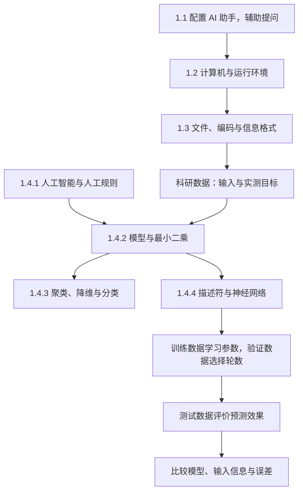

# 第一课教学大纲：计算机基础与机器学习入门

[返回课程入口](README.md) · [120 分钟安排](第一次课120分钟教学大纲.md)

## 学习目标

本课范围为 **1.1—1.4.4**。面向学过高等数学和线性代数、尚无编程基础的材料、化学与化工研究生。

完成本课后，学生应能：

1. 配置 AI 助手入口，检查服务连接，并用它辅助提问。
2. 区分计算与存储，说明代码、程序与运行环境的关系，找到文件与程序。
3. 区分编码与文件格式，阅读简单 CSV、JSON、XML，修改 Markdown 公式。
4. 从输入、输出和参数理解模型，用预测与实测的差异评价模型。
5. 说明最小二乘如何学习参数，区分聚类、降维与分类任务。
6. 阅读 4→8→1 溶解度网络的逐层计算，区分训练、验证和测试，观察参数变化对预测的影响。

## 授课顺序

| 编号 | 讲义 | 操作与检查 |
| --- | --- | --- |
| 1.1 | [Agent 上手与模型服务](内容/1.1_Agent上手与模型服务.md) | 发送一条消息，确认入口可用 |
| 1.2 | [计算机与运行环境](内容/1.2_计算机与运行环境.md) | 查看设备信息，观察一次 CMD 操作，运行 Notebook，解释路径与 PATH |
| 1.3 | [文件与科研信息](内容/1.3_文件与科研信息.md) | 对照同一样品的不同文件格式，切换编码，修改公式 |
| 1.4.1 | [人工智能与人工规则](内容/1.4_AI与Agent的工作方式/1.4.1_人工智能与人工规则.md) | 观察 AI 发展曲线，用化学专家系统理解人工规则 |
| 1.4.2 | [模型、机器学习与最小二乘](内容/1.4_AI与Agent的工作方式/1.4.2_机器学习与最小二乘法.md) | 用 Arrhenius 数据拟合参数并预测新温度下的速率常数 |
| 1.4.3 | [聚类、降维与分类](内容/1.4_AI与Agent的工作方式/1.4.3_聚类降维与分类.md) | 在葡萄酒化学测量数据中观察三种方法的输出 |
| 1.4.4 | [分子描述符与神经网络](内容/1.4_AI与Agent的工作方式/1.4.4_从手工特征到深度神经网络.md) | 播放训练记录，修改参数，比较预测与实测，解释独立测试的用途 |

## 与预习的衔接

[预习课一](../预习课/预习课一/README.zh.md)提供计算机和搜索求助基础；[预习课二](../预习课/预习课二/README.zh.md)介绍文件、路径、编码、Markdown 和公式。课堂用短操作回顾这些内容，再进入科研建模。

学生可使用已配置的 AI 助手提问。Python 语法为选学；本课通过已有程序的输入与输出理解计算过程。

## 知识关系

## 演示准备

- 使用[演示入口](演示/README.md)检查 Notebook、最小二乘、机器学习方法和溶解度网页。
- Notebook 只使用计算、绘图和文件编码部分。
- 溶解度网页播放实际训练记录，手动修改后即时计算预测；课堂明确两种操作的区别。
- 保留模型原始参数和预测结果，供现场演示故障时对照。

语言模型、上下文、Harness、工具调用和原综合实践材料见[后续内容归档](归档/后续内容/README.md)。
