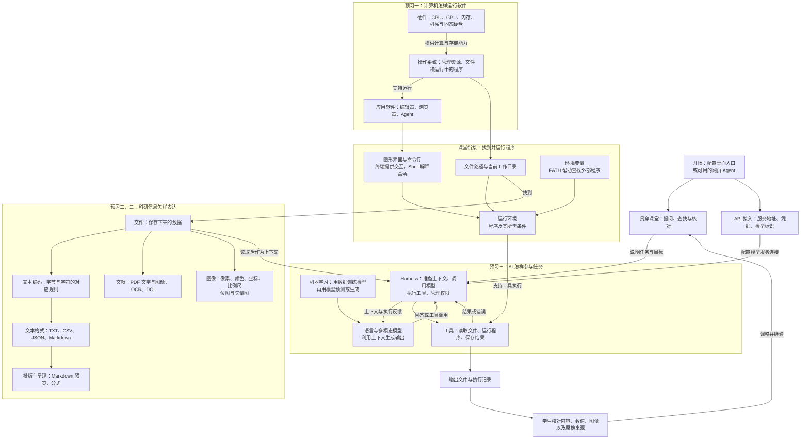

# 第一课教学大纲：计算机基础与 Agent 上手

教师讨论稿 · 2026-11-04 · [返回课程入口](README.md)

## 一、定位与目标

先让每位学生有一个可用的 AI 助手，再连接“计算机怎样运行、文件怎样表达信息、Agent 怎样完成任务”。回顾预习课一、二和预习课三规划中的共同基础，结合操作提问与答疑。

本课结束时，学生应能找到输入文件、解释常见运行和文件现象、说明任务，并对实际输出做一次独立核对。Python 基础为选学，不作为本课入场要求。

## 二、授课顺序与对应讲义

| 环节 | 内容范围 | 对应实际内容 | 观察或检查 |
| --- | --- | --- | --- |
| 开场配置 | 可用的 Agent 入口；服务地址、密钥、模型标识；首次提问 | [01 Agent 上手与模型服务](内容/01_Agent上手与模型服务.md) | 能提问，知道向工具提供了哪些材料 |
| 计算机与运行 | CPU、GPU、内存、存储、操作系统；路径、终端、Shell、环境变量 | [02 计算机与运行环境](内容/02_计算机与运行环境.md) | 能指出输入位置、运行位置与输出位置 |
| 文件与科研信息 | 文本、编码、CSV、JSON；Markdown、公式；PDF、OCR、DOI；图像与尺度 | [03 文件与科研信息](内容/03_文件与科研信息.md) | 对照文件与预览，解释编码、格式和比例尺 |
| AI 与 Agent | 机器学习、LLM、上下文；模型、工具、harness 与反馈 | [04 AI 与 Agent 的工作方式](内容/04_AI与Agent的工作方式.md) | 区分模型回答、工具执行和保存的文件 |
| 综合实践 | 读取样品记录，生成笔记，核对并保存 | [05 课堂实践与结果检查](内容/05_课堂实践与结果检查.md) | 留下一份输出和一次独立检查记录 |

搜索、追问和核对贯穿全课。课时根据试讲与学生反馈分配，安装问题集中处理。主用入口与模型服务在课前试装后确定；讲义中的候选服务不要求学生全部配置。

## 三、与预习的衔接和讲授深度

- [预习课一](../预习课/预习课一/README.zh.md)：搜索求助、硬件与软件、用 VS Code 打开文件夹。
- [预习课二](../预习课/预习课二/README.zh.md)：文件、路径、编码、Markdown 与公式、PDF 与来源。复用现有样例和阅读材料。
- [预习课三规划](../预习课/预习课规划.md)：图像与尺度、AI 和 Agent。学生材料尚需完善。
- 新增衔接：环境变量与 PATH，连接开场配置和程序运行。

课堂以解释现象和完成小动作为主。注意力机制的详细原理、大量公式语法、图像压缩细节和完整环境配置留给选读或后续实践。装机为兴趣拓展。

## 四、知识关系图

箭头表示依赖、作用或反馈关系，不代表逐页讲授的顺序。

## 五、备课与维护

实际说明、例子、外部资源和操作步骤维护在 `内容/`，本大纲维护目标、顺序和范围。后续仅维护中文，不再要求同步英文。

开课前完成主用工具试装，准备带比例尺的图像样例，并核对服务配置与额度。预习课二的示意图不用于物理尺度测量。课堂任务使用既有课程样例，学生自己的科研问题通过[任务模板](内容/科研任务模板.md)记录。

此前以拉伸数据和 Python 为主的方案见[历史归档](归档/README.md)，其课时表、评分建议与环境要求不沿用为本课要求。
