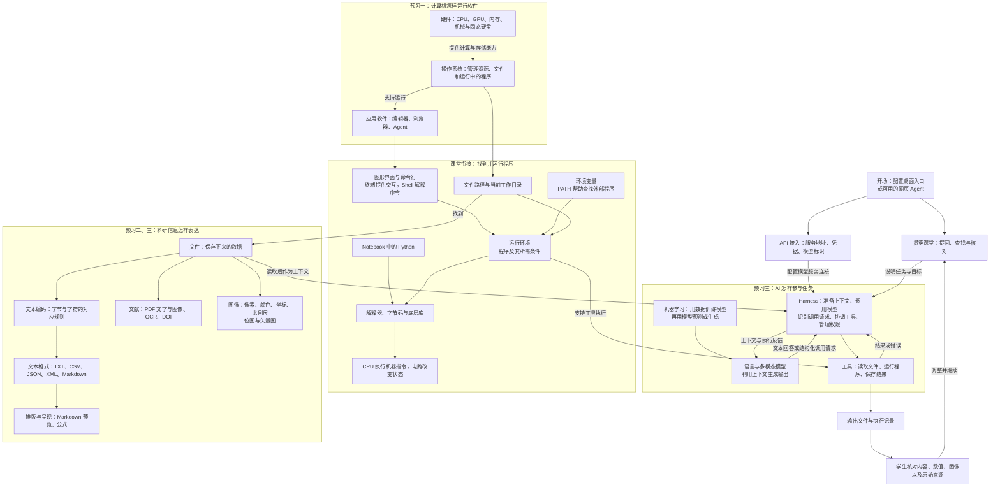

# 第一课教学大纲：计算机基础与 Agent 上手

[返回课程入口](README.md)

## 一、定位与目标

本课依次介绍计算机运行、文件与信息、模型生成和 Agent 执行。课程使用已配置的 AI 助手进行演示与实践。

本课结束时，学生应能：

1. 解释 CPU/GPU、内存/存储为什么分工，并在自己的设备上找到对应信息。
2. 看懂一次文本命令操作和一次 Notebook 计算，认识代码、解释器、机器指令与电路之间的层次。
3. 区分路径、PATH、后缀、格式和编码，看懂 CSV、JSON、XML 的简单结构，并修改 Markdown 公式。
4. 说明上下文的作用，区分模型生成请求、Harness 协调与工具实际执行。
5. 找到输入文件，发出任务，对保存的输出做一次独立核对。

Python 基础为选学；学生带着可用的 Agent 入口参加本课。Notebook 用于教师演示和修改参数观察。

## 二、授课顺序与对应讲义

| 环节 | 内容范围 | 实际内容与材料 | 观察或检查 |
| --- | --- | --- | --- |
| Agent 连接 | 服务地址、密钥、模型标识 | [1.1 Agent 上手与模型服务](内容/1.1_Agent上手与模型服务.md) | 查看连接状态和实际回复 |
| 硬件分工 | CPU/GPU、内存/显存、HDD/SSD；电脑与手机对照 | [1.2 计算机与运行环境](内容/1.2_计算机与运行环境.md) | 解释“内存不足”与“存储空间不足”，理解两组分工的动机 |
| 文本控制与计算 | 单一 CMD 文件夹示例；Notebook 计算与绘图；语法、解释器、机器指令、电路 | [1.2 计算机讲义](内容/1.2_计算机与运行环境.md) · [演示材料](演示/README.md) | 观察创建与改名；改变半径，预测并核对输出 |
| 找到文件和程序 | 绝对/相对路径、工作目录、环境变量、PATH 与快捷方式 | [1.2 计算机讲义](内容/1.2_计算机与运行环境.md) | 解释 `code .` 中的程序查找与目录参数 |
| 文件与科研信息 | 位与字节；后缀、编码、格式；CSV/JSON/XML；Office 格式；Markdown 与公式 | [1.3 文件与科研信息](内容/1.3_文件与科研信息.md) | 找到同一样品字段；解释乱码与格式错误；修改公式预览 |
| 模型与工具协作 | 人工规则、拟合与聚类、表示学习、语言模型、Harness 与工具调用 | [1.4 AI 与 Agent](内容/1.4_AI与Agent的工作方式.md) · [同一 Notebook](演示/计算与工具调用.ipynb) | 区分模拟请求、真实工具执行和最终回答 |
| 综合实践 | 真实 Agent 读取样品，生成笔记并核对 | [1.5 课堂实践与结果检查](内容/1.5_课堂实践与结果检查.md) | 留下一份输出和一次独立检查记录 |

各环节均核对输入、处理过程和结果。课时根据试讲情况调整，安装问题集中处理。

## 三、与预习的衔接和讲授深度

- [预习课一](../预习课/预习课一/README.zh.md)：搜索求助、硬件与软件、用 VS Code 打开文件夹。
- [预习课二](../预习课/预习课二/README.zh.md)：文件、路径、编码、Markdown 与公式、PDF 与来源。课堂实践使用[第一课课堂样例](课堂样例/README.md)，阅读材料按需参考来源页面。
- [预习课三规划](../预习课/预习课规划.md)：图像与尺度、AI 和 Agent。学生材料尚需完善。
- 新增衔接：环境变量与 PATH，连接开场配置和程序运行。

课堂以解释现象和完成小动作为主。命令行集中演示一个 Windows CMD 场景。Python 演示聚焦计算、画图和工具执行。汇编与机器码部分聚焦它们与程序执行的关系。

文件讲义介绍 PDF、OCR、DOI 与图像比例尺。注意力机制、公式语法和图像压缩安排在后续课程中展开。

教学表述要准确：GPU 是显卡中的处理器，手机 SoC 集成 CPU、GPU 等模块；PATH 是用于查找程序的环境变量；普通 Python 代码由解释器和底层库支持执行；文件格式规定数据结构，加密另有专门机制；代码块或合法 JSON 需要交给相应程序处理才会产生操作。

## 四、知识关系图

箭头表示依赖、作用或反馈关系；逐段授课顺序见上方表格。

## 五、备课与维护

实际说明、例子、外部资源和操作步骤维护在 `内容/`，本大纲维护目标、顺序和范围。后续以中文版本为维护对象。

开课前完成主用工具试装，核对服务配置与额度；在教师环境中运行一次[Notebook](演示/计算与工具调用.ipynb)，准备 CMD 演示目录。Notebook 后半段明确标注为预写请求模拟，真实模型调用通过课堂 Agent 和 Harness 演示。准备带比例尺的图像样例，用于预习回顾；物理尺度测量使用带比例尺的图像。课堂任务使用既有课程样例，学生自己的科研问题通过[任务模板](内容/科研任务模板.md)记录。

课程材料目录见[第一课入口](README.md)。
