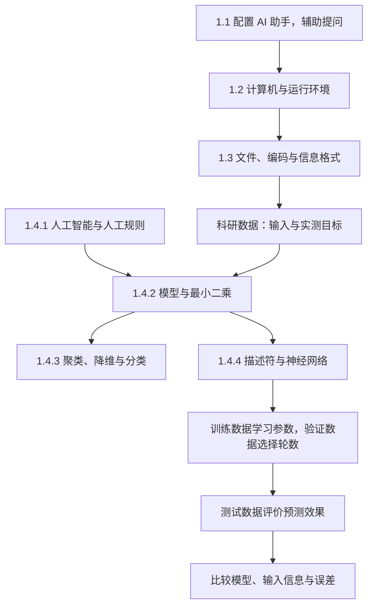

# 第一课：计算机基础与机器学习入门

本课学习 **1.1—1.4.4**：配置 AI 助手，认识计算机与文件，再从人工规则、最小二乘和经典机器学习方法讲到神经网络拟合。课程面向学过高等数学和线性代数的材料、化学与化工研究生，不要求已有编程基础。

## 学习目标

完成本课后，你可以：

- 配置 AI 助手入口，检查连接，并用它辅助提问。
- 区分计算与存储，理解程序与运行环境的关系，找到文件和程序。
- 区分编码与文件格式，阅读简单的结构化数据，修改 Markdown 公式。
- 从输入、输出和参数理解模型，通过预测与实测的差异评价模型。
- 说明最小二乘如何学习参数，区分聚类、降维与分类任务。
- 阅读溶解度神经网络的逐层计算，观察参数变化，并区分训练、验证和测试。

## 课前准备与基础阅读

按[软件安装说明](课前准备/README.md)准备 VS Code、扩展与 Snipaste。[预习课一](../预习课/预习课一/README.zh.md)介绍计算机与搜索求助；[预习课二](../预习课/预习课二/README.zh.md)介绍文件、路径、编码、Markdown 和公式。

Python 基础为选学。本课通过已有程序的输入与输出理解计算过程。

## 内容与详细材料

### 1.1 Agent 上手与模型服务

认识连接模型服务所需的信息，配置 AI 助手并检查连接。发送一条简短问题，确认收到回复。

**详细讲义：**[1.1 Agent 上手与模型服务](内容/1.1_Agent上手与模型服务.md)。

### 1.2 计算机与运行环境

了解 CPU、GPU、内存与存储设备的分工，认识命令行与 Python 代码的执行过程。区分相对路径、绝对路径、当前工作目录和环境变量，理解 PATH 如何帮助查找程序。

**详细讲义：**[1.2 计算机与运行环境](内容/1.2_计算机与运行环境.md)。

**配套材料：**[CMD 操作示意图](演示/cmd-example.svg)、[计算与文件编码 Notebook](演示/计算与文件编码.ipynb)。运行计算与绘图部分，修改半径并观察结果。

### 1.3 文件与科研信息

理解字节、字符、编码、后缀与文件格式的关系。对照同一样品的 CSV、JSON 和 XML，找到相应字段；修改 Markdown 公式并查看预览。

**详细讲义：**[1.3 文件与科研信息](内容/1.3_文件与科研信息.md)。

**配套材料：**[文件样例与使用说明](演示/README.md)、[示例笔记](演示/note.zh.md)、[公式速查](演示/公式速查.md)。

### 1.4 人工智能与机器学习

[本章目录与概念关系](内容/1.4_AI与Agent的工作方式.md)包含以下四个小节。

#### 1.4.1 人工智能与人工规则

认识 AI、专家系统、机器学习、神经网络和深度学习的关系。结合 AI 发展曲线与化学专家系统，理解人工规则如何参与问题求解。

**详细讲义：**[1.4.1 人工智能与人工规则](内容/1.4_AI与Agent的工作方式/1.4.1_人工智能与人工规则.md)。

#### 1.4.2 模型、机器学习与最小二乘

用输入到输出的函数关系理解模型。将 Arrhenius 方程线性化，通过数据拟合参数，并预测新温度下的速率常数。

**详细讲义：**[1.4.2 模型、机器学习与最小二乘](内容/1.4_AI与Agent的工作方式/1.4.2_机器学习与最小二乘法.md)。

**配套材料：**[Arrhenius 拟合数据与结果](演示/Arrhenius拟合/README.md)、[最小二乘交互动画](演示/最小二乘/index.html)。动画使用单独的教学数据，可用于观察参数与误差的关系。

#### 1.4.3 聚类、降维与分类

在同一组葡萄酒化学测量数据中，观察 K-Means 如何分组、PCA 如何投影到低维坐标，以及 SVM 如何利用已知类别学习分类边界。比较三种方法的输入、标签与输出。

**详细讲义：**[1.4.3 聚类、降维与分类](内容/1.4_AI与Agent的工作方式/1.4.3_聚类降维与分类.md)。

**配套材料：**[机器学习方法交互演示](演示/机器学习方法/index.html)、[数据与操作说明](演示/机器学习方法/README.md)。

#### 1.4.4 分子描述符与神经网络

从 ESOL 的四项分子描述符和多元线性回归出发，认识 4→8→1 溶解度网络。依次查看输入标准化、隐藏层、输出层与尺度还原，理解 49 个参数的作用。比较线性回归与神经网络的预测误差，区分训练集、验证集与测试集。

**详细讲义：**[1.4.4 分子描述符与神经网络](内容/1.4_AI与Agent的工作方式/1.4.4_从手工特征到深度神经网络.md)。

**配套材料：**[逐层计算附件](演示/溶解度模型/网络逐层计算.md)、[训练与手动调参演示](演示/溶解度模型/交互演示/index.html)、[操作说明](演示/溶解度模型/交互演示/README.md)、[固定外部测试实验](演示/溶解度模型/外部21测试/README.md)。

播放训练记录后，尝试增加输出偏置，观察预测变化，再撤销修改。手动调参使用训练集或验证集，测试集用于评价选定模型。网页回放实际训练记录，并实时计算手动修改后的预测。

## 知识关系

## 检查理解

1. 在溶解度任务中，模型的输入、输出和可训练参数分别是什么？
2. 人选择了哪些模型条件，训练数据确定了哪些数值？
3. 为什么需要把部分数据保留为测试集？

## 材料使用

编号采用“课次.章.小节”：`1.4.2` 表示第一课第四章第二小节，下级标题继续追加编号。讲义与附件使用相对链接，下载时请保留目录结构。

网页演示下载后用浏览器打开；GitHub 文件预览不会运行交互页面。Notebook 的运行方式见[演示与课堂样例说明](演示/README.md)。

本课到 1.4.4 结束。[后续内容归档](归档/后续内容/README.md)保存语言模型、上下文、Harness、工具调用及原综合实践材料；[历史材料](归档/README.md)保留更早版本。
