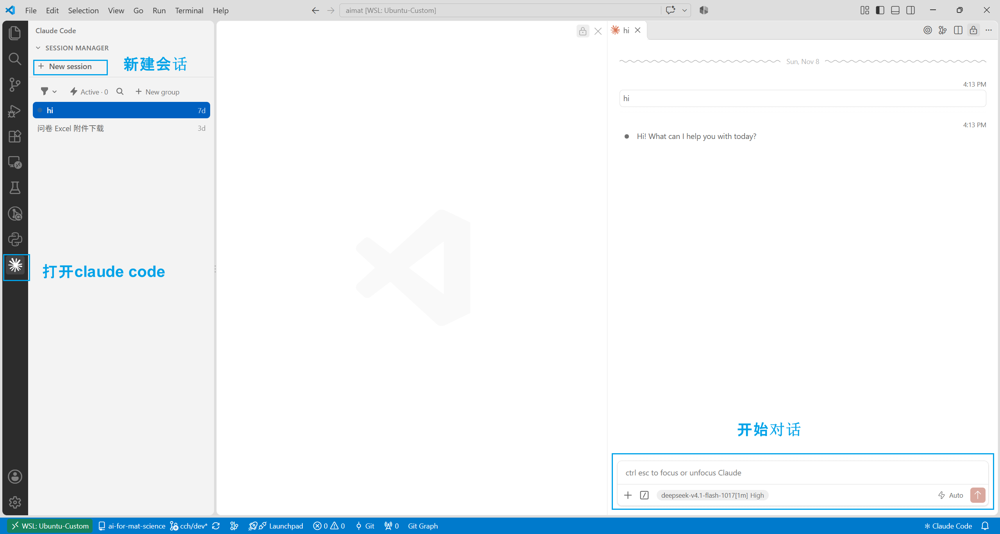

# Agent 上手与模型服务

[返回第一课入口](../README.md)

使用 Claude Code 的同学先完成[课前准备](../课前准备/README.md)，再选择 OpenCode Console Go 或 DeepSeek 配置模型服务。使用网页 Agent 的同学可以上传课程材料，结合材料进行交流。

## 一、API 连接的三项信息

Agent 通过 API 向模型服务发送请求并接收回复。配置连接需要服务地址、API key 和模型名称。

| 配置项 | 作用 | 填写内容 |
| --- | --- | --- |
| 服务地址（base URL） | 指定模型请求的发送位置 | 所选服务提供的 Anthropic 兼容接口地址 |
| API key（密钥） | 标识调用服务的账号或工作区 | 所选服务签发的 API key |
| 模型名称（model ID） | 指定调用的模型 | 所选服务支持的模型 ID |

浏览器直接打开 API 地址时，会发送普通的网页请求。Claude Code 调用模型时，会在请求中附上 API key、模型名称和消息内容。两种请求的方式和内容不同，因此浏览器可能显示 `404`、`405` 或 `401`。模型连接通过 Claude Code 中的实际回复确认。

服务地址、API key 和模型 ID 应来自同一家服务。下方代码用占位符表示密钥。

## 二、选择模型服务

### 路线 A：OpenCode Console Go

- [OpenCode Console](https://opencode.ai/console)：进入自己的工作区，获取 API key。
- [Console 接入 Claude Code 指南](https://opencode.ai/docs/console/harnesses/claude-code/)：查看服务地址、认证方式和模型配置。
- [OpenCode Go 套餐说明](https://opencode.ai/docs/console/go/)：查看订阅价格、可用模型和用量限制。

### 路线 B：DeepSeek 官方 API

- [DeepSeek API 文档](https://api-docs.deepseek.com/zh-cn/)：查找服务地址和模型标识。
- [DeepSeek API key 页面](https://platform.deepseek.com/api_keys)：获取所用账号的调用凭据。
- [DeepSeek 接入 Claude Code 指南](https://api-docs.deepseek.com/quick_start/agent_integrations/claude_code/)：查看兼容接口地址和模型名称。

## 三、在用户配置文件中接入模型服务

### 1. 打开配置文件

Claude Code 的用户配置文件为 `.claude` 文件夹中的 `settings.json`。

| 操作系统 | 配置文件路径 |
| --- | --- |
| Windows | `%USERPROFILE%\.claude\settings.json` |
| macOS、Linux、WSL | `~/.claude/settings.json` |

在 WSL 中，`~` 指 WSL 用户的主目录。Claude Code 命令行和 VS Code 扩展使用这个配置文件。详见 [Claude Code 设置文件说明](https://code.claude.com/docs/en/settings)。

在 VS Code 中打开课程工作文件夹后，可以通过以下快捷键打开或新建配置文件：

| 操作 | Windows、Linux、WSL | macOS |
| --- | --- | --- |
| 打开已有文件 | `Ctrl+O`，选择 `settings.json` | `Cmd+O`，选择 `settings.json` |
| 首次配置时新建并另存为 | `Ctrl+N`，再按 `Ctrl+Shift+S` | `Cmd+N`，再按 `Cmd+Shift+S` |
| 修改后保存 | `Ctrl+S` | `Cmd+S` |

首次配置时，先在用户目录创建 `.claude` 文件夹，再把新文件保存为 `settings.json`。将下方所选路线的 JSON 写入文件，并把密钥占位符替换为自己的 API key。已有配置文件时，把相应条目合并到顶层 `env` 对象。保存前检查 VS Code 的 JSON 语法提示。

也可以按 `Ctrl+Shift+P`（macOS 为 `Cmd+Shift+P`），搜索 **Open File / 打开文件**，输入上表中的完整路径。API key 保存在用户目录的配置文件中。

### 2A. OpenCode Console Go 配置示例

在 [OpenCode Console](https://opencode.ai/console) 中取得 API key，并核对工作区的 Go 订阅和可用额度。将 `<YOUR_OPENCODE_API_KEY>` 替换为自己的密钥。示例使用 Go 套餐的 Anthropic 兼容地址和模型 ID，配置依据见 [Claude Code 接入说明](https://opencode.ai/docs/console/harnesses/claude-code/)和 [Go 模型表](https://opencode.ai/docs/console/go/)。

```json
{
  "env": {
    "ANTHROPIC_BASE_URL": "https://opencode.ai/inference/go/anthropic",
    "ANTHROPIC_AUTH_TOKEN": "<YOUR_OPENCODE_API_KEY>",
    "ANTHROPIC_MODEL": "deepseek-v4.1-flash-1017[1m]",
    "ANTHROPIC_DEFAULT_FABLE_MODEL": "deepseek-v4.1-flash-1017[1m]",
    "ANTHROPIC_DEFAULT_OPUS_MODEL": "deepseek-v4.1-flash-1017[1m]",
    "ANTHROPIC_DEFAULT_SONNET_MODEL": "deepseek-v4.1-flash-1017[1m]",
    "ANTHROPIC_DEFAULT_HAIKU_MODEL": "deepseek-v4.1-flash-1017[1m]",
    "CLAUDE_CODE_SUBAGENT_MODEL": "deepseek-v4.1-flash-1017[1m]",
    "CLAUDE_CODE_AUTO_COMPACT_WINDOW": "786432"
  }
}
```

`ANTHROPIC_BASE_URL` 指定服务地址，Claude Code 会添加 `/v1/messages` 请求路径。`ANTHROPIC_AUTH_TOKEN` 保存 API key，`ANTHROPIC_MODEL` 指定主会话模型，`ANTHROPIC_DEFAULT_*_MODEL` 指定模型别名，`CLAUDE_CODE_SUBAGENT_MODEL` 指定子任务模型，`CLAUDE_CODE_AUTO_COMPACT_WINDOW` 指定长对话的自动压缩窗口。具体配置项见 [Claude Code 模型配置说明](https://code.claude.com/docs/en/model-config)。

示例使用 `deepseek-v4.1-flash-1017[1m]`。请在自己的工作区查看可用模型 ID；[Go 模型表](https://opencode.ai/docs/console/go/)列出的名称为 `deepseek-v4.1-flash`。

### 2B. DeepSeek 官方 API 配置示例

从 [DeepSeek 平台](https://platform.deepseek.com/api_keys)获取 API key。将 `<YOUR_DEEPSEEK_API_KEY>` 替换为自己的密钥。示例地址和模型 ID 见 [DeepSeek 的 Claude Code 接入指南](https://api-docs.deepseek.com/quick_start/agent_integrations/claude_code/)。

```json
{
  "env": {
    "ANTHROPIC_BASE_URL": "https://api.deepseek.com/anthropic",
    "ANTHROPIC_AUTH_TOKEN": "<YOUR_DEEPSEEK_API_KEY>",
    "ANTHROPIC_MODEL": "deepseek-flash[1m]",
    "ANTHROPIC_DEFAULT_OPUS_MODEL": "deepseek-flash[1m]",
    "ANTHROPIC_DEFAULT_SONNET_MODEL": "deepseek-flash[1m]",
    "ANTHROPIC_DEFAULT_HAIKU_MODEL": "deepseek-flash",
    "CLAUDE_CODE_SUBAGENT_MODEL": "deepseek-flash",
    "CLAUDE_CODE_AUTO_COMPACT_WINDOW": "786432"
  }
}
```

每个代码块展示一套完整配置。保存所选路线的配置后，重新打开 Claude Code。已经登录 Claude 账号、准备改用 OpenCode Console 的同学，先根据 [OpenCode 接入说明](https://opencode.ai/docs/console/harnesses/claude-code/)运行 `/logout`。

下图展示 VS Code 中的 Claude Code 界面。左侧有 Claude Code 入口和 **New session** 按钮，右侧是对话区域，底部显示当前模型。



## 四、检查连接

在 VS Code 中打开课程材料所在的文件夹，再进入 Claude Code。运行 `/status` 查看服务地址和认证来源，然后发送一条简短消息。收到模型回复后，就可以使用 Agent 阅读和处理课程材料。分享 `/status` 截图时，请遮盖密钥和账号信息。
