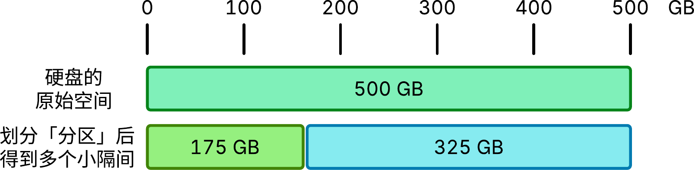
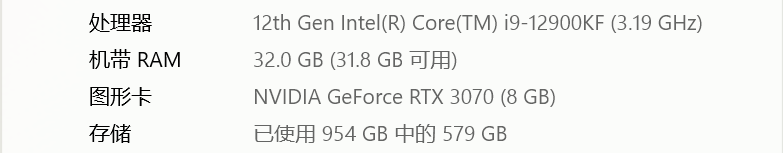
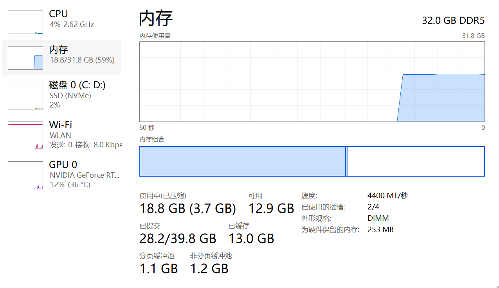
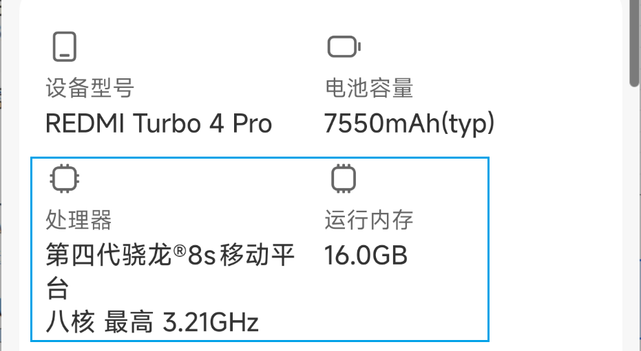
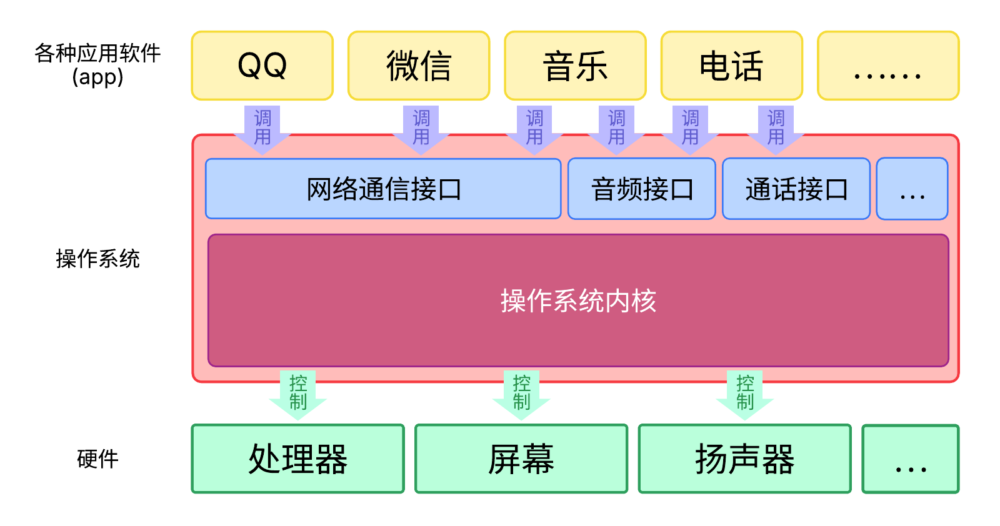
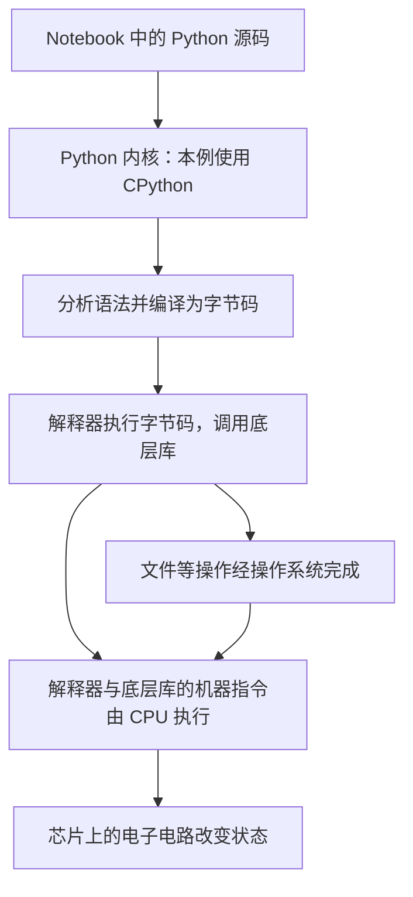
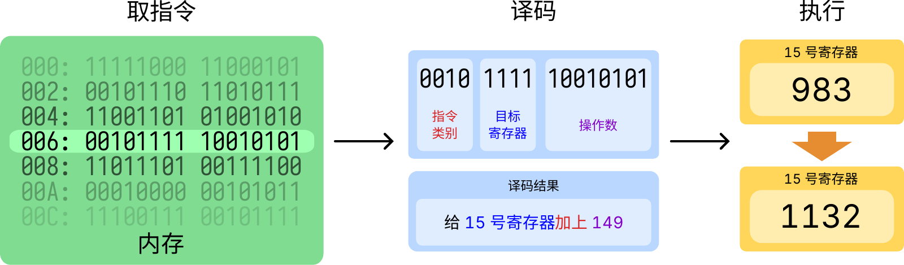
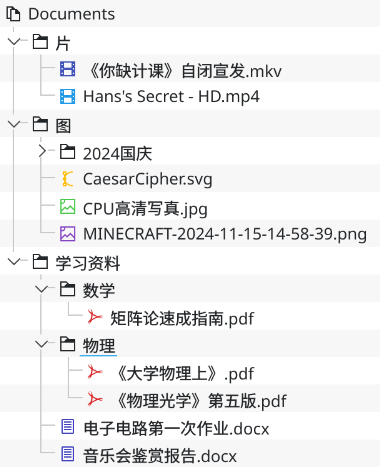

# 计算机与运行环境

[返回第一课入口](../README.md)

打开软件、读取图片和保存结果，分别涉及处理器、内存、存储设备和操作系统。

本节使用《你缺失的那门计算机课》开源 PDF 版的图示说明硬件分工、程序执行和目录层级。图片来源见[图示来源说明](素材/02_计算机与运行环境/你缺计课PDF/来源说明.md)。

## 一、硬件：计算与存储

**硬件**是计算机的物理部件，包括处理器、内存和存储设备。硬件基本知识见《你缺失的那门计算机课》的[“认识你的电脑”](https://www.criwits.top/missing/computer-and-its-components.html)。

| 部件 | 作用 | 例子 |
| --- | --- | --- |
| CPU（中央处理器） | 执行通用程序指令，处理控制流程和各种计算 | 启动应用、判断条件、组织文件处理步骤 |
| GPU（图形处理器） | 擅长同时处理大量相似的运算 | 绘制游戏画面、处理图像、加速适合并行的模型计算 |
| 内存（RAM） | 程序当前工作的空间，临时放指令和数据 | 打开图片、运行程序和编辑中的文字 |
| 显存（VRAM） | 供 GPU 使用的工作存储空间 | 放图像、模型参数和计算中间结果 |
| 存储设备 | 保存程序和文件，断电后仍可保留数据 | 保存课程文件夹、原始数据和输出图片 |

CPU 是执行通用程序指令的芯片。GPU 是擅长并行运算的处理器，可用于图像处理和模型计算。独立显卡通常由 GPU、显存、电路板和散热部件组成。

### CPU 与 GPU 的分工

比较两项任务：打开文件时，程序要查找路径、读取内容并更新窗口；给一百万个像素调节亮度时，每个像素都要做相似的计算。前一项需要灵活安排步骤，后一项适合让许多计算单元同时工作。

绘制一幅图像时，计算机要为大量像素确定颜色；绘制三维画面时，还要计算物体的位置、形状和光照。画面中的许多位置可以同时进行相似的计算。GPU 围绕这类图形任务发展，因此称为**图形处理器**。

CPU 擅长组织程序和处理各种执行步骤；GPU 擅长把大量相似的运算并行完成。运行神经网络时，CPU 可以安排数据和计算任务，GPU 可以同时处理矩阵和张量中的大量数值。两者配合完成整个任务；GPU 加速的效果取决于任务规模、数据搬运速度和软件实现。

### 内存与存储设备的分工

处理器执行计算，内存保存程序当前使用的数据，存储设备长期保存文件。下图用批改作业的场景表示这三个环节。


内存通常比 SSD、HDD 有更低的访问延迟和更高的访问速度，适合程序反复读写；常见运行内存断电后内容会消失。存储设备通常单位容量成本更低、容量更大，可以持久保存文件。

- **机械硬盘（HDD）**：使用旋转的磁性盘片和机械磁头读写数据。
- **固态硬盘（SSD）**：使用闪存芯片读写并保存数据。

运行内存占满时，程序可用的工作空间受限；磁盘空间用尽时，可保存文件的空间受限。一块存储设备可以划分为多个分区。系统中的“磁盘 0”“磁盘 1”用于区分物理设备。

下图把一块 500 GB 硬盘划分为 175 GB 和 325 GB 两个分区。



保存笔记时，程序将修改后的内容写入存储设备；关闭后重新打开，可以读取已保存的内容。

### 显存与系统内存

显存保存 GPU 计算时使用的数据，系统内存保存 CPU 运行程序时使用的数据。独立显卡通常配有专用显存；集成 GPU、手机和一些电脑使用共享或统一内存。

使用远程模型服务时，远端设备承担模型计算，本地电脑运行工具、提供文件和显示结果。

### 在电脑和手机上找这些信息

以 Windows 电脑为例：在“此电脑”上右键查看属性，或打开系统设置中的“系统信息／关于”，找处理器和已安装内存；再查看存储空间。菜单名称因系统版本而异。其他设备的学生可在各自系统设置中查找对应信息。

下图显示 CPU 型号、已安装内存、显卡和存储容量。其中 32.0 GB 是运行内存容量，“已使用 954 GB 中的 579 GB”描述存储空间。



再打开 Windows **任务管理器 → 性能 → 内存**，观察运行时的变化。下图显示当时约使用了 18.8 GB 内存，而电脑安装了 32.0 GB；“已使用”会随程序运行变化。左侧“磁盘 0 (C: D:)”也提示 C 盘和 D 盘可以属于同一块物理设备。



手机也能作对照：设置中的“运行内存”对应 RAM，“存储空间”对应持久存储。手机里的“芯片”通常是 **SoC（片上系统）**，集成 CPU、GPU 等多个功能模块；手机与固态硬盘一样使用闪存保存数据。

下图的“处理器”显示芯片平台及 CPU 核心信息，“运行内存”显示 16.0 GB RAM；旁边的 mAh 表示电池的电荷容量。



下图显示总存储 264 GB、可用存储 34.0 GB。运行内存用于当前运行的程序，机身存储用于保存应用和文件。


手机同时运行应用时，运行内存容量也会影响可用的工作空间。

## 二、软件：程序、文件与运行环境

**软件**是让计算机完成任务的程序及相关数据。**操作系统**管理硬件资源、文件和运行中的程序；Windows、macOS 和 Linux 都是操作系统。VS Code、浏览器和 Agent 属于应用软件，依靠操作系统提供的功能使用硬件。

文件、路径、可执行文件和快捷方式的详细介绍见《你缺失的那门计算机课》的[“文件与文件管理”](https://www.criwits.top/missing/file-and-file-management.html)。

下图显示应用、操作系统和硬件的关系。应用发起保存文件的操作，操作系统调用存储设备完成写入。



### 图形界面和命令行

平时点击图标、拖动文件，是通过**图形界面**操作；输入命令，则是通过**命令行**操作。二者最终都由软件调用系统功能来完成任务。

自动化工具可以通过视觉识别或软件接口操作界面；界面位置和窗口状态的变化会影响视觉操作。命令或 API 能把目标和参数写得更明确，也便于重复执行。**终端**提供文字交互入口，**Shell**解释命令；本课演示的 Windows CMD 就是一种命令解释器。

#### 新建并改名文件夹

在一个空目录中打开 **Windows CMD**，执行以下两条命令：


```bat
mkdir lesson-demo
ren lesson-demo lesson-data
```

第一行创建 `lesson-demo` 文件夹，第二行将其改名为 `lesson-data`。执行后可在文件浏览器中查看结果。命令说明：[mkdir](https://learn.microsoft.com/en-us/windows-server/administration/windows-commands/mkdir)、[ren](https://learn.microsoft.com/en-us/windows-server/administration/windows-commands/ren)。

命令由名称和参数组成。`ren` 后面的两个参数依次是旧名和新名，由 Windows CMD 按顺序解释。

### Notebook 中的代码运行过程

打开[课堂 Notebook](../演示/计算与工具调用.ipynb)，使用“运行全部”依次执行。**Notebook**在同一文档中组织说明、代码单元格和输出；连接的 **Python 内核**负责执行代码。

先观察半径为 2 mm 的圆面积：

```python
import math
radius_mm = 2.0
area_mm2 = math.pi * radius_mm ** 2
print(round(area_mm2, 2))
```

结果约为 `12.57 mm²`。将半径从 2 改为 3 后重新运行，输出的面积和曲线随之变化。

#### Python 代码的执行过程

以常见的 **CPython** 实现为例，源码经过语法分析和编译，形成解释器使用的**字节码**，再由解释器执行。解释器和它调用的底层库本身运行在 CPU 上；涉及文件、窗口等功能时，还会借助操作系统。参考 [Python 官方术语表中的 bytecode](https://docs.python.org/3/glossary.html#term-bytecode)。



下图显示 CPU **取指令—译码—执行**的过程。Python 源码先经过解释器和底层库处理，CPU 再执行这些程序对应的机器指令。图中的指令和寄存器数值用于展示执行步骤。



**汇编语言**用符号表示机器指令；**机器码**用处理器约定的二进制编码表示指令。Python 解释器处理字节码，CPU 执行解释器和底层库对应的机器码。

**位（bit）**可以取 0 或 1；数字电路用高、低电压范围等可区分的物理状态表示逻辑值。


### 文件与路径

文件夹组织文件，**路径**说明文件位置。用演示目录中的虚构文件举例：

| 写法 | 含义 |
| --- | --- |
| `C:\course\lesson-data\sample.csv` | 绝对路径，从盘符开始说明位置 |
| `lesson-data\sample.csv` | 相对路径，若程序当前在 `C:\course`，就指向上面的文件 |
| `.` | 当前目录 |
| `..` | 上一级目录 |

**当前工作目录**是程序解释相对路径时的起点，由启动位置或显式设置决定。Markdown 本地链接通常相对于 Markdown 文件所在位置。[第一课课堂样例](../课堂样例/README.md)中的链接可用于观察文件之间的相对位置。

下图用分叉结构展示文件夹的层级。从 `C:\course` 逐层定位 `lesson-data\sample.csv`，也是沿目录树查找文件。



### 环境变量、PATH 与快捷方式

**环境变量**是运行中的程序可以读取的一组“名称—值”设置。它们可以告诉程序服务地址、配置位置等信息，通常在启动时继承。**运行环境**则是更大的概念，包括操作系统、解释器、依赖与设置。

**PATH** 是环境变量，列出系统查找可执行程序的目录。输入命令名后，系统沿 PATH 查找程序。快捷方式保存目标位置，供用户打开相应程序或文件。

在 VS Code 命令行入口已加入 PATH 的电脑上，打开 CMD 并输入：

```bat
code .
```

`code` 是命令名，`.` 表示当前目录。命令会让 VS Code 打开当前目录。命令查找遇到问题时，核对 VS Code 命令行入口的位置、PATH 设置和终端重启后的结果。参见 [VS Code 命令行说明](https://code.visualstudio.com/docs/configure/command-line)。

在 CMD 中输入 `where code`，可以查看系统找到的命令入口。使用完整路径启动时，需要输入该入口在本机的实际路径。

模型服务的 URL 和 API key 也可以通过环境变量传给工具；PATH 则提供查找程序的目录。
