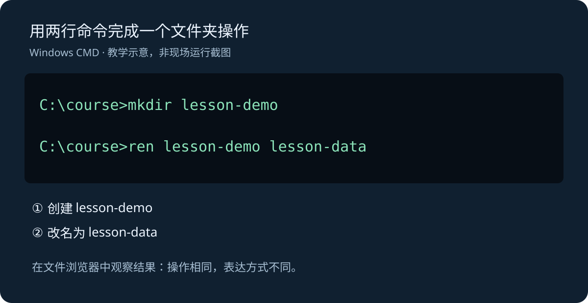
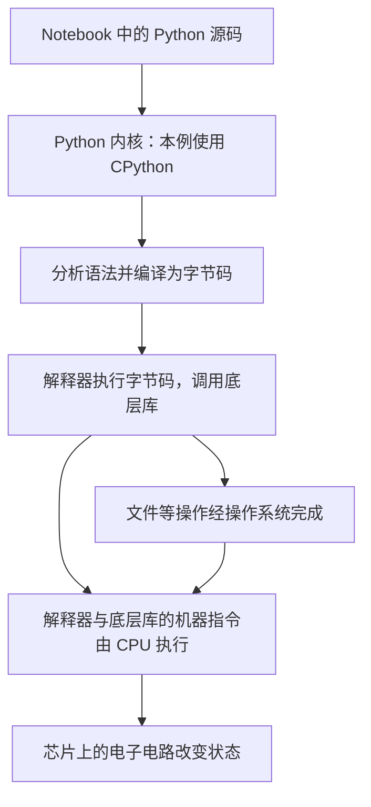

# 计算机与运行环境

[返回第一课入口](../README.md) · [查看教学大纲](../01_第一次课教学大纲.md)

中文讲义草稿 · 2026-11-04

从刚才向 Agent 提的第一个问题开始：**打开一个软件、读一张图片、保存一份结果时，电脑里的哪些部件在工作？**

## 一、计算机里的几种分工

**硬件**是计算机的物理部件，**软件**是让它完成任务的程序及相关数据。**操作系统**管理硬件资源、文件和运行中的程序，Windows、macOS 和 Linux 都属于操作系统。

| 部件 | 可以怎样理解 | 例子 |
| --- | --- | --- |
| CPU（中央处理器） | 执行通用程序指令，处理控制流程和各种计算 | 启动应用、判断条件、组织文件处理步骤 |
| GPU（图形处理器） | 擅长同时处理大量相似的运算 | 绘制游戏画面、处理图像、加速适合并行的模型计算 |
| 内存（RAM） | 程序当前工作的空间，临时放指令和数据 | 打开图片、运行程序和编辑尚未保存的文字 |
| 显存（VRAM） | 供 GPU 使用的工作存储空间 | 放图像、模型参数和计算中间结果 |
| 存储设备 | 保存程序和文件，断电后仍可保留数据 | 保存课程文件夹、原始数据和输出图片 |

CPU 是一种芯片，但“芯片”不只指 CPU。GPU 是处理器；日常说的独立“显卡”通常还包括显存、电路板和散热部件。GPU 的工作也不只是显示画面。

### 为什么要分 CPU 和 GPU？

可以比较两项任务：一项要不断根据前一步结果决定下一步做什么；另一项要对一百万个像素做相似的数值运算。它们需要的计算组织方式不同。

CPU 适合通用控制与较复杂的执行流程；GPU 适合把可并行的工作分给许多计算单元。神经网络中有大量矩阵、向量和张量运算，因此常能使用 GPU 加速；但 GPU 运算不等于矩阵运算，也不是所有任务放到 GPU 上都会更快。任务规模、数据搬运和软件实现都会影响效果。可选阅读 [Intel 对 CPU 与 GPU 分工的解释](https://www.intel.com/content/www/us/en/products/docs/processors/cpu-vs-gpu.html)。

### 为什么要分内存和硬盘？

可以把内存比作工作台，把硬盘比作储物柜：常用材料拿到工作台上，处理完再把需要保留的结果放回柜中。

内存通常比 SSD、HDD 有更低的访问延迟和更高的访问速度，适合程序反复读写；常见运行内存断电后不能保留内容。存储设备通常单位容量成本更低、容量更大，可以持久保存文件。这是速度、成本、容量和断电保存能力之间的取舍，不需要背某个固定倍数或当前价格。

- **机械硬盘（HDD）**：使用旋转的磁性盘片和机械磁头读写数据。
- **固态硬盘（SSD）**：使用闪存保存数据，没有机械读写结构。

“内存不够”通常影响同时运行多少程序、处理多大的任务；“磁盘空间不够”通常指可保存文件的空间不足。电脑可以有多块物理存储设备，也可以把一块设备划分成多个分区；看到 C 盘、D 盘，不能据此断定有两块硬盘。

**课堂动作：**修改一份笔记，保存、关闭，再重新打开。请学生指出：哪一步把需要保留的内容写入了存储设备？

### 显存与内存怎样对应？

可以先把显存理解为 GPU 的工作空间，对照 CPU 使用的系统内存。独立显卡的显存通常是与 GPU 高速连接的专用存储芯片，不能一概说成“都在 GPU 芯片里面”；集成 GPU、手机和一些电脑也可能使用共享或统一内存。两者都服务于运行中的计算，具体访问速度不能脱离设备和访问方式直接比较。

使用远程模型服务时，模型的主要计算由远端设备承担，学生电脑主要运行工具、提供文件和显示结果；这不要求每个人都购买独立显卡。

### 在电脑和手机上找这些信息

教师用自己的 Windows 电脑演示：在“此电脑”上右键查看属性，或打开系统设置中的“系统信息／关于”，找处理器和已安装内存；再查看存储空间。菜单名称因系统版本而异。其他设备的学生可在系统设置中找到对应信息，不必为本环节统一界面。

手机也能作对照：设置中的“运行内存”对应 RAM，“存储空间”对应持久存储。手机里的“芯片”通常是 **SoC（片上系统）**，其中包含 CPU、GPU 等多个功能模块，不只是一个 CPU；手机存储通常使用闪存，也不是机械硬盘。

**提问：**手机剩余存储空间很多，是否就能同时运行任意多的应用？请用“运行内存”和“存储”解释。

可选观看：[教师提供的硬件与装机参考视频](https://www.bilibili.com/video/BV1BG4y137mG/)。具体标题与覆盖范围待教师核对。准备自行装机时先看操作讲解再动手：**大力不会出奇迹，强行安装可能损坏设备。** 本课不安排装机任务。

## 二、用文本告诉计算机做什么

平时点击图标、拖动文件，是通过**图形界面**操作；输入命令，则是通过**命令行**操作。二者最终都由软件调用系统功能来完成任务。

自动化工具可以通过视觉识别或软件接口操作界面，但界面位置、窗口状态可能变化。命令或 API 能把目标和参数写得更明确，也便于重复执行。**终端**提供文字交互入口，**Shell**解释命令；本课演示的 Windows CMD 就是一种命令解释器。

### 只用一个演示场景：新建并改名文件夹

教师提前准备一个空的演示目录，并在其中打开 **Windows CMD**。本课只演示这一个环境，学生观察或在教师指导下尝试，不要求 Mac 同学照搬命令。示意图也可直接用于投影：



```bat
mkdir lesson-demo
ren lesson-demo lesson-data
```

第一行创建 `lesson-demo` 文件夹；第二行把它改名为 `lesson-data`。在文件浏览器中观察结果。演示目录应事先不存在这两个名字，便于看清变化。命令依据：[mkdir](https://learn.microsoft.com/en-us/windows-server/administration/windows-commands/mkdir)、[ren](https://learn.microsoft.com/en-us/windows-server/administration/windows-commands/ren)。

命令有约定的名字、参数和顺序，有点像写数学公式时要遵守符号和括号规则。上面的两个名称分别是旧名和新名；随意调换就改变了意思。不同 Shell 的语法可能不同，不能把 CMD 命令直接当作 Python 代码。

## 三、从 Notebook 中的一次计算，到芯片上的运算

打开[课堂 Notebook](../演示/计算与工具调用.ipynb)，使用“运行全部”依次执行。**Notebook**把说明、代码单元格和输出放在同一文档里；真正执行 Python 的是它连接的 **Python 内核**，也就是负责运行这些代码的程序。教师准备方式见[演示说明](../演示/README.md)。

先观察半径为 2 mm 的圆面积：

```python
import math
radius_mm = 2.0
area_mm2 = math.pi * radius_mm ** 2
print(round(area_mm2, 2))
```

结果约为 `12.57`，单位是 mm²。随后展示半径与面积的曲线。把半径从 2 改成 3，先预测面积变大还是变小，再运行。学生观察修改与输出的对应关系，本环节不要求掌握 Python 语法。

### 这段代码如何控制计算机？

以常见的 **CPython** 实现为例，源码经过语法分析和编译，形成解释器使用的**字节码**，再由解释器执行。解释器和它调用的底层库本身运行在 CPU 上；涉及文件、窗口等功能时，还会借助操作系统。参考 [Python 官方术语表中的 bytecode](https://docs.python.org/3/glossary.html#term-bytecode)。



**汇编语言**用较便于人阅读的符号表示机器指令；**机器码**用处理器约定的二进制编码表示指令。它们帮助我们理解底层，但普通 Python 运行不一定经过一份可见的汇编文件，Python 字节码也不是 CPU 直接执行的机器码。本课只建立层次感，不展开编译器和解释器的实现。

**位（bit）**可以取 0 或 1；数字电路用可区分的物理状态表示这些值，例如不同的电压范围。0 和 1 是抽象的逻辑值，不等同于“完全没有电流”和“有电流”。可以用下面的文字梗图作过渡：


## 四、文件在哪里，程序又在哪里？

文件夹组织文件，**路径**说明文件位置。用演示目录中的虚构文件举例：

| 写法 | 含义 |
| --- | --- |
| `C:\course\lesson-data\sample.csv` | 绝对路径，从盘符开始说明位置 |
| `lesson-data\sample.csv` | 相对路径，若程序当前在 `C:\course`，就指向上面的文件 |
| `.` | 当前目录 |
| `..` | 上一级目录 |

**当前工作目录**是程序解释相对路径时的起点，不一定等于脚本所在目录。Markdown 的本地链接通常相对于该 Markdown 文件所在位置。教师移动整个预习课二文件夹，观察其相对链接仍可使用；再指出如果只移动一个文件，关系可能改变。

## 五、环境变量、PATH 与快捷方式

**环境变量**是运行中的程序可以读取的一组“名称—值”设置。它们可以告诉程序服务地址、配置位置等信息，通常在启动时继承。**运行环境**则是更大的概念，包括操作系统、解释器、依赖与设置。

**PATH**是其中一个变量，列出查找外部可执行程序时使用的目录。可把它类比成一份“程序在哪里”的查找清单：配置好以后，输入一个命令名，就不用每次写出程序的完整路径。快捷方式则是一个指向目标的入口文件；二者都让启动更方便，但 PATH 不是快捷方式集合，也不会自动给程序改名。

沿用刚才教师的 CMD 窗口，在 VS Code 的命令行入口已安装并加入 PATH 的前提下，输入：

```bat
code .
```

这里 `code` 是命令名，`.` 是传给它的参数，表示打开当前目录。如果提示找不到命令，应检查命令入口是否安装、目录是否加入 PATH，以及终端是否需要重新打开。参见 [VS Code 命令行说明](https://code.visualstudio.com/docs/configure/command-line)。本课展示查找关系，不要求全班现场修改 PATH。

回看开场的模型服务配置：URL 和 API key 也可能通过环境变量传给工具，它们负责连接服务；PATH 负责帮助查找程序。这些变量用途不同，并非都可以解释成“简写”。
