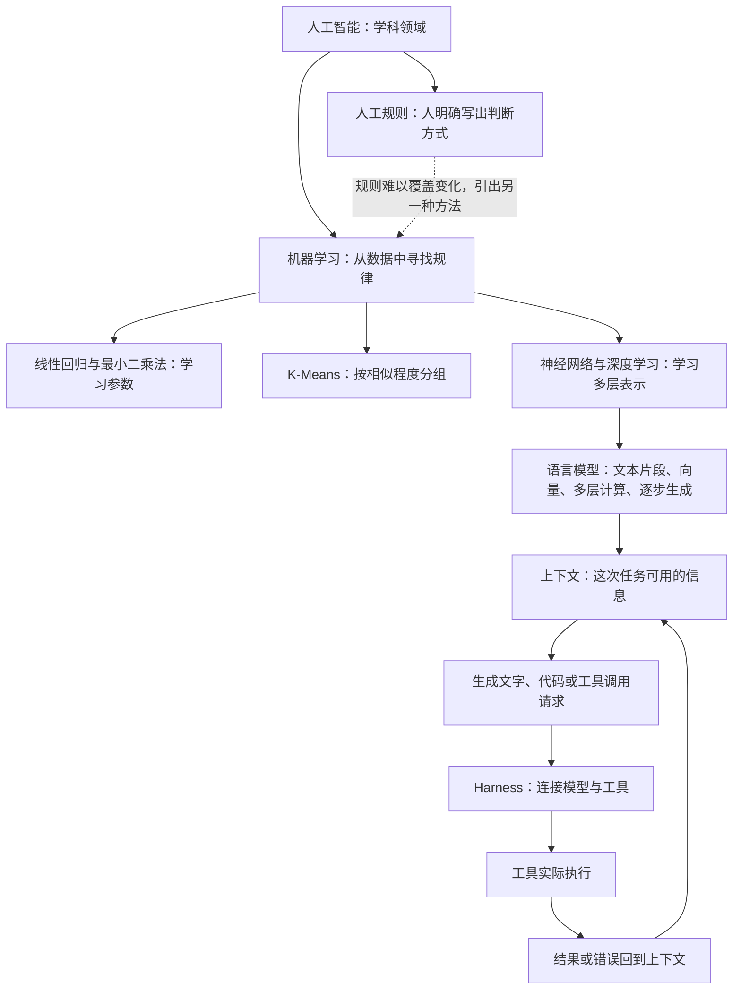

# 第 4 章：AI 与 Agent 的工作方式

[返回第一课入口](../README.md)

本页列出第 4 讲各节内容。详细讲义位于同名文件夹，图片位于 `素材/04_AI与Agent的工作方式/`。

备课资料：[数学建模与 Agent 教学大纲](04_AI与Agent的工作方式/新版教学大纲_讨论稿.md)。

授课安排：[50 分钟内容大纲](04_AI与Agent的工作方式/50分钟必要内容大纲.md)。

## 本章要建立的理解

人工智能是一个学科领域，机器学习是其中的重要方向。机器学习可以从数据中确定参数，深度神经网络进一步学习多层表示。语言模型把文本转换成数值表示，通过计算逐步生成文本；Harness 将模型与工具连接起来，支持围绕任务持续行动。

各节依次说明输入、模型计算、输出和工具执行的过程。

## 分节大纲与正文

| 顺序 | 分节讲义 | 主要内容 | 示例 |
| --- | --- | --- | --- |
| 1 | [认识人工智能：从专家规则到数据学习](04_AI与Agent的工作方式/01_人工智能与人工规则.md) | 专家规则、机器学习与神经网络 | DENDRAL 与价态约束；溶解度预测中的数据和输入信息 |
| 2 | [机器学习与最小二乘法](04_AI与Agent的工作方式/02_机器学习与最小二乘法.md) | 模型、参数、误差与训练 | 三个虚构数据点；[交互动画](../演示/最小二乘/index.html)比较手动调整、梯度下降和直接求解 |
| 3 | [K-Means 与从数据中分组](04_AI与Agent的工作方式/03_KMeans与从数据中分组.md) | 按相似程度分组 | [分步聚类动画](../演示/KMeans/index.html)对照初值、组数与输入描述 |
| 4 | [从分子描述符到深度神经网络](04_AI与Agent的工作方式/04_从手工特征到深度神经网络.md) | 特征、非线性计算与表示学习 | ESOL 多元回归、[分子连接演示](../演示/分子表示/index.html)与 Uni-Mol |
| 5 | [从文本向量到语言模型](04_AI与Agent的工作方式/05_从文本向量到语言模型.md) | 文本表示与逐步生成 | 编码与 token、嵌入、上下文、概率及[本地小模型演示](../演示/本地语言模型/README.md) |
| 6 | [上下文与常见模型](04_AI与Agent的工作方式/06_上下文与常见模型.md) | 对话历史、文件内容与上下文 | 聊天与续写、[历史与文件实测](../演示/本地语言模型/上下文实测.json)、上下文窗口 |
| 7 | [从模型输出到真实操作：最小 Harness](04_AI与Agent的工作方式/07_文本命令与Agent_Harness.md) | 模型请求与工具执行 | [本地小模型工具循环](../演示/最小Harness/README.md)：读取、计算、保存与检查 |
| 8 | [工具调用与执行演示](04_AI与Agent的工作方式/08_工具调用与执行演示.md) | 代码块、带参数请求和原生调用消息 | [带参数调用](../演示/最小Harness/tools_with_args.py)与参数校验 |

## 讲解关系图

图中展示本章知识之间的关系。神经网络也应用于图像、语音等任务。

## 授课安排

本章的八节内容提供完整阅读材料。第一课按[50 分钟大纲](04_AI与Agent的工作方式/50分钟必要内容大纲.md)选择授课内容。

前六节介绍模型与训练，后两节介绍模型与工具的协作。分子水溶解度贯穿前半章，从最小二乘、多元线性回归和 ESOL 延伸到分子表示学习；语言模型部分改用文本示例。

## 内容要点

- 人工规则与机器学习可以结合使用，各自适合解决相应问题。
- 传统机器学习也会依据数据求参数；深度学习的特点包括多层表示学习。
- 神经网络包括大量矩阵运算，也需要非线性变换等操作。
- 文件编码规定文本与字节的对应关系；模型中的向量表示为计算提供数值特征。
- 普通对话中的上下文提供本次输入，模型权重由训练流程更新；生成内容的事实准确性依靠来源核验。
- Agent 系统结合模型、Harness 和工具，围绕任务目标组织执行与反馈。
- Notebook 展示教师预写的请求；文件实践展示真实 Agent 的模型调用和工具执行。

## 资料来源

第三方题图的来源说明见[素材目录](素材/04_AI与Agent的工作方式/)。外部阅读通过讲义中的原站链接访问。
