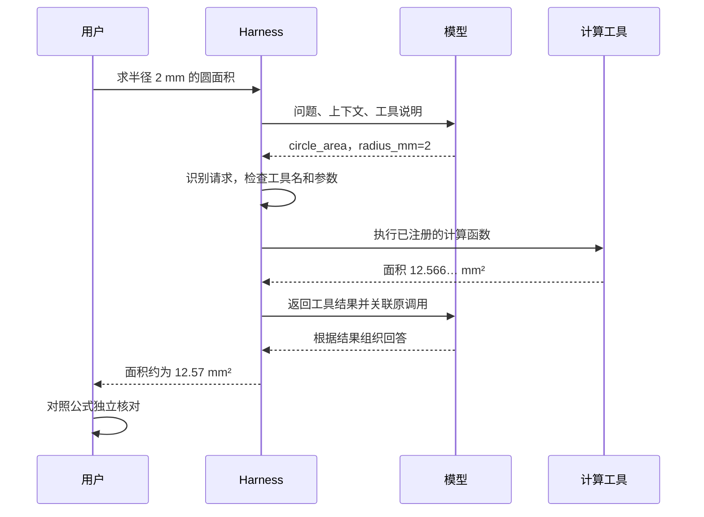

# AI 与 Agent 的工作方式

[返回第一课入口](../README.md) · [查看教学大纲](../01_第一次课教学大纲.md)

中文讲义草稿 · 2026-11-04

前面已经见过文本命令、Python 代码和 JSON。现在把它们接起来：**用户用自然语言提出需求，模型生成回答或工具调用请求，外围程序协调执行，再把结果交回模型。**

## 一、大模型与上下文

**AI**是让计算机完成识别、预测、生成等任务的技术领域；**机器学习**通过数据调整模型。神经网络是其中一类模型，当代大语言模型通常使用深度神经网络。

**大语言模型（LLM）**将文本处理为 **token（文本片段）**，结合当前输入和上下文，逐步生成输出。token 不一定对应一个完整汉字或英文单词。模型在训练中学到的规律存于参数中；当次对话提供的文件和文字则成为可用上下文的一部分，二者不同。

**上下文**可以包括用户问题、相关对话、系统提供的指令、实际读入的文件内容和工具执行结果。文件放在电脑上，不代表已经被模型读取；历史对话很长时，也不保证所有内容都能原样留在本次请求中。

**课堂对照：**先问“这个样品的编号是什么？”，再提供课程中的样品记录后重新提问。请学生指出第二次回答的依据；第一次材料不足时，合理做法是说明缺少信息或请求补充。

给模型一篇文献是补充上下文，不等于现场重新训练模型。回答流畅也不保证结论正确，需要对照原始材料核验。

## 二、认识常见模型系列

本课只认名称和提供方，不按能力排名，不要求记住最新型号。以下为截至 2026-11-04 查阅的官方入口；具体可用模型和接口标识在配置时查文档。

| 提供方 | 模型系列举例 | 官方入口 |
| --- | --- | --- |
| OpenAI | GPT | [模型目录](https://developers.openai.com/api/docs/models) |
| Anthropic | Claude | [模型资料](https://www.anthropic.com/system-cards) |
| Google | Gemini | [模型目录](https://ai.google.dev/gemini-api/docs/models) |
| DeepSeek | DeepSeek | [API 文档](https://api-docs.deepseek.com/) |
| 阿里巴巴 | Qwen（通义千问） | [官方介绍](https://qwenlm.github.io/) |
| 月之暗面 | Kimi | [开放平台文档](https://platform.moonshot.ai/docs/overview) |
| 智谱 | GLM | [开放平台文档](https://docs.bigmodel.cn/) |

模型系列、聊天产品、Agent 工具和模型服务不是同一层东西。例如 Claude 是模型系列，Claude Code 是 Agent 工具；通过兼容接口配置后，某款工具可以使用另一个提供方的模型。具体组合能否工作，要看工具和服务支持的接口。

## 三、Harness 为什么必要？

**Agent**是围绕目标使用模型和工具、根据结果继续行动的任务系统。**Harness**是支撑这一过程的软件，可以先理解为组织模型与工具协作的外围程序。

| 工作 | 谁来负责 | 课堂中的例子 |
| --- | --- | --- |
| 提出需求、判断结果 | 用户 | 说明要算面积，检查单位和数值 |
| 根据上下文生成内容 | 模型 | 生成解释、代码，或指定工具名与参数的调用请求 |
| 整理可用信息 | Harness | 选择相关文件内容和执行结果放入上下文，必要时压缩历史 |
| 识别并检查调用请求 | Harness | 检查工具名是否存在、参数结构是否符合约定、是否允许执行 |
| 实际执行任务 | 工具及其运行环境 | Python 内核计算，文件工具写入结果 |
| 反馈与继续处理 | Harness 与模型协作 | 将结果或报错返回模型，模型再回答或提出下一步调用 |

模型可以生成“我已经保存文件”这句话，但实际是否保存，要看工具是否执行成功，以及文件是否存在、内容是否正确。

## 四、代码块、结构化输出与 function calling

### 1. 代码块：先是一段展示出来的文字

模型可以在回答中给出：

```python
import math
print(math.pi * 2.0 ** 2)
```

这段代码只有交给 Python 执行后才会产生计算结果。普通 Markdown 预览不会执行它。有些系统约定从代码块提取代码再交给执行器，但那是外围程序明确实现的行为。

### 2. Function calling：按约定提出工具调用请求

**Function calling（函数调用）**在这里指模型依据事先提供的工具说明，输出工具名称和参数，供程序处理。工具说明会告诉模型：有哪些工具、各自做什么、参数名称和类型是什么。它不是模型直接进入电脑执行一个函数。

例如，教师事先提供 `circle_area` 工具，参数 `radius_mm` 是半径，单位为 mm。模型可能提出下面的请求：

```json
{
  "name": "circle_area",
  "arguments": {
    "radius_mm": 2.0
  }
}
```

这是**本课简化的结构示意**，不是某家 API 的完整报文。不同服务可能使用专门的工具调用消息、调用标识或字符串化参数；不能假定所有工具调用都是从普通聊天文字里提取 JSON。

### 3. Harness 接收请求，工具执行并返回结果

Harness 根据协议读取请求，检查工具名和参数，协调工具执行。`circle_area` 的实际程序计算面积后，可以返回：

```json
{
  "area_mm2": 12.566370614359172
}
```

Harness 将结果连同必要的调用关联信息交回模型，模型才可以据此回答“面积约为 12.57 mm²”。格式正确只能说明请求可解析，不能保证工具选对、参数合理或结论正确。

官方说明可参考 [Claude 工具使用文档](https://platform.claude.com/docs/en/agents-and-tools/tool-use/overview)。本课展示的本地工具由外围程序执行；有些服务也提供在服务端执行的工具，其运行位置要另行确认。



## 五、在 Notebook 中看清执行边界

复用[课堂 Notebook](../演示/计算与工具调用.ipynb)中的面积计算。前半段展示计算和绘图，后半段用预写 JSON 请求模拟模型提出调用，再由一个很小的调度程序解析并执行函数。

**演示明确标注：没有真实模型调用。** JSON 请求和最后一句回答由教师预先写好，真实运行的是 Python 解析、检查和计算；不能把它描述为模型现场自主决定调用。

请学生指出：

1. 哪一段是请求中的工具名与参数？
2. 哪一步读取请求，哪一步真正做了计算？
3. 如果把半径改成负数，检查程序为什么拒绝它？
4. 结果如果没有回到上下文，模型能否仅凭“打算调用”就声称计算完成？

最后回到[文件实践](05_课堂实践与结果检查.md)：用已经配置的真实 Agent 读取课程文件，检查工具记录和新生成的笔记，将刚才的机制与实际操作对应起来。
