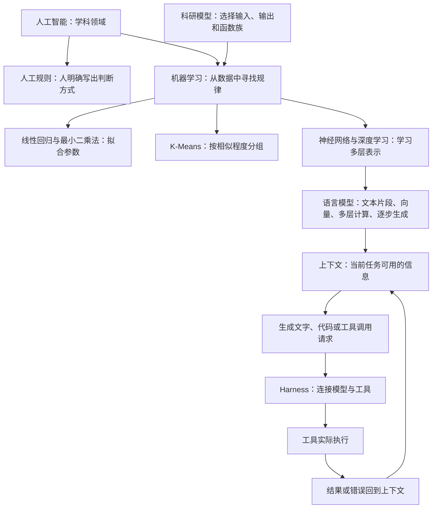

# 第 4 章：AI 与 Agent 的工作方式

[返回第一课入口](../README.md)

> **AI（Artificial Intelligence，人工智能）**研究感知、推理和学习等任务。**LLM（Large Language Model，大语言模型）**根据输入文本生成内容。**Harness（执行框架）**组织模型输入、工具调用和结果反馈。**Agent（智能体）**根据任务调用模型与工具。

本章从科研模型中的输入、输出与参数出发，依次介绍机器学习、神经网络、语言模型和工具执行。

## 章节内容

| 顺序 | 分节讲义 | 主要内容 | 示例 |
| --- | --- | --- | --- |
| 1 | [认识人工智能：从专家规则到数据学习](04_AI与Agent的工作方式/01_人工智能与人工规则.md) | 专家规则、机器学习与神经网络 | DENDRAL 与价态约束；溶解度预测中的数据和输入信息 |
| 2 | [模型、机器学习与最小二乘法](04_AI与Agent的工作方式/02_机器学习与最小二乘法.md) | Arrhenius 方程、函数族、参数拟合与训练 | 温度与速率常数；三组标定数据及[最小二乘交互动画](../演示/最小二乘/index.html) |
| 3 | [K-Means 与从数据中分组](04_AI与Agent的工作方式/03_KMeans与从数据中分组.md) | 按相似程度分组 | [分步聚类动画](../演示/KMeans/index.html)对照初值、组数与输入描述 |
| 4 | [从分子描述符到深度神经网络](04_AI与Agent的工作方式/04_从手工特征到深度神经网络.md) | 特征、非线性计算与表示学习 | ESOL 多元回归、[分子连接演示](../演示/分子表示/index.html)与 Uni-Mol |
| 5 | [从文本向量到语言模型](04_AI与Agent的工作方式/05_从文本向量到语言模型.md) | 文本表示与逐步生成 | 编码与 token、嵌入、上下文、概率及[本地小模型演示](../演示/本地语言模型/README.md) |
| 6 | [上下文与常见模型](04_AI与Agent的工作方式/06_上下文与常见模型.md) | 对话历史、文件内容与上下文 | 聊天与续写、[历史与文件实测](../演示/本地语言模型/上下文实测.json)、上下文窗口 |
| 7 | [从模型输出到真实操作：最小 Harness](04_AI与Agent的工作方式/07_文本命令与Agent_Harness.md) | 模型请求与工具执行 | [本地小模型工具循环](../演示/最小Harness/README.md)：读取、计算、保存与检查 |
| 8 | [工具调用与执行演示](04_AI与Agent的工作方式/08_工具调用与执行演示.md) | 代码块、带参数请求和原生调用消息 | [带参数调用](../演示/最小Harness/tools_with_args.py)与参数校验 |

## 概念关系

