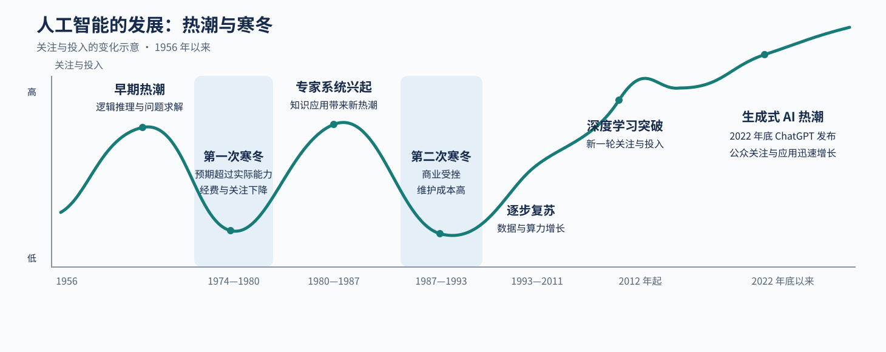
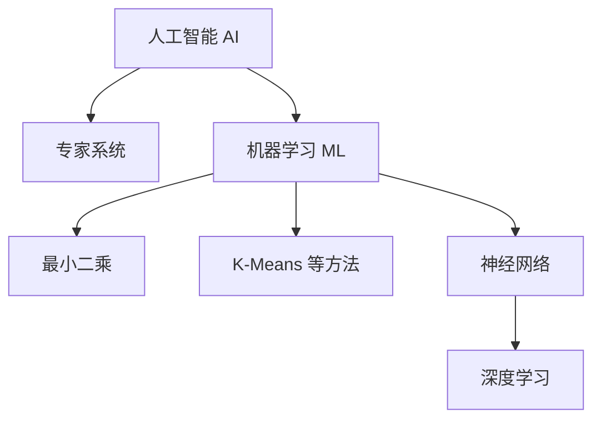

# 认识人工智能：从专家规则到机器学习与深度学习

[返回本章大纲](../04_AI与Agent的工作方式.md) · [下一节：模型与机器学习](02_机器学习与最小二乘法.md)

*依据 WIPO 2019 年报告绘制，并补充 2022 年底以来的生成式 AI 热潮。曲线高度、斜率与时间间距均为示意。见[来源说明](../素材/04_AI与Agent的工作方式/AI发展历史/来源说明.md)。*

人工智能经历过多次热潮与低谷。20 世纪 70 年代，过高的预期与有限的程序能力之间出现落差，研究经费和关注度下降。80 年代，专家系统带来新一轮发展；随后，专用硬件市场衰退、系统局限和高昂的维护成本再次削弱了政府与投资者的信心。这两段时期通常被称为“人工智能寒冬”。夸大的承诺使 AI 遭到质疑，实际应用的进展则推动了后续复苏。[WIPO 历史回顾](https://www.wipo.int/edocs/pubdocs/en/wipo_pub_1055.pdf#page=21)

2022 年 11 月 30 日，OpenAI 发布 ChatGPT。此后，生成式 AI 获得广泛的公众关注，相关应用与投资迅速增长。[ChatGPT 发布记录](https://openai.com/index/chatgpt/) · [相关报道](https://apnews.com/article/03f157ddc482ef76f4999b929eaac7bf)

人工智能包含多种研究方法。专家系统利用领域知识进行推理，机器学习利用数据建立模型，深度学习通过多层神经网络学习表示与预测关系。

**什🐎是人工智能**

## 一、人工智能是一门研究领域

**人工智能（Artificial Intelligence，AI）**研究让计算机完成感知、推理、学习等通常与人类智能相关的任务的方法与系统。根据谱图推断分子结构、根据结构预测性质、理解文字并生成回答，都是相关任务。

AI 系统通过算法、模型和程序实现。人工规则与数据学习是其中两种重要的方法。

## 二、专家系统：将人的知识组织成可执行的规则

化学家解读质谱时，会结合分子式、价态和碎裂知识筛选结构。**专家系统**把领域知识组织起来，再由推理程序将它们用于当前问题。

| 部分 | 含义 | 化学任务中的例子 |
| --- | --- | --- |
| 知识库 | 事先整理的知识、约束和规则 | 价态约束、碎裂知识 |
| 当前事实 | 本次已经知道的信息 | 分子式、谱图、实验条件 |
| 推理程序 | 根据知识推导或检验结论 | 生成候选结构，再筛选、检查 |

规则常写成“如果满足条件 A，那么推出结论 B”，多条规则可以组成推理过程。DENDRAL 是早期化学专家系统的重要案例：它结合化学知识与实验信息，生成并检验可能的分子结构。[原始案例介绍](https://ijcai.org/proceedings/1977/231)

这与经验建模有相通之处：人先整理对体系的认识，再给出判断办法。规则明确、适用范围清楚时很有用；困难在于经验难以逐条写全，多个因素可能相互影响，条件变化后还需要重新检验。

乙醇和 1-己醇都含有一个羟基，但碳链长度不同。判断水溶解度时，需要同时考虑亲水基团与疏水部分等信息。

## 三、机器学习：利用数据学习规律

**机器学习（Machine Learning，ML）**利用数据建立或改进模型，再用于新的情况。模型可以表示根据输入作出预测或判断的计算关系。

以溶解度预测为例：

1. 收集分子信息及实验测得的溶解度。
2. 让程序根据这些数据学习输入与性质之间的关系。
3. 对未参与学习的分子作预测，并用实验结果检验。

分子量、基团计数等描述输入的数字称为**特征**，化学中常称为**分子描述符**。

人工规则直接给出判断办法；机器学习则由人设计学习方式，让数据帮助确定判断办法。经验公式若利用数据拟合系数，也包含从数据学习的步骤，两者可以结合。

机器学习还包括不预先提供每个样品答案的任务，例如根据测量特征把相似样品分组；后面的聚类演示会展示这种情况。

## 四、最小二乘：熟悉的拟合也是学习

假设我们用一条直线描述输入与输出之间的关系，需要确定它的斜率与截距。这是**线性回归**的简单例子。

**最小二乘法**用预测与实测差值的平方和衡量拟合误差，寻找使这个平方和最小的参数。用实验数据拟合直线，就是一种具体的从数据学习参数的过程。

因此，线性回归既属于经典统计方法，也是基础机器学习方法。最小二乘是拟合准则，可以用于不同模型；它与“人工智能”或“深度学习”不是同一层级的分类。

## 五、神经网络与深度学习：学习更复杂的关系

**神经网络**是一类由多个计算单元连接构成的模型。它通过多层数值计算，将输入逐步转换为输出，并利用数据调整其中的参数。

**深度学习**使用具有多层表示的神经网络。它可以表达复杂的非线性关系，也可以把中间特征的形成与最终预测一起学习，减少对人工逐项设计特征和具体关系的依赖。

研究者需要选择输入、网络结构和学习目标，并通过新样本检验模型的预测能力。

后续语言模型也是这一方向的应用：把文本转换为数值表示，通过训练学习生成文本的关系。

## 六、把这些名词放在一起

机器学习包含多种方法。最小二乘用于参数拟合，K-Means 用于聚类；神经网络是一类可学习的模型，深度学习使用具有多层表示的神经网络。这些方法可以结合使用，例如神经网络的回归任务也可以采用最小二乘准则。

| 名词 | 在本课中的位置 | 先记住什么 |
| --- | --- | --- |
| 人工智能 | 研究领域 | 研究感知、推理、学习等任务 |
| 专家系统 | AI 的一种系统与方法路线 | 组织专家知识并进行规则推理 |
| 机器学习 | AI 的重要方向 | 利用数据学习关系或结构 |
| 线性回归 | 一种预测建模方法 | 通过数据确定线性关系的参数 |
| 最小二乘 | 一种拟合准则 | 让残差平方和尽可能小 |
| 神经网络 | 一类可学习的模型 | 用连接起来的计算单元表达关系 |
| 深度学习 | 机器学习中的一个方向 | 使用多层神经网络学习表示与关系 |

下一节从科研模型出发，介绍函数族、参数拟合与预测检验。

## 参考资料

- [ITU 术语文件](https://www.itu.int/epublications/publication/itu-t-y-suppl-97-2025-11-glossary-of-terms-and-definitions-for-machine-learning)：引用 ISO/IEC 2382 的 AI 学科定义。本节使用教学转述。
- Edward A. Feigenbaum，1977，[The Art of Artificial Intelligence: Themes and Case Studies of Knowledge Engineering](https://ijcai.org/proceedings/1977/231)：DENDRAL 的知识表示与生成—检验方法。
- [计算机历史博物馆：DENDRAL 档案](https://softwarepreservation.computerhistory.org/AI/DENDRAL/)：项目文献、软件与历史资料。
- [《动手学深度学习》](https://zh.d2l.ai/)：后续可选读线性回归与多层感知机章节。
