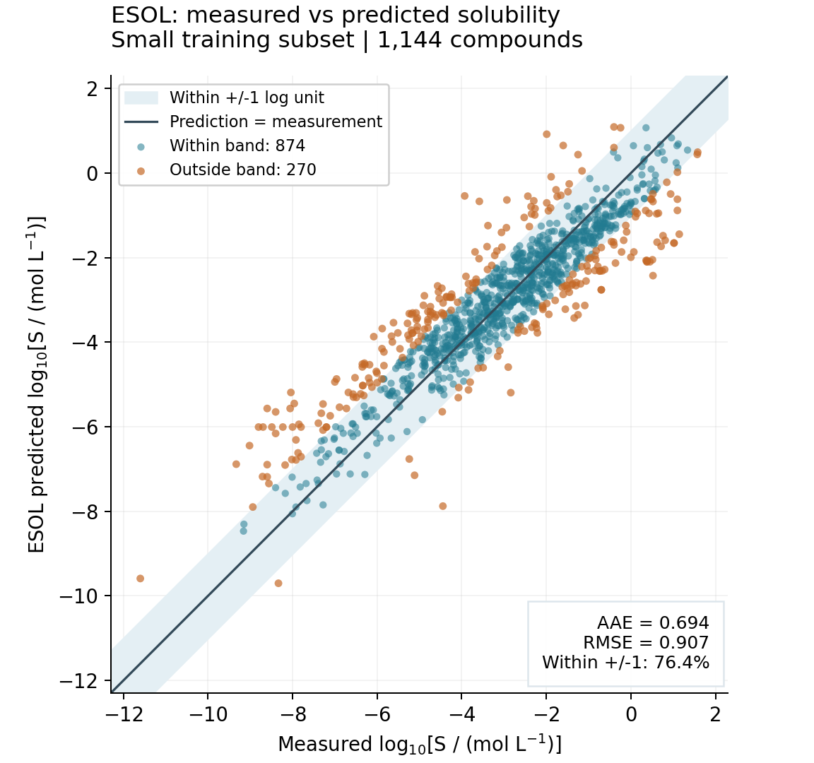
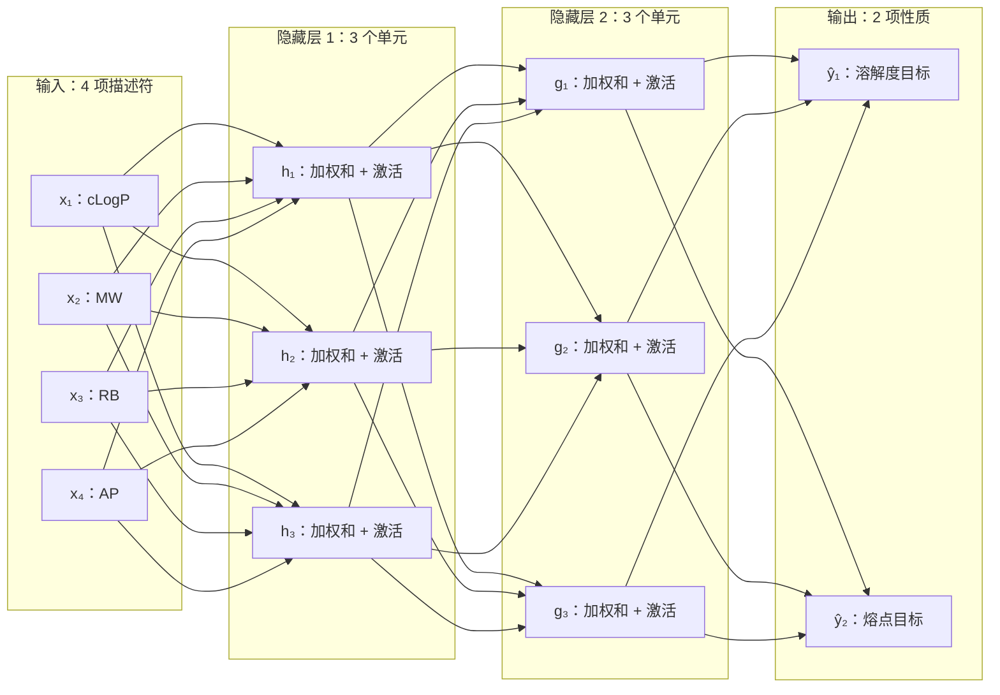

# 从分子描述符到深度神经网络

[返回本章大纲](../04_AI与Agent的工作方式.md) · [上一节：聚类、降维与分类](03_聚类降维与分类.md) · [下一节：语言模型](05_从文本向量到语言模型.md)

本节先查看线性回归预测分子溶解度的实际误差，再介绍由多个输入、多个计算单元和多个输出组成的神经网络。

## 一、从一个输入到多个输入和输出

第二节用一个输入预测一个输出：

$$\hat y=ax+b$$

当性质受多种因素影响时，模型可以使用多个输入：

$$\hat y=w_1x_1+w_2x_2+\cdots+w_dx_d+b$$

> **多元线性回归（Multiple Linear Regression）**用多个输入特征的加权和预测一个连续数值。$x_1,\ldots,x_d$ 是同一样品的不同特征，$w_1,\ldots,w_d$ 是对应权重，$b$ 是截距，也称偏置。

同一个样品也可以有多个预测目标。例如，用四项分子描述符同时预测水溶解度和熔点，可以分别写出两个式子：

$$\begin{aligned}
\hat y_1&=w_{11}x_1+w_{12}x_2+w_{13}x_3+w_{14}x_4+b_1,\\
\hat y_2&=w_{21}x_1+w_{22}x_2+w_{23}x_3+w_{24}x_4+b_2.
\end{aligned}$$

> **多输出回归（Multi-output Regression）**对同一样品同时预测多个连续数值。每个输出有自己的权重和偏置。

这里四个输入来自同一个分子，两个输出分别对应这个分子的两项性质。每增加一个预测目标，就需要准备对应的测量标签。下面先看已有的单目标溶解度模型，再用双目标的教学示例说明网络结构。

## 二、ESOL 水溶解度模型

> **ESOL（Estimated Solubility，估算溶解度）**是根据分子结构预测水溶解度的模型。

Delaney 于 2004 年提出这一模型，使用以下四个整分子描述符：

> **cLogP（calculated logarithm of the partition coefficient，计算的分配系数对数）**衡量分子的亲脂性。
>
> **MW（Molecular Weight，分子量）**、**RB（Rotatable Bonds，可旋转键数）**和 **AP（Aromatic Proportion，芳香重原子比例）**是本节使用的分子描述符。

| 描述符 | 符号 | 含义 |
| --- | --- | --- |
| 计算的辛醇／水分配系数对数 | cLogP | 描述亲脂性，是由结构估算的一个指标 |
| 分子量 | MW | 描述分子大小，使用通常的分子量数值 |
| 可旋转键数量 | RB | 按既定规则统计结构中的可旋转键 |
| 芳香重原子比例 | AP | 芳香原子数除以非氢原子总数 |

预测目标为 $\log_{10}[S/(\mathrm{mol\,L^{-1}})]$。使用对数是为了处理跨越多个数量级的溶解度：相差 1 个对数单位，对应浓度相差 10 倍。

原论文的最终公式为：

$$\widehat{\log S}=0.16-0.63\,\mathrm{cLogP}-0.0062\,\mathrm{MW}
+0.066\,\mathrm{RB}-0.74\,\mathrm{AP}$$

它来自对 2,874 个中性化合物的测量数据进行回归；论文的目标条件为 25 ℃水溶解度。**人选择描述符与模型形式，数据确定系数。**这是多元线性拟合，简单公式也可以通过数据拟合参数，构成机器学习案例。[Delaney 原论文](https://doi.org/10.1021/ci034243x)

### 原模型的预测精度

溶解度是连续数值，预测精度可以用预测值与实测值之间的误差衡量。

> **AAE（Average Absolute Error，平均绝对误差）**是每个样品的预测误差取绝对值后再求平均。本节以 $\log_{10}S$ 为预测目标，误差单位为对数单位。

$$\mathrm{AAE}=\frac{1}{n}\sum_{i=1}^{n}\left|\widehat{\log S_i}-\log S_i\right|$$

### 直接查看原论文附带的预测数据

课程提供了[原始预测数据](../素材/04_AI与Agent的工作方式/ci034243x_si_001.txt)。文件以逗号分隔，共有 1,144 条记录，每条记录包含分子名称、实测 $\log S$、ESOL 预测 $\log S$ 和分子结构字符串。

> **SMILES（Simplified Molecular Input Line Entry System，简化分子线性输入规范）**用字符串表示分子的原子和连接关系，是原始文件中结构列的名称。

这份数据对应论文的 **“Small” 训练子集**。下面直接使用文件中的实测列和原模型预测列计算误差，展示模型在这一训练子集上的拟合效果。数据归属见[原论文的补充材料说明](https://pubs.acs.org/doi/abs/10.1021/ci034243x)。

> **RMSE（Root Mean Squared Error，均方根误差）**将预测误差平方后求平均，再开平方。平方运算使较大的误差对结果产生更大影响。

横轴是实测值，纵轴是预测值；每个点代表一个分子。对角线上的点表示预测与实测相等，线上方表示预测偏高，线下方表示预测偏低。浅色带对应误差在 ±1 个对数单位内的区域。

| 指标 | 从这份数据计算的结果 | 含义 |
| --- | ---: | --- |
| 样品数量 | 1,144 | 文件中的全部记录 |
| 平均绝对误差 AAE | 0.694 | 平均相差 0.694 个对数单位 |
| 均方根误差 RMSE | 0.907 | 对较大偏差更敏感的总体误差 |
| 绝对误差 ≤1 个对数单位 | 874 / 1,144，约 76.4% | 预测与实测浓度相差的倍率在 10 倍以内 |
| 绝对误差 >1 个对数单位 | 270 / 1,144，约 23.6% | 图中的橙色点 |

这里选择“误差在 ±1 个对数单位内”作为课堂观察的阈值。改变允许误差，达标样品的比例也会改变。

同一份文件中的两个分子可以进一步说明个体差异：

| 分子 | 实测 $\log S$ | ESOL 预测 $\log S$ | 绝对误差 |
| --- | ---: | ---: | ---: |
| 咖啡因（Caffeine） | −0.876 | −1.498 | 0.622 |
| 呋喃妥因（Nitrofurantoin） | −3.380 | −1.243 | 2.137 |

呋喃妥因的预测溶解度约为实测值的 $10^{2.137}\approx137$ 倍。整体误差描述数据集的平均表现，具体样品的偏差帮助判断预测值能否满足实验需求。图表和统计结果由[数据处理脚本](../素材/04_AI与Agent的工作方式/plot_esol.py)生成。

### 新样品上的预测表现

原论文还报告了三个验证集的结果：

| 验证数据 | 样品数量 | ESOL 的 AAE（对数单位） |
| --- | ---: | ---: |
| 企业内部盲测集 | 528 | 0.83 |
| 小型文献验证集 | 21 | 0.69 |
| 另一组文献数据 | 150 | 0.71 |

这些数值来自原论文的 Results 部分和表 4。盲测集用于检查模型对建模后另取样品的预测表现。[Delaney 原论文全文，第 1001、1003 页](https://www.moreisdifferent.com/assets/DIY_drug_discovery/Delaney_paper.pdf)

误差为 0.83 个对数单位时，对应的浓度倍率约为 $10^{0.83}\approx6.8$。对整个数据集，$10^{\mathrm{AAE}}$ 是各样品误差倍率的几何平均；这里的误差倍率取预测与实测浓度中较大值除以较小值。

## 三、从误差看模型的改进方向

### 预测关系：固定系数表达各属性的贡献

ESOL 用固定系数叠加四项描述符。保持其他输入相同时，cLogP 每增加 1，模型预测的 $\log S$ 就下降 0.63。分子量或芳香比例取其他值时，这个系数仍为 −0.63。

真实性质可能随多项因素共同变化。例如，亲脂性对溶解度的影响可能随分子结构环境变化。可以用带有交互项的回归或神经网络表达这类关系，再通过相同测试数据比较预测误差。

### 输入表示：整分子统计量概括结构信息

四个描述符分别概括亲脂性、分子大小、可旋转键数量和芳香比例。原子的连接环境、三维构象和晶体排列等信息，还可以通过更丰富的结构表示补充。

例如，乙醇与二甲醚都具有分子式 C₂H₆O，用碳数、氧数和分子量描述时会得到相同输入。加入连接信息后，CH₃—CH₂—OH 与 CH₃—O—CH₃ 可以得到各自的表示。这里以元素计数说明结构信息的作用；ESOL 的完整输入还包含按具体结构计算的描述符。

预测误差同时受模型关系、输入信息和实验数据质量影响。下面先保留描述符输入，介绍一种更丰富的预测关系；随后再介绍分子图表示。

## 四、神经网络：每一层接收一组数，计算出另一组数

> **神经网络（Neural Network）**将多个可训练的计算单元按层连接。每层接收上一层的输出，再计算新的输出。

以四个分子描述符为输入，设计一个同时预测水溶解度和熔点的教学网络：

**4 个输入 → 3 个隐藏单元 → 3 个隐藏单元 → 2 个输出。**

这个双目标网络用于说明结构；前面引用的 ESOL 实测结果对应单目标溶解度模型。训练双目标网络需要收集同一批分子的溶解度和熔点标签。输入特征和两项标签可以分别标准化，最终将输出换算回各自的物理量。

> **隐藏层（Hidden Layer）**位于输入与最终输出之间，其数值由前一层计算得到。**神经元（Neuron）**是层中的计算单元，在本例中执行加权求和、加偏置和激活变换。

每条连线对应一个权重，每个隐藏单元和输出单元还各有一个偏置。同一层的各个单元接收相同的一组输入，使用各自的权重计算出不同数值；这些数值组成下一层的输入。

> **全连接层（Fully Connected Layer）**将本层的每个计算单元与前一层的全部输出连接。层中单元的数量称为**宽度（Width）**；沿输入到输出方向，计算层的数量体现网络的**深度（Depth）**。

图中第一隐藏层把 4 个数转换为 3 个数，第二隐藏层把这 3 个数重新组合为 3 个数，输出层再计算两项预测。增加同一层的单元数会加宽网络，继续连接计算层会加深网络。

### 一个单元如何计算

第 $j$ 个隐藏单元先计算加权和，再进行激活变换：

$$z_j=w_{j1}x_1+w_{j2}x_2+w_{j3}x_3+w_{j4}x_4+b_j,\qquad h_j=\max(0,z_j).$$

> **激活函数（Activation Function）**对加权求和的结果进行变换。这里使用 **ReLU（Rectified Linear Unit，修正线性单元）**：负数变成 0，零和正数保持原值。

激活函数使各层之间形成非线性关系。多个线性层的连续计算可以合并为一次线性映射；在层间加入 ReLU 后，输出会随输入分段变化。[《动手学深度学习》：多层感知机](https://zh.d2l.ai/chapter_multilayer-perceptrons/mlp.html)

## 五、一次完整的多输入、多输出计算

> **向量（Vector）**是按顺序排列的一组数，**矩阵（Matrix）**是按行列排列的一组数。矩阵的一行可以存放一个计算单元的全部权重。

下面使用人为设定的参数和无量纲数值演示计算。四个输入、各层权重和两个输出均为教学数值。

$$\mathbf x=\begin{bmatrix}1\\2\\0\\1\end{bmatrix}$$

第一隐藏层的三个单元同时接收这四个数：

| 单元 | 加权求和与偏置 | ReLU 后的输出 |
| --- | --- | ---: |
| $h_1$ | $1\times1+0\times2+1\times0-1\times1+1=1$ | 1 |
| $h_2$ | $0\times1+1\times2-1\times0+1\times1-1=2$ | 2 |
| $h_3$ | $1\times1-1\times2+0\times0+0\times1+0=-1$ | 0 |

这一层把输入 $[1,2,0,1]$ 转换为 $[1,2,0]$。接着将三个输出一起传给第二隐藏层：

| 单元 | 加权求和与偏置 | ReLU 后的输出 |
| --- | --- | ---: |
| $g_1$ | $h_1+h_2=1+2=3$ | 3 |
| $g_2$ | $-h_1+h_3=-1+0=-1$ | 0 |
| $g_3$ | $h_2+h_3-1=2+0-1=1$ | 1 |

输出层接收 $[3,0,1]$，分别计算两个目标：

$$\hat y_1=g_1-g_3-1=1,\qquad \hat y_2=2g_2+g_3+1=2.$$

这次计算的完整过程为：

$$\underbrace{[1,2,0,1]}_{4\text{ 个输入}}
\longrightarrow\underbrace{[1,2,0]}_{3\text{ 个隐藏值}}
\longrightarrow\underbrace{[3,0,1]}_{3\text{ 个隐藏值}}
\longrightarrow\underbrace{[1,2]}_{2\text{ 个输出}}.$$

本例隐藏层使用 ReLU，连续性质的输出层使用加权求和。两个输出共享前面的隐藏层，各有一组最终权重，用于预测各自的性质。

### 用矩阵描述整层计算

把一层中各个单元的计算写在一起，得到：

$$\begin{aligned}
\mathbf h&=\operatorname{ReLU}(\mathbf W_1\mathbf x+\mathbf b_1),\\
\mathbf g&=\operatorname{ReLU}(\mathbf W_2\mathbf h+\mathbf b_2),\\
\hat{\mathbf y}&=\mathbf W_3\mathbf g+\mathbf b_3.
\end{aligned}$$

| 计算层 | 权重矩阵大小 | 偏置数量 | 输出数量 | 可训练参数数量 |
| --- | --- | ---: | ---: | ---: |
| 第一隐藏层 | $3\times4$ | 3 | 3 | $3\times4+3=15$ |
| 第二隐藏层 | $3\times3$ | 3 | 3 | $3\times3+3=12$ |
| 输出层 | $2\times3$ | 2 | 2 | $2\times3+2=8$ |

矩阵的行数等于本层输出数，列数等于本层输入数。这个网络共有 35 个可训练参数。示例将部分权重设为零，训练时这些权重也可以调整。

> **GPU（Graphics Processing Unit，图形处理器）**擅长并行处理大量相似的运算。

一层中的多个单元可以并行计算，多条样品也可以成批计算。矩阵运算把这些乘加操作组织在一起，便于 GPU 并行执行。

## 六、训练：用两项预测的误差共同调整参数

一次训练先输入一批分子的四项特征，计算每个分子的两项预测，再与对应的实测标签比较。将两个目标分别标准化后，可以把两项平方误差共同纳入损失：

$$L=\frac{1}{2n}\sum_{i=1}^{n}\left[(\hat y_{i1}-y_{i1})^2+(\hat y_{i2}-y_{i2})^2\right].$$

这里 $n$ 是分子数量，$y_{i1},y_{i2}$ 是第 $i$ 个分子两项标准化后的实测标签。两项任务的误差共同影响隐藏层参数，各自的误差还会调整对应输出单元的参数。

> **反向传播（Backpropagation）**利用链式法则计算损失对各层参数的梯度。优化方法根据这些梯度更新权重和偏置。

训练反复执行“计算预测、计算误差、更新参数”。评价时，将两项输出分别还原为目标物理量，并分别报告测试集误差。神经网络与线性回归的效果应在相同任务和数据划分下比较。

## 七、从描述符到分子图：让表示也参与学习

**表示**是把研究对象转换成计算机可以使用的数值描述。四个 ESOL 描述符是一种表示；分子指纹、原子连接图和三维结构也可以用于构建表示。

**分子图**把原子作为节点，把化学键作为连接。模型需要元素类型、键类型、形式电荷等基础输入特征。

一种图神经网络的直观过程是：

1. 给每个原子一个初始数值表示。
2. 结合相邻原子与化学键的信息，更新原子表示。
3. 重复几层，让表示包含更远的连接环境。
4. 将各原子的表示汇总成分子表示，再预测性质。

在这种**局部消息传递**框架下，一个原子的表示如何变化，取决于周围结构，也取决于训练得到的参数。深度学习通常利用多层网络学习这样的表示。

打开[分子连接环境演示](../../演示/分子表示/index.html)，逐步扩大乙醇与二甲醚中一个碳原子的连接范围。先发现元素计数相同，再观察连接环境不同。

演示程序高亮原子的连接范围。训练后的向量表示由模型参数和训练数据决定。

这是有真实研究基础的路线。Duvenaud 等人 2015 年的工作把分子指纹构建替换为可训练的图网络，并用于包括溶解度在内的任务。可结合论文图示理解“学习表示”与最终预测的连接。[论文与配图](https://arxiv.org/abs/1509.09292)

## 八、Uni-Mol 的三维分子表示

分子的空间排布也可能影响目标性质；相同连接关系可以对应多种三维构象。

**Uni-Mol** 利用原子类型和三维几何信息学习分子表示，再用于性质预测等任务。它使用 Transformer 架构；前面的图模型使用局部消息传递。[原始论文入口与官方代码](https://github.com/deepmodeling/Uni-Mol)

**预训练**可以先理解为：先在较大规模结构数据上训练模型，例如根据被遮住的原子信息及受扰动的几何信息学习恢复任务；之后再针对具体性质，用相应标签数据调整模型，这一步通常称为**微调**。

这类方法使用更丰富的结构信息，并通过预训练学习分子表示。模型在具体材料性质任务中的效果需要独立检验。

针对温度、酸碱条件或固体晶型等任务，还需提供相应实验条件和结构信息。模型能否用于当前问题，仍要核对输入、目标与训练数据范围。

## 九、模型越来越复杂，数据和输入依然是根本

| 检查项目 | 检查内容 |
| --- | --- |
| 预测目标 | 溶解度类型、单位和测量条件 |
| 数据质量 | 测量误差、重复样本和缺失信息 |
| 输入信息 | 结构、立体化学及与目标相关的状态 |
| 独立检验 | 与训练分子不同的样本上的表现 |
| 模型选择 | 与简单回归或其他基线相比的稳定改善 |

复杂模型的效果取决于数据规模、任务与训练条件。小数据集里，简单模型可能更稳健、更容易检查。学习到的预测关系还需要实验设计与机理证据支持因果解释；输入描述中的偏差可能被模型利用。

下一节介绍语言模型如何表示文本并生成输出。

## 参考资料

- Delaney，2004，[ESOL 原论文](https://doi.org/10.1021/ci034243x)：本节公式与四个描述符的来源。
- Duvenaud 等，2015，[Convolutional Networks on Graphs for Learning Molecular Fingerprints](https://arxiv.org/abs/1509.09292)：分子表示学习案例。
- Zhou 等，2023，[Uni-Mol 官方仓库与论文入口](https://github.com/deepmodeling/Uni-Mol)：三维表示和预训练案例，课堂选读论文与代码介绍。
- [《动手学深度学习》：多层感知机](https://zh.d2l.ai/chapter_multilayer-perceptrons/mlp.html)：全连接层、隐藏层与激活函数。
- Goodfellow、Bengio、Courville，[《Deep Learning》第一章](https://www.deeplearningbook.org/contents/intro.html)：介绍表示学习。
