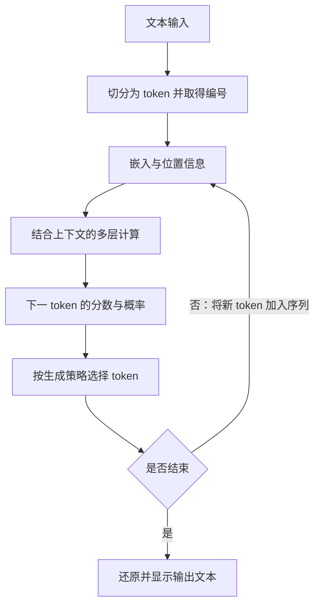

# 从文本向量到语言模型：文字怎样被计算和生成？

[返回本章大纲](README.md) · [上一节：分子描述符与神经网络](04_从手工特征到深度神经网络.md) · [下一节：上下文](06_上下文与常见模型.md)

建议用时：15—20 分钟。重点是理解数值表示、上下文和逐步生成；不要求记住网络结构名称或自己训练模型。本地模型演示为教师选用，不要求全体学生配置环境。

## 一、从预测性质，走到生成文本

前面根据分子输入预测一个性质。现在希望输入一段文字，输出另一段文字，例如把实验记录整理成说明，或者根据问题生成回答。

**生成式模型**能够产生文本、图片等内容。**语言模型**对文本序列建立概率模型，本节讨论能根据已有文本逐步生成后续内容的**大语言模型（Large Language Model，LLM）**。

现代生成式 LLM 通常使用深度神经网络，许多采用 Transformer 架构。并非所有语言模型都很大，早期也有不使用神经网络的统计语言模型。我们从小模型观察机制，不用模型大小作为是否正确的判断标准。

**课堂提问：**请补全“样品编号是 M-”。后面可以接很多内容；只有读入这次实验记录，才有依据知道具体编号。这将贯穿后面的演示。

## 二、先把文字切成模型能处理的片段

**token** 是模型处理文本的片段，可能是字、词的一部分、标点或空白。**分词器（tokenizer）**按特定规则把文本转成 token 序列，再将 token 对应到整数编号。

例如，可以把一段话示意写成：

> 样品编号是 M-02。 → 若干文本片段 → 一串整数编号

这里不预先给出真实切分或编号：它们取决于所用模型的词表与规则，应在演示时读取分词器的实际输出。一个汉字不保证是一个 token，一个单词也不保证是一个 token；有些片段单独看甚至只是部分 UTF-8 字节，合在一起才能显示完整文字。

**词表**是模型可处理的 token 及其编号的集合。编号用于识别片段，编号大小本身不代表语义更强、更接近或更重要。

### 编码与分词不要混淆

| 层次 | 解决什么问题 |
| --- | --- |
| UTF-8 等文件编码 | 怎样在文件中保存文字，怎样把字节解读为文字 |
| tokenizer 与 token 编号 | 模型把文字按什么片段组织，怎样给片段编号 |
| 嵌入向量 | 怎样把 token 转成可学习、可计算的数值表示 |

读文件时发生乱码，不能指望用模型的分词过程自动修复正确原文。

## 三、从编号到向量：不是把字排成大小关系

**向量**是一串按顺序排列的数。模型通常为 token 建立**嵌入（embedding）**，可以先理解为一张由训练确定的数值表：拿到编号，就取出相应向量。

例如，为了说明形式，可以假设某片段对应 `[0.2, -0.4, 0.7]`。这三个数完全是教学示意，不是本地模型的真实权重，也不分别代表“化学性、温度、重要程度”。

向量的维数、数值和相互关系由模型结构与训练决定。不要把每个维度硬解释为一个人能命名的概念。

最初的 token 表示还要结合顺序和上下文继续计算。同一个片段出现在不同语境时，后续得到的上下文表示可以不同。

### 可选演示：查看我们模型里的真实向量

[四组典型词向量案例](../../演示/词向量/课堂候选案例.md)提供首都、亲属称谓、比较级和进行式的实测对照。每个 token 是 1,024 个数，文档展示前 8 维的实际数值和逐项加减，完整向量可下载查看。

例如，计算 `v(伦敦)−v(英国)+v(法国)` 后，完整词表近邻搜索得到“巴黎”。这是已训练的初始表示中观察到的关系，不是模型在聊天中回答了“巴黎”，也不是严格向量等式。不需要学生手算 1,024 个分量。

## 四、结合上下文计算：注意力在做什么？

**上下文**是这次生成实际可用的输入信息，例如问题、已提供的记录和此前对话。下一节再详细讨论它怎样被管理。

**注意力机制**可以先理解为：模型更新某个位置的表示时，根据当前计算，对不同位置的信息作不同程度的组合。

例如：

> 样品 A 的编号是 M-02，样品 B 的编号是 M-03。请写出样品 B 的编号。

回答需要关联“样品 B”和它对应的记录，而不能只凭看到第一个编号就输出。这个例子用来说明任务需求，不保证模型内部某个注意力头只负责这一个对应关系；注意力权重也不能直接当成完整的思考解释。

现代网络包含许多层表示更新，大量运算可以组织成矩阵乘法，同时还有非线性变换、归一化等操作。GPU 可以加速其中的并行计算，但“用了 GPU”不保证回答正确。

## 五、输出的是下一片段的概率，再逐步选择

经过计算，模型为词表中的候选 token 产生一组分数，常称为 **logits**。通常通过 softmax 运算，把分数变成非负、总和为 1 的概率。

为说明机制，假设某一步只有三个候选：

| 下一片段 | 概率 |
| --- | --- |
| “02” | 0.6 |
| “03” | 0.3 |
| “01” | 0.1 |

这是人工编写的示意分布，不是模型实测结果；真实词表大得多。选出一个片段，接回已有序列，再计算下一步，直到遇到结束条件或达到输出上限。

**采样**表示按照概率选择，不一定总取最大者；**贪心选择**则每次取最高分候选。**温度（temperature）**会影响选择分布的集中程度，但不是事实准确性的开关。更低温度不等于更可靠，更高温度也不等于更有知识。不同模型的建议设置不同。

图示省略 KV 缓存等加速细节。实际推理可以缓存已有信息，不必每一步从头重算全部文本。界面一次显示的一小段流式文字，也不保证严格对应一个 token。

## 六、训练为什么能让这样的计算有用？

许多生成式语言模型的核心预训练任务是预测下一个 token。训练时，已有文本提供后续片段作为答案，预测出错会影响损失，再通过反向传播与优化方法更新参数。

例如，训练文本中已经有完整的一句话，程序可以取前一部分作输入，用下一片段检查预测。真实训练使用大规模文本，不是只背这一句。后续还可通过指令训练、偏好优化等方式改善模型完成任务的行为，本课不展开训练配方。

| 阶段 | 在做什么 | 通常是否更新模型权重 |
| --- | --- | --- |
| 训练 | 根据数据与目标调整参数 | 是 |
| 普通推理 | 用已有权重和当前上下文计算输出 | 否 |
| 对话中提供文件 | 将实际读入的内容加入当前任务信息 | 本身不等于重新训练 |

“预测下一片段”描述了重要的训练目标与生成机制，不等于模型只会机械接词。大量训练可以形成用于语言、代码与其他任务的复杂能力；具体能力仍需检验，不能由回答流畅直接推断。

## 七、教师演示：用一个小模型看真实输出

本课选择 **Qwen3-0.6B** 作为小模型候选。0.6B 表示约 6 亿参数，不是 0.6GB，也不是最大上下文长度。小模型适合观察机制，不代表课堂应把它当作可靠化学顾问。[官方模型卡](https://huggingface.co/Qwen/Qwen3-0.6B)

本机环境、启动方式与验证进度统一维护在[WSL 本地演示说明](../../演示/本地语言模型/README.md)。本机已在 WSL 用 AMD GPU 成功运行，日志确认 29/29 层卸载到 GPU，分词、候选概率和流式回答均已验证。详细配置以该说明为准。

### 演示 A：真实分词

运行 `inspect_llm.py tokens`，观察“样品编号是 M-02。”实际对应的片段与编号。再加入换行或英文，比较结果。这里展示分词，不需要 GPU 计算完整回答。

本机已用 Qwen3-0.6B Q8_0 实测，片段依次为 `样品`、`编号`、`是`、` M`、`-`、`0`、`2`、`。`。注意 ` M` 包含前导空格，`02` 也不是单个 token。这是该模型与当前设置的实际结果，不推广成所有模型的分词规则。见[保留的实测示例](../../演示/本地语言模型/实测示例.json)。

### 演示 B：只生成一个 token

运行 `inspect_llm.py next`，输入一个待续写的前缀，令服务器只生成一个 token，同时返回候选分数。此模式是原始文本续写，没有自动应用聊天模板，所以不能按聊天助手的回答质量评价。

脚本保留原始 JSON，便于核对服务器版本。若返回 `logprob`，它是概率的自然对数，概率需用 `exp(logprob)` 换算；只展示前几个候选，其概率总和不一定为 1。接口中的候选分数也要区分是否经过温度等采样处理，不能混着解释。

本机一次原始续写的真实结果如下（固定 seed=42、temperature=0.7，采样前概率）：

| 候选 token | 概率约值 |
| --- | --- |
| `1` | 0.282 |
| `0` | 0.216 |
| `2` | 0.197 |
| `3` | 0.094 |
| `4` | 0.038 |

这次实际选中的是 `2`，而不是概率最高的 `1`，可用来区分采样与贪心选择。前缀没有提供真实编号，这些概率也不是“样品真实编号”的可信度。换模型、输入或运行设置，结果可能不同。

### 演示 C：给出资料，流式生成回答

运行 `inspect_llm.py chat`，先问“样品编号是什么？”，再单独提供“记录：样品编号是 M-02。请只回答编号。”，观察有无明确依据的区别。

两次请求分别发出，脚本不自动记忆上次对话。输出随服务器流式返回，没有预写答案。小模型可能失败；失败也用于说明能力边界，不现场编造成功结果。

教师先验证模型和服务，再决定是否现场使用。若环境未就绪，可先用第 5 节的人工概率表解释机制，并明确这只是示意，之后再补真实模型结果。

## 八、为什么仍然会生成错误内容？

模型根据学到的规律和当前输入生成输出，不等于每次都查验过真实世界。数据中的错误、上下文不足、任务难度和生成策略都可能影响回答。

举例：只问“烘箱温度设为多少”，没有材料和实验方案时，流畅报出一个温度也缺少依据。我们应要求它指出缺失条件；如果给出明确的教学记录，则让它说明答案依据。

这里的课堂任务使用编号等简单信息，不拿生成的实验条件直接指导真实操作。生成的数值、引用和科研结论仍需对照原始材料检查。

## 九、把输出能力接回电脑操作

模型能生成普通说明，也能生成 Markdown、JSON 或一行命令。然而生成 `mkdir lesson-demo` 不等于文件夹已经创建。

要让输出变成真实动作，还需要外围程序读取调用请求，协调工具执行，把结果或错误送回上下文。这就是后续 Harness 与 Agent 内容要解决的问题。

**课堂检查：**

1. token 编号、UTF-8 编码、嵌入向量是不是同一层东西？
2. 模型每次只选一个 token，为什么还能生成完整段落？
3. 提供一条新记录，是更新了权重，还是补充了这次可用信息？
4. 模型输出“文件已保存”，需要什么额外证据？

参考回答：不是；通过循环生成；普通推理时主要是补充上下文；需要实际工具执行及文件检查。

## 参考资料

- [Hugging Face：Tokenizers](https://huggingface.co/learn/llm-course/chapter2/4)：优先看文本到编号的过程。
- [Hugging Face LLM 课程](https://huggingface.co/learn/llm-course/chapter1/1)：按需了解 Transformer，无需完成来源课程习题。
- [Qwen3-0.6B 官方模型卡](https://huggingface.co/Qwen/Qwen3-0.6B)及[官方 GGUF](https://huggingface.co/Qwen/Qwen3-0.6B-GGUF)：候选模型、许可与运行设置。
- [llama.cpp 服务器说明](https://github.com/ggml-org/llama.cpp/tree/master/tools/server)：本地脚本使用的接口依据。

本节文字与示意概率均为课程编写，示意值不冒充真实模型权重或输出；外部资料通过原站链接提供。实际模型文件不放入课程 Git 仓库。
