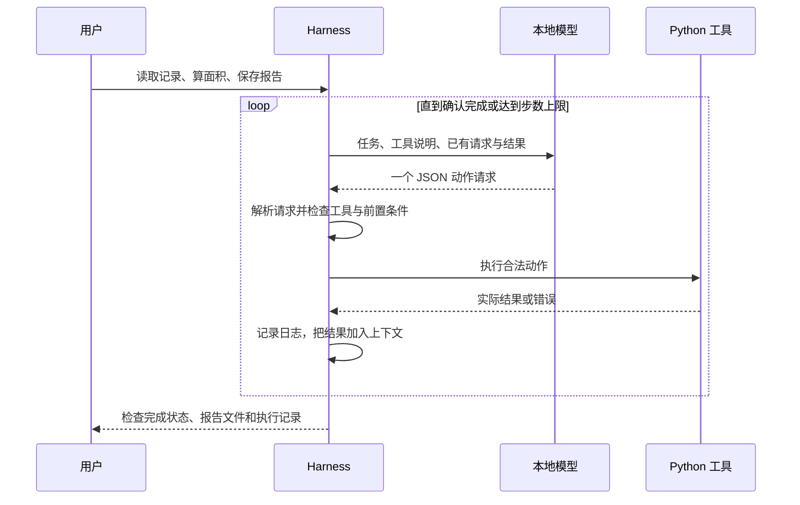

# 从模型输出到真实操作：搭一个最小 Harness

[返回本章大纲](../04_AI与Agent的工作方式.md) · [上一节：上下文](06_上下文与常见模型.md) · [下一节：工具调用格式与执行边界](08_工具调用与执行演示.md)

本节使用本地模型和 Python 程序展示工具请求、执行与结果反馈。

## 一、模型输出与程序执行

模型可以生成 `mkdir lesson-demo`；命令解释程序执行后，文件夹才会出现。

Python 解释器负责执行 Python 代码。程序保存报告后，可以在硬盘上检查文件。

模型之外，还需要程序完成这些工作：准备输入、调用模型、识别调用请求、执行工具、检查结果，并把结果交回模型。这些组织与运行工作，可以由 **Harness** 承担。

**Harness** 是组织模型输入、工具调用和任务状态的外围程序，可由普通代码或现成框架实现。

## 二、读取记录、计算面积并保存报告

程序向模型提供工具说明。模型依次请求读取记录、计算面积和保存报告。

任务内容：

> 读取教学样品记录，按圆形计算面积，保存一份 Markdown 报告，然后结束。

[输入记录](../../演示/最小Harness/data/sample.json)包含虚构样品 DROP-07，半径为 2 mm。程序根据记录计算圆面积。

模型首先收到任务和工具说明。模型请求读取后，程序返回文件中的数值。

## 三、最小框架只提供四个动作

| 请求动作 | 实际由谁做什么 | 什么时候可以执行 |
| --- | --- | --- |
| `read_record` | Python 读取指定的 JSON 文件，检查并返回编号和半径 | 文件存在、内容可用 |
| `circle_area` | Python 使用已读取的半径计算 $A=\pi r^2$ | 已有合法记录 |
| `write_report` | Python 用固定模板保存报告，再读回核对 | 已读取且已计算 |
| `finish` | Harness 检查是否达到任务完成条件 | 完整任务需要已有核对过的报告；只读任务需要已读记录 |

调用请求只有一个动作名称，例如：

```json
{"action":"read_record"}
```

运行程序时指定文件路径，工具从记录中获取半径，模型选择动作。下一节介绍带参数的调用请求。

**报告来自固定模板。**模型决定请求哪个动作；程序根据实际记录计算面积，并把编号和面积填入模板。

## 四、逐轮运行

先确认 [WSL 本地模型服务](../../演示/本地语言模型/README.md)已经运行。进入[最小 Harness 目录](../../演示/最小Harness/README.md)，执行：

```bash
python3 harness.py --pause
```

每按一次 Enter，进入下一轮。屏幕会分开打印模型请求与 Harness 的执行结果。

### 第 1 轮：模型请求读取

模型的一次真实输出为：

```json
{"action":"read_record"}
```

Harness 解析请求、查找注册工具，再由 Python 读取文件。结果为：

```json
{"ok":true,"result":{"sample_id":"DROP-07","radius_mm":2.0}}
```

Python 工具打开文件。Harness 将读取结果加入下一轮模型输入。

### 第 2 轮：模型请求计算

Harness 把刚才的请求与工具结果加入消息历史。模型下一次生成：

```json
{"action":"circle_area"}
```

Python 实际计算并返回面积约 12.566370614359172 mm²。模型负责请求合适的工具，Python 负责圆面积计算。

### 第 3 轮：模型请求保存

收到计算结果后，模型请求 `write_report`。程序用记录和面积生成 Markdown，写到本次输出目录的 `report.md`，再读回核对。

模型输出工具名称后，还需观察写入函数的返回状态并检查文件。

### 第 4 轮：模型请求结束

模型请求 `finish`，Harness 再检查是否有已核对的报告。确认完成后，才打印“任务完成”。

打开实际生成的报告，看编号、半径和面积是否正确。默认结果应为 **12.57 mm²**；同时检查终端消息和实际报告。

[模型请求与工具结果](../../演示/最小Harness/examples/成功执行.json)和[生成报告](../../演示/最小Harness/examples/实际生成报告.md)记录了一次运行过程。

## 五、看清这个循环的结构



图中的循环包含请求检查与停止条件。请求违反规则时，程序返回错误并保留当前状态；达到上限时明确停止。

程序按以下步骤循环：

```text
准备任务与工具说明
重复：
    请求模型生成下一步
    解析并检查请求
    调用已注册的工具
    把真实结果加入上下文
    检查是否完成或应当停止
```

实际代码见 [harness.py](../../演示/最小Harness/harness.py)，其中 `choose_action`、`Tools` 和 `run` 分别负责模型请求、工具处理和运行循环。

## 六、模型与程序的分工

| 事情 | 本例由谁决定 |
| --- | --- |
| 任务目标与建议顺序 | 程序预先写入任务提示 |
| 工具名称、功能、文件路径和报告模板 | 程序预先定义 |
| 每轮实际输出哪个动作 | 本地模型真实生成 |
| 请求是否允许执行 | Harness 检查 |
| 读文件、计算、写报告 | Python 工具执行 |
| 工具返回什么 | 实际执行结果决定 |
| 能否宣布任务完成 | Harness 根据实际状态核对 |

程序每轮提供四种候选动作，任务提示建议“先读、再算、再保存”。模型在给定动作中选择下一步，形成受指导的工具循环。

输出采用 **JSON Schema** 约束：Schema 是对 JSON 结构的约定，本例限制只有 action 字段，动作必须来自给定列表。推理程序据此限制生成格式。

这会帮助小模型输出可解析请求，Harness 仍需检查请求顺序、任务意图和参数，并依据已定义的工具映射执行 JSON 请求。

本例的 `{"action":...}` 是自定义教学协议，原生 `tool_calls` 报文还包含服务规定的消息结构。任务与工具说明放在用户消息中，现有服务仍然关闭系统提示词。

### Harness 组织输入与执行过程

Harness 组织模型输入，解析工具请求，管理执行状态，并根据结果继续运行或结束。

| 职责 | 本课小程序怎样实现 | 代码中的位置 |
| --- | --- | --- |
| 准备输入 | 将任务、工具说明和输出格式约定提交给模型 | `INSTRUCTIONS`、`choose_action` |
| 管理上下文 | 把此前请求与真实工具结果加入下一轮消息 | `run` 中的 `messages` |
| 协调工具 | 解析动作名称、查找工具并检查前置条件 | `Tools.dispatch` 与各工具函数 |
| 管理执行状态 | 保存已读记录、计算结果和报告路径 | `Tools.record`、`Tools.area`、`Tools.report` |
| 判断停止 | 检查任务是否真正完成，或达到步数上限 | `Tools.finish`、`run` |
| 保留执行证据 | 保存实际请求、返回结果和停止原因 | `trace.json` |

### “上下文”和“记忆”需要分开看

模型继续先前对话时，程序会使用不同来源的信息：

| 信息 | 保存位置 | 进入模型输入的条件 |
| --- | --- | --- |
| 对话历史 | Python 的 `messages` 列表 | 只有随请求提交的部分才成为本次上下文 |
| 程序状态 | `Tools` 对象中的记录、面积和路径 | 程序选择相关内容并提交给模型时可用 |
| 执行日志 | 输出目录中的 `trace.json` | 本例供人核查；如需用于后续请求，可由程序读取并提交 |
| 模型参数 | 已加载的模型权重 | 用于计算；对话历史由消息列表提供 |

**上下文**强调“这一次实际提供给模型什么”；**对话历史**是可以从中选择输入的一份记录，本例从对话历史中依次加入已有消息；历史压缩与片段筛选属于扩展实现。

**程序状态**保存在执行程序中。`circle_area` 从 `Tools.record` 取半径，`write_report` 从 `Tools.area` 取面积。模型每轮只需选择下一步动作。

**执行日志**主要供教师和学生核查发生了什么。日志保存在硬盘上供核查；每次运行都新建消息列表和工具状态。跨运行检索旧日志属于长期记忆扩展。

更复杂的 Harness 可以增加历史摘要、长期记忆检索、权限管理或重试等功能，这些属于后续扩展；本例聚焦最小行动循环。

### 当前使用的程序结构

这里使用一个由 **Python 标准库**编写的小程序，通过 HTTP 调用本地模型服务。JSON 输出格式约束由推理服务支持，具体工具与循环由本课代码实现。

程序包含真实模型调用、工具执行、结果反馈、完成检查，以及日志和暂停功能。

本例由模型选择动作名称，程序读取半径并用固定模板生成报告。下一节介绍由模型同时生成工具参数的请求形式。

## 七、用三个对照看清 Harness 的职责

### 对照 A：任务变成只读

运行：

```bash
python3 harness.py --task read --pause
```

本机实测中，模型读取后请求结束，日志显示计算与保存步骤缺席。检查日志和新目录即可看到实际状态；工具端限制只读任务的写入动作。[实测记录](../../演示/最小Harness/examples/只读任务.json)

### 对照 B：文件中的半径变了

运行：

```bash
python3 harness.py --record data/sample_radius3.json
```

读取 DROP-08 的半径 3 mm，实际结果约为 **28.27 mm²**。借此确认工具使用的是文件中的数值，记录中的数值决定计算结果。[实测记录](../../演示/最小Harness/examples/半径改为3.json)

### 对照 C：步骤跳过与文件缺失

初次较长提示的真实测试中，模型读完记录就请求保存，跳过了计算。Harness 拒绝保存；随后模型多次请求结束，由于报告文件缺席而返回错误，最终达到上限停止。[初次失败记录](../../演示/最小Harness/examples/初次失败.json)

另一次指定缺失的教学文件时，读取返回错误，Harness 保持真实状态，并拒绝模型的完成请求。[文件缺失记录](../../演示/最小Harness/examples/文件缺失.json)

Harness 检查执行条件，并依据工具状态和实际文件确认任务完成。连续错误会触发停止条件。

### 省略结果反馈后的执行

本例提供 `--drop-feedback`，实际执行仍然发生，工具结果留在程序内部；实测中，模型依然按提示里的固定顺序走完了任务。[实际对照记录](../../演示/最小Harness/examples/未反馈结果.json)

这次运行完成了固定顺序任务。任务顺序由提示清楚给出，工具还在内部保存记录和面积，模型依照步骤即可选择动作。研究结果反馈对动态决策的作用，需要设计依赖工具结果的分支任务，留待后续扩展。

## 八、Harness 与 Agent 的关系

**Agent**在本课指围绕目标使用模型和工具、根据结果继续行动的任务系统。Harness 提供支撑它运行的软件机制：组织上下文、连接工具、检查请求、执行与反馈、记录和停止条件。

这个演示包含受指导的工具循环。科研任务中的检索、图像处理和数据分析工具也可接入同类框架。

下一节对照代码块、结构化输出与 function calling 的消息格式。

## 参考资料

- [Hugging Face：工具使用](https://huggingface.co/docs/transformers/chat_extras)：模型提出调用，应用处理执行与返回结果。
- [Anthropic：Building effective agents](https://www.anthropic.com/research/building-effective-agents)：介绍工作流与 Agent 的实现方式。
- [本课框架说明](../../演示/最小Harness/README.md)：命令、代码、真实记录与验证方式。
