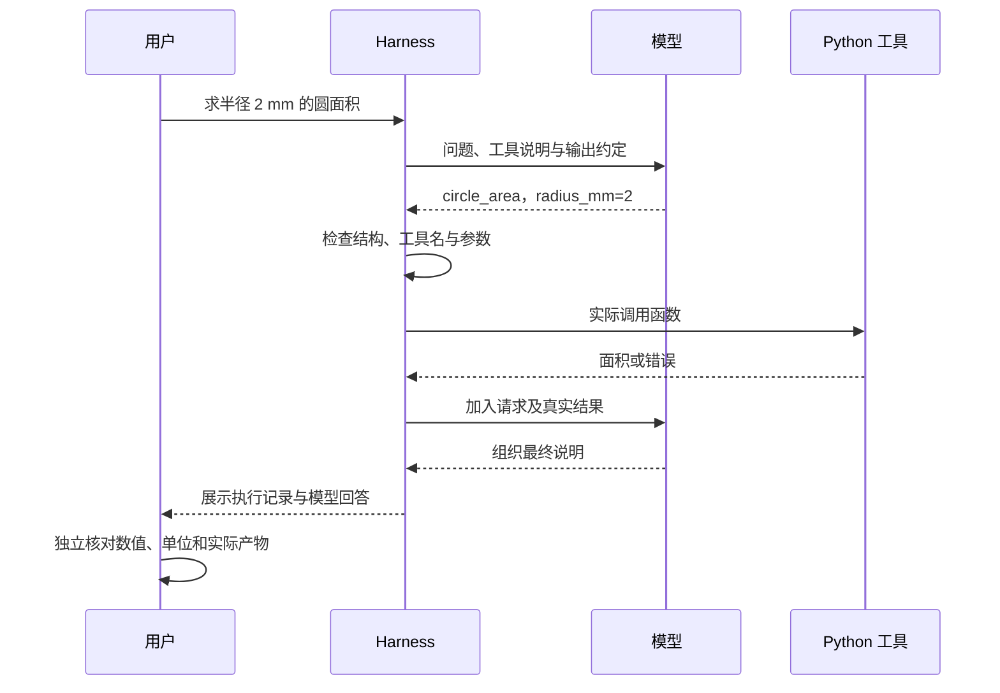

# 工具调用与执行：从一段文字到有参数的请求

[返回本章大纲](../04_AI与Agent的工作方式.md) · [上一节：最小 Harness](07_文本命令与Agent_Harness.md) · [进入课堂文件实践](../05_课堂实践与结果检查.md)

本节说明代码块、结构化请求、工具调用消息与实际执行结果的区别。

## 一、上一节的动作请求

> **Harness（执行框架）**组织模型输入、工具调用和结果反馈。

最小 Harness 中，模型返回：

```json
{"action":"circle_area"}
```

程序从记录中取得半径，模型选择工具动作。Harness 执行动作并返回结果。

带参数的请求需要同时指定工具名称和半径。

## 二、代码块与程序执行

模型可以生成：

```python
import math
print(math.pi * 2.0 ** 2)
```

Markdown 预览显示代码块；程序把代码交给 Python 解释器后产生真实计算结果。

三个反引号标记代码块。外围程序可以展示代码，也可以调用解释器执行代码。执行记录用于确认数值来自程序计算。

## 三、结构化请求：把工具名与参数写清楚

> **JSON（JavaScript Object Notation，JavaScript 对象表示法）**是用名称和值组织数据的文本格式。

**结构化输出**按约定格式组织内容，便于程序读取。

例如：

```json
{
  "name": "circle_area",
  "arguments": {
    "radius_mm": 2.0
  }
}
```

| 字段 | 在本例中表示什么 |
| --- | --- |
| `name` | 请求哪一个已注册工具 |
| `arguments` | 交给工具的参数集合 |
| `radius_mm` | 半径，工具说明明确单位为 mm |

**参数**是调用某个工具时提供的输入。这里的半径是一次工具调用的输入，神经网络权重是训练过程确定的参数。

这段 JSON 描述调用请求，Python 工具负责返回执行结果。本例的调用格式由课程程序定义。

样品记录 JSON 保存数据；调用请求 JSON 则由外围程序识别、验证并交给工具处理。两者的用途由程序约定。

## 四、工具说明与参数检查

程序向模型提供 Python 工具的名称、用途、输入和单位。

本节提供的工具只有一个：

> `circle_area(radius_mm)`：输入以 mm 表示的半径，计算圆面积，返回以 mm² 表示的结果；半径必须是非负有限数值。

模型依据说明生成调用请求，Harness 根据请求调用程序中的函数。

**JSON Schema** 描述 JSON 的结构。本例规定工具名称和数值半径两个字段。Harness 在执行前检查请求结构和参数值。

例如，用户说的是直径 4 mm，工具要求半径，模型就需要正确转换；本节实时演示直接给出半径，单位换算留作扩展任务。

## 五、模型生成参数，工具执行计算

在[最小 Harness 目录](../../演示/最小Harness/README.md)中运行：

```bash
python3 tools_with_args.py --radius-mm 2 --pause
```

> **WSL（Windows Subsystem for Linux，适用于 Linux 的 Windows 子系统）**在 Windows 中提供 Linux 环境。

运行前启动 WSL 本地模型服务。程序在本次输入中提交工具说明。

### 第一步：只看模型请求

模型生成工具名 `circle_area` 和半径 2 后，程序在工具执行前暂停。

### 第二步：Harness 检查并执行

按 Enter 后，程序检查：

- 请求结构是否符合约定，工具是否已注册；
- 参数是否为数值、是否保留任务给定的半径；
- 半径是否非负且有限。

检查通过，再调用 Python 的 `math.pi * radius_mm ** 2`。实际返回：

```json
{
  "ok": true,
  "result": {
    "radius_mm": 2,
    "area_mm2": 12.566370614359172
  }
}
```

### 第三步：把结果交回模型

程序将模型请求和执行结果加入消息，再请求模型说明。一次实测回答包含：

> 半径为 2 mm 的圆面积为 12.566370614359172 mm²。

面积数值来自工具返回，最后一句由模型组织。核对记录见[半径 2 mm 实测结果](../../演示/最小Harness/examples/带参数_半径2.json)。

此脚本演示单次带参数调用及结果转述。上一节的脚本展示完整行动循环。

## 六、三个短对照，检查执行边界

### 改半径

```bash
python3 tools_with_args.py --radius-mm 3
```

实测模型生成 3，工具返回约 28.27 mm²，模型据此回答。对照半径 2 mm 的结果 12.57，确认输入变化如何影响输出。[实测记录](../../演示/最小Harness/examples/带参数_半径3.json)

### 请求生成后的暂停点

```bash
python3 tools_with_args.py --radius-mm 2 --skip-execution
```

程序打印模型生成的请求后暂停。**计算发生在后续调用面积函数的步骤。**[实测记录](../../演示/最小Harness/examples/带参数_未执行.json)

### 负半径触发工具校验

```bash
python3 tools_with_args.py --radius-mm -2
```

实测中，模型提交负半径，工具返回参数错误。模型随后解释错误原因。

脚本退出码为 1，表示运行在参数校验处停止。[实测记录](../../演示/最小Harness/examples/带参数_负半径.json)

程序会将模型提交的参数与任务要求进行比较。

## 七、原生 function calling 消息

**Function calling（函数调用）**在模型应用中通常指：应用提供工具说明，模型提出工具名称及参数，应用处理调用，再返回工具结果。这里说的是模型提出调用的协议，函数仍由应用程序调用和执行。

有些服务提供专门的调用字段，例如常见接口中的 `tool_calls`。结构可以示意为：

```json
{
  "role": "assistant",
  "tool_calls": [
    {
      "id": "call_example_1",
      "type": "function",
      "function": {
        "name": "circle_area",
        "arguments": "{\"radius_mm\":2.0}"
      }
    }
  ]
}
```

返回结果可以使用关联标识指明对应哪个调用：

```json
{
  "role": "tool",
  "tool_call_id": "call_example_1",
  "content": "{\"area_mm2\":12.566370614359172}"
}
```

上面的代码展示一种常见消息结构。本节脚本使用课程自定义 JSON 格式。具体服务规定工具字段、消息类型和参数编码。

| 对照 | 本课自定义 JSON | 支持工具调用的原生接口 |
| --- | --- | --- |
| 工具说明在哪里 | 用户消息中的简单说明和输出 Schema | 通常有专门工具定义字段，由服务按模型格式处理 |
| 模型请求在哪里读取 | 本例读取回答 `content` 后解析 JSON | 通常读取专门的调用字段或消息 |
| 如何关联结果 | 本例每次一个请求，按对话顺序反馈 | 通常用调用标识关联，可支持多个请求 |
| 谁执行本地函数 | Python Harness | 仍需要应用或服务中实际负责执行的程序 |

原生接口提供工具调用消息格式。应用程序仍需处理参数检查、工具执行和结果记录。

## 八、复用已有 Notebook：离线看清程序执行

[计算与工具调用 Notebook](../../演示/计算与工具调用.ipynb)使用预写 JSON 请求展示解析、检查和 Python 计算。

现在应明确区分：

| 材料 | 请求来自哪里 | 哪些部分真实执行 |
| --- | --- | --- |
| Notebook | 教师预写的 JSON | Python 解析与计算；请求由教师预写 |
| 第七节最小 Harness | 本地模型逐轮生成动作 | 文件读取、计算、模板报告写入与核对 |
| 本节带参数脚本 | 本地模型生成工具名与数值参数 | 参数检查、计算及结果回传，再由模型生成解释 |
| 本节原生报文片段 | 教师提供的格式示意 | 展示协议格式，实测调用见本节自定义协议记录 |

Notebook、脚本和实测记录分别用于查看预写请求、实时模型调用和已保存的执行过程。

## 九、模型、Harness 与工具的分工



完成演示后，可以在[课堂文件实践](../05_课堂实践与结果检查.md)中使用 Agent 处理课程材料。

## 参考资料

- [Hugging Face：工具使用](https://huggingface.co/docs/transformers/chat_extras)：工具说明、请求、执行与结果回传的分工。
- [llama.cpp：Function Calling](https://github.com/ggml-org/llama.cpp/blob/master/docs/function-calling.md)：介绍模型模板、服务解析及原生接口支持。
- [本课参数调用代码](../../演示/最小Harness/tools_with_args.py)：使用 Python 标准库，使用当前 WSL 小模型。
