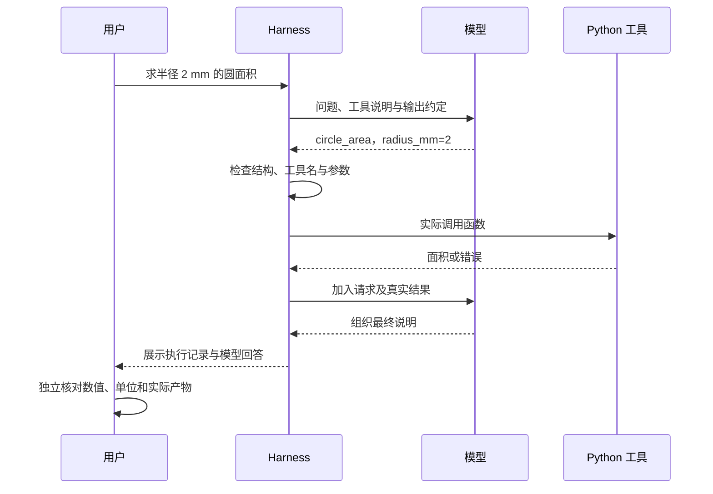

# 工具调用与执行：从一段文字到有参数的请求

[返回本章大纲](README.md) · [上一节：最小 Harness](07_文本命令与Agent_Harness.md) · [进入课堂文件实践](../05_课堂实践与结果检查.md)

建议用时：10—15 分钟。作为本章收尾，分清代码块、结构化请求、原生工具调用消息和实际执行结果，不要求记忆 API 报文。

## 一、先回顾：上一节的模型只选动作

最小 Harness 中，模型返回：

```json
{"action":"circle_area"}
```

半径由程序从已经读取的记录取得，模型没有提供参数。这个简化让我们看清了请求、执行与反馈的循环。

现在扩展一步：如果用户直接问“半径 2 mm 的圆面积是多少”，能不能让模型把工具名称与半径一起交给程序？

## 二、代码块只是在展示文字

模型可以生成：

```python
import math
print(math.pi * 2.0 ** 2)
```

普通 Markdown 预览只把它显示成代码块，不会执行。只有程序将代码交给 Python 解释器，才会产生真实计算结果。

有些 Agent 可以提取代码并执行，有些只显示代码，有些会请求专门的代码执行工具。这些行为由外围程序和运行环境实现，不是三个反引号本身的功能。

**课堂提问：**如果聊天窗口中出现 `12.57`，怎样知道它是模型生成的数字，还是工具实际算出的结果？需要检查执行过程或工具记录，不能只看答案长得像不像正确。

## 三、结构化请求：把工具名与参数写清楚

**结构化输出**就是按约定的格式组织内容，便于程序读取。JSON 是一种常见方式。

例如：

```json
{
  "name": "circle_area",
  "arguments": {
    "radius_mm": 2.0
  }
}
```

| 字段 | 在本例中表示什么 |
| --- | --- |
| `name` | 请求哪一个已注册工具 |
| `arguments` | 交给工具的参数集合 |
| `radius_mm` | 半径，工具说明明确单位为 mm |

**参数**是调用某个工具时提供的输入。这里的半径参数与神经网络的权重参数不是同一种东西；不是把半径 2 写进请求，就在训练模型。

这仍然是一份请求，不是执行结果。本例采用课程自定义 JSON 协议，供后面的 Python 程序读取，不是某家服务的完整原生 function calling 报文。

而且，不是所有 JSON 都是工具请求：样品记录 JSON 只是数据，只有外围程序把特定结构识别为调用，并实际处理，它才会进入工具执行流程。

## 四、先有工具说明，模型才知道怎样请求

教师先定义实际的 Python 工具，说明它做什么、需要什么输入、单位是什么。

本节提供的工具只有一个：

> `circle_area(radius_mm)`：输入以 mm 表示的半径，计算圆面积，返回以 mm² 表示的结果；半径必须是非负有限数值。

模型拿到的是这份说明及参数结构，不是获得了任意执行 Python 的权限。实际函数仍在程序中，由 Harness 调用。

**JSON Schema**是描述 JSON 结构的约定。本例用它限制输出只能包含已知工具名称与一个数值半径。它帮助生成可解析的请求，但模型仍可能选错输入数值，所以需要执行前检查。

例如，用户说的是直径 4 mm，工具要求半径，模型就需要正确转换；本节的实时演示先只给明确半径，不把复杂单位换算混进主任务。

## 五、现场演示：真实模型生成参数，真实工具执行

在[最小 Harness 目录](../../演示/最小Harness/README.md)中运行：

```bash
python3 tools_with_args.py --radius-mm 2 --pause
```

前提是 WSL 本地模型已启动。现有入口仍关闭系统提示词，工具说明作为本次用户输入的一部分提交；没有重新打开系统消息。

### 第一步：只看模型请求

本机实测生成了工具名 `circle_area` 和半径 2。此时程序暂停，**工具尚未执行**。

请学生指出：哪个字段是工具名，哪个字段是参数？有没有面积结果？

### 第二步：Harness 检查并执行

按 Enter 后，程序检查：

- 请求结构是否符合约定，工具是否已注册；
- 参数是否为数值、是否保留任务给定的半径；
- 半径是否非负且有限。

检查通过，再调用 Python 的 `math.pi * radius_mm ** 2`。实际返回：

```json
{
  "ok": true,
  "result": {
    "radius_mm": 2,
    "area_mm2": 12.566370614359172
  }
}
```

### 第三步：把结果交回模型

程序将模型请求和真实执行结果加入消息，再请求模型用一句话说明。模型的一次实测回答包含：

> 半径为 2 mm 的圆面积为 12.566370614359172 mm²。

这个数值来自工具返回；最后一句的表达由模型生成。工具计算正确，也不保证模型一定正确转述，仍要核对数字和单位。[完整实测记录](../../演示/最小Harness/examples/带参数_半径2.json)

这个脚本只演示一次带参数调用及结果转述，不自动循环规划；完整行动循环已在上一节展示。

## 六、三个短对照，检查执行边界

### 改半径

```bash
python3 tools_with_args.py --radius-mm 3
```

实测模型生成 3，工具返回约 28.27 mm²，模型据此回答。确认不是预写的 12.57。[实测记录](../../演示/最小Harness/examples/带参数_半径3.json)

### 只生成请求，不执行

```bash
python3 tools_with_args.py --radius-mm 2 --skip-execution
```

程序打印模型生成的请求后停止，没有调用面积函数，也没有让模型继续生成最终回答。**请求格式正确不等于计算已经发生。**[实测记录](../../演示/最小Harness/examples/带参数_未执行.json)

### 给一个不合法的半径

```bash
python3 tools_with_args.py --radius-mm -2
```

本机实测中，模型保留了负号，工具拒绝计算，并把错误交回模型。模型随后说明半径不符合要求，没有给出有效面积。

脚本退出码为 1，表示任务没有产生合法计算结果，这是预期的拒绝演示，不是需要教师偷偷改成正数的故障。[实测记录](../../演示/最小Harness/examples/带参数_负半径.json)

若模型自行修改参数，程序也会拒绝与任务不一致的值。模型可能无法正确处理错误；课堂按实际结果分析，不预先保证任何小模型都会给出理想解释。

## 七、原生 function calling 与这个 JSON 演示有什么关系？

**Function calling（函数调用）**在模型应用中通常指：应用提供工具说明，模型提出工具名称及参数，应用处理调用，再返回工具结果。这里说的是模型提出调用的协议，不是模型直接进入电脑运行函数。

有些服务提供专门的调用字段，例如常见接口中的 `tool_calls`。结构可以示意为：

```json
{
  "role": "assistant",
  "tool_calls": [
    {
      "id": "call_example_1",
      "type": "function",
      "function": {
        "name": "circle_area",
        "arguments": "{\"radius_mm\":2.0}"
      }
    }
  ]
}
```

返回结果可以使用关联标识指明对应哪个调用：

```json
{
  "role": "tool",
  "tool_call_id": "call_example_1",
  "content": "{\"area_mm2\":12.566370614359172}"
}
```

**以上仅是常见消息形态的教学示意，不是完整请求，也不是本节实测脚本使用的协议。**不同服务可能使用其他字段、消息类型或参数编码；有的服务还提供服务端执行工具。不能一概认为所有工具请求都需要从普通聊天文字里抓取 JSON。

| 对照 | 本课自定义 JSON | 支持工具调用的原生接口 |
| --- | --- | --- |
| 工具说明在哪里 | 用户消息中的简单说明和输出 Schema | 通常有专门工具定义字段，由服务按模型格式处理 |
| 模型请求在哪里读取 | 本例读取回答 `content` 后解析 JSON | 通常读取专门的调用字段或消息 |
| 如何关联结果 | 本例每次一个请求，按对话顺序反馈 | 通常用调用标识关联，可支持多个请求 |
| 谁执行本地函数 | Python Harness | 仍需要应用或服务中实际负责执行的程序 |

原生接口减少了自行约定消息格式的工作，也不自动保证工具选对、参数正确或执行成功。下一步接入其他工具时，仍要保留执行与核对过程。

## 八、复用已有 Notebook：离线看清程序执行

[计算与工具调用 Notebook](../../演示/计算与工具调用.ipynb)保留为不依赖模型服务的选用材料：它用预写 JSON 请求展示解析、检查和 Python 计算。

现在应明确区分：

| 材料 | 请求来自哪里 | 哪些部分真实执行 |
| --- | --- | --- |
| Notebook | 教师预写的 JSON | Python 解析与计算；没有真实模型调用 |
| 第七节最小 Harness | 本地模型逐轮生成动作 | 文件读取、计算、模板报告写入与核对 |
| 本节带参数脚本 | 本地模型生成工具名与数值参数 | 参数检查、计算及结果回传，再由模型生成解释 |
| 本节原生报文片段 | 教师提供的格式示意 | 只讲协议，不冒充已经运行过的原生工具调用 |

课堂可以只选择一个现场演示，其余保留为复习或网络、设备临时不可用时的材料。回放与实时运行要说清楚。

## 九、收束整章：模型、Harness、工具，各自做什么？



回到最初的认识：人工智能是一门学科；模型可以从数据中学习参数与表示；语言模型根据上下文生成文本或请求；外围程序把请求接到真实工具，并组织后续过程。

接下来进入[课堂文件实践](../05_课堂实践与结果检查.md)，让已经配置的真实 Agent 处理课程材料，检查实际读取记录和新生成的文件。我们刚才搭的小框架是解释机制的例子，不替代这些工具的全部能力。

**课堂检查：**

1. 代码块、调用请求、执行结果，分别是什么？
2. 工具输入的半径参数与模型权重参数有什么不同？
3. 工具返回正确面积后，为什么还要检查模型最终回答？
4. 当前哪一段演示用了真实模型，哪一段是预写或格式示意？

参考回答：待执行文字、要求执行的结构化消息、实际程序产生的结果；一个是函数输入，一个是训练得到的模型数值；模型可能错误转述；对照上表辨认。

## 参考资料

- [Hugging Face：工具使用](https://huggingface.co/docs/transformers/chat_extras)：工具说明、请求、执行与结果回传的分工。
- [llama.cpp：Function Calling](https://github.com/ggml-org/llama.cpp/blob/master/docs/function-calling.md)：教师按需了解模型模板、服务解析及原生接口支持。
- [本课参数调用代码](../../演示/最小Harness/tools_with_args.py)：不依赖额外框架，使用当前 WSL 小模型。

本节代码与讲解为课程编写；外部资料通过原站链接提供。不要求学生背诵报文、实现框架或在课后完成尚未布置的开发任务。
