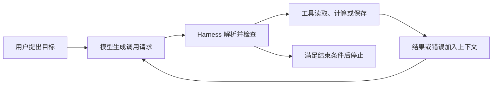

# 50 分钟授课大纲：从科研建模到 AI Agent

[返回本章入口](../04_AI与Agent的工作方式.md) · [完整备课讨论稿](新版教学大纲_讨论稿.md)

本方案安排第 4 章的 50 分钟教学。学生已有高等数学和线性代数基础，机器学习与编程概念从入门讲起。课堂以教师展示为主；本地模型和演示由教师课前启动。

## 一、学习目标

1. 能在一个模型中指出：什么由人选择，什么从数据中学习。
2. 能解释训练与使用各自的任务，并用新样本检验预测可靠性。
3. 能区分模型生成的请求与工具实际执行的结果，知道怎样核验完成情况。

分子水溶解度预测贯穿本章。Arrhenius 方程连接已有数学知识；读取数据、计算面积和保存报告展示工具执行。

## 二、50 分钟安排

| 时间 | 必要内容 | 学生需要得到的结论 |
| --- | --- | --- |
| 0—4 分钟 | AI 与专家规则 | AI 是学科方向，AI 系统通过程序实现 |
| 4—10 分钟 | 熟悉的模型与函数族 | 人选择候选关系，数据确定具体关系 |
| 10—20 分钟 | 从最小二乘理解机器学习 | 学习依据数据和目标求解参数；使用将新输入交给已训练模型 |
| 20—29 分钟 | 三种方法动画；从分子描述符到神经网络 | 观察分组、投影和分类的不同输出；关注函数表达能力与输入信息 |
| 29—37 分钟 | 从文本表示到语言生成 | 模型通过数值计算，逐步生成 token |
| 37—47 分钟 | 上下文、Harness 与真实执行 | 模型提出请求，外围程序协调工具执行与反馈 |
| 47—50 分钟 | 结果核对与机动 | 对照三个学习目标核对实际结果 |

各段时间包含互动。到时间即转段，延伸问题记下后讨论。

## 三、逐段授课内容

### 0—4 分钟：AI 与专家规则

人工智能研究用于执行推理与学习等任务的模型和系统。具体系统由算法、模型和程序等组成。定义来源见[教学大纲中的参考资料](新版教学大纲_讨论稿.md#六定义来源与后续修订)。

介绍专家系统：人提供知识与规则，程序据此推理。例如根据价态等约束筛选合理的分子结构。这是依靠预设知识开展推理的经典 AI 方法；课堂规则示例只展示其中一步，完整化学结构判定还涉及更多知识与检验。

实验数据也可以用于确定判断或预测关系。

**材料：**[认识人工智能](01_人工智能与人工规则.md)。

### 4—10 分钟：科研建模中的参数拟合

从熟悉的 Arrhenius 方程开始：

$$k(T)=A\exp\left(-\frac{E_a}{RT}\right).$$

指出输入温度、输出速率常数，以及可从实验数据拟合的参数 $A,E_a$。取对数后成为直线关系：

$$\ln k=\ln A-\frac{E_a}{R}\frac1T.$$

用这一例引出统一表达：

$$\hat y=f_\theta(x).$$

- 人选择模型框架，也就是允许考虑哪些函数。
- 数据帮助确定参数，从而确定其中的具体函数。
- 线性回归和神经网络都由人确定候选结构，再由数据确定具体参数。

Arrhenius 方程的形式由研究者选择，参数由实验数据拟合。

这里用共同的数学语言比较建模方法。物理模型依据机理知识建立，专家系统依据明确的领域规则推理；科学模型还可以采用其他表达形式。

随后用直线模型展示参数拟合过程。

### 10—20 分钟：机器学习就是从数据中学习

先用溶解度说清任务：收集分子信息和实验溶解度，学习两者之间的关系，用于预测新分子。

为便于展示求解，暂时换成已有演示中的三个虚构标定点。明确这些点是教学用的虚构标定数据。

$$\hat y=ax+b,\qquad L(a,b)=\sum_i[y_i-(ax_i+b)]^2.$$

定义预测、参数、残差与损失：损失是衡量预测与实测差距的目标函数，本例采用残差平方和。

**演示控制在 4 分钟内：**

1. 手动改变斜率与截距，观察直线和残差。
2. 播放梯度下降，观察参数与损失的变化。
3. 展示最小二乘直接解，说明同一目标可以有不同求解方式。

只保留一条更新公式：

$$\theta\leftarrow\theta-\eta\nabla_\theta L.$$

梯度由各参数的偏导数组成，更新沿负梯度方向，$\eta$ 控制步长；求导步骤留作选读。

- **训练：**利用数据确定参数。
- **使用：**固定参数，为新输入计算输出。
- **检验：**用独立测试数据检查表现，并单独评估研究范围之外的外推。

更换训练数据后，模型形式可以保持，拟合参数可能改变。

**材料：**[机器学习与最小二乘](02_机器学习与最小二乘法.md)、[交互演示](../../演示/最小二乘/README.md)。

### 20—29 分钟：分子描述符与神经网络

播放[三种机器学习方法动画](../../演示/机器学习方法/index.html)，依次观察 K-Means 分组、PCA 二维投影和 SVM 分类边界。课堂只比较三种输出，不展开算法推导。

分子溶解度预测可以用分子量、亲脂性等多个描述符作为输入：

$$\widehat{\log S}=b+\sum_j w_jx_j.$$

以 ESOL 为例说明具体做法：人选描述符与线性关系，数据确定系数。本次聚焦描述符、线性关系和拟合系数的分工。

提出两个不同问题：

1. 输入信息足够，数据呈曲线关系：选择能表达曲线的模型。
2. 输入遗漏重要信息：先补充相关测量或特征，再比较模型。

展示一个两层神经网络：

$$\hat y=W_2\sigma(W_1x+b_1)+b_2.$$

依次指出：矩阵把输入组合成中间量，非线性变换后再计算输出。人选择结构，数据确定矩阵和偏置中的参数。反向传播用链式法则计算梯度，优化器利用梯度更新参数；计算图推导留作选读。

用分子连接表示补一句表示学习：网络可以从原子、连接等给定信息中学习中间特征，并在已选分子描述符之外形成新的表示。学习过程依赖给定的输入表示和训练数据。

预测受温度影响的性质时，输入还需要包含温度等实验条件。

**材料：**[方法动画讲义](03_聚类降维与分类.md)、[分子描述符与神经网络](04_从手工特征到深度神经网络.md)。

### 29—37 分钟：语言模型的逐步生成

只保留一条流程，逐个定义新词：

> 文本 → token（模型处理的文本片段）→ 编号 → 嵌入向量 → 依赖上下文的网络计算 → 下一个 token 的概率分布 → 选择一个 token → 继续生成。

嵌入表把编号对应到向量，也是训练得到的参数。后续网络结合上下文继续计算；中间向量表示文本特征，最终概率分布表示下一片段各候选的可能性。

用本地模型展示一句中文的切分，再展示一次短续写或下一 token 候选。现场聚焦切分、续写和候选分数；向量类比、完整训练过程与模型尺寸细节留作选读。

强调：生成结果可能流畅且含事实错误，需要核验。普通对话提供本次调用的上下文，模型权重通过训练流程更新。

工具执行过程将在下一段演示。

**材料：**[文本向量与语言模型](05_从文本向量到语言模型.md)、[本地演示](../../演示/本地语言模型/README.md)。

### 37—47 分钟：模型请求与工具执行

先定义上下文：本次调用交给模型的信息。模型获得文件正文的方式是由程序读取文件并将内容加入本次输入；文件名只提供定位线索。

再定义 Harness：围绕模型组织输入、协调工具、收集结果并控制后续流程的程序层。这里重点展示输入、工具与结果的循环；对话历史、执行状态和长期记忆留在详细讲义中。

用同一张流程图解释演示：

**真实演示只运行一个成功流程：**读取样品半径 → 计算圆面积 → 保存报告 → 检查文件。

在一次调用处暂停，指出 JSON 是一种用字段和值记录信息的文本格式；请求说明工具名称和参数。代码或 JSON 显示在屏幕上属于展示阶段；工具返回结果和实际文件用于确认执行阶段。

核对模型发出的请求、工具返回的结果和磁盘上保存的报告。

说明这个最小 Harness 展示受引导的教学流程；模型的通用自主规划能力需要更广泛的任务测试。“LLM 加 Harness 形成 Agent”作为简写，需要结合任务目标、行动与反馈循环理解。

**材料：**[Harness 讲义](07_文本命令与Agent_Harness.md)、[工具调用讲义](08_工具调用与执行演示.md)、[最小 Harness 演示](../../演示/最小Harness/README.md)。

### 47—50 分钟：结果核对

核对神经网络的人工设计与训练参数、模型在独立测试数据上的表现，以及报告的执行记录和实际文件。

## 四、时间调整与演示备用

- 最小二乘部分超时：保留一次自动拟合和训练／使用区别，略过直接解按钮比较。
- 神经网络部分超时：保留输入信息与模型能力的区别，将反向传播口述移为课后选读，保留新数据检验。
- 语言模型部分超时：只展示预先保存的切分与短输出，保留 token、向量、概率分布的区别。
- 本地服务故障：打开已有实测记录与报告，明确说明记录来自先前运行；仍沿请求、执行、文件三步核验。
- 最后 3 分钟用于核对学习目标和执行证据。

## 五、备课范围与选读内容

课前确认机器学习方法动画与最小二乘网页可用、本地模型已启动、Harness 的输出位置可写，并准备已有运行记录作为备用。

K-Means、SVM、PCA 的算法细节，以及完整神经网络推导、词向量算术、RAG、模型排行榜、长期记忆和原生工具调用协议，留作后续课程或课后选读。
