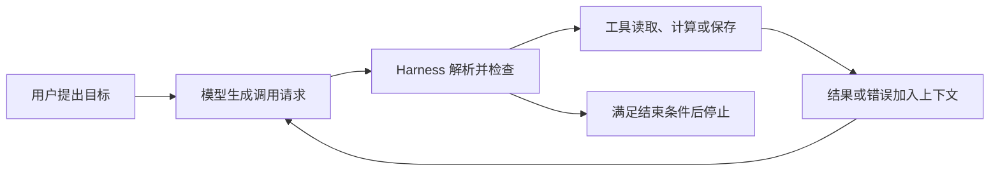

# 50 分钟授课大纲：从科研建模到 AI Agent

[返回本章入口](README.md) · [完整备课讨论稿](新版教学大纲_讨论稿.md)

本方案适用于第 4 章只有 50 分钟的情况，不是整门课程的大纲。假定学生学过高等数学和线性代数，但不了解机器学习与编程。课堂以教师展示为主，不安排现场安装环境；本地模型和演示应提前启动。

## 一、本次只要求建立三种判断

1. 能在一个模型中指出：什么由人选择，什么从数据中学习。
2. 能解释训练与使用的区别，并知道拟合好不等于新样本预测可靠。
3. 能区分模型生成的请求与工具实际执行的结果，知道怎样核验完成情况。

贯穿案例是分子水溶解度预测。Arrhenius 方程用于连接已有数学经验；末尾用读取数据、计算面积、保存报告的小任务说明真实操作。不要求记忆算法名称或推导训练公式，不新增课外作业。

## 二、50 分钟安排

| 时间 | 必要内容 | 学生需要得到的结论 |
| --- | --- | --- |
| 0—4 分钟 | AI 是什么：从开场提问到专家规则 | AI 是学科方向，AI 系统也通过程序实现 |
| 4—10 分钟 | 熟悉的模型与函数族 | 人选择候选关系，数据确定具体关系 |
| 10—20 分钟 | 从最小二乘理解机器学习 | 学习是依据数据和目标求解；训练与使用不同 |
| 20—29 分钟 | 从分子描述符到神经网络 | 同时关注函数表达能力与输入信息 |
| 29—37 分钟 | 从文本表示到语言生成 | 模型通过数值计算，逐步生成 token |
| 37—47 分钟 | 上下文、Harness 与真实执行 | 模型提出请求，外围程序协调工具执行与反馈 |
| 47—50 分钟 | 三问检查与机动 | 用自己的话解释三种判断 |

各段时间包含互动。到时间即转段，延伸问题记下后讨论。

## 三、逐段授课内容

### 0—4 分钟：AI 是什么？

**开场只问一个问题：**计算器、根据化学规则分析分子结构的程序、ChatGPT，哪些会被称为 AI？请一位同学说明判断依据，不展开投票辩论。

给出学科层面的教学定义：人工智能研究用于执行通常与人类智能相关功能的模型和系统，例如推理与学习。定义来源见[完整讨论稿](新版教学大纲_讨论稿.md#六定义来源与后续修订)。具体系统由算法、模型和程序等组成，不意味着具有人的意识。

介绍专家系统：人提供知识与规则，程序据此推理。例如根据价态等约束排除不合理的分子结构。这是经典 AI 方法，不需要先从数据训练；规则示例不冒充完整化学结构判定系统。

**过渡：**当我们难以逐条写出判断办法，能否利用实验数据确定关系？

**复用：**[认识人工智能](01_人工智能与人工规则.md)。本次不展开图形题和 DENDRAL 历史。

### 4—10 分钟：我们其实已经做过建模

从熟悉的 Arrhenius 方程开始：

$$k(T)=A\exp\left(-\frac{E_a}{RT}\right).$$

指出输入温度、输出速率常数，以及可从实验数据拟合的参数 $A,E_a$。取对数后成为直线关系：

$$\ln k=\ln A-\frac{E_a}{R}\frac1T.$$

用这一例引出统一表达：

$$\hat y=f_\theta(x).$$

- 人选择模型框架，也就是允许考虑哪些函数。
- 数据帮助确定参数，从而确定其中的具体函数。
- 线性回归和神经网络都有这两个步骤；不能说神经网络完全不规定函数形式。

**提问：**拟合 Arrhenius 参数时，我们是在决定方程长什么样，还是在决定已经选定方程里的数值？

只说明共同数学语言，不把物理模型直接称为专家系统，也不声称所有科学模型都是显式函数。

**过渡：**现在先用最简单的直线，把“数据如何确定参数”看清楚。

### 10—20 分钟：机器学习就是从数据中学习

先用溶解度说清任务：收集分子信息和实验溶解度，学习两者之间的关系，用于预测新分子。

为便于展示求解，暂时换成已有演示中的三个虚构标定点。明确它们不是实际溶解度数据。

$$\hat y=ax+b,\qquad L(a,b)=\sum_i[y_i-(ax_i+b)]^2.$$

定义预测、参数、残差与损失：损失是衡量预测与实测差距的目标函数，本例采用残差平方和。

**演示控制在 4 分钟内：**

1. 手动改变斜率与截距，观察直线和残差。
2. 播放梯度下降，观察参数与损失的变化。
3. 展示最小二乘直接解，说明同一目标可以有不同求解方式。

只保留一条更新公式：

$$\theta\leftarrow\theta-\eta\nabla_\theta L.$$

梯度由各参数的偏导数组成，更新沿负梯度方向，$\eta$ 控制步长；不展开求导。

- **训练：**利用数据确定参数。
- **使用：**固定参数，为新输入计算输出。
- **检验：**用未参与训练的数据检查表现，尤其注意研究范围之外的外推。

**理解检查：**换一组训练数据，直线参数可能改变，直线这一模型形式是否一定改变？答案：不一定，模型形式可以保持不变。

**复用：**[机器学习与最小二乘](02_机器学习与最小二乘法.md)、[交互演示](../../演示/最小二乘/README.md)。

### 20—29 分钟：为什么需要神经网络？

回到分子溶解度，用分子量、亲脂性等描述符表示输入，说明多元回归只是从一个输入扩展到多个输入：

$$\widehat{\log S}=b+\sum_j w_jx_j.$$

以 ESOL 为例说明具体做法：人选描述符与线性关系，数据确定系数。本次不逐项抄写系数或计算整条公式。

提出两个不同问题：

1. 输入信息足够，但线性关系不合适：需要考虑更合适的模型。
2. 输入遗漏重要信息：仅换复杂模型未必能解决。

展示一个两层神经网络：

$$\hat y=W_2\sigma(W_1x+b_1)+b_2.$$

依次指出：矩阵把输入组合成中间量，非线性变换后再计算输出。人选择结构，数据确定矩阵和偏置中的参数。反向传播用链式法则计算梯度，优化器利用梯度更新参数，不展开计算图推导。

用分子连接表示补一句表示学习：网络可以从原子、连接等给定信息中学习中间特征，而不只依赖预先列出的分子描述符。它仍然依赖输入表示和数据，并非凭空获得信息。

**理解检查：**如果温度影响实验溶解度，但数据没有记录温度，换更大的网络能保证解决吗？答案：不能；缺失信息不会因为模型更大就自动补齐。

**过渡：**如果输入不再是分子，而是文字，怎样把它交给同样需要数值输入的模型？

**复用：**[分子描述符与神经网络](04_从手工特征到深度神经网络.md)。本次不展开 Uni-Mol 架构，也不运行额外分子动画。

### 29—37 分钟：语言模型怎样生成文字？

只保留一条流程，逐个定义新词：

> 文本 → token（模型处理的文本片段）→ 编号 → 嵌入向量 → 依赖上下文的网络计算 → 下一个 token 的概率分布 → 选择一个 token → 继续生成。

嵌入表把编号对应到向量，也是训练得到的参数。后续网络不是简单查表，而是结合上下文继续计算；最终概率分布与中间向量不是同一个对象。

用本地模型展示一句中文的切分，再展示一次短续写或下一 token 候选。不在现场讲向量类比、完整训练过程或模型尺寸细节。

强调：生成结果可能合理却不真实，需要核验。普通对话提供新上下文，不等于修改模型权重。

**过渡：**既然模型生成的是文本或调用请求，它怎样真正读取文件、计算和保存结果？

**复用：**[文本向量与语言模型](05_从文本向量到语言模型.md)、[本地演示](../../演示/本地语言模型/README.md)。

### 37—47 分钟：模型输出怎样变成真实操作？

先定义上下文：本次调用交给模型的信息。仅告诉模型一个文件名，不等于已经把文件内容交给它。

再定义 Harness：围绕模型组织输入、协调工具、收集结果并控制后续流程的程序层。对话历史、执行状态和长期记忆不在这里逐项展开。

用同一张流程图解释演示：

**真实演示只运行一个成功流程：**读取样品半径 → 计算圆面积 → 保存报告 → 检查文件。

在一次调用处暂停，指出 JSON 是一种用字段和值记录信息的文本格式；请求说明工具名称和参数。代码或 JSON 显示在屏幕上，并不意味着操作已经执行。

确认三个证据：模型实际发出的请求、工具实际返回的结果、磁盘上实际保存的报告。让学生分辨哪一步由模型生成，哪一步由普通程序执行。

说明这个最小 Harness 是受引导的教学流程，不作为模型具有通用自主规划能力的证明。“LLM 加 Harness 形成 Agent”作为简写，需要结合任务目标、行动与反馈循环理解。

**复用：**[Harness 讲义](07_文本命令与Agent_Harness.md)、[工具调用讲义](08_工具调用与执行演示.md)、[最小 Harness 演示](../../演示/最小Harness/README.md)。本次不讲原生工具协议、长期记忆和多 Agent。

### 47—50 分钟：三问检查

请学生口头回答或自行判断，教师各用一句话核对：

1. 神经网络哪些部分由人选择，哪些从数据中学习？——结构、输入表示、目标等由人选择，参数及其形成的中间表示通过训练学习。
2. 训练误差很小，是否足以证明新分子预测可靠？——不足，还要检查未参与训练的数据与适用范围。
3. 模型说“报告已保存”，怎样确认？——检查工具执行结果和实际文件，不能仅凭模型声明。

## 四、超时与演示故障时怎样处理

- 最小二乘部分超时：保留一次自动拟合和训练／使用区别，略过直接解按钮比较。
- 神经网络部分超时：保留输入信息与模型能力的区别，略过反向传播口述，不删新数据检验。
- 语言模型部分超时：只展示预先保存的切分与短输出，保留 token、向量、概率分布的区别。
- 本地服务故障：打开已有实测记录与报告，明确说明是先前运行结果，不假装现场成功；仍沿请求、执行、文件三步核验。
- 最后 3 分钟尽量保留；若讨论占用，至少用三个检查问题收束，不临时补算法清单。

## 五、备课范围与本次不展开的内容

课前只需确认最小二乘网页可用、本地模型已启动、Harness 的输出位置可写，并准备已有运行记录作为备用。

K-Means、SVM、PCA、完整神经网络推导、词向量算术、RAG、模型排行榜、长期记忆和原生工具调用协议均留在备课材料中，不作为本次必须掌握的内容。无需新增演示代码。
