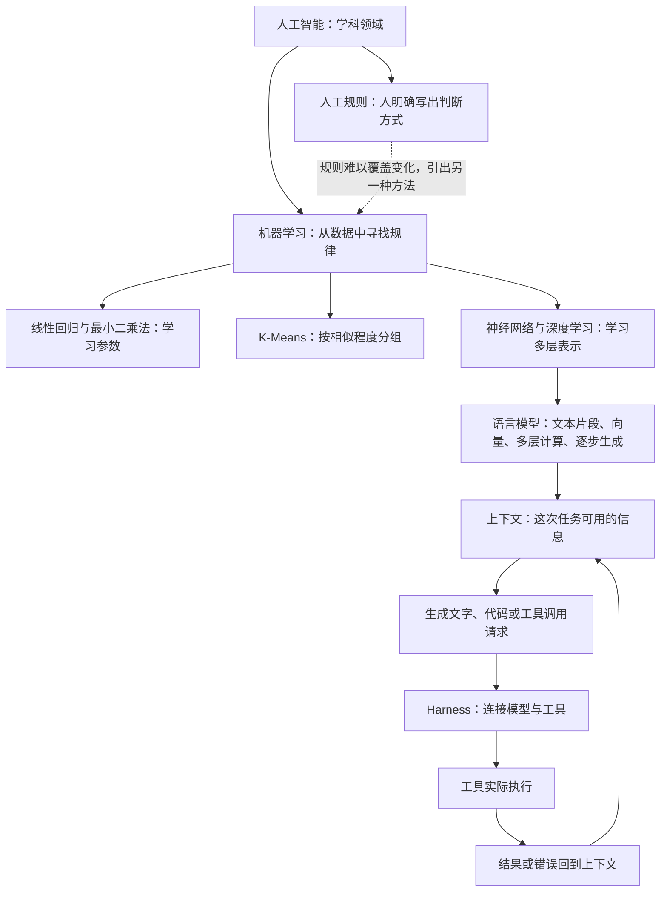

# 第 4 章：AI 与 Agent 的工作方式

[返回第一课入口](../../README.md) · [查看第一课总纲](../../01_第一次课教学大纲.md)

中文讲义草稿，供教师逐节修改。大纲在本文件，各节正文分别维护；后续增加图示、演示或阅读材料时，就近链接到对应小节。

**近期讨论形成的更新方案：**[新版教学大纲：从数学建模认识 AI，再到 Agent](新版教学大纲_讨论稿.md)。该稿增加研究生已有数学与科研建模经验的衔接；下方仍是现有正文目录，尚未全部按新方案重排。

**50 分钟授课版本：**[必要内容大纲与课堂安排](50分钟必要内容大纲.md)，包含三项学习目标、分段时间、理解检查及超时取舍。

## 本章要建立的理解

人工智能是一个学科领域，机器学习是其中的重要方向。机器学习可以从数据中确定参数，深度神经网络进一步学习多层表示。语言模型把文本转换成数值表示，通过计算逐步生成文本；Harness 将模型与工具连接起来，支持围绕任务持续行动。

不要求记住算法名字、推导训练公式或自己训练模型。课堂重点是辨认每一步的输入、输出，以及人和程序分别承担什么工作。

## 分节大纲与正文

| 顺序 | 分节讲义 | 核心问题 | 例子与课堂动作 |
| --- | --- | --- | --- |
| 1 | [认识人工智能：从专家规则到数据学习](01_人工智能与人工规则.md) | AI 是什么学科？规则、学习与神经网络分别怎样解决问题？ | DENDRAL 与价态约束；引入溶解度，检查数据和输入信息 |
| 2 | [机器学习与最小二乘法](02_机器学习与最小二乘法.md) | 模型、参数、误差、训练分别是什么？ | 三个虚构数据点；[交互动画](../../演示/最小二乘/index.html)比较手动调整、梯度下降和直接求解 |
| 3 | [K-Means 与从数据中分组](03_KMeans与从数据中分组.md) | 没有标准答案，也能从数据中找结构吗？ | [分步聚类动画](../../演示/KMeans/index.html)；对照不同初值、组数与输入描述 |
| 4 | [从分子描述符到深度神经网络](04_从手工特征到深度神经网络.md) | 谁来决定看什么特征？深度学习的进展来自哪里？ | ESOL 多元回归、非线性计算、[分子连接演示](../../演示/分子表示/index.html)与 Uni-Mol |
| 5 | [从文本向量到语言模型](05_从文本向量到语言模型.md) | 文字怎样参与计算，又怎样生成新文字？ | 编码与 token、嵌入、上下文、概率及[WSL 小模型演示](../../演示/本地语言模型/README.md) |
| 6 | [上下文与常见模型](06_上下文与常见模型.md) | 模型这次到底看到了什么？ | 聊天／续写、模板／系统提示词、[历史与文件实测](../../演示/本地语言模型/上下文实测.json)、窗口与模型层次 |
| 7 | [从模型输出到真实操作：最小 Harness](07_文本命令与Agent_Harness.md) | 谁把模型输出接到真实操作上？ | [本地小模型真实工具循环](../../演示/最小Harness/README.md)：读取、计算、保存与检查 |
| 8 | [工具调用与执行演示](08_工具调用与执行演示.md) | 代码、带参数请求和原生调用消息有什么区别？ | [真实参数调用](../../演示/最小Harness/tools_with_args.py)、负半径与不执行对照；Notebook 选用 |

## 讲解关系图

图中的分支表示本章讨论的关系，不是完整分类。生成式模型不限于语言模型，神经网络也不限于语言任务。

## 课堂取舍

八节完整展开约需 100—135 分钟，属于备课材料总量。第一课建议精选约 40—50 分钟，包含提问和工具演示，不要求逐页讲完。若本课时间不足，K-Means 的手算、神经网络公式和模型名称表可以作为选读；保留人工规则、拟合、表示学习、语言生成和工具执行这条主线。这里是备课时间建议，不要求额外增加学生任务。

前六节讲模型能力从何而来，后两节讲能力如何连接实际操作。分子水溶解度将作为前半章的贯穿案例，从化学经验接到最小二乘、多元线性回归与 ESOL，再讨论学习分子表示。K-Means、SVM 与 PCA 将作为方法演示补充，后接 Uni-Mol 等工作。当前已按此主线更新第 1—8 节；SVM、PCA 的短演示仍待单独补充，目录顺序也可在后续调整；进入语言模型后再切换到文本例子。

## 讲解时需要守住的边界

- 人工规则与机器学习可以结合使用，不是前者必然落后。
- 传统机器学习也会自动求参数；深度学习的区别不能只说成“自动调参”。
- 神经网络包括大量矩阵运算，也需要非线性变换等操作。
- 文本的文件编码与模型中的向量表示不同。
- 普通对话中的上下文不等于现场更新权重；生成流畅不等于事实准确。
- “LLM + Harness → Agent”是课堂简写，要结合目标、工具与反馈循环理解。
- Notebook 的请求由教师预写，没有真实模型调用；文件实践中再观察真实 Agent。

## 资料使用方式

正文中的外部阅读用于复用已有解释和图示，按需查看，不要求通读或完成来源课程的全部练习。本章为自行编写的教学串讲，没有复制或重新分发来源课件；第三方图文仍以原站作者和许可为准。涉及产品的模型表沿用原资料核对日期，实际配置时另查官方说明。
