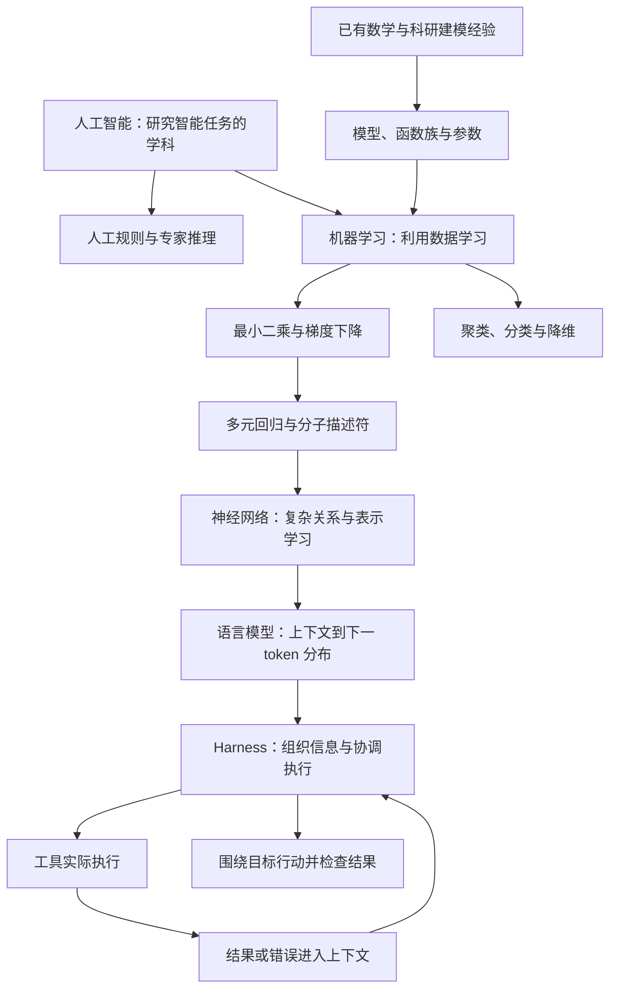

# 第 4 章新版教学大纲：从数学建模认识 AI，再到 Agent

[返回本章入口](README.md)

本稿整理近期讨论，供教师审阅与手动修改。它是拟议的教学组织方案，不表示各节正文已经全部按此改写。现有八节讲义与演示继续作为素材库，后续逐节迭代。

## 一、面向谁，建立什么理解

面向材料、化学、化工研究生：假定学过高等数学和线性代数，可以使用函数、向量、矩阵、偏导数和链式法则；不假定了解编程、机器学习或计算机术语。数学用于连接已有知识，不以推导和记忆术语为目标。

本章主线：人工智能是一门学科；其中许多任务可以从输入到输出的映射理解。机器学习利用数据确定映射，深度学习进一步把中间表示的构建纳入学习。语言模型将这种计算用于文本生成，Harness 再把模型输出连接到工具、执行与反馈。

希望学生能回答：任务的输入和输出是什么？哪些知识由人提供，哪些关系从数据中获得？模型怎样训练、怎样使用？结果由谁执行，又怎样检查？

## 二、分节安排

### 第 1 节：人工智能是什么——从大众印象到学科定义

**核心问题：**能聊天才算 AI 吗？人工智能与普通程序是什么关系？

- 开场投票：计算器、下棋程序、分子结构专家系统、ChatGPT，哪些算 AI？请说明依据，不把投票当作唯一标准答案。
- 区分大众常见印象与学科定义：表现得像人，不等于采用人的工作方式，也不意味着具有意识。
- 采用权威定义的教学改写：人工智能研究执行通常与人类智能相关功能的模型和系统，例如推理与学习。区分学科、方法、具体系统。
- AI 系统也由程序实现；“能在计算机上运行”“接收输入并产生输出”不足以单独区分 AI 与其他程序。
- 与网络、数据库比较研究目标，而不将它们划为互斥的软件类别。
- 介绍专家系统：人提供知识和规则，程序组织推理。用图形找规律作为规则体验，再以 DENDRAL 连接化学背景；不把所有专家系统简化为固定阈值判断。

**课堂动作：**让学生为一道图形题写出一条明确规则，再检查它能否解释所有已知图形。

**复用：**[现有第 1 节](01_人工智能与人工规则.md)、[图形推理课堂题](课堂演示_图形找规律.md)。

### 第 2 节：模型是什么——把 AI 接回数学与科研建模

**核心问题：**物理模型、化学模型与机器学习模型，有什么共同语言？

- 模型是一套描述变量关系的数学表达；有的直接给出函数，有的需要求解方程、给定初始条件或边界条件。
- 用 Arrhenius 方程连接已有知识：

$$k(T)=A\exp\left(-\frac{E_a}{RT}\right),\qquad
\ln k=\ln A-\frac{E_a}{R}\frac1T.$$

- 明确输入、输出、参数及适用条件：温度为输入，速率常数为输出，指前因子和活化能可由实验拟合。
- 统一记号：$\hat y=f_\theta(x)$。人选择函数族 $\mathcal F=\{f_\theta\}$，数据帮助确定具体函数 $f_{\theta^\ast}$。
- 物理模型与机器学习可以共享参数拟合等数学工具，但知识来源和约束不同；物理模型不直接等于专家系统。
- 把回归、分类、生成都放入映射视角：输出可以是数值、类别概率、序列或分布。说明这个视角覆盖本章许多任务，但不是 AI 的独有定义。

**课堂动作：**在 Arrhenius 方程上标出人选择的关系和需要由实验确定的量；讨论已有关系成立时，是否有必要换成复杂网络。

**复用与新增：**复用[现有第 2 节的模型与参数解释](02_机器学习与最小二乘法.md)；Arrhenius 桥接段落待补入正文。已有最小二乘演示仍使用虚构标定数据，不直接改称动力学实验。

### 第 3 节：机器学习——从数据中确定具体关系

**核心问题：**“学习”究竟改变了什么？

- 机器学习从数据中学习规律，并用于新情况。以分子信息、实验溶解度、未见分子的预测解释数据、学习、使用。
- 人工规则直接指定判断办法；机器学习由人设计学习方式，再从数据中确定参数或判断结构。两者最终都可能表现为简单规则。
- 从 $\hat y=ax+b$ 开始：残差、损失函数、最小二乘、训练和使用。
- 梯度是损失对参数的偏导数组成的向量；梯度下降沿负梯度方向更新参数，学习率是步长系数。
- 对照直接求解与迭代求解：不同求解方法可以服务于同一个目标。
- 训练误差小不保证新样本可靠：介绍泛化、独立检验与外推。

**课堂动作：**手动调整直线，比较残差平方和，再播放真实梯度下降；让学生说明变化的是参数还是数据。

**复用：**[现有第 2 节](02_机器学习与最小二乘法.md)、[最小二乘交互演示](../../演示/最小二乘/README.md)。

### 第 4 节：不止拟合直线——不同任务与输入描述

**核心问题：**机器学习能做什么？怎样把科研对象交给模型？

- K-Means：根据提供的特征与距离分组，没有提前给定每个样品的类别答案。观察组数、初值和尺度的影响。
- SVM：作为分类方法的选讲，借助二维图理解分界与间隔，不展开优化推导。
- PCA：作为降维方法的选讲，理解把多维数据投影到少数方向；它不是分类方法。
- 回到溶解度：从一个输入扩展到多个分子描述符，用 ESOL 解释多元线性回归。
- 输入描述决定模型能使用哪些信息；模型只能利用输入中保留的差异，相关关系也不自动成为因果解释。

**课堂动作：**改变 K-Means 初值；辨认 ESOL 的输入、参数和输出。比较“增加一种输入信息”与“更换模型”的区别。

**复用：**[现有第 3 节](03_KMeans与从数据中分组.md)、[K-Means 演示](../../演示/KMeans/README.md)、[现有第 4 节中的 ESOL](04_从手工特征到深度神经网络.md)。SVM、PCA 短演示尚待准备，不作为已经完成的材料。

### 第 5 节：神经网络——学习复杂关系，也学习中间表示

**核心问题：**传统方法与深度学习的共同点和进步分别在哪里？

- 两者都由人选择候选函数族，再通过数据确定具体函数。不能把“学习参数”作为神经网络独有的特点。
- 传统方法通常依赖人工设计的特征；深度学习可以将中间特征与预测关系一起学习，但仍需要选择输入、结构、目标和训练方法。
- 展示两层网络：

$$\hat y=W_2\sigma(W_1x+b_1)+b_2.$$

- 对应线性代数：矩阵乘法、偏置、维度；解释非线性变换为什么重要，多层纯线性变换仍可合成线性变换。
- 对应微积分：反向传播利用链式法则计算梯度，优化器利用梯度更新参数。
- 用分子连接和 Uni-Mol 说明表示学习；并非“不需要输入特征”，而是部分特征由模型从给定表示中学习。
- 理论表达能力、实际可训练性、数据量与泛化是不同问题。更复杂不自动意味着更适用。

**课堂动作：**沿一个小网络标出输入、中间表示和输出；说明哪些量由人选择，哪些量在训练中更新。

**复用：**[现有第 4 节](04_从手工特征到深度神经网络.md)、[分子表示演示](../../演示/分子表示/README.md)。

### 第 6 节：语言模型——文字怎样变成可计算的对象

**核心问题：**从函数和矩阵运算，怎样走到生成语言？

- 文本编码、token 切分、编号、嵌入查表是不同步骤，逐个解释。
- 嵌入表也是可训练参数；训练后查表得到初始向量，后续网络形成依赖上下文的表示。
- 用本地模型的实际尺寸建立数量感：词表 151,936 项，每项初始向量 1,024 维；向量维度不是概率类别数。
- 展示首都、亲属称谓、比较级等真实向量案例；短表只展示部分维度，计算使用全部维度。不展示运算前排名，也不把近似关系讲成严格等式。
- 模型将上下文映射为下一个 token 的概率分布，采样后继续生成。生成不是在词表中一次找到完整答案。
- 区分训练和推理、聊天和续写、初始词向量和用于语义检索的文本向量。

**课堂动作：**观察一句中文的切分；运行一次续写，检查候选 token 与生成结果。

**复用：**[现有第 5 节](05_从文本向量到语言模型.md)、[词向量案例与完整数据](../../演示/词向量/课堂候选案例.md)、[本地小模型演示](../../演示/本地语言模型/README.md)。

### 第 7 节：上下文与 Harness——模型如何接触任务信息

**核心问题：**模型看到了什么？谁维护历史、读取文件、执行操作？

- 上下文是本次调用提供的信息，不等于现场训练或更改模型参数。
- 对照提供记录、移除历史、只给文件名、实际读取文件四种情况。
- Harness 是围绕模型组织任务的程序层：构造输入、管理上下文、协调工具、收集结果，并决定是否继续。
- 对话历史、工具执行状态、日志、长期记忆分别说明；最小演示没有实现长期记忆或历史压缩。
- 承接前面命令行内容：文本可以表达操作，但必须由相应程序解析和执行。

**课堂动作：**先只给文件名，再让程序读取文件并把内容提供给模型，比较实际输出。

**复用：**[现有第 6 节](06_上下文与常见模型.md)、[现有第 7 节](07_文本命令与Agent_Harness.md)。常见模型清单作为更新性较强的参考，不占主线讲解时间。

### 第 8 节：从调用请求到真实执行——理解 Agent

**核心问题：**模型说“完成了”，是否真的完成？

- 贯穿实际流程：用户目标 → 模型生成请求 → Harness 解析与检查 → 工具执行 → 结果进入上下文 → 继续或结束。
- 展示自定义 JSON 请求与参数，区分普通文字、代码块、约定格式和原生工具调用消息。
- 用读取半径、计算面积、保存报告的小任务观察完整循环；用负半径、不执行等对照检查边界。
- “LLM + Harness → Agent”作为教学简写，结合目标、工具和反馈理解，不暗示任何包装了模型的软件都具有自主规划能力。
- 检查真实文件和数值，不以模型的完成声明代替验证。

**课堂动作：**查看一次调用请求、工具返回结果和实际保存的报告，分别指出谁生成、谁执行、谁检查。

**复用：**[现有第 7 节](07_文本命令与Agent_Harness.md)、[现有第 8 节](08_工具调用与执行演示.md)、[最小 Harness 与真实参数调用](../../演示/最小Harness/README.md)。保留失败案例，不将受引导流程说成通用规划能力的证明。

## 三、统一数学语言

| 课堂术语 | 数学对应或具体含义 |
| --- | --- |
| 模型与函数族 | 人选择允许哪些计算关系，训练确定其中的具体关系 |
| 参数 | 待确定的系数、矩阵元素、偏置等 |
| 训练 | 依据数据和目标求解参数或其他模型结构的过程 |
| 损失函数 | 衡量预测与目标差异的目标函数；不同任务可以采用不同目标 |
| 梯度 | 目标函数对参数的偏导数组成的向量 |
| 反向传播 | 利用链式法则高效计算梯度 |
| 梯度下降 | 利用负梯度方向迭代更新参数 |
| 正则化（选讲） | 对参数或函数复杂程度增加约束或惩罚 |
| 泛化 | 对未参与训练的数据仍然有效，不等于训练拟合得好 |
| 表示学习 | 在学习过程中形成用于后续任务的中间特征 |

## 四、讲解关系图

图表示教学衔接，不是完整学科分类；传统机器学习与神经网络并非互斥类别。

## 五、第一节正式课怎样取舍

这是备课大纲，不要求八部分全部讲完。若本章在第一节正式课只有约 45—50 分钟，可按以下顺序选讲：

| 内容 | 建议分钟 |
| --- | --- |
| AI 定义、规则与开场提问 | 5 |
| Arrhenius 桥接、函数族与模型 | 6 |
| 最小二乘、训练与新数据检验 | 8 |
| ESOL、输入表示与神经网络 | 9 |
| token、嵌入与逐步生成 | 8 |
| 上下文、Harness 与真实工具演示 | 12 |

合计约 48 分钟，包含简短互动。K-Means、SVM、PCA、完整反向传播推导、词向量逐项运算作为选讲或后续阅读。具体时长应以课堂试讲为准；不据此新增学生作业。

## 六、定义来源与后续修订

- [ITU 术语文件，引用 ISO/IEC 2382 的 AI 定义](https://www.itu.int/epublications/publication/itu-t-y-suppl-97-2025-11-glossary-of-terms-and-definitions-for-machine-learning)：用于学科层面的定义。
- [ISO/IEC 23053 官方正文](https://www.iso.org/obp/ui?_escaped_fragment_=iso%3Astd%3Aiso-iec%3A23053%3Aed-1%3Av1%3Aen)：引用 ISO/IEC 22989 的 AI 系统定义。
- [OECD 更新定义的说明文件](https://www.oecd.org/content/dam/oecd/en/publications/reports/2024/03/explanatory-memorandum-on-the-updated-oecd-definition-of-an-ai-system_3c815e51/623da898-en.pdf)：用于解释输入、推断、输出以及系统自主性等概念。

以上中文表述为教学转述，不冒充标准的官方中文译文。没有全球唯一的 AI 定义；函数映射是本课采用的数学视角，也适用于许多非 AI 程序。

下一步优先调整现有第 1、2、4 节：补入学科定义、科研建模桥梁和函数族视角，再据此统一后续术语。正式拆分或重排正文文件时，再同步修改章节目录，避免把本讨论稿当作已经完成的正文。
