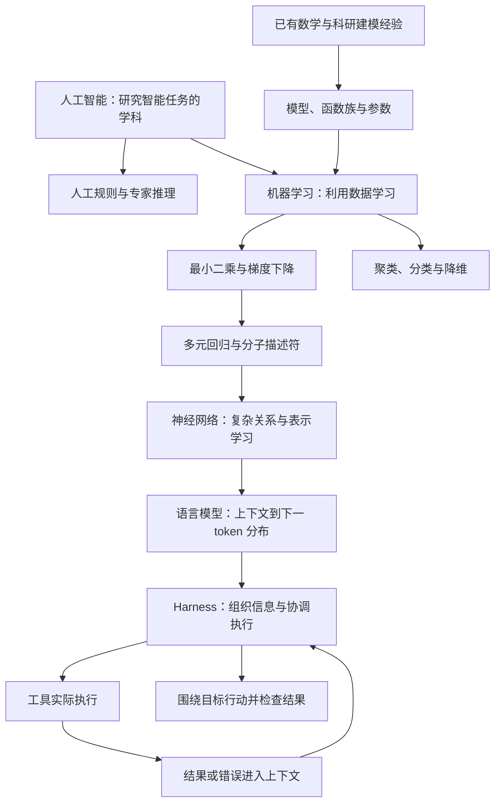

# 第 4 章新版教学大纲：从数学建模认识 AI，再到 Agent

[返回本章入口](../04_AI与Agent的工作方式.md)

本大纲按数学建模、机器学习、语言模型和 Agent 的顺序组织第 4 章内容。

## 一、面向谁，建立什么理解

面向材料、化学、化工研究生：假定学过高等数学和线性代数，可以使用函数、向量、矩阵、偏导数和链式法则；编程、机器学习与计算机术语从入门讲起。数学用于连接已有知识，课堂重点是用概念解释实际任务。

本章主线：人工智能是一门学科；其中许多任务可以从输入到输出的映射理解。机器学习利用数据确定映射，深度学习进一步把中间表示的构建纳入学习。语言模型将这种计算用于文本生成，Harness 再把模型输出连接到工具、执行与反馈。

学习目标是识别任务的输入与输出，区分人工设计与数据学习，并核对工具执行结果。

## 二、分节安排

### 第 1 节：人工智能的学科定义与专家系统

**主要内容：**人工智能研究推理、学习等任务；专家系统用领域规则进行推理。

- 比较计算器、下棋程序、分子结构专家系统和聊天工具的任务与实现方式。
- 区分大众常见印象与学科定义：表现、工作机制与意识属于三个层次；课堂围绕可观察的输入、推断和输出分析。
- 采用权威定义的教学改写：人工智能研究执行通常与人类智能相关功能的模型和系统，例如推理与学习。区分学科、方法、具体系统。
- AI 系统也由程序实现；区分 AI 与其他程序时，还要考察其研究目标、推断方式和任务能力。
- 与网络、数据库比较研究目标，并允许同一系统同时使用网络、数据库和 AI 方法。
- 介绍专家系统：人提供知识和规则，程序组织推理。用图形找规律作为规则体验，再以 DENDRAL 连接化学背景；专家系统还可组合规则、知识表示与推理过程。

**演示：**用一条明确规则解释图形变化，并用已知图形检验规则。

**材料：**[人工智能与人工规则](01_人工智能与人工规则.md)、[图形规律演示](课堂演示_图形找规律.md)。

### 第 2 节：模型、函数族与科研建模

**主要内容：**模型形式、输入、输出与参数拟合。

- 模型是一套描述变量关系的数学表达；有的直接给出函数，有的需要求解方程、给定初始条件或边界条件。
- 用 Arrhenius 方程连接已有知识：

$$k(T)=A\exp\left(-\frac{E_a}{RT}\right),\qquad
\ln k=\ln A-\frac{E_a}{R}\frac1T.$$

- 明确输入、输出、参数及适用条件：温度为输入，速率常数为输出，指前因子和活化能可由实验拟合。
- 统一记号：$\hat y=f_\theta(x)$。人选择函数族 $\mathcal F=\{f_\theta\}$，数据帮助确定具体函数 $f_{\theta^\ast}$。
- 物理模型依据机理与约束，专家系统依据领域规则，机器学习利用数据拟合参数；这些方法都可以使用数学工具。
- 把回归、分类、生成都放入映射视角：输出可以是数值、类别概率、序列或分布。这个视角覆盖本章许多任务，也适用于其他计算任务。

**演示：**在 Arrhenius 方程中标出模型形式和实验拟合参数。

**材料：**[机器学习与最小二乘法](02_机器学习与最小二乘法.md)、虚构标定数据。Arrhenius 方程用于说明模型形式与参数拟合。

### 第 3 节：机器学习与参数拟合

**主要内容：**数据、参数、损失、训练与检验。

- 机器学习从数据中学习规律，并用于新情况。以分子信息、实验溶解度、新分子的预测解释数据、学习、使用。
- 人工规则直接指定判断办法；机器学习由人设计学习方式，再从数据中确定参数或判断结构。两者最终都可能表现为简单规则。
- 从 $\hat y=ax+b$ 开始：残差、损失函数、最小二乘、训练和使用。
- 梯度是损失对参数的偏导数组成的向量；梯度下降沿负梯度方向更新参数，学习率是步长系数。
- 对照直接求解与迭代求解：不同求解方法可以服务于同一个目标。
- 训练误差小之后，还要检验新样本表现：介绍泛化、独立检验与外推。

**演示：**调整直线参数，比较残差平方和，再播放梯度下降动画。

**材料：**[机器学习与最小二乘法](02_机器学习与最小二乘法.md)、[最小二乘交互演示](../../演示/最小二乘/README.md)。

### 第 4 节：从拟合直线扩展到其他任务与输入描述

**主要内容：**聚类、分类、降维与分子描述符。

- K-Means：根据提供的特征与距离分组，根据样品特征分组，组别由算法形成。观察组数、初值和尺度的影响。
- SVM：作为分类方法的选讲，借助二维图理解分界与间隔，优化推导留作选读。
- PCA：作为降维方法的选讲，理解把多维数据投影到少数方向；它侧重数据的方向与维度。
- 回到溶解度：从一个输入扩展到多个分子描述符，用 ESOL 解释多元线性回归。
- 输入描述决定模型能使用哪些信息；模型只能利用输入中保留的差异，因果解释需要结合实验设计和领域证据。

**演示：**改变 K-Means 初值，辨认 ESOL 的输入、参数和输出。

**材料：**[K-Means 讲义](03_KMeans与从数据中分组.md)、[交互演示](../../演示/KMeans/README.md)、[ESOL 案例](04_从手工特征到深度神经网络.md)。

### 第 5 节：神经网络——学习复杂关系，也学习中间表示

**主要内容：**非线性计算、参数训练和表示学习。

- 两者都由人选择候选函数族，再通过数据确定具体函数。“学习参数”是多种机器学习方法共有的步骤。
- 传统方法通常使用人工设计的特征；深度学习可以同时学习中间特征与预测关系。两者都需要选择输入、结构和目标。
- 展示两层网络：

$$\hat y=W_2\sigma(W_1x+b_1)+b_2.$$

- 对应线性代数：矩阵乘法、偏置、维度；解释非线性变换为什么重要，多层纯线性变换仍可合成线性变换。
- 对应微积分：反向传播利用链式法则计算梯度，优化器利用梯度更新参数。
- 用分子连接和 Uni-Mol 说明表示学习；模型从给定输入表示中学习部分中间特征。
- 理论表达能力、实际可训练性、数据量与泛化是不同问题。适用性还取决于数据、训练和检验。

**演示：**沿小型网络标出输入、中间表示、输出和训练参数。

**材料：**[分子描述符与神经网络](04_从手工特征到深度神经网络.md)、[分子表示演示](../../演示/分子表示/README.md)。

### 第 6 节：语言模型的文本表示与生成

**主要内容：**token、嵌入向量、上下文和逐步生成。

- 文本编码、token 切分、编号、嵌入查表是不同步骤，逐个解释。
- 嵌入表也是可训练参数；训练后查表得到初始向量，后续网络形成依赖上下文的表示。
- 用本地模型的实际尺寸建立数量感：词表 151,936 项，每项初始向量 1,024 维；向量维度描述表示的长度，概率类别数对应输出候选。
- 展示首都、亲属称谓、比较级等真实向量案例；短表只展示部分维度，计算使用全部维度。课堂展示运算后的近邻，并把向量关系描述为近似规律。
- 模型将上下文映射为下一个 token 的概率分布，采样后继续生成。生成过程逐步选择下一片段，形成完整输出。
- 区分训练和推理、聊天和续写、初始词向量和用于语义检索的文本向量。

**演示：**观察中文分词、候选 token 和续写结果。

**材料：**[语言模型讲义](05_从文本向量到语言模型.md)、[词向量案例](../../演示/词向量/课堂候选案例.md)、[本地小模型演示](../../演示/本地语言模型/README.md)。

### 第 7 节：上下文与 Harness

**主要内容：**历史消息、文件读取、上下文组织和工具协调。

- 上下文是本次调用提供的信息；模型参数通过训练流程更新。
- 对照提供记录、移除历史、只给文件名、实际读取文件四种情况。
- Harness 是围绕模型组织任务的程序层：构造输入、管理上下文、协调工具、收集结果，并决定是否继续。
- 对话历史、工具执行状态、日志、长期记忆分别说明；最小演示逐轮保留消息；长期记忆与历史压缩属于扩展方案。
- 文本表达操作要求，相应程序负责解析和执行。

**演示：**比较只提供文件名和实际读取文件正文后的模型输出。

**材料：**[上下文讲义](06_上下文与常见模型.md)、[Harness 讲义](07_文本命令与Agent_Harness.md)。

### 第 8 节：从调用请求到真实执行——理解 Agent

**主要内容：**调用请求、工具执行、结果反馈和文件核验。

- 贯穿实际流程：用户目标 → 模型生成请求 → Harness 解析与检查 → 工具执行 → 结果进入上下文 → 继续或结束。
- 展示自定义 JSON 请求与参数，区分普通文字、代码块、约定格式和原生工具调用消息。
- 用读取半径、计算面积、保存报告的小任务观察完整循环；用负半径拒绝和仅生成请求等案例检查边界。
- “LLM + Harness → Agent”作为教学简写，结合目标、工具和反馈理解，规划能力需要结合具体任务与实测行为评价。
- 检查真实文件和数值，以真实文件和数值验证完成情况。

**演示：**查看调用请求、工具结果和保存的报告。

**材料：**[Harness 讲义](07_文本命令与Agent_Harness.md)、[工具调用讲义](08_工具调用与执行演示.md)、[最小 Harness 演示](../../演示/最小Harness/README.md)。

## 三、统一数学语言

| 课堂术语 | 数学对应或具体含义 |
| --- | --- |
| 模型与函数族 | 人选择允许哪些计算关系，训练确定其中的具体关系 |
| 参数 | 待确定的系数、矩阵元素、偏置等 |
| 训练 | 依据数据和目标求解参数或其他模型结构的过程 |
| 损失函数 | 衡量预测与目标差异的目标函数；不同任务可以采用不同目标 |
| 梯度 | 目标函数对参数的偏导数组成的向量 |
| 反向传播 | 利用链式法则高效计算梯度 |
| 梯度下降 | 利用负梯度方向迭代更新参数 |
| 正则化（选讲） | 对参数或函数复杂程度增加约束或惩罚 |
| 泛化 | 对独立测试数据仍然有效，需结合训练表现和测试表现判断 |
| 表示学习 | 在学习过程中形成用于后续任务的中间特征 |

## 四、讲解关系图

图表示本章的教学衔接；神经网络属于机器学习方法之一。

## 五、第一次正式课的授课安排

这是备课大纲，课堂按时间选择其中的核心段落。若本章在第一节正式课只有约 45—50 分钟，可按以下顺序选讲：

| 内容 | 建议分钟 |
| --- | --- |
| AI 定义与专家规则 | 5 |
| Arrhenius 桥接、函数族与模型 | 6 |
| 最小二乘、训练与新数据检验 | 8 |
| ESOL、输入表示与神经网络 | 9 |
| token、嵌入与逐步生成 | 8 |
| 上下文、Harness 与真实工具演示 | 12 |

合计约 48 分钟，包含简短互动。K-Means、SVM、PCA、完整反向传播推导、词向量逐项运算作为选讲或后续阅读。具体时长应以课堂试讲为准；学生任务沿用现有课堂安排。

## 六、定义来源与后续修订

- [ITU 术语文件，引用 ISO/IEC 2382 的 AI 定义](https://www.itu.int/epublications/publication/itu-t-y-suppl-97-2025-11-glossary-of-terms-and-definitions-for-machine-learning)：用于学科层面的定义。
- [ISO/IEC 23053 官方正文](https://www.iso.org/obp/ui?_escaped_fragment_=iso%3Astd%3Aiso-iec%3A23053%3Aed-1%3Av1%3Aen)：引用 ISO/IEC 22989 的 AI 系统定义。
- [OECD 更新定义的说明文件](https://www.oecd.org/content/dam/oecd/en/publications/reports/2024/03/explanatory-memorandum-on-the-updated-oecd-definition-of-an-ai-system_3c815e51/623da898-en.pdf)：用于解释输入、推断、输出以及系统自主性等概念。

以上中文表述为教学转述，官方标准请查看所引原文。AI 的定义随标准与研究视角有所侧重；函数映射是本课采用的数学视角，也适用于其他程序。
