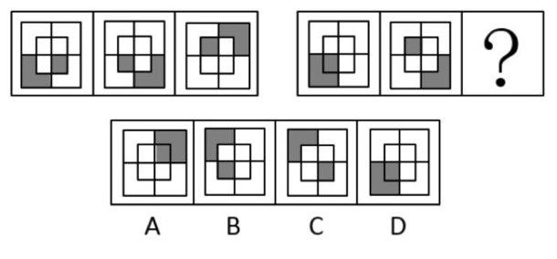
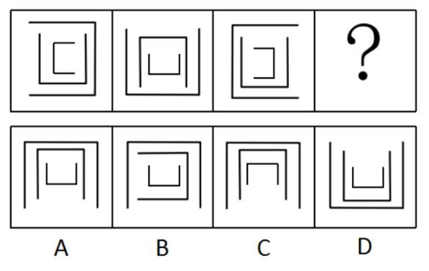
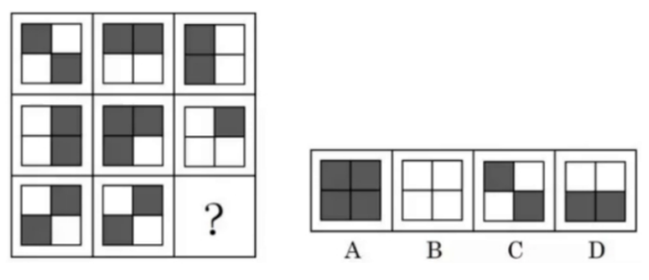

# 课堂演示：图形找规律

[返回第一节](01_人工智能与人工规则.md) · [返回本章目录](README.md)

来源：[粉笔《图形推理之位置、样式、复合》](https://hera-webapp.fenbi.com/api/article/detail?deviceType=1&id=429794889856001)。这些是公考备考资料中的例题，未核实具体考试年份。题图原样保留，答案按来源解析并对照题图检查；以下讲解为课程改写。详见[来源说明](素材/粉笔图形推理/来源说明.md)。

建议课堂只选第 1 题，用时 2—3 分钟。其余作为备选，不需要学生提前练习。

## 题 1：两个元素分别怎样移动？

观察左边一组三幅图的变化，再为右边一组选出缺失图形。

先让学生选择 A、B、C、D，再要求用两句话说清规律。

展开答案与讲解

**答案：A。**

将内侧黑色小方块与外侧灰色 L 形分开观察：

- 内侧方块沿内圈四个位置，每次顺时针移动一格。
- 外侧 L 形沿外圈四个转角，每次逆时针移动一格。

左侧的三幅图用于检验这两条规律；将同样规律用于右侧，内侧方块应回到右下，外侧 L 形应移到右上，只有 A 同时满足。

题图中的重叠容易干扰观察，可以用手指分别追踪两个元素。

## 题 2：不同层可以采用不同旋转规则

从四个选项中选出下一幅图。

展开答案与讲解

**答案：C。**

分别观察各层的开口方向：外层每次顺时针转 90°；内层每次逆时针转 90°。下一幅图外层与内层开口均应朝下。外层条件排除 D，内层条件在 A、B、C 中选出 C。中层也可作为进一步核对。

这题用来说明：一个候选答案需要同时满足多条约束，不能只符合其中一条。

## 题 3：黑白也可以按规则运算

九宫格每一行，前两幅图按相同规则得到第三幅图。问号处应选什么？

展开答案与讲解

**答案：A。**

逐个对应小格比较：两幅图中颜色相同，结果为黑；颜色不同，结果为白。前两行都符合。

第三行前两幅图完全相同，因此四个位置都得到黑色，对应 A。

如果把黑、白分别记成 1、0，这可以写成一个四行的规则表。但本题只需直接看颜色，不要求学生先理解图像编码。

## 怎样接到专家系统？

先问学生：“刚才用了哪些知识？”例如知道顺逆时针、旋转角度、内外圈，以及怎样逐项比较。

假设我们事先为程序提供平移、旋转、同异比较等候选规则，并且已经把题图描述成元素位置、开口方向等信息，程序就可以检验哪些规则符合已知图，再推导候选答案。

这里展示的是**已有规则、任务事实与检验推理的配合**，不是说专家系统必然能自己看懂任意题图。让程序从图片中提取这些信息，是另一个需要解决的问题；课堂由人观察并提供描述即可。

这也不是一套完整专家系统的实现。接着回到 DENDRAL：把图形题的规则换成领域知识，推理系统就可以用于更专业的任务。

最后提醒：有限例子可能符合不止一种规则。课堂采用与题目选项、整体结构一致的解释，不把它当作对唯一自然规律的证明。
