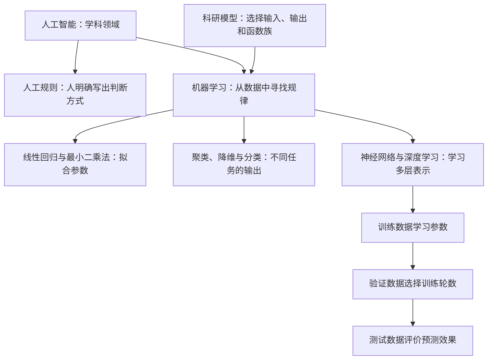

# 1.4 人工智能与机器学习

[返回第一课入口](../README.md)

本章范围为 1.4.1—1.4.4，从人工规则和科研模型出发，介绍最小二乘、聚类、降维、分类与神经网络拟合。

## 章节内容

| 编号 | 分节讲义 | 主要内容 | 示例 |
| --- | --- | --- | --- |
| 1.4.1 | [1.4.1 认识人工智能：从专家规则到机器学习与深度学习](1.4_AI与Agent的工作方式/1.4.1_人工智能与人工规则.md) | AI、专家系统、机器学习、最小二乘与深度学习的概念关系 | DENDRAL 与价态约束；溶解度预测中的数据和输入信息 |
| 1.4.2 | [1.4.2 模型、机器学习与最小二乘法](1.4_AI与Agent的工作方式/1.4.2_机器学习与最小二乘法.md) | 预测能力、建模方法对应、函数族与参数拟合 | [Arrhenius 拟合](../演示/Arrhenius拟合/README.md)；[最小二乘交互动画](../演示/最小二乘/index.html) |
| 1.4.3 | [1.4.3 分组、降维与分类](1.4_AI与Agent的工作方式/1.4.3_聚类降维与分类.md) | K-Means、PCA 与 SVM 的输出 | [真实化学测量数据动画](../演示/机器学习方法/index.html)展示 178 个样品 |
| 1.4.4 | [1.4.4 从分子描述符到深度神经网络](1.4_AI与Agent的工作方式/1.4.4_从手工特征到深度神经网络.md) | 特征、非线性计算与表示学习 | ESOL 多元回归、49 参数的 4→8→1 溶解度网络与固定 21 个化合物测试 |

## 概念关系

本课到此结束。原语言模型、上下文、Harness 与工具调用讲义见[后续内容归档](../归档/后续内容/README.md)。
