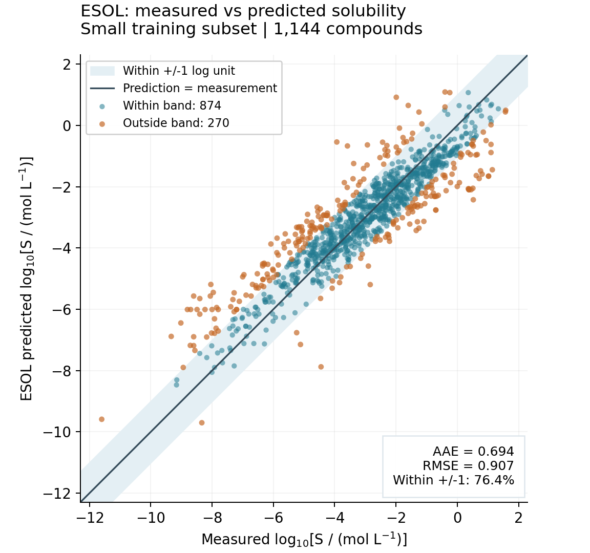
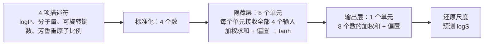

# 1.4.4 从分子描述符到深度神经网络

[返回本章大纲（1.4）](../1.4_AI与Agent的工作方式.md) · [上一节：1.4.3 聚类、降维与分类](1.4.3_聚类降维与分类.md)

本节以水溶解度预测为例，从四项分子描述符的线性回归，过渡到使用相同输入的神经网络，观察模型如何计算、训练和预测。

## 1.4.4.1 从一个输入到多个输入

1.4.2 节将 Arrhenius 方程线性化，用倒数温度预测速率常数的自然对数：

$$\hat y=ax+b$$

当性质受多种因素影响时，模型可以使用多个输入：

$$\hat y=w_1x_1+w_2x_2+\cdots+w_dx_d+b$$

> **多元线性回归（Multiple Linear Regression）**用多个输入特征的加权和预测一个连续数值。$x_1,\ldots,x_d$ 是同一样品的不同特征，$w_1,\ldots,w_d$ 是对应权重，$b$ 是截距，也称偏置。

本节用四项分子描述符预测一个数值：水溶解度的对数 logS。线性回归和神经网络都完成这一任务，使用相同的输入与实测目标。

## 1.4.4.2 ESOL 水溶解度模型

> **ESOL（Estimated Solubility，估算溶解度）**是根据分子结构预测水溶解度的模型。

Delaney 于 2004 年提出这一模型，使用以下四个整分子描述符：

> **cLogP（calculated logarithm of the partition coefficient，计算的分配系数对数）**衡量分子的亲脂性。
>
> **MW（Molecular Weight，分子量）**、**RB（Rotatable Bonds，可旋转键数）**和 **AP（Aromatic Proportion，芳香重原子比例）**是本节使用的分子描述符。

| 描述符 | 符号 | 含义 |
| --- | --- | --- |
| 计算的辛醇／水分配系数对数 | cLogP | 描述亲脂性，是由结构估算的一个指标 |
| 分子量 | MW | 描述分子大小，使用通常的分子量数值 |
| 可旋转键数量 | RB | 按既定规则统计结构中的可旋转键 |
| 芳香重原子比例 | AP | 芳香原子数除以非氢原子总数 |

预测目标为 $\log_{10}[S/(\mathrm{mol\,L^{-1}})]$。使用对数是为了处理跨越多个数量级的溶解度：相差 1 个对数单位，对应浓度相差 10 倍。

原论文的最终公式为：

$$\widehat{\log S}=0.16-0.63\,\mathrm{cLogP}-0.0062\,\mathrm{MW}
+0.066\,\mathrm{RB}-0.74\,\mathrm{AP}$$

它来自对 2,874 个中性化合物的测量数据进行回归；论文的目标条件为 25 ℃水溶解度。**人选择描述符与模型形式，数据确定系数。**这是多元线性拟合，简单公式也可以通过数据拟合参数，构成机器学习案例。[Delaney 原论文](https://doi.org/10.1021/ci034243x)

### 1.4.4.2.1 原模型的预测精度

溶解度是连续数值，预测精度可以用预测值与实测值之间的误差衡量。

> **AAE（Average Absolute Error，平均绝对误差）**是每个样品的预测误差取绝对值后再求平均。本节以 $\log_{10}S$ 为预测目标，误差单位为对数单位。

$$\mathrm{AAE}=\frac{1}{n}\sum_{i=1}^{n}\left|\widehat{\log S_i}-\log S_i\right|$$

### 1.4.4.2.2 直接查看原论文附带的预测数据

课程提供了[原始预测数据](../素材/04_AI与Agent的工作方式/ci034243x_si_001.txt)。文件以逗号分隔，共有 1,144 条记录，每条记录包含分子名称、实测 $\log S$、ESOL 预测 $\log S$ 和分子结构字符串。

> **SMILES（Simplified Molecular Input Line Entry System，简化分子线性输入规范）**用字符串表示分子的原子和连接关系，是原始文件中结构列的名称。

这份数据对应论文的 **“Small” 训练子集**。下面直接使用文件中的实测列和原模型预测列计算误差，展示模型在这一训练子集上的拟合效果。数据归属见[原论文的补充材料说明](https://pubs.acs.org/doi/abs/10.1021/ci034243x)。

> **RMSE（Root Mean Squared Error，均方根误差）**将预测误差平方后求平均，再开平方。平方运算使较大的误差对结果产生更大影响。

横轴是实测值，纵轴是预测值；每个点代表一个分子。对角线上的点表示预测与实测相等，线上方表示预测偏高，线下方表示预测偏低。浅色带对应误差在 ±1 个对数单位内的区域。

| 指标 | 从这份数据计算的结果 | 含义 |
| --- | ---: | --- |
| 样品数量 | 1,144 | 文件中的全部记录 |
| 平均绝对误差 AAE | 0.694 | 平均相差 0.694 个对数单位 |
| 均方根误差 RMSE | 0.907 | 对较大偏差更敏感的总体误差 |
| 绝对误差 ≤1 个对数单位 | 874 / 1,144，约 76.4% | 预测与实测浓度相差的倍率在 10 倍以内 |
| 绝对误差 >1 个对数单位 | 270 / 1,144，约 23.6% | 图中的橙色点 |

这里选择“误差在 ±1 个对数单位内”作为课堂观察的阈值。改变允许误差，达标样品的比例也会改变。

同一份文件中的两个分子可以进一步说明个体差异：

| 分子 | 实测 $\log S$ | ESOL 预测 $\log S$ | 绝对误差 |
| --- | ---: | ---: | ---: |
| 咖啡因（Caffeine） | −0.876 | −1.498 | 0.622 |
| 呋喃妥因（Nitrofurantoin） | −3.380 | −1.243 | 2.137 |

呋喃妥因的预测溶解度约为实测值的 $10^{2.137}\approx137$ 倍。整体误差描述数据集的平均表现，具体样品的偏差帮助判断预测值能否满足实验需求。图表和统计结果由[数据处理脚本](../素材/04_AI与Agent的工作方式/plot_esol.py)生成。

### 1.4.4.2.3 新样品上的预测表现

原论文还报告了三个验证集的结果：

| 验证数据 | 样品数量 | ESOL 的 AAE（对数单位） |
| --- | ---: | ---: |
| 企业内部盲测集 | 528 | 0.83 |
| 小型文献验证集 | 21 | 0.69 |
| 另一组文献数据 | 150 | 0.71 |

这些数值来自原论文的 Results 部分和表 4。盲测集用于检查模型对建模后另取样品的预测表现。[Delaney 原论文全文，第 1001、1003 页](https://www.moreisdifferent.com/assets/DIY_drug_discovery/Delaney_paper.pdf)

[表 4 的 21 条数据与核查说明](../../演示/溶解度模型/原论文验证数据/README.md)已整理为 CSV。其中 17 个化合物名称也出现在公开的 Small 训练子集中。1.4.4.5 节将说明如何排除名称或结构匹配的记录，重新训练模型，再使用这 21 个化合物测试。

误差为 0.83 个对数单位时，对应的浓度倍率约为 $10^{0.83}\approx6.8$。对整个数据集，$10^{\mathrm{AAE}}$ 是各样品误差倍率的几何平均；这里的误差倍率取预测与实测浓度中较大值除以较小值。

## 1.4.4.3 从误差看模型的改进方向

### 1.4.4.3.1 预测关系：固定系数表达各属性的贡献

ESOL 用固定系数叠加四项描述符。保持其他输入相同时，cLogP 每增加 1，模型预测的 $\log S$ 就下降 0.63。分子量或芳香比例取其他值时，这个系数仍为 −0.63。

真实性质可能随多项因素共同变化。例如，亲脂性对溶解度的影响可能随分子结构环境变化。可以用带有交互项的回归或神经网络表达这类关系，再通过相同测试数据比较预测误差。

### 1.4.4.3.2 输入表示：整分子统计量概括结构信息

四个描述符分别概括亲脂性、分子大小、可旋转键数量和芳香比例。原子的连接环境、三维构象和晶体排列等信息，还可以通过更丰富的结构表示补充。

例如，乙醇与二甲醚都具有分子式 C₂H₆O，用碳数、氧数和分子量描述时会得到相同输入。加入连接信息后，CH₃—CH₂—OH 与 CH₃—O—CH₃ 可以得到各自的表示。这里以元素计数说明结构信息的作用；ESOL 的完整输入还包含按具体结构计算的描述符。

预测误差同时受模型关系、输入信息和实验数据质量影响。下面保留描述符输入，介绍神经网络如何表达更丰富的预测关系。

## 1.4.4.4 神经网络：用四项描述符预测溶解度

> **神经网络（Neural Network）**将多个可训练的计算单元按层连接。每层接收上一层的输出，再计算新的输出。

本节使用实际训练的溶解度模型：**4 个输入 → 8 个隐藏单元 → 1 个输出**。下面的参数示例采用排除重叠后、以原论文 21 个化合物作外部测试的模型。

> **隐藏层（Hidden Layer）**位于输入与最终输出之间。**神经元（Neuron）**是层中的计算单元，本例的隐藏单元先进行加权求和，再进行非线性变换。

> **全连接层（Fully Connected Layer）**将本层每个计算单元与前一层的全部输出连接。层中单元的数量称为**宽度（Width）**；沿输入到输出方向，计算层的数量体现网络的**深度（Depth）**。

这个网络有一个宽度为 8 的隐藏层，属于浅层神经网络。增加隐藏层可以构成更深的网络；本例先用一个隐藏层学习四项描述符与溶解度之间的非线性关系。

### 1.4.4.4.1 输入如何进入网络

四项描述符的数值尺度不同。例如，分子量可能为几百，芳香重原子比例在 0 到 1 之间。**标准化**用训练集的均值和标准差对每项输入进行缩放：

$$\tilde x_i=\frac{x_i-\mu_i}{\sigma_i},\qquad i=1,2,3,4.$$

$\mu_i$、$\sigma_i$ 分别为第 $i$ 项描述符在训练集中的均值和标准差。预测新分子时沿用这组数值。

### 1.4.4.4.2 一个隐藏单元如何计算

第 $j$ 个隐藏单元使用自己的四个权重和一个偏置：

$$a_j=\sum_{i=1}^{4}w_{ji}\tilde x_i+b_j,\qquad h_j=\tanh(a_j),\qquad j=1,\ldots,8.$$

> **激活函数（Activation Function）**对加权求和的结果进行变换。本模型使用双曲正切函数 **tanh**，将实数平滑地映射到 −1 与 1 之间。

$$\tanh(a)=\frac{e^a-e^{-a}}{e^a+e^{-a}}.$$

八个隐藏单元接收相同的四项输入，各自的权重和偏置使它们计算出不同数值。这八个数共同进入输出层：

$$\hat{\tilde y}=\sum_{j=1}^{8}v_jh_j+c,\qquad
\widehat{\log S}=\mu_y+\sigma_y\hat{\tilde y}.$$

训练时，实测 logS 也使用训练集的均值 $\mu_y$ 和标准差 $\sigma_y$ 标准化。最后一步将网络输出还原为 logS。

tanh 使输入与输出形成非线性关系。若去掉这些非线性变换，连续的加权求和仍可合并为一个线性模型。[《动手学深度学习》：多层感知机](https://zh.d2l.ai/chapter_multilayer-perceptrons/mlp.html)

完整的逐层公式、八个隐藏单元的参数表和矩阵维度见[网络逐层计算附件](../../演示/溶解度模型/网络逐层计算.md)。

### 1.4.4.4.3 模型有多少个参数

| 位置 | 权重 | 偏置 | 合计 |
| --- | ---: | ---: | ---: |
| 4 个输入到 8 个隐藏单元 | 4 × 8 = 32 | 8 | 40 |
| 8 个隐藏单元到 1 个输出 | 8 | 1 | 9 |
| 总计 | 40 | 9 | **49** |

这 49 个参数通过训练学习。标准化使用的均值和标准差另由训练集统计得到，不计入这 49 个网络参数。

## 1.4.4.5 神经网络拟合：调整参数，降低预测误差

### 1.4.4.5.1 改变一个参数，预测怎样变化

可以把每个权重和偏置看作一个数值旋钮。固定其他参数，改变输出偏置 $c$，就能直接观察它对预测的影响：

$$\Delta\widehat{\log S}=\sigma_y\Delta c.$$

本次外部测试模型的 $\sigma_y\approx2.124$。将 $c$ 增加 0.1，会使所有分子的预测 logS 增加约 0.2124，对应预测溶解度变为原来的 $10^{0.2124}\approx1.63$ 倍。这个调整对每个分子都产生相同的对数偏移。

改变某个输出权重 $v_j$ 时，预测变化为 $\sigma_y h_j\Delta v_j$。不同分子的 $h_j$ 不同，因此同一个权重调整会对不同分子产生不同影响。隐藏层的权重和偏置则会进一步改变 $h_j$ 的计算结果。

打开[本次模型参数](../../演示/溶解度模型/外部21测试/模型参数.json)，可以查看实际数值。其中 `weights[0][i][j]` 保存第 $i$ 个输入到第 $j$ 个隐藏单元的权重；`weights[1]` 保存输出权重；`biases` 保存两层的偏置。文件中的数组下标从 0 开始。

### 1.4.4.5.2 自动训练如何调整参数

训练程序对每个分子计算预测值，与标准化后的实测值比较，得到均方误差：

$$L_{\mathrm{MSE}}(\theta)=\frac1n\sum_{k=1}^{n}
[\hat{\tilde y}_k-\tilde y_k]^2.$$

$\theta$ 包含全部 49 个权重和偏置。**梯度**给出损失对各个参数的变化率；**反向传播**利用链式法则计算这些变化率。最基本的梯度下降更新可以写成：

$$\theta\leftarrow\theta-\eta\nabla_\theta L,$$

其中 $\eta$ 为学习率，控制更新步长。本实验使用 Adam 优化方法，根据梯度及其历史统计调整各参数的更新幅度，并对权重加入 L2 惩罚，以约束过大的权重。输入描述符和实测标签在训练过程中保持不变。

程序反复用训练数据更新参数，并在验证集上检查误差。验证误差用于选择训练轮数；最终用保留的测试数据评价预测效果。固定外部测试实验选用了第 **230** 轮的参数，训练在第 **380** 轮停止。

### 1.4.4.5.3 用溶解度数据训练模型：Small 内部划分实验

[溶解度模型实验](../../演示/溶解度模型/README.md)使用前面的 1,144 条数据，从分子结构计算亲脂性、分子量、可旋转键数和芳香重原子比例，训练一个 **4 个输入→8 个 tanh 隐藏单元→1 个输出**的小网络。网络共有 49 个参数，预测实测 logS。

第一套实验使用全部 1,144 条 Small 记录，按规范化分子结构分组，划分为 **729 条训练数据、184 条验证数据和 231 条内部测试数据**。训练集用于学习参数，验证集用于选择神经网络的训练轮数，测试集用于评价选定模型的预测效果。下面的误差对应这 231 条内部测试数据。

| 模型 | 测试集 MAE | 测试集 RMSE |
| --- | ---: | ---: |
| 使用相同四项输入重新拟合的线性回归 | 0.764 | 1.013 |
| 4→8→1 神经网络 | 0.554 | 0.753 |

本次固定划分中，小网络取得了更低的测试误差。两种模型使用相同的输入，比较反映了不同预测关系的效果。描述符由 RDKit 计算，其实现与原论文可能不同，因此这里的线性模型与前面的原 ESOL 结果分别报告。

打开[模型参数](../../演示/溶解度模型/模型参数.json)，可以查看全部权重和偏置；[训练曲线](../../演示/溶解度模型/训练与测试.png)展示程序调整这些参数时误差怎样变化。训练脚本只在训练集上计算标准化参数，相同规范化结构不会跨越数据子集。相似骨架仍可能出现在不同子集中，新的化学体系需要另行验证。

### 1.4.4.5.4 用原论文的 21 个化合物作固定测试

第二套实验将原论文表 4 的 **21 个化合物作为固定外部测试集**。这里的“外部”指样本取自另一份文献表格；使用前仍需检查它们与 Small 的重叠。

我们通过 PubChem 补齐这 21 个化合物的结构，按名称和规范化后的分子结构检查重叠，从 Small 的 1,144 条记录中排除 **20 条匹配记录**。剩余 **1,124 条**按结构分组，重新划分：

| 数据划分 | 数量 | 来源与用途 |
| --- | ---: | --- |
| 训练集 | 724 | 来自排除重叠后的 Small，用于学习模型参数 |
| 验证集 | 179 | 来自排除重叠后的 Small，用于选择神经网络的训练轮数 |
| 内部测试集 | 221 | 来自排除重叠后的 Small，用于评价选定模型在该数据集留出样本上的表现 |
| 固定外部测试集 | 21 | 来自原论文表 4，用于评价模型对这组文献实测数据的预测效果 |

两种模型使用相同的四项输入：**计算的 logP、分子量、可旋转键数量、芳香重原子比例**。预测目标为各样本的**实测 logS**；原论文给出的 ESOL 预测值不参与训练。

输入和目标的标准化参数只由训练集计算。神经网络沿用第一套实验的结构与训练设置，再用验证集选择训练轮数。**内部测试集和外部测试集均不参与参数学习或训练轮数选择。**第一套实验及其结果单独保留；下面的外部测试结果来自排除重叠后重新训练的模型。

结构匹配已排除本次规则能够识别的重叠。PubChem 提供的标准结构与原实验样品的具体异构体、组成可能存在差异，详细记录见[结构与重叠核查说明](../../演示/溶解度模型/外部21测试/README.md)。

| 模型 | 外部 21 个化合物 MAE | 外部 21 个化合物 RMSE |
| --- | ---: | ---: |
| 重新拟合的线性回归 | 0.789 | 1.012 |
| 4→8→1 神经网络 | 0.731 | 0.942 |

这次网络的改善幅度小于此前的随机留出测试。不同测试数据衡量的是不同样本上的预测能力。数据划分、结构处理与逐条预测见[固定外部测试实验](../../演示/溶解度模型/外部21测试/README.md)。

### 1.4.4.5.5 本地交互演示：训练过程与参数变化

下载后用浏览器打开[溶解度网络交互演示](../../演示/溶解度模型/交互演示/index.html)，即可回放这次实验的 380 轮训练记录，查看全部 49 个参数的变化。

1. 将进度拖到第 1 轮，播放训练，观察训练与验证误差。
2. 载入第 230 轮模型，选择训练集或验证集，点击一个参数并修改数值，查看预测指标与散点图的变化。
3. 选择一个分子，查看标准化、隐藏层和输出层的计算；将输出偏置增加 0.1，核对预测 logS 的变化。
4. 撤销修改，恢复当前轮的原始参数。

播放使用实际训练的参数记录；手动修改后，浏览器即时重新计算预测。测试集用于最终评价。打开方式和操作说明见[演示说明](../../演示/溶解度模型/交互演示/README.md)。

### 1.4.4.5.6 可选在线演示：修改权重，再观察自动训练

[TensorFlow Playground](https://playground.tensorflow.org/)由 Daniel Smilkov 和 Shan Carter 开发，可以在浏览器中运行小型神经网络，修改权重、偏置并观察训练过程。[项目源码](https://github.com/tensorflow/playground)采用 Apache 2.0 许可。

[打开简单回归配置](https://playground.tensorflow.org/#problem=regression&regDataset=reg-gauss&activation=tanh&networkShape=3&learningRate=0.03&regularization=none&regularizationRate=0&noise=0&batchSize=10&percTrainData=50&x=true&y=true&xSquared=false&ySquared=false&xTimesY=false&sinX=false&sinY=false&cosX=false&cosY=false&seed=0.42&showTestData=true)。该页面使用两个输入、一个含 3 个单元的隐藏层和一个输出，共 13 个参数，拟合内置的二维连续数值数据；它用于补充观察参数变化，数据和网络结构与本节的溶解度模型不同。

1. 确认 **Problem type** 为 **Regression**（回归），只启用 $x_1,x_2$ 两个输入，隐藏层为 1 层、3 个单元。
2. 在暂停状态下，点击一条连接或偏置对应的数值编辑区，改变权重或偏置，观察输出背景的变化。
3. 点击播放，观察连接数值与 **Training loss**（训练损失）的变化，再暂停检查参数。
4. 对照 **Test loss**（测试损失），观察未参与参数更新的数据上的表现。

输出图的位置表示两个输入，背景颜色表示预测数值。手动参数修改与训练都会改变预测结果。判断模型质量时，还需要比较独立测试数据上的误差。

## 1.4.4.6 模型的评价

| 检查项目 | 检查内容 |
| --- | --- |
| 预测目标 | 溶解度类型、单位和测量条件 |
| 数据质量 | 测量误差、重复样本和缺失信息 |
| 输入信息 | 结构、立体化学及与目标相关的状态 |
| 独立检验 | 与训练分子不同的样本上的表现 |
| 模型选择 | 与简单回归或其他基线相比的稳定改善 |

复杂模型的效果取决于数据规模、任务与训练条件。小数据集里，简单模型可能更稳健、更容易检查。学习到的预测关系还需要实验设计与机理证据支持因果解释；输入描述中的偏差可能被模型利用。

本课内容到此结束。语言模型及工具调用材料见[后续内容归档](../../归档/后续内容/README.md)。

## 参考资料

- Delaney，2004，[ESOL 原论文](https://doi.org/10.1021/ci034243x)：本节公式与四个描述符的来源。
- [《动手学深度学习》：多层感知机](https://zh.d2l.ai/chapter_multilayer-perceptrons/mlp.html)：全连接层、隐藏层与激活函数。
- [TensorFlow Playground](https://playground.tensorflow.org/)：小型网络的参数修改与训练演示。
