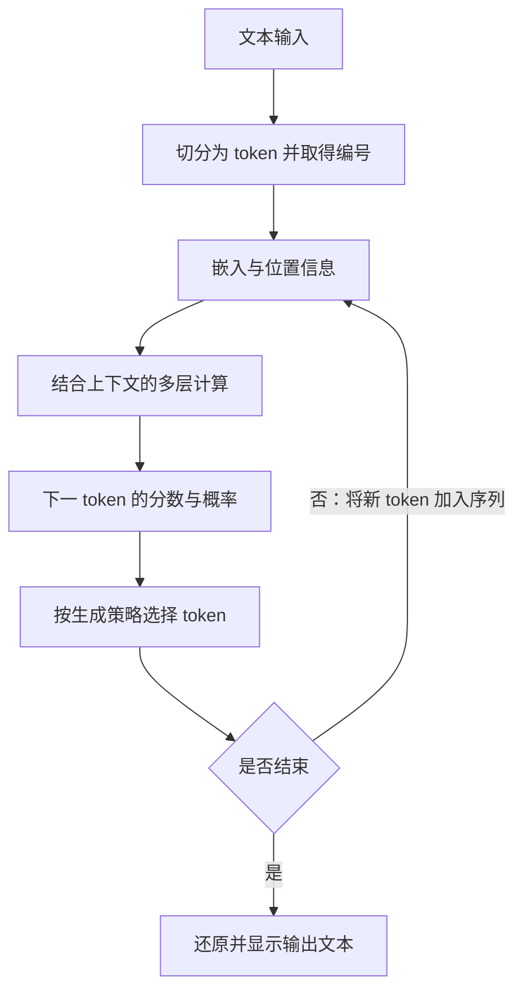

# 1.4.5 从文本向量到语言模型

[返回本章大纲（1.4）](../1.4_AI与Agent的工作方式.md) · [上一节：1.4.4 分子描述符与神经网络](1.4.4_从手工特征到深度神经网络.md) · [下一节：1.4.6 上下文](1.4.6_上下文与常见模型.md)

本节介绍文本的数值表示、语言模型的训练和逐步生成过程。

## 1.4.5.1 从预测性质，走到生成文本

语言模型可以根据输入文字生成说明，例如整理实验记录或回答问题。

**生成式模型**能够产生文本、图片等内容。**语言模型**对文本序列建立概率模型，本节讨论能根据已有文本逐步生成后续内容的大语言模型。

> **LLM（Large Language Model，大语言模型）**通过大量文本训练，能够根据输入生成后续文本。

现代生成式 LLM 通常使用深度神经网络，许多采用 Transformer 架构。早期统计方法也属于语言模型。模型需要读取实验记录，才能根据记录回答具体样品编号。

## 1.4.5.2 先把文字切成模型能处理的片段

**token** 是模型处理文本的片段，可能是字、词的一部分、标点或空白。**分词器（tokenizer）**按特定规则把文本转成 token 序列，再将 token 对应到整数编号。

> **UTF-8（Unicode Transformation Format – 8-bit，8 位 Unicode 转换格式）**是一种文本编码。

文本转换过程示意如下：

> 样品编号是 M-02。 → 若干文本片段 → 一串整数编号

切分和编号取决于模型的词表与规则。token 可以对应汉字、词的一部分、多个字符或部分 UTF-8 字节。演示程序会显示分词器的实际输出。

**词表**列出模型可处理的 token 及其编号。编号用于区分片段，训练得到的向量表示包含其语义关系。

### 1.4.5.2.1 文件编码与模型分词

| 层次 | 解决什么问题 |
| --- | --- |
| UTF-8 等文件编码 | 怎样在文件中保存文字，怎样把字节解读为文字 |
| tokenizer 与 token 编号 | 模型把文字按什么片段组织，怎样给片段编号 |
| 嵌入向量 | 怎样把 token 转成可学习、可计算的数值表示 |

读文件发生乱码时，先核对原始字节和解码方式，再进行模型分词。

## 1.4.5.3 从编号到向量：构建数值表示

**向量**是一串按顺序排列的数。模型为 token 建立**嵌入（embedding）**。每个 token 编号对应一个由训练确定的向量。

例如，为了说明形式，可以假设某片段对应 `[0.2, -0.4, 0.7]`。这三个数是教学示意；本地模型的真实权重由模型文件提供，单个维度通常需要结合整体表示理解。

向量的维数、数值和相互关系由模型结构与训练决定。解释语义时应结合整个向量及任务表现。

最初的 token 表示还要结合顺序和上下文继续计算。同一个片段出现在不同语境时，后续得到的上下文表示可以不同。

### 1.4.5.3.1 查看模型中的词向量

[四组典型词向量案例](../../演示/词向量/课堂候选案例.md)提供首都、亲属称谓、比较级和进行式的实测对照。每个 token 是 1,024 个数，文档展示前 8 维的实际数值和逐项加减，完整向量可下载查看。

计算 `v(伦敦)−v(英国)+v(法国)` 后，完整词表近邻搜索得到“巴黎”。这反映了已训练的初始表示中的近似向量关系。程序完成完整向量运算和搜索。

## 1.4.5.4 注意力机制与上下文

**上下文**是这次生成实际可用的输入信息，例如问题、已提供的记录和此前对话。下一节再详细讨论它怎样被管理。

**注意力机制**在更新某个位置的表示时，对其他位置的信息赋予不同权重并进行组合。

例如：

> 样品 A 的编号是 M-02，样品 B 的编号是 M-03。请写出样品 B 的编号。

回答需要关联“样品 B”和对应的记录。模型通过多层计算形成输出；具体行为可结合任务测试和内部分析研究。

> **GPU（Graphics Processing Unit，图形处理器）**擅长并行处理大量相似的运算。

现代网络包含许多层表示更新，大量运算可以组织成矩阵乘法，同时还有非线性变换、归一化等操作。GPU 可以加速其中的并行计算，回答质量仍需通过任务结果检验。

## 1.4.5.5 输出的是下一片段的概率，再逐步选择

沿用前节的 $f_\theta(x)$ 记号，语言模型的输入 $x$ 是当前文本片段序列，输出是下一片段在词表上的概率分布。经过计算，模型为各候选 token 产生一组分数，常称为 **logits**。通常通过 softmax 运算，把分数变成非负、总和为 1 的概率。

为说明机制，假设某一步只有三个候选：

| 下一片段 | 概率 |
| --- | --- |
| “02” | 0.6 |
| “03” | 0.3 |
| “01” | 0.1 |

这是人工编写的示意分布；模型实测结果需读取实际输出，真实词表也更大。选出一个片段，接回已有序列，再计算下一步，直到遇到结束条件或达到输出上限。

**采样**表示按照概率选择，可以取到最高概率以外的候选；**贪心选择**则每次取最高分候选。**温度（temperature）**会影响选择分布的集中程度；事实准确性还要靠输入证据和结果核查。不同模型的建议设置不同。

> **KV（Key–Value，键值）缓存**保存模型已处理文本的中间计算结果，供后续生成步骤复用。

图示省略了缓存等加速细节。界面的流式文字还会经过显示层的分段处理。

## 1.4.5.6 语言模型的训练

许多生成式语言模型的核心预训练任务是预测下一个 token。训练时，已有文本提供后续片段作为答案，预测出错会影响损失，再通过反向传播与优化方法更新参数。

训练时，程序用文本前缀预测下一片段，并用原文检查预测。大规模文本训练形成更广泛的统计规律；指令训练和偏好优化进一步调整模型行为。

| 阶段 | 在做什么 | 通常是否更新模型权重 |
| --- | --- | --- |
| 训练 | 根据数据与目标调整参数 | 是 |
| 普通推理 | 用已有权重和当前上下文计算输出 | 否 |
| 对话中提供文件 | 将实际读入的内容加入当前任务信息 | 提供本次上下文；参数保持训练后的状态 |

预测下一片段是语言模型的重要训练目标。训练还可能形成语言、代码等任务能力，具体表现通过任务测试检验。

## 1.4.5.7 本地小模型演示

本课选择 **Qwen3-0.6B** 作为小模型候选。0.6B 表示约 6 亿参数；文件大小和上下文长度由模型格式与设置分别决定。小模型适合观察机制，化学结论还需由专业资料核验。[官方模型卡](https://huggingface.co/Qwen/Qwen3-0.6B)

> **WSL（Windows Subsystem for Linux，适用于 Linux 的 Windows 子系统）**在 Windows 中提供 Linux 环境。

本地模型的启动方式和实测记录见[WSL 本地演示说明](../../演示/本地语言模型/README.md)。

### 1.4.5.7.1 演示 A：真实分词

> **GGUF** 是 llama.cpp 系列工具使用的模型文件格式名称；**Q8_0** 是该格式下的一种 8 位量化类型。

运行 `inspect_llm.py tokens`，观察“样品编号是 M-02。”实际对应的片段与编号。再加入换行或英文，比较结果。这里用分词器展示切分结果，完整回答留在后续演示。

本机已用 Qwen3-0.6B Q8_0 实测，片段依次为 `样品`、`编号`、`是`、` M`、`-`、`0`、`2`、`。`。注意 ` M` 包含前导空格，`02` 被切分成两个 token。这是该模型与当前设置的实际结果；其他模型应读取各自分词器输出。见[保留的实测示例](../../演示/本地语言模型/实测示例.json)。

### 1.4.5.7.2 演示 B：只生成一个 token

> **JSON（JavaScript Object Notation，JavaScript 对象表示法）**是结构化文本格式。

运行 `inspect_llm.py next`，输入一个待续写的前缀。服务器生成一个 token 并返回候选分数。聊天模式还会使用消息模板。

脚本保留原始 JSON，便于核对服务器版本。若返回 `logprob`，它是概率的自然对数，概率需用 `exp(logprob)` 换算；只展示前几个候选，其概率总和覆盖部分候选。接口中的候选分数也要区分是否经过温度等采样处理，需按实际采样配置分别解释。

本机一次原始续写的真实结果如下（固定 seed=42、temperature=0.7，采样前概率）：

| 候选 token | 概率约值 |
| --- | --- |
| `1` | 0.282 |
| `0` | 0.216 |
| `2` | 0.197 |
| `3` | 0.094 |
| `4` | 0.038 |

这次实际选中的是 `2`，概率最高的候选则是 `1`，可用来区分采样与贪心选择。前缀只提供有限上下文，这些概率描述下一片段的候选分布；真实编号需查阅样品记录。换模型、输入或运行设置，结果可能不同。

### 1.4.5.7.3 演示 C：给出资料，流式生成回答

运行 `inspect_llm.py chat`，先问“样品编号是什么？”，再单独提供“记录：样品编号是 M-02。请只回答编号。”，观察两次回答所依据的信息来源。

两次请求各自建立输入消息，服务器流式返回模型生成的内容。输出结果可以与提供的记录逐项核对。

## 1.4.5.8 检查生成内容的依据

模型根据学到的规律和当前输入生成输出，回答的事实依据需结合原始资料检查。数据中的错误、上下文不足、任务难度和生成策略都可能影响回答。

确定烘箱温度需要材料和实验方案等条件。提供实验记录后，应核对模型回答引用的条件和数值。

这里的课堂任务使用编号等简单信息，真实实验条件依照原始记录、规范和专业判断确定。生成的数值、引用和科研结论仍需对照原始材料检查。

## 1.4.5.9 把输出能力接回电脑操作

模型能生成普通说明，也能生成 Markdown、JSON 或一行命令。生成 `mkdir lesson-demo` 后，程序还需调用命令并检查文件夹。

要让输出变成真实动作，还需要外围程序读取调用请求，协调工具执行，把结果或错误送回上下文。这就是后续 Harness 与 Agent 内容要解决的问题。

## 参考资料

- [Hugging Face：Tokenizers](https://huggingface.co/learn/llm-course/chapter2/4)：优先看文本到编号的过程。
- [Hugging Face LLM 课程](https://huggingface.co/learn/llm-course/chapter1/1)：按需了解 Transformer，选读对应章节即可。
- [Qwen3-0.6B 官方模型卡](https://huggingface.co/Qwen/Qwen3-0.6B)及[官方 GGUF](https://huggingface.co/Qwen/Qwen3-0.6B-GGUF)：候选模型、许可与运行设置。
- [llama.cpp 服务器说明](https://github.com/ggml-org/llama.cpp/tree/master/tools/server)：本地脚本使用的接口依据。
