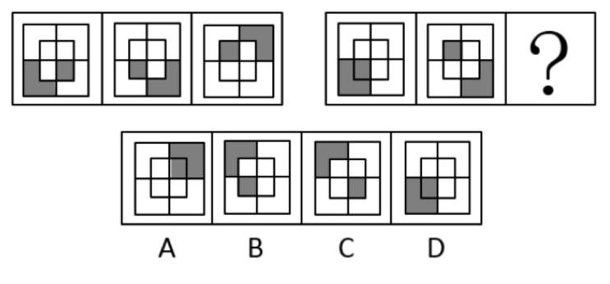
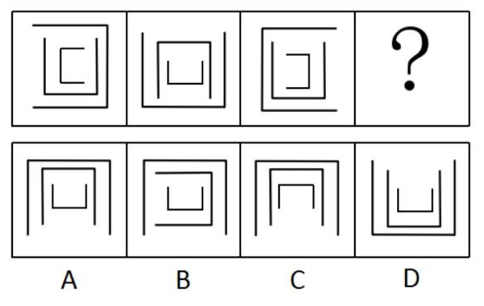
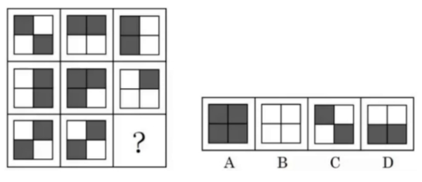

# 课堂演示：图形找规律

[1.4.1 返回第一节](1.4.1_人工智能与人工规则.md) · [1.4 返回本章目录](../1.4_AI与Agent的工作方式.md)

来源：[粉笔《图形推理之位置、样式、复合》](https://hera-webapp.fenbi.com/api/article/detail?deviceType=1&id=429794889856001)。这些是公考备考资料中的例题，题目按来源页面展示，考试年份留待查证。题图原样保留，答案按来源解析并对照题图检查；以下讲解为课程改写。详见[来源说明](../素材/04_AI与Agent的工作方式/粉笔图形推理_来源说明.md)。

三道题分别展示平移、旋转和颜色规则。

## 题 1：两个元素的移动规律

观察左边一组三幅图的变化，再为右边一组选出缺失图形。

展开答案与讲解

**答案：A。**

将内侧黑色小方块与外侧灰色 L 形分开观察：

- 内侧方块沿内圈四个位置，每次顺时针移动一格。
- 外侧 L 形沿外圈四个转角，每次逆时针移动一格。

左侧的三幅图用于检验这两条规律；将同样规律用于右侧，内侧方块应回到右下，外侧 L 形应移到右上，只有 A 同时满足。

题图中的重叠容易干扰观察，可以用手指分别追踪两个元素。

## 题 2：不同层可以采用不同旋转规则

从四个选项中选出下一幅图。

展开答案与讲解

**答案：C。**

分别观察各层的开口方向：外层每次顺时针转 90°；内层每次逆时针转 90°。下一幅图外层与内层开口均应朝下。外层条件排除 D，内层条件在 A、B、C 中选出 C。中层也可作为进一步核对。

这题用来说明：一个候选答案需要同时满足多条约束，每条约束都要逐项检查。

## 题 3：黑白颜色的运算规则

九宫格每一行，前两幅图按相同规则得到第三幅图。需要根据前两行的规则确定缺失图形。

展开答案与讲解

**答案：A。**

逐个对应小格比较：两幅图中颜色相同，结果为黑；颜色不同，结果为白。前两行都符合。

第三行前两幅图完全相同，因此四个位置都得到黑色，对应 A。

如果把黑、白分别记成 1、0，这可以写成一个四行的规则表。本题直接观察颜色即可，图像编码留作后续学习。

## 图形规则与专家系统

程序可以接收图形的位置、方向等信息，并使用平移、旋转和颜色比较规则检验候选答案。

本演示由人提供图形描述和规则，程序根据已知事实检查规则并推导答案。

专家系统也用领域规则处理专业任务。DENDRAL 使用化学知识推断候选分子结构。
