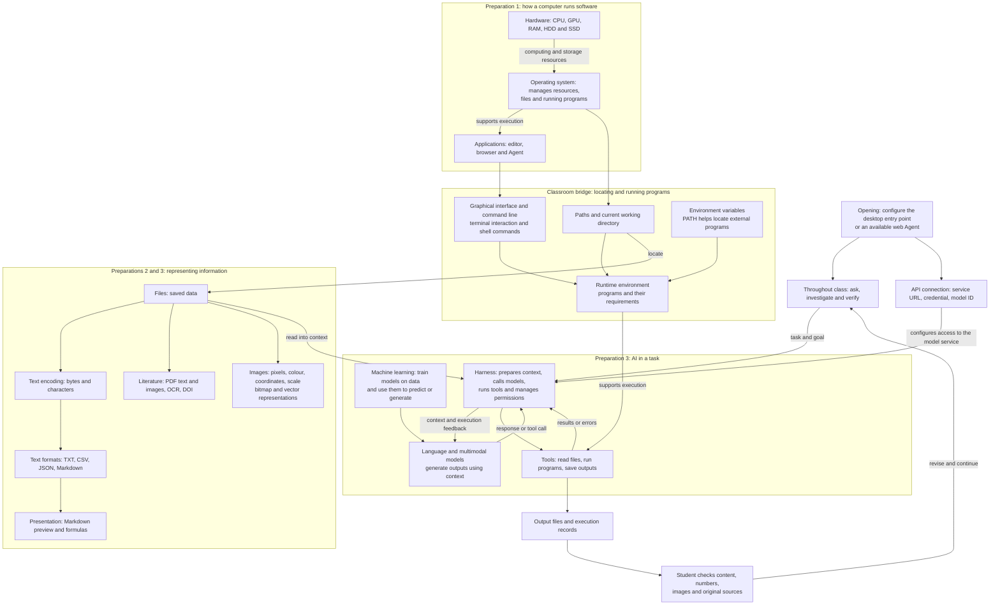

# Formal class 1: computer fundamentals and getting started with an Agent

Teacher discussion draft · 2026-11-03

The class begins by giving every student a working AI assistant. It then connects three questions: how a computer runs software, how files represent information, and how an Agent uses tools to complete a task. Students should be able to explain an observed result, locate an input file, describe a task, and check an output.

This outline draws on [preparation class 1](../../预习课/预习课一/README.md), [preparation class 2](../../预习课/预习课二/README.md), and the [plan for preparation class 3](../../预习课/预习课规划.md). Class 3 is still a plan. This document records the current discussion; the earlier tensile-data syllabus and slides remain reference material.

## 1. Start with a working assistant

Begin with the desktop entry point already planned for the course. Install it, complete its supported sign-in or service configuration, select the course folder, and send a first question. The new Claude Code examples below provide alternative ways to connect a model service; students only need to follow the route selected for class. Students using a web Agent can begin with the explanation activity after supplying the relevant material. A web interface should not be assumed to have access to files on the student's computer.

### 1.1 Understand the three core connection settings

An **API** is an interface through which software requests a service from another program. Here, the Agent application sends a request to a model service and receives its response. For an API-based connection, start with three core pieces of information:

| Setting | Plain-language meaning | What students should identify |
| --- | --- | --- |
| Service URL / base URL | The address to which the application sends model requests | The endpoint specified for this tool and API format, not the provider's website homepage. |
| API key | A credential authorising requests under an account or workspace | A key issued by the selected provider. It is like a password for programmatic access, not the account's sign-in password. |
| Model name / model ID | The identifier telling the service which model to use | An available identifier from that provider's documentation; a display name may differ from the API identifier. |

These settings must match the chosen provider and tool. Installation, account access, billing or usage allowance, API compatibility and tool-specific settings may also be required. Account-based sign-in can hide some of these details. For classroom examples, use a placeholder such as `<YOUR_API_KEY>` rather than an actual credential.

### 1.2 Connection examples and reference links

**Option A: DeepSeek as the model service, accessed through Claude Code.** Claude Code supplies the Agent interface; DeepSeek supplies the model service. This illustrates why the application name does not necessarily identify the model being used.

- [DeepSeek API documentation](https://api-docs.deepseek.com/zh-cn/): look up the service address and model identifiers.
- [DeepSeek API key page](https://platform.deepseek.com/api_keys): obtain the credential for the account being used.
- [DeepSeek's Claude Code integration guide](https://api-docs.deepseek.com/zh-cn/quick_start/agent_integrations/claude_code/): follow the instructions for the student's operating system. The guide supplies the compatible endpoint and environment-variable settings.

**Option B: OpenCode Console as the model service, accessed through Claude Code.** Distinguish the OpenCode Agent application from the Console service used to obtain model access.

- [OpenCode Console](https://opencode.ai/console): enter the relevant workspace and obtain an API key.
- [Connecting Console to Claude Code](https://opencode.ai/v2/docs/console/harnesses/claude-code/): check the endpoint, authentication and model configuration.
- [OpenCode Go plans](https://opencode.ai/v2/docs/console/go/): check subscription prices, available models and usage limits.

As checked on 2026-11-03, the individual plans include **Go at USD 10/month** and **Go Plus at USD 40/month**. They have usage limits; whether either costs less than usage-based billing depends on the model and amount used. Confirm current terms before choosing a classroom plan. The documentation also lists a team plan.

Teacher bookmark: the originally supplied [organisation service-account page](https://opencode.ai/console/org_01M4D87KW3Y15KSD889B3GP88M/settings/service-accounts) belongs to a specific workspace and is not a universal student entry point. The Go documentation states that service accounts are not covered by Go Teams; do not assume that a service-account key uses an individual's subscription allowance.

### 1.3 Confirm that the assistant works

The first prompt can be:

> I have no computing background. Using an example from this course material, explain the difference between RAM and persistent storage. Then ask me one simple question to check my understanding.

The opening activity establishes a way to ask questions throughout the class. Later, an actual file task makes the Agent's execution process visible. Verify the installation screens and account requirements when preparing the hands-on guide; the [official quickstart](https://learn.chatgpt.com/docs/quickstart) describes installation, sign-in, choosing a workspace, and sending a first message.

## 2. Six connected questions

| Order | Question | Concepts | Observable example or action |
| --- | --- | --- | --- |
| 1 | What happens when I open an application? | Hardware and software; CPU, GPU, RAM and storage (HDD and SSD); operating system; installation and execution | Edit, save, close and reopen a note; distinguish working state from a saved file. |
| 2 | How does the computer find files and programs? | Folders; absolute and relative paths; current working directory; graphical interfaces, terminal and shell; environment variables and PATH | Locate the course folder and identify where a program runs and where it saves output. |
| 3 | How do stored bytes become readable information? | Bytes, text and character encoding; file formats and extensions; TXT, CSV and JSON | Compare the supplied samples in VS Code; reopen a copy with an incorrect encoding, then restore the correct interpretation. |
| 4 | How do we express and present research information? | Markdown and LaTeX-style formulas; source and preview; PDF, OCR and DOI; pixels, colour, coordinates, scale bars, bitmap and vector images | Modify a formula, compare two PDFs, and convert a pixel length into a physical length. |
| 5 | How does AI use the information we supply? | AI, machine learning, neural networks and LLMs; training and inference; tokens, context and sequential generation; multimodal inputs | Compare answers with and without a supplied source passage; check the evidence. |
| 6 | How does an Agent turn a request into an output? | Models, Agents, harnesses, tools and runtime environments; reading, execution, feedback and checking | Read sample records, produce a Markdown note with an image, formula and source, and check the saved result. |

Hardware means the physical components of a computer. Software supplies instructions and data. The operating system manages resources and supports running programs. A terminal provides a text interaction interface; a shell interprets commands. Introduce each term at its first demonstration.

### 2.1 Hardware: connect each component to a task

| Component | First explanation | Classroom connection |
| --- | --- | --- |
| CPU | Executes program instructions and handles many general-purpose tasks | Starts applications and performs calculations in a data-processing program. |
| GPU | Processes many similar operations in parallel | Used for graphics and, when the software supports it, model training or inference. |
| RAM | Holds instructions and data currently in use | Opening large images or running several applications consumes working memory. |
| Storage | Keeps saved programs and files after power is removed | Holds the course folder, original data and saved outputs. |
| HDD | A storage device that reads and writes using rotating magnetic platters and a mechanical head | Recognise it as a form of persistent storage. |
| SSD | A storage device that uses flash memory and has no moving read/write mechanism | Compare it with an HDD, while keeping both distinct from RAM. |

Show students where to inspect their CPU, memory and storage information. Ask them to explain the difference between insufficient RAM and insufficient disk space. When a model runs on a remote service, its computation takes place there; using that service does not by itself require a powerful local GPU.

Optional viewing: [hardware and PC assembly video supplied by the teacher](https://www.bilibili.com/video/BV1BG4y137mG/). The page could not be retrieved during this edit, so its title and exact coverage have not been independently checked. Keep it as a viewing reference. Students intending to assemble a computer should watch the relevant guidance before starting: forcing a component into place can damage it. PC assembly is not a classroom assignment.

### 2.2 Information, AI and software roles

Text encoding specifies the correspondence between characters and bytes. File format describes how content is organised and interpreted. A filename extension provides a clue about the format; renaming it does not convert the content. Keep these distinctions explicit during the encoding demonstration.

For images, introduce a pixel as a small unit of colour, coordinates as a location within the image, and a scale bar as a relationship between image distance and physical distance. For example, if 100 pixels represent 10 μm, 30 pixels represent 3 μm. RGB and HEX colour values, compression, and print size can be revisited through the preparation readings when needed.

AI is the broader field; machine learning learns patterns from data. An LLM is a language model that processes tokens—pieces of text—and generates output using the available context. Training changes model parameters; supplying a document during a conversation provides context. Giving a model more context is not the same as retraining it.

An Agent pursues a task using models and tools, responding to execution results. The harness is the supporting software that prepares context, connects model calls and tool execution, manages permissions, and keeps the task moving. Model, product interface and runtime environment describe different roles rather than one simple hierarchy.

## 3. Connect paths, program execution and environment variables

Explain these terms in order:

- **Current working directory:** the folder a running program uses as the starting point for relative file paths.
- **Runtime environment:** the operating system, interpreter, dependencies and other conditions needed to run a program.
- **Environment variables:** named settings available to a running process, often inherited when it starts.
- **PATH:** an environment variable listing directories used to look up external executable programs.

A useful question is: “Why might a program be installed, but its command still cannot be found?” PATH is one possible cause, alongside the command name and the environment in which it is being run. Start by observing settings and explaining the symptom. Change settings when a concrete installation or execution issue calls for it.

Connect this section back to the opening setup: a provider guide may pass the service address and API key to a tool through environment variables. Those variables tell the tool which service to use; PATH helps locate an executable. Use the actual provider guide to show the distinction.

Character encoding was optional in preparation class 2; it now receives a short classroom demonstration. Environment variables are a connecting topic added for this class. Neither needs a long configuration exercise.

## 4. Concept map

Arrows indicate a dependency, contribution or feedback relationship. They are not a slide-by-slide teaching sequence.

## 5. One small task to connect the concepts

Reuse the sample records, image, formula examples and literature record in [preparation class 2](../../预习课/预习课二/README.md). Ask the Agent:

> Read the sample records in the course folder and create a Markdown note. Include the sample identifier, the supplied image, a given formula, and the literature source. Save it as a new file.

Use this task to ask students:

- Where is the input file, and what is the base for its relative path?
- Why can both CSV and JSON be opened in a text editor?
- How does an encoding problem differ from a format problem?
- Why do the Markdown source and preview look different?
- How would a scale bar relate pixel distance to physical distance?
- Which claims came from supplied material, and which were generated by the model?
- Which step actually used a tool, and where was the result saved?

Use a separate scale-bar example for the measurement question: the preparation class 2 illustration is not a calibrated measurement image. Keep a short model answer in conversation distinct from a file that has actually been created and checked.

Students practise the preparation class 1 help-seeking pattern throughout: describe the goal, the action taken, and the observed result; retain the exact error message when one appears. The lesson closes with a saved output and an independent check. Detailed attention mechanisms, extensive formula syntax, image compression details and complete environment setup remain available for later study or the practical class that needs them.
