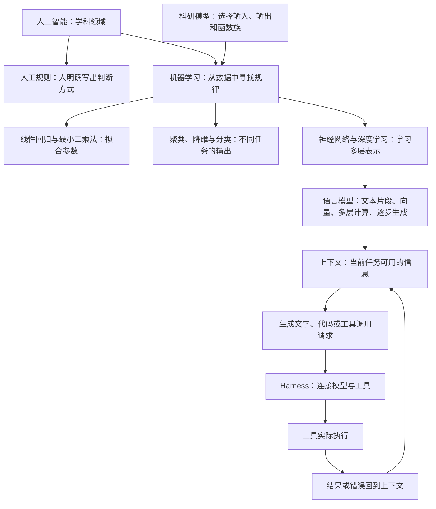

# 1.4 人工智能与智能体的工作方式

[返回第一课入口](../../../README.md)

本章从科研模型中的输入、输出与参数出发，依次介绍机器学习、神经网络、语言模型和工具执行。

## 章节内容

| 编号 | 分节讲义 | 主要内容 | 示例 |
| --- | --- | --- | --- |
| 1.4.1 | [1.4.1 认识人工智能：从专家规则到机器学习与深度学习](../../../内容/1.4_AI与Agent的工作方式/1.4.1_人工智能与人工规则.md) | AI、专家系统、机器学习、最小二乘与深度学习的概念关系 | DENDRAL 与价态约束；溶解度预测中的数据和输入信息 |
| 1.4.2 | [1.4.2 模型、机器学习与最小二乘法](../../../内容/1.4_AI与Agent的工作方式/1.4.2_机器学习与最小二乘法.md) | 预测能力、建模方法对应、函数族与参数拟合 | 温度与速率常数；三组标定数据及[最小二乘交互动画](../../../演示/最小二乘/index.html) |
| 1.4.3 | [1.4.3 分组、降维与分类](../../../内容/1.4_AI与Agent的工作方式/1.4.3_聚类降维与分类.md) | K-Means、PCA 与 SVM 的输出 | [真实化学测量数据动画](../../../演示/机器学习方法/index.html)展示 178 个样品 |
| 1.4.4 | [1.4.4 从分子描述符到深度神经网络](../../../内容/1.4_AI与Agent的工作方式/1.4.4_从手工特征到深度神经网络.md) | 特征、非线性计算与表示学习 | ESOL 多元回归、49 参数的 4→8→1 溶解度网络与固定 21 个化合物测试 |
| 1.4.5 | [1.4.5 从文本向量到语言模型](../内容/1.4_AI与Agent的工作方式/1.4.5_从文本向量到语言模型.md) | 文本表示与逐步生成 | 编码与 token、嵌入、上下文、概率及[本地小模型演示](../演示/本地语言模型/README.md) |
| 1.4.6 | [1.4.6 上下文与常见模型](../内容/1.4_AI与Agent的工作方式/1.4.6_上下文与常见模型.md) | 对话历史、文件内容与上下文 | 聊天与续写、[历史与文件实测](../演示/本地语言模型/上下文实测.json)、上下文窗口 |
| 1.4.7 | [1.4.7 从模型输出到真实操作：最小 Harness](../内容/1.4_AI与Agent的工作方式/1.4.7_文本命令与Agent_Harness.md) | 模型请求与工具执行 | [本地小模型工具循环](../演示/最小Harness/README.md)：读取、计算、保存与检查 |
| 1.4.8 | [1.4.8 工具调用与执行演示](../内容/1.4_AI与Agent的工作方式/1.4.8_工具调用与执行演示.md) | 代码块、带参数请求和原生调用消息 | [带参数调用](../演示/最小Harness/tools_with_args.py)与参数校验 |

## 概念关系

