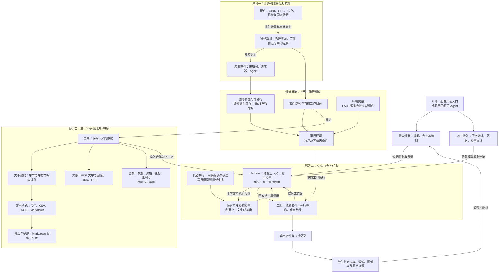

# 正式课第一课：计算机基础与 Agent 上手

教师讨论稿 · 2026-11-03

这节课先让每位学生有一个可用的 AI 助手，再围绕三个问题展开：计算机怎样运行软件，文件怎样表达信息，Agent 怎样使用工具完成任务。学生应当能够解释眼前的现象、找到输入文件、说明任务，并检查实际输出。

本文依据[预习课一](../../预习课/预习课一/README.zh.md)、[预习课二](../../预习课/预习课二/README.zh.md)以及[预习课三的规划](../../预习课/预习课规划.md)整理。预习课三尚处于规划阶段。本文记录当前讨论方案；此前以拉伸数据为例的大纲和课件保留作参考素材。

## 一、先让大家有一个可用的助手

开场沿用原先计划的桌面入口，完成安装、该工具支持的登录或服务配置、选择课程文件夹和第一次提问。下面新增的 Claude Code 接入示例作为模型服务配置的候选路线；学生按课堂选定的一条路线完成即可。使用网页 Agent 的同学，提供相关材料后，也可以先参与概念问答。不能默认网页工具可以读取学生电脑上的文件。

### 1.1 认识模型服务连接的三项核心信息

**API** 是软件向另一个程序请求服务的接口。这里，Agent 工具通过 API 向模型服务发送请求，并接收回答。采用 API 接入时，先认识三项核心信息：

| 配置项                            | 怎样理解                                       | 学生需要认清什么                                                                     |
| --------------------------------- | ---------------------------------------------- | ------------------------------------------------------------------------------------ |
| 服务地址（URL / base URL）        | 工具把模型请求发送到哪里                       | 使用文档中与当前工具、接口格式对应的地址，不能直接填服务商的网站首页。               |
| API key（密钥）                   | 允许程序以某个账号或工作区的身份调用服务的凭据 | 使用所选服务商签发的密钥。可以把它理解为“给程序用的密码”，但它不是账号的登录密码。 |
| 模型名称（model name / model ID） | 告诉服务商这次要调用哪个模型的标识             | 从服务商文档中查找可用名称；网页上的展示名称不一定就是 API 接受的名称。              |

三项信息需要与选用的服务和工具配套。实际使用还可能涉及工具安装、账号权限、余额或套餐额度、接口兼容性，以及工具自身的其他设置。采用账号登录的入口，可能会替用户处理其中一部分信息。课堂示例统一用 `<YOUR_API_KEY>` 这样的占位符，不填写真实密钥。

### 1.2 接入候选与参考入口

**路线 A：通过 Claude Code 使用 DeepSeek 模型服务。** Claude Code 提供 Agent 操作入口，DeepSeek 提供模型服务。这个例子正好可以说明：工具的名称不一定就是实际使用的模型名称。

- [DeepSeek API 文档](https://api-docs.deepseek.com/zh-cn/)：查找服务地址和模型标识。
- [DeepSeek API key 页面](https://platform.deepseek.com/api_keys)：获取所用账号的调用凭据。
- [DeepSeek 接入 Claude Code 指南](https://api-docs.deepseek.com/zh-cn/quick_start/agent_integrations/claude_code/)：按自己的操作系统查看步骤，使用指南给出的兼容接口地址和环境变量设置。

**路线 B：通过 Claude Code 使用 OpenCode Console 模型服务。** 这里要区分 OpenCode 这款 Agent 工具，以及提供模型访问的 Console 服务。

- [OpenCode Console](https://opencode.ai/console)：进入自己的工作区，获取 API key。
- [Console 接入 Claude Code 指南](https://opencode.ai/v2/docs/console/harnesses/claude-code/)：查看服务地址、认证方式和模型配置。
- [OpenCode Go 套餐说明](https://opencode.ai/v2/docs/console/go/)：查看订阅价格、可用模型和用量限制。

截至 2026-11-03 核对，个人套餐包括 **Go：10 美元/月**和 **Go Plus：40 美元/月**。套餐有用量限制，是否比按量付费划算，要结合模型和实际使用量判断；确定课堂方案前再核对当时条款。官方文档还列有团队套餐。

教师备课书签：原先提供的[组织服务账号页面](https://opencode.ai/console/org_01M4D87KW3Y15KSD889B3GP88M/settings/service-accounts)指向一个特定工作区，不是所有学生通用的入口。Go 文档说明服务账号不在 Go Teams 的覆盖范围内，不能默认服务账号密钥会使用个人订阅额度。

### 1.3 确认助手已经可以使用

第一次可以这样问：

> 我没有计算机基础。请用这份课程材料中的例子，解释内存和硬盘有什么区别，再问我一个简单的问题，检查我是否理解。

这个环节先建立课堂中随时提问的入口。随后通过一次实际文件操作，让大家看到 Agent 的执行过程。制作操作指南时，再核对安装界面和账号要求；[官方入门说明](https://learn.chatgpt.com/docs/quickstart)提供了安装、登录、选择工作位置和发出第一条消息的流程。

## 二、围绕六个相互连接的问题展开

| 顺序 | 要回答的问题                     | 涵盖的内容                                                                                        | 现场例子或动作                                                             |
| ---- | -------------------------------- | ------------------------------------------------------------------------------------------------- | -------------------------------------------------------------------------- |
| 1    | 打开软件时，计算机在做什么？     | 硬件与软件；CPU、GPU、内存、存储（机械硬盘与固态硬盘）；操作系统；安装与运行                      | 修改、保存、关闭并重新打开一份笔记，理解运行中的内容与保存下来的文件。     |
| 2    | 计算机怎样找到文件和程序？       | 文件夹；绝对路径与相对路径；当前工作目录；图形界面、终端与 Shell；环境变量与 PATH                 | 找到课程文件夹，指出程序从哪里运行、结果保存在哪里。                       |
| 3    | 存下来的字节怎样变成可读的信息？ | 字节、文本与编码；文件格式与后缀；TXT、CSV、JSON                                                  | 在 VS Code 中对照样例；用错误编码重新打开副本，再恢复正确显示。            |
| 4    | 科研信息怎样表达和呈现？         | Markdown 与 LaTeX 风格的公式；源文件与预览；PDF、OCR、DOI；像素、颜色、坐标、比例尺、位图与矢量图 | 修改公式、比较两份 PDF，并将像素长度换算为实际长度。                       |
| 5    | AI 怎样利用我们提供的信息？      | AI、机器学习、神经网络与 LLM；训练与使用；token、上下文、逐步生成；多模态输入                     | 比较提供原文前后的回答，检查答案的依据。                                   |
| 6    | Agent 怎样把请求变成实际结果？   | 模型、Agent、harness、工具与运行环境；读取、执行、反馈和检查                                      | 读取样品记录，生成包含图片、公式和来源的 Markdown 笔记，再核对保存的结果。 |

**硬件**是计算机的物理部件；**软件**提供指令和数据；**操作系统**管理资源，支持程序运行。**终端**提供文字交互的入口，**Shell**负责解释命令。各个名词都在第一次演示到它时，用一句直白的话说明。

### 2.1 硬件：把每个部件与实际任务对应起来

| 部件            | 先怎样理解                                     | 课堂中的联系                                       |
| --------------- | ---------------------------------------------- | -------------------------------------------------- |
| CPU             | 执行程序指令，承担许多通用处理任务             | 启动应用、执行数据处理程序中的计算。               |
| GPU             | 擅长并行处理大量相似的运算                     | 用于图形处理，也可在软件支持时承担模型训练或推理。 |
| 内存（RAM）     | 存放程序当前正在使用的指令和数据               | 打开大图或同时运行多个应用，会占用这部分工作空间。 |
| 存储设备        | 断电后仍能保留已经保存的程序和文件             | 保存课程文件夹、原始数据和处理结果。               |
| 机械硬盘（HDD） | 通过旋转的磁性盘片和机械磁头读写数据的存储设备 | 认识它是持久保存文件的一种设备。                   |
| 固态硬盘（SSD） | 使用闪存保存数据，没有机械读写结构的存储设备   | 与机械硬盘作比较，同时明确它们都不同于内存。       |

带学生找到自己电脑的 CPU、内存和存储信息，再请他们解释“内存不够”与“硬盘空间不够”有什么区别。模型运行在远程服务上时，模型计算由远端承担；使用这类服务本身不要求学生电脑配备高性能 GPU。

可选观看：[教师提供的计算机硬件与装机参考视频](https://www.bilibili.com/video/BV1BG4y137mG/)。本次整理未能读取视频页面，标题和具体覆盖内容尚未独立核对，先保留为观看参考。准备自行装机的同学，应先看完相关操作讲解再动手：**大力不会出奇迹，强行安装可能损坏设备。** 装机不作为本课任务。

### 2.2 信息表达、AI 与软件分工

**文本编码**规定字符与字节怎样对应；**文件格式**规定内容怎样组织和解释；**后缀**提供格式线索，改名不会自动转换内容。演示乱码时，要把这三个层次区分清楚。

图像部分先把**像素**解释为一小格颜色，**坐标**解释为图中的位置，**比例尺**解释为图上距离与实际距离的对应关系。例如，100 像素对应 10 μm，则 30 像素对应 3 μm。RGB、HEX 颜色值、压缩和排版尺寸，可以在需要时回到预习材料中查阅。

**AI**是一个更广泛的技术领域；**机器学习**通过数据学习规律。**LLM**是处理 token（文本片段）、利用当前上下文生成输出的语言模型。训练会改变模型参数；在对话中提供文献，是补充上下文。提供更多上下文，与重新训练模型是两件不同的事。

**Agent**围绕任务使用模型和工具，并根据执行结果继续行动。**Harness**是支撑这一过程的软件：准备上下文、衔接模型调用与工具执行、管理权限，并组织任务继续进行。模型、产品入口和运行环境分别描述不同的作用，不能简单排成一条上下级分类链。

## 三、把路径、程序运行与环境变量接起来

按下面的顺序解释，学生更容易理解各个概念为什么有用：

- **当前工作目录**：运行中的程序以哪个文件夹为起点，解释相对文件路径。
- **运行环境**：程序运行所需的操作系统、解释器、依赖等条件。
- **环境变量**：运行中的进程可以读取的一组“名称—值”设置，通常在启动时继承。
- **PATH**：一个环境变量，列出查找外部可执行程序时使用的目录。

可以用这个问题引出 PATH：“为什么软件已经安装，输入命令时却提示找不到？”PATH 是一种可能原因，还需要看命令名和实际运行环境。先观察设置、解释现象；遇到具体的安装或运行问题时，再修改相关设置。

再回到开场的服务配置：服务商指南可能通过环境变量，把服务地址和 API key 传给工具。这些变量告诉工具连接哪个服务；PATH 则帮助查找可执行程序。结合实际接入指南，指出它们各自负责什么。

编码原本是预习课二的选读内容，这次安排一个短演示。环境变量是第一课新增的衔接知识点。两者都不需要扩展成长时间的配置练习。

## 四、知识关系图

箭头表示依赖、作用或反馈关系，不代表逐页讲授的顺序。

## 五、用一个小任务贯穿课堂

直接复用[预习课二](../../预习课/预习课二/README.zh.md)已有的样品记录、图片、公式示例和文献记录，让 Agent 完成以下任务：

> 读取课程文件夹中的样品记录，生成一份 Markdown 笔记。包含样品编号、给定图片、一个给定公式和文献来源，保存为新文件。

围绕同一个任务，穿插下面的问题：

- 输入文件在哪里？它的相对路径从哪里开始算？
- CSV 和 JSON 为什么都能用文本编辑器打开？
- 编码问题与文件格式问题有什么区别？
- Markdown 原文与预览为什么不同？
- 怎样借助比例尺，把像素距离换成实际距离？
- 哪些信息来自输入材料，哪些是模型生成的？
- 哪一步真正调用了工具？结果保存在哪里？

比例尺换算另用一个带标定信息的例子：预习课二的示意图不是经过标定的测量图像。课堂中要让学生看到，对话里的一段回答与已经生成、保存并核对过的文件分别是什么。

预习课一的求助方法贯穿整个过程：说清目标、做过的操作和实际结果；出现报错时保留原文。课末以一份保存的输出和一次独立核对结束。注意力机制的详细原理、大量公式语法、图像压缩细节和完整环境配置，留给后续选读或实际需要它们的实践课。
