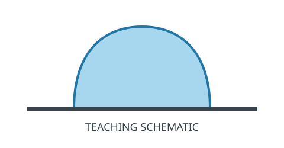

# 表面样品笔记

样品：M-02（虚构教学样例）

- 图片：[打开样品示意图](figure.svg)
- 文件记录：[查看样品 JSON](sample.json)
- 阅读：[《你缺失的那门计算机课》“文件与文件管理”](https://www.criwits.top/missing/file-and-file-management.html)

示例公式：$A=\pi r^2$。

编辑公式时可查阅[本课公式速查](公式速查.md)，并检查 Markdown 预览。
