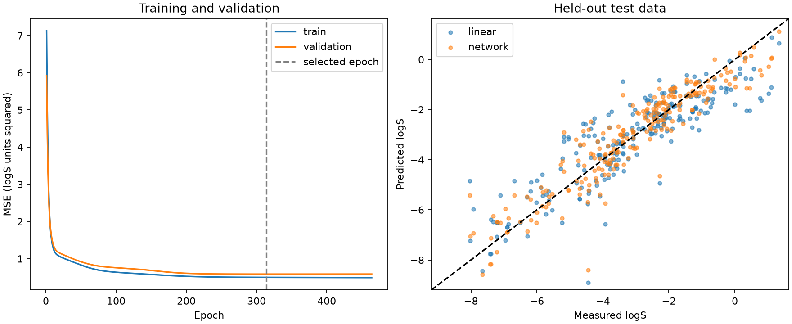

# 从溶解度数据训练一个小型神经网络

使用课程已有的 [Delaney 补充数据](../../内容/素材/04_AI与Agent的工作方式/ci034243x_si_001.txt)，比较多元线性回归与一个 **4→8→1** 网络。目标为实测 `log10(S / (mol/L))`。

## 输入与模型

RDKit 从 SMILES 计算四项输入：Wildman–Crippen MolLogP、MolWt、严格定义的可旋转键数、芳香重原子数占全部重原子的比例。它们与 ESOL 使用相同类型的描述符，但计算实现不完全等同原论文，因此本实验是重新训练的教学模型，不是原 ESOL 模型复现。文件中的原 ESOL 预测列不作为输入或标签。

网络隐藏层有 8 个 tanh 单元，输出层为线性输出，共有 `(4×8+8)+(8×1+1)=49` 个权重和偏置。每个参数都对应可调整的数值。激活函数 tanh 把加权和转换到 −1 至 1 之间。

## 数据划分与训练

1,144 条记录均能解析，得到 1,117 个不同的规范化异构 SMILES。同一规范化结构的记录放在同一分组，避免相同结构出现在不同数据子集中。按结构分组随机划分，得到训练 729 条、验证 184 条、测试 231 条。划分种子分别为 42 和 43。

输入和目标的标准化参数只从训练集计算。两种模型使用相同训练集与输入。网络使用 Adam、学习率 0.003、批大小 64、L2 参数 0.001，初始化种子为 42。训练上限 2,000 轮，验证 MSE 连续 150 轮未改善至少 0.00001 时停止，保留验证误差最低的参数。本次第 464 轮停止，采用第 314 轮参数。测试集不参与停止轮次选择。

| 模型 | 测试 MAE | 测试 RMSE | 测试 R² |
| --- | ---: | ---: | ---: |
| 重新拟合的线性回归 | 0.764 | 1.013 | 0.755 |
| 4→8→1 神经网络 | 0.554 | 0.753 | 0.865 |

误差以 logS 为单位。这是一次固定划分的结果；结构分组随机划分仍可能使相近骨架分布在训练集和测试集中，不能由此推断对全新化学空间的预测能力。模型未显式输入温度、pH 或晶型。



左图比较训练和验证 MSE，虚线标记选定轮次；右图比较测试集实测值与预测值。对角线表示两者相等。

## 运行

在独立 Python 环境中安装 `requirements.txt`，然后运行：

```bash
python train.py
python predict.py 'CCO'
```

训练使用 CPU；该规模无需 GPU。预测命令中的乙醇可能已在课程数据中出现，该操作只演示推理，不构成独立检验。真实科研使用前需要检查适用范围与实验结果。

- [train.py](train.py)：提取描述符、划分、训练、评价并导出结果。
- [predict.py](predict.py)：读取 JSON 权重，对输入 SMILES 预测。
- [模型参数.json](模型参数.json)：全部 49 个网络参数及标准化参数，可查看数值。
- [结果.json](结果.json)：环境版本、源文件校验值、各数据子集指标。
- [样本与预测.csv](样本与预测.csv)：每条数据的划分、描述符和两种模型预测。
- [训练过程.csv](训练过程.csv)：每轮训练与验证 MSE。

源码为课程编写，模型参数由本次训练得到。数据来源为 [Delaney，2004，ESOL](https://doi.org/10.1021/ci034243x) 的补充材料，遵循原材料使用说明。相关计算定义见 [RDKit 文档](https://www.rdkit.org/docs/source/rdkit.Chem.Crippen.html)，训练接口见 [scikit-learn MLPRegressor](https://scikit-learn.org/stable/modules/generated/sklearn.neural_network.MLPRegressor.html)。

## 原论文验证数据

已整理[原论文表 4 的 21 条记录及来源核查](原论文验证数据/README.md)。名称初查发现其中 17 个与 Small 重叠，因此不能直接将它们作为当前模型的新独立测试集。150 条文献数据与 528 条内部盲测数据尚未取得完整清单。

## 固定外部测试版本

现已将原论文表 4 的 21 个化合物设为固定外部测试集。按规范化结构及名称从 Small 排除 20 条记录后重新训练，完整过程见[外部21测试](外部21测试/README.md)。上文 0.753 的 RMSE 属于先前随机留出测试；新实验外部测试 RMSE 为 0.942，两者来自不同测试样本。

## 交互演示与逐层公式

- [网络逐层计算](网络逐层计算.md)：固定外部测试模型的全部参数、矩阵维度和每层运算。
- [交互演示](交互演示/index.html)：回放训练、手动修改 49 个参数并即时查看预测变化；[使用说明](交互演示/README.md)。
