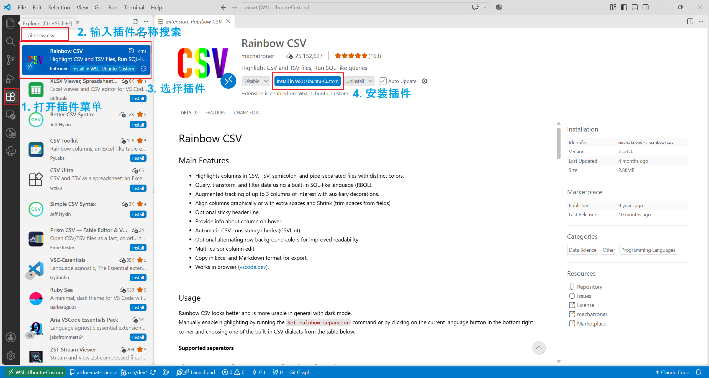
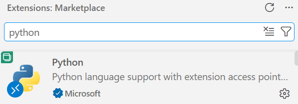
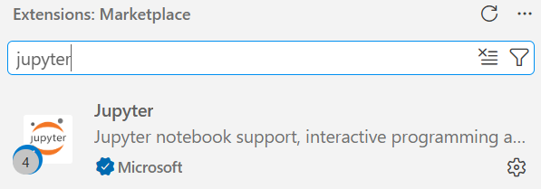
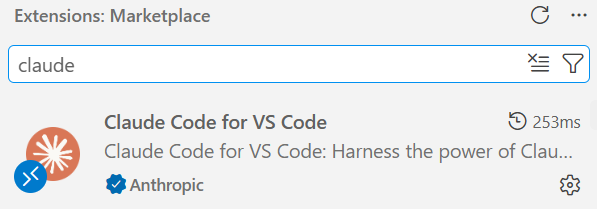
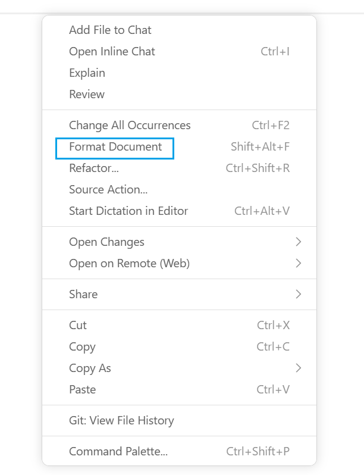

# 第一课课前准备：VS Code 与截图工具

课前安装 VS Code、指定扩展和 Snipaste，并用样例文件检查。课堂将使用 VS Code 阅读 CSV、JSON、Markdown 和 Notebook 文件。

## 1. 安装并打开 VS Code

从 [VS Code 官方下载页](https://code.visualstudio.com/download)选择对应系统的版本并安装，然后打开编辑器。安装步骤见 [VS Code 官方入门说明](https://code.visualstudio.com/docs/getstarted/overview)。

## 2. 检查或安装 VS Code 扩展

打开 VS Code 左侧的**扩展**图标；也可以按 Windows/Linux 的 `Ctrl+Shift+X` 或 macOS 的 `Cmd+Shift+X`。在搜索框逐项搜索下表中的名称，核对发布者后再操作。按钮显示“安装”时点击安装；显示“已安装”或“禁用”时，说明已经安装。扩展的安装方法见 [VS Code 官方说明](https://code.visualstudio.com/docs/configure/extensions/extensions)。

下图展示搜索 `Rainbow CSV`、核对发布者 `mechatroner` 并安装的步骤。不同系统中的安装按钮文字可能不同。

下面是一些其他需要安装的扩展和他们的作用

| 项目 | 搜索或核对什么 | 课上用来做什么 |
| --- | --- | --- |
| Rainbow CSV | 搜索 `Rainbow CSV`，发布者 `mechatroner` | 用不同颜色区分 CSV 的列 |
| Python | 搜索 `Python`，发布者 `Microsoft` | 认识 Python 文件与后续课程的编辑环境 |
| Jupyter | 搜索 `Jupyter`，发布者 `Microsoft`| 打开和阅读 `.ipynb` Notebook；教师课堂演示时运行代码单元 |
| Claude Code | 如果课堂确定用它作为 Agent 入口，搜索 `Claude Code for VS Code`，发布者 `Anthropic`，| 在 VS Code 中使用课堂选定的 Agent |

对应的图标：

- Python · Microsoft：
- Jupyter · Microsoft：
- Claude Code for VS Code · Anthropic：

## 3. 安装 Snipaste 截图工具

截图软件的正式名称为 **Snipaste**。从 [Snipaste 官方下载页](https://www.snipaste.com/download.html)选择自己电脑对应的版本，按页面说明安装或解压运行。打开后试着截取 VS Code 窗口的一小块，并保存为图片，确认课上能用它记录界面或报错。官网介绍的默认快捷键是 `F1` 开始截图、`F3` 将剪贴板图片贴到屏幕上；如果快捷键与电脑其他功能冲突，也可以从软件界面操作。[功能说明](https://www.snipaste.com/index.html)

## 4. 用课程样例检查准备结果

本课的检查文件都放在[课前准备样例](样例/README.md)中。请下载并保留整个第一课文件夹，让样例文件及相邻图片保持原有的相对位置。

1. 用 Excel、WPS 表格或其他兼容的表格软件打开 [`sample.xlsx`](样例/sample.xlsx)，找到 `sample_id` 和 `file_name` 两列，以及样品 `M-02`。
2. 在 VS Code 中打开同名的 [`sample.csv`](样例/sample.csv)，找到同一行数据。观察 Excel 工作表中的单元格与 CSV 文本中的逗号、换行如何对应；CSV 按列着色需要启用 Rainbow CSV。
3. 在 VS Code 中打开单行的 [`sample.json`](样例/sample.json)，找到 `sample_id` 对应的值 `M-02`。先复制一份到同目录，再在副本的编辑区域右键，选择 **Format Document（格式化文档）**，观察它如何变成多行缩进的样子。格式化只改变排版，字段和值应保持一致。

   
4. 试着玩一玩 Snipaste 。
