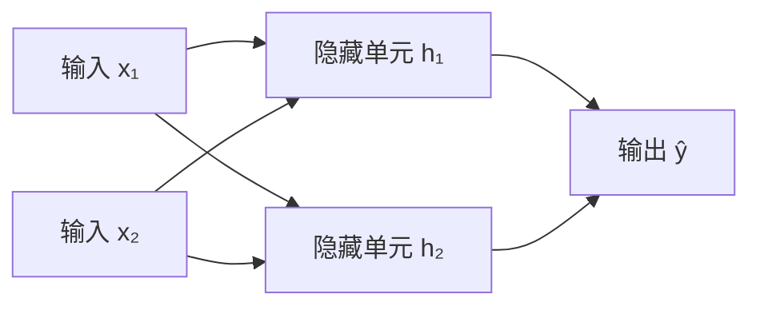

# 2.2.2 机器学习简介

本节用熟悉的曲线拟合说明机器学习的基本流程，再把同一流程用于理解手写数字识别和显微图中的颗粒识别。读完后，应能说清：模型接收什么输入、给出什么输出，训练数据起什么作用，以及怎样判断模型能否用于新图像。

## 1. 从科研模型理解机器学习

物理、化学和化工中的模型描述变量之间的关系。例如，Arrhenius 公式根据温度计算反应速率常数。机器学习中的**模型（model）**也可以看作一个函数：给定输入 $x$，用参数 $\theta$ 计算预测输出 $\hat y$。

$$\hat y=f_\theta(x)$$

| 符号 | 含义 | 速率常数预测中的例子 |
| --- | --- | --- |
| $x$ | 输入 | 温度 $T$ |
| $\hat y$ | 模型的预测 | 预测的速率常数 $\hat k$ |
| $f$ | 输入到输出的计算关系 | Arrhenius 公式 |
| $\theta$ | 决定具体计算结果的参数 | 指前因子 $A$、活化能 $E_a$ |

**机器学习**利用数据确定模型中需要学习的部分，使模型能够处理未见过的输入。它是人工智能领域的一类方法。研究者仍需确定任务、提供数据，并选择适合的模型和评价方式。

我们在科研中通过实验值检验预测值。模型在已有数据上拟合得好，还不足以说明它能预测新实验；后面会用独立数据检查这一点。

## 2. 用线性回归认识训练

先考虑一组输入 $x$ 和测量值 $y$。**线性回归（linear regression）**选择一组直线作为候选模型：

$$\hat y=kx+b$$

直线的形式由人选定；斜率 $k$ 和截距 $b$ 由数据确定。例如，测量不同浓度的溶液吸光度时，可以用浓度作 $x$、吸光度作 $y$，拟合直线并检查它在测量范围内的预测表现。

每组 $(x_i,y_i)$ 是一个**样本（sample）**。模型对它的预测为 $\hat y_i=kx_i+b$；预测与测量的差 $y_i-\hat y_i$ 称为**残差**。一种常见的拟合方法是选择 $k,b$，使残差平方和最小：

$$L(k,b)=\sum_{i=1}^{n}\left[y_i-(kx_i+b)\right]^2$$

这里的 $L$ 是**损失函数（loss function）**，用一个数衡量这组预测与测量的差异。**训练（training）**就是利用数据调整模型参数，使损失减小。最小二乘法正是这样的训练方法；第一节课的 [Arrhenius 拟合案例](../../lesson01/内容/1.4_AI与Agent的工作方式/1.4.2_机器学习与最小二乘法.md) 展示了如何先把公式转为直线，再由实验数据求参数。

| 名称 | 在线性回归中 | 在手写数字识别中 |
| --- | --- | --- |
| 输入与特征（feature） | 输入变量 $x$，如浓度 | 表示图像的像素值 |
| 标签（label） | 已知的测量值 $y$ | 人工确认的数字类别，如“6” |
| 参数（parameter） | 斜率 $k$、截距 $b$ | 网络中需要学习的权重、偏置 |
| 预测（prediction） | 新浓度对应的吸光度 | 新图像属于哪个数字类别 |
| 损失（loss） | 预测值与测量值的差异 | 预测类别与真实类别的差异 |

**特征**是送入模型、用来描述样本的信息；**标签**是学习或检查预测时所用的已知答案。标签可以是数值、类别，也可以是图像中每个目标的标注区域。这里介绍的线性回归和后面的数字识别、颗粒分割都属于使用已知答案训练的**监督学习**。没有预先给出每个样本答案、让算法按相似性分组的聚类，则属于另一类任务。

## 3. 先确定任务，再准备数据

同一张图像可以对应不同的问题。问题变了，所需标签和评价方法也会变。

| 任务 | 输入 | 期待的输出 | 一个样本的标签 |
| --- | --- | --- | --- |
| 回归 | 温度或浓度等变量 | 连续数值，如速率常数 | 实验测量值 |
| 分类 | 一张手写数字图像 | 0～9 中的一个类别 | 图上写的是哪个数字 |
| 实例分割 | 一张含多个颗粒的显微图 | 每个颗粒各自占据的像素区域 | 人工描出的各颗粒区域 |

**像素（pixel）**是数字图像中的一个小格，图像可以表示为像素值组成的数组。常见的手写数字样本为 $28\times28$ 像素：模型接收这些数值，输出十个数字类别的分数，再选择分数最高的类别。图中数字的位置和笔画会变化，因此仅凭一条固定规则难以覆盖所有写法。

颗粒任务比“这张图里有没有颗粒”的分类更细：我们要知道**每一颗**的范围。实例分割的输出通常是一张与原图等大的**标签图**：0 表示背景，1、2、3 等编号分别表示不同颗粒。同一颗粒内的像素使用同一编号。得到标签图后，可以数颗粒，并按像素尺寸换算面积、周长。分割结果仍需与原图及人工标注比较，尤其要检查相互接触、低对比度和位于图像边缘的颗粒。[颗粒分割案例](../4cellpose/README.md)会展示这一流程。

颗粒案例使用已经训练好的模型做**推理（inference）**，即固定模型参数，输入新图片并读取预测结果。课堂会重点检查预测和测量；讲解训练流程，是为了理解模型参数从哪里来，以及为什么换成自己的显微图后仍需验证结果。

在开始训练前，要确认每个样本的输入和标签一一对应。若图像与标签错位，模型即使正常运行，也学不到预期的关系。科研图像还应保留尺度标定、采集条件和标注依据，以便解释结果。

## 4. 怎样检验模型对新数据是否有效

通常把可用数据按用途分开：

| 数据 | 用途 | 可以据此做什么 |
| --- | --- | --- |
| **训练集** | 学习参数 | 计算损失、更新参数 |
| **验证集** | 比较方案 | 选择网络结构、训练轮数等设置 |
| **测试集** | 最后检查 | 报告选定方案对未参与训练和选择的数据的表现 |

训练集损失持续降低，但模型在新样本上表现变差，称为**过拟合（overfitting）**。模型对未见过的样本仍能给出可靠预测的能力，称为**泛化能力（generalization）**。例如，数字模型记住了训练图片的笔迹，却难以识别另一位同学写的数字，就是泛化不足的表现。

测试集只在确定方案后用于最终评价。反复查看测试结果并据此修改模型，会让测试集间接参与选择，最终结果可能过于乐观。来自同一实验批次或同一显微视野的相似图片也可能使评价偏高；评估颗粒模型时，应尽可能用独立视野、样品或采集批次检查实际使用效果。

评价指标要与任务相配。回归可以看预测与测量值相差多少；数字分类可以看**准确率**（判对的图片数除以总图片数）及错例；颗粒分割则需检查漏检、误检、相邻颗粒是否分开，以及预测轮廓与人工标注的重合情况。颗粒数量接近，不代表每个颗粒的边界都准确。

## 5. 从直线到神经网络

直线适合描述某些关系，但图像里的笔画和颗粒边界涉及复杂的形状变化。**神经网络（neural network）**把多次“加权求和”和非线性变换连接起来，形成可从数据学习的复杂函数。我们仍需选择输入表示、网络结构和训练目标；训练负责确定网络中的参数。

一个最简单的计算单元先对输入加权求和，再经过**激活函数（activation function）**：

$$z=\sum_{j=1}^{m}w_jx_j+b,\qquad a=\sigma(z)$$

$w_j$ 称为**权重**，$b$ 称为**偏置**，它们都是可学习参数。$\sigma$ 是激活函数，例如 $\operatorname{ReLU}(z)=\max(0,z)$。若多层之间只有加权求和，整体仍可合并成一次线性变换；加入非线性激活后，网络才能表示更复杂的关系。

下面用两个输入、两个中间计算单元、一个输出说明“层”的含义；图中的连线各有自己的权重。真实图像模型的单元和参数通常更多。

$$
\begin{aligned}
h_1&=\sigma(w_{11}x_1+w_{12}x_2+b_1),\\
h_2&=\sigma(w_{21}x_1+w_{22}x_2+b_2),\\
\hat y&=v_1h_1+v_2h_2+c.
\end{aligned}
$$

若把 $\sigma$ 去掉，代入并整理后，输出仍是 $\hat y=\alpha x_1+\beta x_2+\gamma$。这个小例子说明了非线性变换的作用；网络层数增加本身并不会让纯线性计算产生非线性。

有多个中间层的网络通常称为**深度学习（deep learning）**模型。手写数字识别可以用多层感知机作为入门模型：把 $28\times28$ 个像素展开成 784 个输入数值，经过中间层计算，得到十个数字类别的分数。用于颗粒分割的图像网络则要保留或恢复像素在图中的位置，才能给出每颗粒的区域；这也是不同任务会选择不同网络结构的原因。

## 6. 神经网络怎样学到参数

训练网络与拟合直线遵循同一思路：输入有标签的样本，计算预测和损失，再调整参数。差别在于神经网络的参数很多，通常采用迭代方法：

1. **前向计算**：让输入逐层通过网络，得到预测。
2. **计算损失**：将预测与标签比较，得到一个需要尽量减小的数。
3. **计算梯度**：求损失对各参数的导数。**反向传播（backpropagation）**按微积分的链式法则，从输出层向前高效地计算这些导数。
4. **更新参数**：沿着使损失减小的方向调整参数，再处理下一批样本。

以直线拟合为例，若用梯度下降更新斜率 $k$，写作：

$$k\leftarrow k-\eta\frac{\partial L}{\partial k},\qquad
b\leftarrow b-\eta\frac{\partial L}{\partial b}$$

**梯度**表示损失随参数变化的方向和快慢；**学习率** $\eta$ 控制每次更新的步长。最小二乘直线拟合也可以直接求解参数，无需使用梯度下降。神经网络训练中，反向传播负责计算梯度，优化算法利用梯度更新参数：两者承担不同工作。

每次更新使用的一组样本称为一个**批次（batch）**，其中样本数是**批量大小（batch size）**。训练集完整使用一遍称为一个 **epoch（轮）**；多轮训练会反复使用训练集，并在验证集上观察效果。训练轮数增加未必能提高新数据上的表现。

## 7. 带着这些问题看后续案例

| 需要回答的问题 | 手写数字识别 | 颗粒识别 |
| --- | --- | --- |
| 一个输入是什么？ | 一张数字图片 | 一张显微图片 |
| 标签是什么？ | 图片对应的数字 0～9 | 每颗颗粒的人工标注区域 |
| 模型输出什么？ | 十类分数与预测类别 | 每颗颗粒的像素区域及编号 |
| 怎样检查结果？ | 准确率、错例、类别间的混淆 | 漏检、误检、粘连分离、轮廓和尺寸 |

实际操作时，先查看几张原图和对应标签；运行模型后，再查看它判错的数字或画错的颗粒轮廓。观察具体错误，通常比只看一个总分更能帮助判断模型是否适合自己的数据。

## 可选阅读

- [Google 机器学习速成课程：线性回归](https://developers.google.com/machine-learning/crash-course/linear-regression?hl=zh-cn)：回顾模型、损失和梯度下降。
- [《动手学深度学习》：多层感知机](https://zh.d2l.ai/chapter_multilayer-perceptrons/mlp.html)：查看非线性激活函数和多层计算。
- [scikit-learn 用户指南](https://scikit-learn.org/stable/user_guide.html)：按需了解其他机器学习方法。
