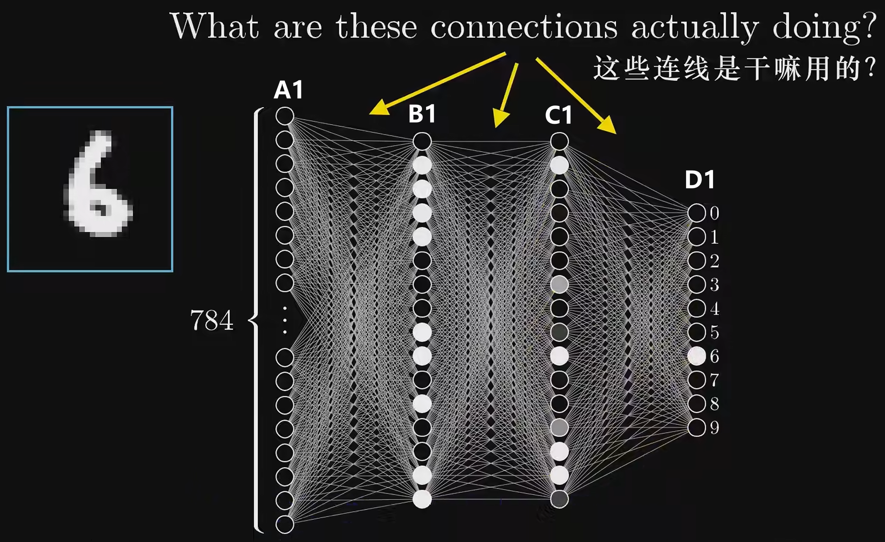
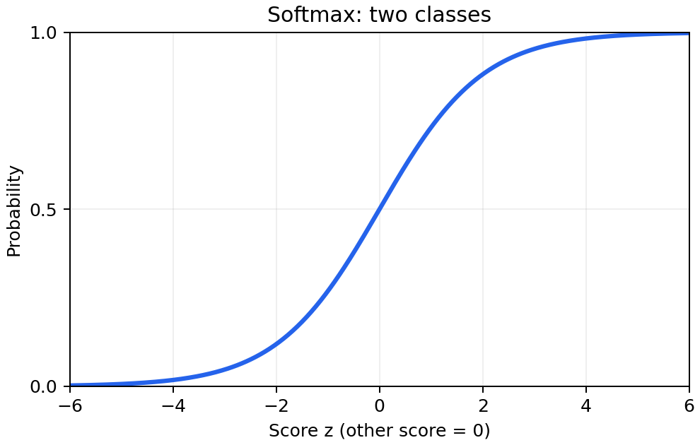

# 机器学习与神经网络简介

本节从阿伦尼乌斯公式和实验数据的直线拟合出发，介绍模型与训练，再说明神经网络的多层计算和图像任务的输入输出，最后介绍数据划分与模型评价。

## 1. 模型：描述输入与输出的关系

物理和化学研究常用模型描述变量之间的关系。例如，吸光度与浓度的关系用于定量分析，反应速率与温度的关系用于研究动力学。模型通过选定的变量和参数表达研究对象的某些性质。

以阿伦尼乌斯公式为例，在适用温度范围内，反应速率常数与温度的关系写为：

$$k(T)=A\exp\left(-\frac{E_a}{RT}\right).$$

> **阿伦尼乌斯公式（Arrhenius Equation）**：描述反应速率常数随温度变化关系的经验公式。

| 符号 | 含义 |
| --- | --- |
| $T$ | 绝对温度，单位为 K |
| $k(T)$ | 温度 $T$ 下的反应速率常数，其单位由反应级数决定 |
| $A$ | 指前因子，与速率常数具有相同单位 |
| $E_a$ | 活化能 |
| $R$ | 气体常数；例如取 $8.314\ \mathrm{J\,mol^{-1}\,K^{-1}}$ 时，$E_a$ 使用 $\mathrm{J\,mol^{-1}}$ |

对于给定反应，确定 $A$ 和 $E_a$ 后，输入温度 $T$，公式就能计算相应的速率常数预测值。实验中测量一系列温度下的速率常数，可以用来拟合这两个参数。

这里的公式描述了温度到速率常数的计算关系，$A$ 和 $E_a$ 决定具体的曲线。我们把这种计算关系称为模型，把需要确定的系数称为参数。

> **模型（Model）**：根据输入计算输出的数学关系或计算过程。**参数（Parameter）**：模型中通过拟合或训练确定的数值。

将这种输入与输出的关系写成一般形式：

$$\hat y=f_\theta(x).$$

根据任务的需要，函数 $f$ 可以包含多步计算，输入 $x$ 和输出 $\hat y$ 都可以由多个数值组成。

| 符号 | 含义 | 阿伦尼乌斯公式中的对应量 |
| --- | --- | --- |
| $x$ | 输入 | 温度 $T$ |
| $\hat y$ | 预测输出 | 计算得到的速率常数 $\hat k(T)$ |
| $f$ | 输入到输出的计算关系 | $A\exp[-E_a/(RT)]$ |
| $\theta$ | 模型参数的集合 | 指前因子 $A$ 和活化能 $E_a$ |
| $y$ | 用于比较的观测值 | 对应温度下实验测得的速率常数 |

模型可以输出一个数值、多个数值、一组类别分数或一张图像。模型的输出形式由任务决定，预测质量通过相应数据和指标评价。

## 2. 机器学习：通过数据确定模型

对于一组温度和速率常数的测量记录，可以让计算机尝试不同的 $A$ 和 $E_a$，比较预测与测量的差异，寻找合适的参数。这种利用数据确定模型的方法属于机器学习。图像识别、语言处理等任务也可以利用数据学习输入与输出的关系，它们属于人工智能研究的内容。

> **AI（Artificial Intelligence，人工智能）**：研究和实现感知、推理、学习、规划等能力的领域。**ML（Machine Learning，机器学习）**：通过数据学习模型参数或结构，并将模型用于预测、分析或生成的方法。

机器学习流程包括定义任务、整理数据、选择模型、训练和评价。研究者确定输入信息、输出目标和模型结构，训练算法利用数据调整模型。后文将从直线拟合开始，逐步介绍如何构建和训练模型。

### 数据、特征与标签

以温度和速率常数的实验记录表为例，整张表是一组数据，每一行对应一次测量。用于计算的温度是输入属性，测得的速率常数是期望模型预测的目标值。机器学习分别用数据集、样本、特征和标签来描述这些内容。

> **数据集（Dataset）**：按照任务组织的一组数据。**样本（Sample）**：数据集中的一个观测对象。**特征（Feature）**：模型使用的输入属性。**标签（Label）**：与输入对应的目标值，例如实验测量结果、数字类别或人工标注的颗粒区域。

| 任务 | 一个样本 | 输入特征 | 标签 |
| --- | --- | --- | --- |
| 吸光度预测 | 一次溶液测量 | 浓度、光程等 | 测得的吸光度 |
| 材料性能预测 | 一个样品及其条件 | 成分、制备温度、处理时间等 | 测得的强度或电导率 |
| 手写数字识别 | 一张数字图片 | 图像像素 | 数字类别 0～9 |
| 颗粒实例分割 | 一张显微图像 | 图像像素 | 每个颗粒的人工标注区域 |

### 常见任务

用温度预测速率常数时，输出是一个连续数值；判断图片中的数字时，输出是一个类别。按光谱相似性对样品分组时，输出是一组分组结果。这些输出目标对应不同的任务。

| 任务 | 输出形式 | 材料化学中的例子 |
| --- | --- | --- |
| 回归 | 连续数值 | 预测反应速率常数、带隙或强度 |
| 分类 | 已定义的类别 | 判断晶相类别或缺陷类型 |
| 聚类 | 根据相似性形成的组 | 按光谱或组成对样品分组 |
| 降维 | 较少维度的数据表示 | 将多通道光谱投影到几个主要变化方向 |
| 实例分割 | 每个独立目标的像素区域 | 从电镜图中分出各个颗粒 |
| 生成 | 新的数据内容 | 根据条件生成候选分子结构 |

上面的直线拟合和数字识别都提供了输入对应的目标值，模型可以比较预测与目标后调整参数。按光谱相似性分组时，则可以直接分析数据之间的关系。这两类学习方式分别称为监督学习和无监督学习。

> **监督学习（Supervised Learning）**：利用输入和对应标签学习预测关系。**无监督学习（Unsupervised Learning）**：利用数据自身的结构进行分组、表示学习等分析。

回归、分类和使用人工标签训练的分割属于监督学习。聚类和常见的降维方法属于无监督学习。各任务的结果含义由其训练目标和评价方法确定。

## 3. 线性回归：从直线拟合理解训练

假设输入为 $x$，预测输出为 $\hat y$，模型形式为：

$$\hat y=kx+b.$$

这类用输入预测连续数值、并采用直线关系的模型称为线性回归。斜率 $k$ 和截距 $b$ 是需要从数据中确定的参数。对于 $n$ 组观测数据 $(x_i,y_i)$，先计算每个样本的预测，再计算预测与观测之间的差异。将每个差值平方后取平均，就得到衡量当前参数预测误差的一个数值，我们用它作为训练中的损失。

> **损失函数（Loss Function）**：将预测与目标之间的差异表示为数值的函数。本节在线性回归中使用 **MSE（Mean Squared Error，均方误差）**：预测误差平方的平均值。

$$L(k,b)=\frac{1}{n}\sum_{i=1}^{n}\left(kx_i+b-y_i\right)^2.$$

训练的目标是找到一组参数，使得损失尽量小：

$$(k^*,b^*)=\operatorname*{arg\,min}_{k,b}L(k,b).$$

利用已有数据寻找参数的过程称为训练。参数确定后，将新的 $x$ 代入模型得到预测值，这个计算过程称为推理。

> **训练（Training）**：利用数据和优化方法确定模型参数的过程。**推理（Inference）**：使用已确定参数的模型计算输入对应的输出，也称预测。

下面用三组教学数据展示损失的计算。数值采用任意单位：

| 输入 $x$ | 观测值 $y$ | 参数 $k=1,b=0$ 时的预测 | 参数 $k=2,b=1$ 时的预测 |
| ---: | ---: | ---: | ---: |
| 1 | 3 | 1 | 3 |
| 2 | 6 | 2 | 5 |
| 3 | 7 | 3 | 7 |

第一组参数的均方误差为 $(4+16+16)/3=12$；第二组参数的均方误差为 $(0+1+0)/3=1/3$。三个观测点呈现近似线性趋势，中间点高于第二组参数对应的直线。训练通过调整斜率和截距，使全部样本的总体损失尽量小。

对这三个点使用最小二乘法，得到 $k=2$、$b=4/3$。预测值依次为 $10/3$、$16/3$ 和 $22/3$，对应的均方误差为 $2/9$。拟合直线综合了三个点的信息，各点与直线之间的差值称为残差。

> **残差（Residual）**：观测值与模型预测值之差，即 $y_i-\hat y_i$。

多个输入时，线性回归写为：

$$\hat y=w_1x_1+w_2x_2+\cdots+w_dx_d+b.$$

例如，使用成分、温度和处理时间三个输入预测材料性质时，模型分别为三个输入配置系数。输入变量的单位和尺度会影响系数的数值；系数的物理解释需要结合数据采集方式和变量关系。

### 化学中的两个例子

**阿伦尼乌斯公式的线性化**将温度与速率常数的指数关系转换为直线关系。对第 1 节的公式取自然对数，得到：

$$\ln k=\ln A-\frac{E_a}{R}\frac{1}{T}.$$

用 $1/T$ 作为输入、$\ln k$ 作为输出拟合直线，斜率 $m=-E_a/R$，因此 $E_a=-mR$。温度使用开尔文，活化能的单位与 $R$ 的单位保持一致。这里的 $k$ 表示速率常数，直线斜率另记为 $m$。

**Beer–Lambert 定律**描述一定适用条件下吸光度与浓度的关系：

$$A_{\mathrm{abs}}=\varepsilon cl.$$

其中 $A_{\mathrm{abs}}$ 为吸光度，$\varepsilon$ 为摩尔吸光系数，$c$ 为浓度，$l$ 为光程。固定光程后，用一系列标准溶液拟合 $A_{\mathrm{abs}}=mc+b$，斜率满足 $m=\varepsilon l$。利用拟合曲线和待测吸光度，可计算待测浓度 $c=(A_{\mathrm{abs}}-b)/m$。标定范围和实验条件决定曲线的适用范围。

## 4. 神经网络：组合多层计算

前面的线性回归先确定 $\hat y=kx+b$ 的形式，再利用数据求出斜率和截距。阿伦尼乌斯公式也先给出温度与速率常数之间的指数关系，再通过实验数据确定指前因子和活化能。

对于复杂任务，输入与输出之间的函数形式往往难以预先确定。例如，一张数字图片包含许多像素，笔画的形状、位置和粗细共同影响数字类别；电镜图中的颗粒区域则受到亮度、纹理、形貌和相邻颗粒的影响。为这些因素写出一个明确的预测公式，需要描述大量相互关联的变化。

神经网络采用另一种构建函数的方式：我们不预先指定输入与输出之间的具体函数表达式，而是选择计算单元、层数和连接方式，将简单计算逐层组合，再通过数据学习其中的参数。网络结构规定了可表达函数的范围，训练从这个范围中寻找适合当前任务的输入输出关系。

可以先对输入做一组加权计算，再将结果交给下一组计算单元，逐层得到最终输出。这样组成的模型称为神经网络，其中的基本计算单元称为神经元。

> **神经网络（Neural Network）**：由多个计算单元和层组成的参数化模型。**神经元（Neuron）**：接收输入、计算加权和并进行变换的基本计算单元。

一个神经元可以写为：

$$z=\sum_{j=1}^{d}w_jx_j+b,\qquad h=\phi(z).$$

> **权重（Weight）**：输入对应的乘法系数。**偏置（Bias）**：加权和中的常数项。**激活函数（Activation Function）**：对加权和进行变换的函数，常用于引入非线性。

### 多层感知机

把多个神经元排成一层，再将几层依次连接，就得到一种常见的网络。每一层是一组接收上一组输出、共同产生新数值的计算单元。输入与最终输出之间的层计算中间结果，称为隐藏层。各层按输入到输出的方向依次计算，就形成前馈网络；采用全连接计算的这类结构称为多层感知机。

> **MLP（Multilayer Perceptron，多层感知机）**：由输入、一个或多个隐藏层和输出层组成的前馈神经网络。**隐藏层（Hidden Layer）**：位于输入与输出之间、计算中间表示的层。

对于手写数字识别，一张 $28\times28$ 像素的灰度图可以展开为 784 个输入数值。下面给出一个示例结构：

$$784\;\longrightarrow\;128\;\longrightarrow\;64\;\longrightarrow\;10.$$

| 部分 | 数值数量 | 作用 |
| --- | ---: | --- |
| 输入 | 784 | 接收缩放到 0～1 的像素值 |
| 第一隐藏层 | 128 | 计算第一组中间特征 |
| 第二隐藏层 | 64 | 组合上一层的特征 |
| 输出层 | 10 | 给出数字 0～9 的类别分数 |

每层接收多个数值，并产生一组新的数值。全连接层中，每个输出单元都使用上一层的所有输出。

> **全连接层（Fully Connected Layer）**：每个输出单元与上一层全部输入相连接的层。

一个具有 $d$ 个输入、$m$ 个输出的全连接层，包含 $dm$ 个权重和 $m$ 个偏置。上例的参数数量为：

$$(784\times128+128)+(128\times64+64)+(64\times10+10)=109386.$$

对于取值为 0～255 的灰度图，可以先将像素值除以 255，使输入落在 0～1。这样按规定尺度变换数值的过程称为归一化。

> **归一化（Normalization）**：按照指定规则调整数值尺度的预处理操作。

这些参数通过训练共同确定。输出层产生十个分数，取得分最大的类别作为预测数字。通过 Softmax 变换，还可将分数转换为和为 1 的类别概率形式。

> **Softmax 函数**：将一组实数分数转换为非负、总和为 1 的数值的函数。该输出用于表示模型对各类别的预测分布；例如，模型可为数字 0～9 分别给出一个预测概率。

对 $C$ 个类别的分数 $z_1,\ldots,z_C$，Softmax 的计算公式为：

$$p_i=\frac{e^{z_i}}{\sum_{j=1}^{C}e^{z_j}},\qquad i=1,\ldots,C.$$

下图以两个类别为例，将分数写成 $[z,0]$，展示第一个类别的概率 $p=e^z/(e^z+1)$。随着分数 $z$ 增加，该类别的概率逐渐接近 1。

### 非线性激活与层的组合

前面的每个神经元各有一行加权求和公式。把输入排成列向量，把各单元的权重逐行排列，再把偏置排成一列，就可以合写一层的计算。逐项计算、矩阵乘法和维度说明见 [神经网络的逐层计算](网络逐层计算.md)。

将所有单元写为矩阵形式，一层计算为：

$$\mathbf h=\phi(W\mathbf x+\mathbf b).$$

这里 $W$ 收集一层的权重，$\mathbf b$ 收集偏置，$\mathbf x$ 和 $\mathbf h$ 分别收集输入和输出。加权求和再加偏置的计算称为仿射变换。

若连续两层均采用仿射变换，则它们可以合并为一个仿射变换：

$$W_2(W_1\mathbf x+\mathbf b_1)+\mathbf b_2
=(W_2W_1)\mathbf x+(W_2\mathbf b_1+\mathbf b_2).$$

在层之间加入非线性激活函数，可以使多层网络表达更丰富的输入输出关系。[多层感知机与激活函数](https://zh.d2l.ai/chapter_multilayer-perceptrons/mlp.html)

例如，可以把加权和中的负数变为 0，保留正数。这种激活方式称为 ReLU。

> **ReLU（Rectified Linear Unit，修正线性单元）**：常用的激活函数，定义为 $\operatorname{ReLU}(z)=\max(0,z)$。

例如，三个单元的加权和为 $[-2,1,3]$，经过 ReLU 后得到 $[0,1,3]$。下一层再对这些输出进行加权组合。

展开：两个输入、两个隐藏单元和一个输出的计算

设输入为 $x_1=1,x_2=2$，隐藏层计算为：

$$h_1=\operatorname{ReLU}(x_1+x_2-1)=2,$$

$$h_2=\operatorname{ReLU}(2x_1-x_2+1)=1.$$

输出层计算为：

$$\hat y=3h_1-h_2+0.5=5.5.$$

这个教学例子展示了“加权求和 → 激活 → 再组合”的过程。各层的权重和偏置在训练过程中更新。

## 5. 神经网络的训练过程

训练从一组初始参数出发。为了确定参数的调整方向，可以计算损失对每个参数的导数，了解参数的小幅变化如何影响损失。把这些导数放在一起，就得到梯度；每次沿选定方向调整多大的幅度，由学习率控制。

> **梯度（Gradient）**：函数对各个参数偏导数组成的向量，描述函数在当前位置随参数变化的方向和快慢。**学习率（Learning Rate）**：控制每次参数更新幅度的系数。

对线性回归的均方误差求导，得到：

$$\frac{\partial L}{\partial k}=\frac{2}{n}\sum_{i=1}^{n}(kx_i+b-y_i)x_i,$$

$$\frac{\partial L}{\partial b}=\frac{2}{n}\sum_{i=1}^{n}(kx_i+b-y_i).$$

梯度下降使用当前梯度更新参数：

$$k\leftarrow k-\eta\frac{\partial L}{\partial k},\qquad
b\leftarrow b-\eta\frac{\partial L}{\partial b}.$$

这里 $\eta$ 为学习率，两个新参数都根据更新前的参数计算。对前面的三组教学数据，从 $k=1,b=0$ 出发，两个梯度分别为 $-44/3$ 和 $-20/3$。当 $\eta=0.01$ 时，一次更新得到 $k\approx1.1467,b\approx0.0667$，均方误差从 12 降为约 9.5484。[梯度下降视频讲解（哔哩哔哩）](https://www.bilibili.com/video/BV1bx411M7Zx/)

> **梯度下降（Gradient Descent）**：沿当前损失梯度的反方向调整参数的优化方法。

神经网络包含许多层，训练软件利用链式法则计算损失对各层参数的梯度。

例如，输出层的计算依赖隐藏层，隐藏层又依赖输入层的权重。链式法则可以沿这些依赖关系逐层计算导数，这个求导过程称为反向传播。得到梯度后，再由优化器执行参数更新。

> **反向传播（Backpropagation）**：沿计算图反向应用链式法则，高效计算损失对参数梯度的方法。**优化器（Optimizer）**：利用梯度等信息更新参数的算法。

| 步骤 | 执行的计算 | 手写数字识别中的对应过程 |
| --- | --- | --- |
| 前向计算 | 从输入逐层计算输出 | 像素经过网络，得到十个类别分数 |
| 计算损失 | 比较输出与标签 | 根据正确数字类别计算分类损失 |
| 反向传播 | 计算各参数的梯度 | 得到每层权重、偏置对应的梯度 |
| 参数更新 | 优化器调整参数 | 改变网络参数，进入下一批数据 |

数字识别中，标签给出正确的数字类别。训练需要推动模型提高正确类别的预测概率，常用的损失为交叉熵。

> **交叉熵（Cross Entropy）**：分类任务中常用的损失函数，衡量预测分布与目标分布的差异。

图像分类训练常使用交叉熵。分割训练会采用与像素区域、实例构建等目标相适配的损失。具体损失由模型的输出形式和训练目标确定。

实际训练可以每次取出 100 张图片，计算这一组图片的平均损失并更新一次参数。这一组图片称为一个批次，100 就是批量大小。把全部训练图片使用一遍，称为一轮。

> **批次（Batch）**：一次参数更新所使用的一组样本。**批量大小（Batch Size）**：批次中的样本数量。**轮次（Epoch）**：完整使用一次训练集的训练过程。

例如，训练集有 1000 个样本，批量大小为 100，完整一轮包含 10 次参数更新。训练期间记录损失，观察参数更新后的变化。训练完成后，保存参数供后续推理使用。第 8 节进一步介绍用于模型选择和评价的数据划分。

## 6. 常见网络结构与科研数据

处理图像时，可以让计算单元观察局部像素，并在不同位置重复使用同一组权重；处理实验时间序列时，可以按顺序读取信号并传递前一步的状态；处理位置之间的联系时，可以计算各位置的关联权重并组合信息。这些组织计算的方式形成了不同的网络结构。

| 结构 | 主要计算特点 | 适合展示的任务 |
| --- | --- | --- |
| 多层感知机 | 全连接层组合输入特征 | 根据成分和实验条件预测性质；入门手写数字识别 |
| 卷积神经网络 | 在局部区域计算并共享权重 | 图像分类、缺陷识别、显微图像分割 |
| 循环神经网络 | 按序处理输入并传递隐藏状态 | 时间序列、实验过程信号 |
| Transformer | 通过注意力机制组合不同位置的信息 | 图像表示、光谱与序列分析、语言建模 |

> **CNN（Convolutional Neural Network，卷积神经网络）**：通过卷积等操作提取局部图像或信号特征的网络。**RNN（Recurrent Neural Network，循环神经网络）**：通过循环连接传递状态、处理序列的网络。
>
> **Transformer**：以注意力机制为核心的神经网络结构。**注意力机制（Attention Mechanism）**：根据输入内容计算位置或特征之间的权重，并加权组合信息的机制。

网络结构决定信息如何在层间传递。通过多层计算，网络逐步组合和变换图像或信号中的信息，形成用于预测的中间特征。这类使用多层神经网络学习数据表示的方法称为深度学习。

> **深度学习（Deep Learning）**：使用多层神经网络学习数据表示并完成预测、生成等任务的方法。

输入质量、标注质量和训练数据覆盖范围共同影响最终表现。

例如，将文本作为输入，学习文字之间的关系并生成后续内容，可以构建语言模型。通过大规模数据训练的语言模型中，有一类通常称为大语言模型。

> **LLM（Large Language Model，大语言模型）**：通过大规模数据训练、用于语言理解和生成等任务的模型。许多大语言模型采用 Transformer 结构。

## 7. 本课的两个图像任务

本课先训练一个数字识别模型，再加载已经训练好的 Cellpose 模型处理显微图。后者的参数由此前的训练确定，课堂直接使用它进行预测。

> **预训练模型（Pretrained Model）**：已通过训练学习到参数、可加载用于预测或继续训练的模型。

| 项目 | 手写数字识别 | Cellpose 颗粒实例分割 |
| --- | --- | --- |
| 输入 | 一张 $28\times28$ 灰度图 | 一张电镜图或细胞图 |
| 输出 | 十个类别分数和预测数字 | 与图像对应的整数实例标签图 |
| 标签 | 图片对应的数字 | 人工标注的各目标区域 |
| 训练或运行方式 | 使用数字数据训练入门模型 | 加载预训练模型进行预测 |
| 结果核查 | 判断正确的比例、各数字之间的错判情况、错例图片 | 漏检、背景误检、接触目标分离、轮廓位置 |
| 后续分析 | 比较各类数字的识别效果 | 计算面积和周长，剔除接触边缘的颗粒 |

数字识别材料见 [手写数字识别实战](../MNIST/README.md)。颗粒分割材料见 [Cellpose 模型与测量案例](../4cellpose/README.md)。

以颗粒测量为例，流程为“图像 → 分割标签 → 轮廓核对 → 几何测量 → 边缘筛选 → 统计表”。分割区域的误差会传递到面积、周长和粒径分布，因此轮廓核查是几何分析中的一个步骤。

## 8. 数据划分与模型评价

例如，有 1000 个样品时，可以用其中 700 个拟合参数，用 150 个比较不同网络设置，再用剩余 150 个评价最终模型。三部分分别称为训练集、验证集和测试集。数据划分在训练开始前完成，各部分承担不同用途。

| 数据部分 | 用途 | 对模型的影响 |
| --- | --- | --- |
| 训练集 | 拟合参数 | 参与参数更新 |
| 验证集 | 选择结构、训练轮数和其他设置 | 参与模型选择 |
| 测试集 | 评价最终模型 | 提供独立评价结果 |

前面的学习率、隐藏层单元数和训练轮数，都需要由研究者设置并结合验证结果选择。这些设置称为超参数。模型在新的样本上保持预测表现的能力，称为泛化能力。

> **超参数（Hyperparameter）**：在训练或模型选择过程中设置的配置，例如学习率、隐藏层宽度和训练轮数。**泛化能力（Generalization）**：模型在新样本上的预测表现。

划分比例根据数据量和任务确定，例如可将数据按 70%、15%、15% 划分为训练、验证和测试部分。测试集保持独立，最终评价时使用。数据量较小时，可以将用于模型选择的数据分成几组，轮流保留一组作验证、使用其余组训练，再汇总评价结果。这个过程称为交叉验证。

> **交叉验证（Cross-validation）**：通过多次训练与验证的数据划分，评价模型或选择设置的方法。

[数据划分与评价方法](https://scikit-learn.org/stable/model_selection.html)

材料数据的划分单位尤其重要。同一样品的重复测量、同一批次的相关图像、同一原图裁出的重叠区域，应按样品、批次或原图分组划分。这样得到的测试结果更接近模型面对独立样品时的情况。

输入的不同特征可能使用不同单位和数值范围。例如，将每列特征减去均值、再除以标准差，可以调整不同特征的尺度，这称为标准化。均值与标准差由训练集计算，再应用到验证集和测试集。

> **标准化（Standardization）**：本节指将数值减去均值、再除以标准差的变换。

如果同一原图裁出的重叠区域分散到训练和测试部分，测试结果可能主要反映模型对相似图像的适应程度。训练过程提前获得评价信息的情况称为数据泄漏。

训练误差很小而独立样本误差较大时，模型可能过度适应了训练数据的细节；训练和独立样本上的误差都较大时，模型可能还需要更充分的表达或学习。这两种情况分别称为过拟合和欠拟合。

> **数据泄漏（Data Leakage）**：训练或模型选择过程使用了本应保留给独立评价的信息，导致评价结果偏高。

> **过拟合（Overfitting）**：模型对训练数据中的细节和噪声适应较强，在独立数据上的表现较差。**欠拟合（Underfitting）**：模型对数据主要关系的表达或学习程度不足，在训练和独立数据上均表现较差。

评价时，可以先比较预测值与测量值的差距、统计判断正确的样本数，或比较预测颗粒区域与人工标注区域的重叠程度。不同任务由此采用不同的评价量。

| 任务 | 常用评价量 | 结果解释 |
| --- | --- | --- |
| 回归 | 平均绝对误差、均方根误差 | 预测值与测量值的差异，结合目标单位解释 |
| 分类 | 准确率、混淆矩阵 | 判断正确的比例，以及各类别之间的混淆 |
| 实例分割 | 区域重叠、目标匹配后的检出与误检统计 | 目标是否被找到、相邻目标是否分开、轮廓是否准确 |

例如，回归误差为 $[-1,2,-3]$ 时，绝对误差的平均值为 $(1+2+3)/3=2$，平方误差平均值的平方根为 $\sqrt{14/3}$。数字识别中，将真实数字与预测数字交叉计数，就可以看到哪些数字容易混淆。

> **MAE（Mean Absolute Error，平均绝对误差）**：预测误差绝对值的平均值。**RMSE（Root Mean Squared Error，均方根误差）**：均方误差的平方根。**混淆矩阵（Confusion Matrix）**：按真实类别与预测类别交叉统计样本数量的表。

回归误差与分类准确率分别对应数值预测和类别判断。分割任务中，可以进一步比较预测区域与人工标注区域的交并比，并按明确的匹配规则统计独立目标。颗粒的面积和周长属于基于分割区域得到的几何测量值。

例如，预测区域与标注区域的交集为 80 个像素，并集为 100 个像素，则交并比为 $80/100=0.8$。

> **IoU（Intersection over Union，交并比）**：两个区域交集面积与并集面积之比，用于描述区域重叠程度。

## 延伸阅读

- [机器学习与神经网络视频合集（哔哩哔哩）](https://www.bilibili.com/video/BV1bx411M7Zx/)：配合本节内容观看。

- [《动手学深度学习》中文版](https://zh.d2l.ai/chapter_preface/index.html)：系统学习线性模型、神经网络和训练方法。
- [scikit-learn 官方文档](https://scikit-learn.org/stable/)：按任务查阅回归、分类、聚类和降维方法。
