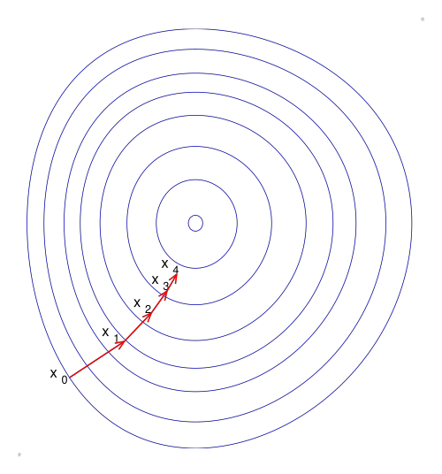

# 机器学习与神经网络简介

本节从阿伦尼乌斯公式和实验数据的直线拟合出发，介绍模型与训练，再说明神经网络的多层计算和图像任务的输入输出，最后介绍数据划分与模型评价。

## 1. 模型：描述输入与输出的关系

物理和化学研究常用模型描述变量之间的关系。例如，吸光度与浓度的关系用于定量分析，反应速率与温度的关系用于研究动力学。模型通过选定的变量和参数表达研究对象的某些性质。

以阿伦尼乌斯公式为例，在适用温度范围内，反应速率常数与温度的关系写为：

$$k(T)=A\exp\left(-\frac{E_a}{RT}\right).$$

> **阿伦尼乌斯公式（Arrhenius Equation）**：描述反应速率常数随温度变化关系的经验公式。

| 符号 | 含义 |
| --- | --- |
| $T$ | 绝对温度，单位为 K |
| $k(T)$ | 温度 $T$ 下的反应速率常数，其单位由反应级数决定 |
| $A$ | 指前因子，与速率常数具有相同单位 |
| $E_a$ | 活化能 |
| $R$ | 气体常数；例如取 $8.314\ \mathrm{J\,mol^{-1}\,K^{-1}}$ 时，$E_a$ 使用 $\mathrm{J\,mol^{-1}}$ |

对于给定反应，确定 $A$ 和 $E_a$ 后，输入温度 $T$，公式就能计算相应的速率常数预测值。实验中测量一系列温度下的速率常数，可以用来拟合这两个参数。

将这种输入与输出的关系写成一般形式：

$$\hat y=f_\theta(x).$$

根据任务的需要，函数 $f$ 可以包含多步计算，输入 $x$ 和输出 $\hat y$ 都可以由多个数值组成。

| 符号 | 含义 | 阿伦尼乌斯公式中的对应量 |
| --- | --- | --- |
| $x$ | 输入 | 温度 $T$ |
| $\hat y$ | 预测输出 | 计算得到的速率常数 $\hat k(T)$ |
| $f$ | 输入到输出的计算关系 | $A\exp[-E_a/(RT)]$ |
| $\theta$ | 模型参数的集合 | 指前因子 $A$ 和活化能 $E_a$ |
| $y$ | 用于比较的观测值 | 对应温度下实验测得的速率常数 |

模型可以输出一个数值、多个数值、一组类别分数或一张图像。模型的输出形式由任务决定，预测质量通过相应数据和指标评价。

## 2. 机器学习：通过数据确定模型

> **AI（Artificial Intelligence，人工智能）**：研究和实现感知、推理、学习、规划等能力的领域。**ML（Machine Learning，机器学习）**：通过数据学习模型参数或结构，并将模型用于预测、分析或生成的方法。

机器学习流程包括定义任务、整理数据、选择模型、训练和评价。研究者确定输入信息、输出目标和模型结构，训练算法利用数据调整模型。神经网络是机器学习中的一类模型；深度学习使用包含多层计算的神经网络学习数据表示。

### 数据、特征与标签

以实验记录表为例，每一行可以表示一个样品，每一列可以表示一个测量条件或性质。

> **数据集（Dataset）**：按照任务组织的一组数据。**样本（Sample）**：数据集中的一个观测对象。**特征（Feature）**：模型使用的输入属性。**标签（Label）**：与输入对应的目标值，例如实验测量结果、数字类别或人工标注的颗粒区域。

| 任务 | 一个样本 | 输入特征 | 标签 |
| --- | --- | --- | --- |
| 吸光度预测 | 一次溶液测量 | 浓度、光程等 | 测得的吸光度 |
| 材料性能预测 | 一个样品及其条件 | 成分、制备温度、处理时间等 | 测得的强度或电导率 |
| 手写数字识别 | 一张数字图片 | 图像像素 | 数字类别 0～9 |
| 颗粒实例分割 | 一张显微图像 | 图像像素 | 每个颗粒的人工标注区域 |

### 常见任务

| 任务 | 输出形式 | 材料化学中的例子 |
| --- | --- | --- |
| 回归 | 连续数值 | 预测反应速率常数、带隙或强度 |
| 分类 | 已定义的类别 | 判断晶相类别或缺陷类型 |
| 聚类 | 根据相似性形成的组 | 按光谱或组成对样品分组 |
| 降维 | 较少维度的数据表示 | 将多通道光谱投影到几个主要变化方向 |
| 实例分割 | 每个独立目标的像素区域 | 从电镜图中分出各个颗粒 |
| 生成 | 新的数据内容 | 根据条件生成候选分子结构 |

> **监督学习（Supervised Learning）**：利用输入和对应标签学习预测关系。**无监督学习（Unsupervised Learning）**：利用数据自身的结构进行分组、表示学习等分析。

回归、分类和使用人工标签训练的分割属于监督学习。聚类和常见的降维方法属于无监督学习。各任务的结果含义由其训练目标和评价方法确定。

## 3. 线性回归：从直线拟合理解训练

假设输入为 $x$，预测输出为 $\hat y$，模型形式为：

$$\hat y=kx+b.$$

斜率 $k$ 和截距 $b$ 是需要从数据中确定的参数。对于 $n$ 组观测数据 $(x_i,y_i)$，先计算每个样本的预测，再计算预测与观测之间的差异。

> **损失函数（Loss Function）**：将预测与目标之间的差异表示为数值的函数。本节在线性回归中使用 **MSE（Mean Squared Error，均方误差）**：预测误差平方的平均值。

$$L(k,b)=\frac{1}{n}\sum_{i=1}^{n}\left(kx_i+b-y_i\right)^2.$$

训练的目标是找到一组参数，使得损失尽量小：

$$(k^*,b^*)=\operatorname*{arg\,min}_{k,b}L(k,b).$$

> **训练（Training）**：利用数据和优化方法确定模型参数的过程。**推理（Inference）**：使用已确定参数的模型计算输入对应的输出，也称预测。

下面用三组教学数据展示损失的计算。数值采用任意单位：

| 输入 $x$ | 观测值 $y$ | 参数 $k=1,b=0$ 时的预测 | 参数 $k=2,b=1$ 时的预测 |
| ---: | ---: | ---: | ---: |
| 1 | 3 | 1 | 3 |
| 2 | 5 | 2 | 5 |
| 3 | 7 | 3 | 7 |

第一组参数的均方误差为 $(4+9+16)/3=29/3$；第二组参数的均方误差为 0。实际训练通过优化方法寻找使损失较小的参数。线性回归也可以利用最小二乘法直接求解参数。

多个输入时，线性回归写为：

$$\hat y=w_1x_1+w_2x_2+\cdots+w_dx_d+b.$$

例如，使用成分、温度和处理时间三个输入预测材料性质时，模型分别为三个输入配置系数。输入变量的单位和尺度会影响系数的数值；系数的物理解释需要结合数据采集方式和变量关系。

### 化学中的两个例子

**阿伦尼乌斯公式的线性化**将温度与速率常数的指数关系转换为直线关系。对第 1 节的公式取自然对数，得到：

$$\ln k=\ln A-\frac{E_a}{R}\frac{1}{T}.$$

用 $1/T$ 作为输入、$\ln k$ 作为输出拟合直线，斜率 $m=-E_a/R$，因此 $E_a=-mR$。温度使用开尔文，活化能的单位与 $R$ 的单位保持一致。这里的 $k$ 表示速率常数，直线斜率另记为 $m$。

**Beer–Lambert 定律**描述一定适用条件下吸光度与浓度的关系：

$$A_{\mathrm{abs}}=\varepsilon cl.$$

其中 $A_{\mathrm{abs}}$ 为吸光度，$\varepsilon$ 为摩尔吸光系数，$c$ 为浓度，$l$ 为光程。固定光程后，用一系列标准溶液拟合 $A_{\mathrm{abs}}=mc+b$，斜率满足 $m=\varepsilon l$。利用拟合曲线和待测吸光度，可计算待测浓度 $c=(A_{\mathrm{abs}}-b)/m$。标定范围和实验条件决定曲线的适用范围。

## 4. 神经网络：组合多层计算

图像识别的输入可以包含数百至数百万个像素。数字的形状、笔画位置和背景共同影响类别判断；颗粒的亮度、纹理和相邻边界共同影响分割结果。神经网络通过多层参数化计算学习这些信息与输出之间的关系。

> **神经网络（Neural Network）**：由多个计算单元和层组成的参数化模型。**神经元（Neuron）**：接收输入、计算加权和并进行变换的基本计算单元。

一个神经元可以写为：

$$z=\sum_{j=1}^{d}w_jx_j+b,\qquad h=\phi(z).$$

> **权重（Weight）**：输入对应的乘法系数。**偏置（Bias）**：加权和中的常数项。**激活函数（Activation Function）**：对加权和进行变换的函数，常用于引入非线性。

### 多层感知机

> **MLP（Multilayer Perceptron，多层感知机）**：由输入、一个或多个隐藏层和输出层组成的前馈神经网络。**隐藏层（Hidden Layer）**：位于输入与输出之间、计算中间表示的层。

对于手写数字识别，一张 $28\times28$ 像素的灰度图可以展开为 784 个输入数值。下面给出一个示例结构：

$$784\;\longrightarrow\;128\;\longrightarrow\;64\;\longrightarrow\;10.$$

| 部分 | 数值数量 | 作用 |
| --- | ---: | --- |
| 输入 | 784 | 接收归一化后的像素值 |
| 第一隐藏层 | 128 | 计算第一组中间特征 |
| 第二隐藏层 | 64 | 组合上一层的特征 |
| 输出层 | 10 | 给出数字 0～9 的类别分数 |

每层接收多个数值，并产生一组新的数值。全连接层中，每个输出单元都使用上一层的所有输出。

> **全连接层（Fully Connected Layer）**：每个输出单元与上一层全部输入相连接的层。

一个具有 $d$ 个输入、$m$ 个输出的全连接层，包含 $dm$ 个权重和 $m$ 个偏置。上例的参数数量为：

$$(784\times128+128)+(128\times64+64)+(64\times10+10)=109386.$$

这些参数通过训练共同确定。输出层产生十个分数，取得分最大的类别作为预测数字。通过 Softmax 变换，还可将分数转换为和为 1 的类别概率形式。

> **Softmax 函数**：将一组实数分数转换为非负、总和为 1 的数值的函数。该输出用于表示模型对各类别的预测分布；其数值与实际正确率的关系可通过校准评价。

### 非线性激活与层的组合

将所有单元写为矩阵形式，一层计算为：

$$\mathbf h=\phi(W\mathbf x+\mathbf b).$$

若连续两层均采用仿射变换，则它们可以合并为一个仿射变换：

$$W_2(W_1\mathbf x+\mathbf b_1)+\mathbf b_2
=(W_2W_1)\mathbf x+(W_2\mathbf b_1+\mathbf b_2).$$

在层之间加入非线性激活函数，可以使多层网络表达更丰富的输入输出关系。[多层感知机与激活函数](https://zh.d2l.ai/chapter_multilayer-perceptrons/mlp.html)

> **ReLU（Rectified Linear Unit，修正线性单元）**：常用的激活函数，定义为 $\operatorname{ReLU}(z)=\max(0,z)$。

例如，三个单元的加权和为 $[-2,1,3]$，经过 ReLU 后得到 $[0,1,3]$。下一层再对这些输出进行加权组合。

展开：两个输入、两个隐藏单元和一个输出的计算

设输入为 $x_1=1,x_2=2$，隐藏层计算为：

$$h_1=\operatorname{ReLU}(x_1+x_2-1)=2,$$

$$h_2=\operatorname{ReLU}(2x_1-x_2+1)=1.$$

输出层计算为：

$$\hat y=3h_1-h_2+0.5=5.5.$$

这个教学例子展示了“加权求和 → 激活 → 再组合”的过程。各层的权重和偏置在训练过程中更新。

## 5. 神经网络的训练过程

训练从一组初始参数出发，重复计算预测、损失、梯度和参数更新。

> **梯度（Gradient）**：函数对各个参数偏导数组成的向量，描述函数在当前位置随参数变化的方向和快慢。**学习率（Learning Rate）**：控制每次参数更新幅度的系数。

对线性回归的均方误差求导，得到：

$$\frac{\partial L}{\partial k}=\frac{2}{n}\sum_{i=1}^{n}(kx_i+b-y_i)x_i,$$

$$\frac{\partial L}{\partial b}=\frac{2}{n}\sum_{i=1}^{n}(kx_i+b-y_i).$$

梯度下降使用当前梯度更新参数：

$$k\leftarrow k-\eta\frac{\partial L}{\partial k},\qquad
b\leftarrow b-\eta\frac{\partial L}{\partial b}.$$

这里 $\eta$ 为学习率，两个新参数都根据更新前的参数计算。对前面的三组教学数据，从 $k=1,b=0$ 出发，两个梯度分别为 $-40/3$ 和 $-6$。当 $\eta=0.01$ 时，一次更新得到 $k\approx1.1333,b=0.06$，均方误差从约 9.6667 降为约 7.6475。[梯度下降的计算过程](https://developers.google.com/machine-learning/crash-course/linear-regression/gradient-descent?hl=zh-cn)

> **梯度下降（Gradient Descent）**：沿当前损失梯度的反方向调整参数的优化方法。

神经网络包含许多层，训练软件利用链式法则计算损失对各层参数的梯度。

> **反向传播（Backpropagation）**：沿计算图反向应用链式法则，高效计算损失对参数梯度的方法。**优化器（Optimizer）**：利用梯度等信息更新参数的算法。

| 步骤 | 执行的计算 | 手写数字识别中的对应过程 |
| --- | --- | --- |
| 前向计算 | 从输入逐层计算输出 | 像素经过网络，得到十个类别分数 |
| 计算损失 | 比较输出与标签 | 根据正确数字类别计算分类损失 |
| 反向传播 | 计算各参数的梯度 | 得到每层权重、偏置对应的梯度 |
| 参数更新 | 优化器调整参数 | 改变网络参数，进入下一批数据 |

> **交叉熵（Cross Entropy）**：分类任务中常用的损失函数，衡量预测分布与目标分布的差异。

图像分类训练常使用交叉熵。分割训练会采用与像素区域、实例构建等目标相适配的损失。具体损失由模型的输出形式和训练目标确定。

> **批次（Batch）**：一次参数更新所使用的一组样本。**批量大小（Batch Size）**：批次中的样本数量。**轮次（Epoch）**：完整使用一次训练集的训练过程。

例如，训练集有 1000 个样本，批量大小为 100，完整一轮包含 10 次参数更新。训练期间记录损失，观察参数更新后的变化。训练完成后，保存参数供后续推理使用。第 8 节进一步介绍用于模型选择和评价的数据划分。

## 6. 常见网络结构与科研数据

| 结构 | 主要计算特点 | 适合展示的任务 |
| --- | --- | --- |
| 多层感知机 | 全连接层组合输入特征 | 根据成分和实验条件预测性质；入门手写数字识别 |
| 卷积神经网络 | 在局部区域计算并共享权重 | 图像分类、缺陷识别、显微图像分割 |
| 循环神经网络 | 按序处理输入并传递隐藏状态 | 时间序列、实验过程信号 |
| Transformer | 通过注意力机制组合不同位置的信息 | 图像表示、光谱与序列分析、语言建模 |

> **CNN（Convolutional Neural Network，卷积神经网络）**：通过卷积等操作提取局部图像或信号特征的网络。**RNN（Recurrent Neural Network，循环神经网络）**：通过循环连接传递状态、处理序列的网络。
>
> **Transformer**：以注意力机制为核心的神经网络结构。**注意力机制（Attention Mechanism）**：根据输入内容计算位置或特征之间的权重，并加权组合信息的机制。

网络结构决定信息如何在层间传递。深度学习可以直接从图像或信号中学习中间特征；输入质量、标注质量和训练数据覆盖范围共同影响最终表现。

> **LLM（Large Language Model，大语言模型）**：通过大规模数据训练、用于语言理解和生成等任务的模型。许多大语言模型采用 Transformer 结构。

## 7. 本课的两个图像任务

| 项目 | 手写数字识别 | Cellpose 颗粒实例分割 |
| --- | --- | --- |
| 输入 | 一张 $28\times28$ 灰度图 | 一张电镜图或细胞图 |
| 输出 | 十个类别分数和预测数字 | 与图像对应的整数实例标签图 |
| 标签 | 图片对应的数字 | 人工标注的各目标区域 |
| 训练或运行方式 | 使用数字数据训练入门模型 | 加载预训练模型进行预测 |
| 结果核查 | 准确率、混淆矩阵、错例图片 | 漏检、背景误检、接触目标分离、轮廓位置 |
| 后续分析 | 比较各类数字的识别效果 | 计算面积和周长，剔除接触边缘的颗粒 |

> **预训练模型（Pretrained Model）**：已通过训练学习到参数、可加载用于预测或继续训练的模型。

数字识别材料见 [手写数字识别实战](../MNIST/README.md)。颗粒分割材料见 [Cellpose 模型与测量案例](../4cellpose/README.md)。

以颗粒测量为例，流程为“图像 → 分割标签 → 轮廓核对 → 几何测量 → 边缘筛选 → 统计表”。分割区域的误差会传递到面积、周长和粒径分布，因此轮廓核查是几何分析中的一个步骤。

## 8. 数据划分与模型评价

模型训练完成后，需要通过独立样本评价预测表现。数据划分为参数学习、模型选择和最终评价分别提供数据。

| 数据部分 | 用途 | 对模型的影响 |
| --- | --- | --- |
| 训练集 | 拟合参数 | 参与参数更新 |
| 验证集 | 选择结构、训练轮数和其他设置 | 参与模型选择 |
| 测试集 | 评价最终模型 | 提供独立评价结果 |

> **超参数（Hyperparameter）**：在训练或模型选择过程中设置的配置，例如学习率、隐藏层宽度和训练轮数。**泛化能力（Generalization）**：模型在新样本上的预测表现。

划分比例根据数据量和任务确定，例如可将数据按 70%、15%、15% 划分为训练、验证和测试部分。测试集保持独立，最终评价时使用。数据量较小时，也可使用交叉验证进行模型选择。[数据划分与评价方法](https://scikit-learn.org/stable/model_selection.html)

材料数据的划分单位尤其重要。同一样品的重复测量、同一批次的相关图像、同一原图裁出的重叠区域，应按样品、批次或原图分组划分。这样得到的测试结果更接近模型面对独立样品时的情况。标准化等预处理的统计量由训练集确定，再应用到验证集和测试集。

> **数据泄漏（Data Leakage）**：训练或模型选择过程使用了本应保留给独立评价的信息，导致评价结果偏高。**过拟合（Overfitting）**：模型对训练数据中的细节和噪声适应较强，在独立数据上的表现较差。**欠拟合（Underfitting）**：模型对数据主要关系的表达或学习程度不足，在训练和独立数据上均表现较差。

| 任务 | 常用评价量 | 结果解释 |
| --- | --- | --- |
| 回归 | 平均绝对误差、均方根误差 | 预测值与测量值的差异，结合目标单位解释 |
| 分类 | 准确率、混淆矩阵 | 判断正确的比例，以及各类别之间的混淆 |
| 实例分割 | 区域重叠、目标匹配后的检出与误检统计 | 目标是否被找到、相邻目标是否分开、轮廓是否准确 |

> **MAE（Mean Absolute Error，平均绝对误差）**：预测误差绝对值的平均值。**RMSE（Root Mean Squared Error，均方根误差）**：均方误差的平方根。**混淆矩阵（Confusion Matrix）**：按真实类别与预测类别交叉统计样本数量的表。

回归误差与分类准确率分别对应数值预测和类别判断。分割任务中，可以进一步比较预测区域与人工标注区域的交并比，并按明确的匹配规则统计独立目标。颗粒的面积和周长属于基于分割区域得到的几何测量值。

> **IoU（Intersection over Union，交并比）**：两个区域交集面积与并集面积之比，用于描述区域重叠程度。

## 延伸阅读

- [机器学习与神经网络视频合集（哔哩哔哩）](https://www.bilibili.com/video/BV1bx411M7Zx/)：配合本节内容观看。

- [《动手学深度学习》中文版](https://zh.d2l.ai/chapter_preface/index.html)：系统学习线性模型、神经网络和训练方法。
- [scikit-learn 官方文档](https://scikit-learn.org/stable/)：查阅支持向量机、K-Means 聚类和主成分分析等经典方法。

> **SVM（Support Vector Machine，支持向量机）**：可用于分类和回归的方法。**K-Means（K 均值聚类）**：通过迭代分配样本和更新中心，将样本分为 K 组的方法。**PCA（Principal Component Analysis，主成分分析）**：通过寻找数据方差较大的正交方向构建低维表示的方法。
