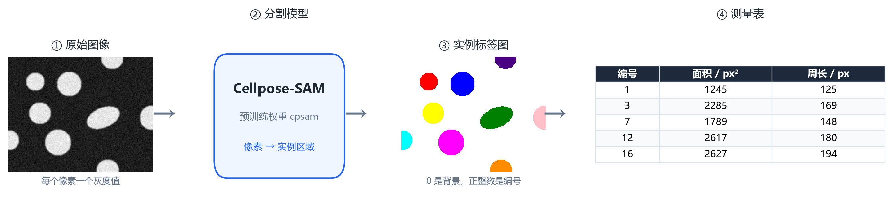
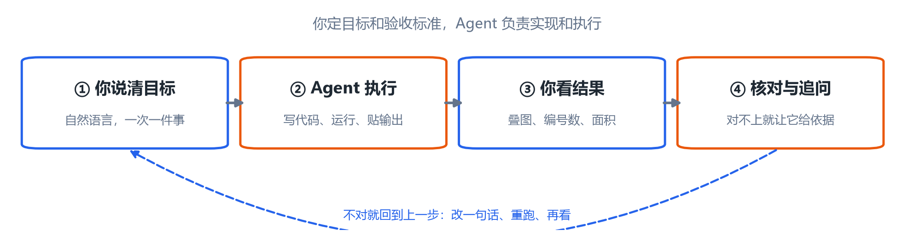
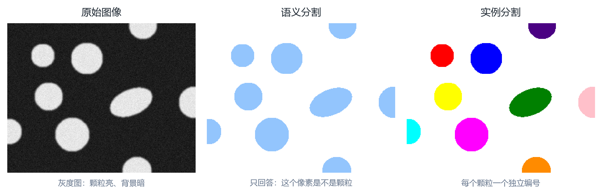
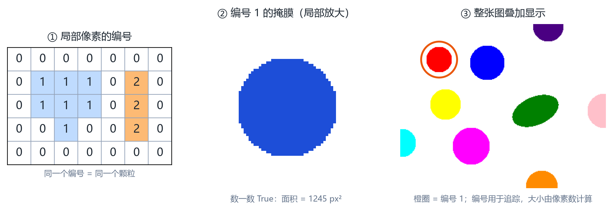
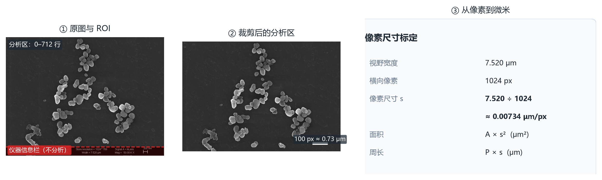
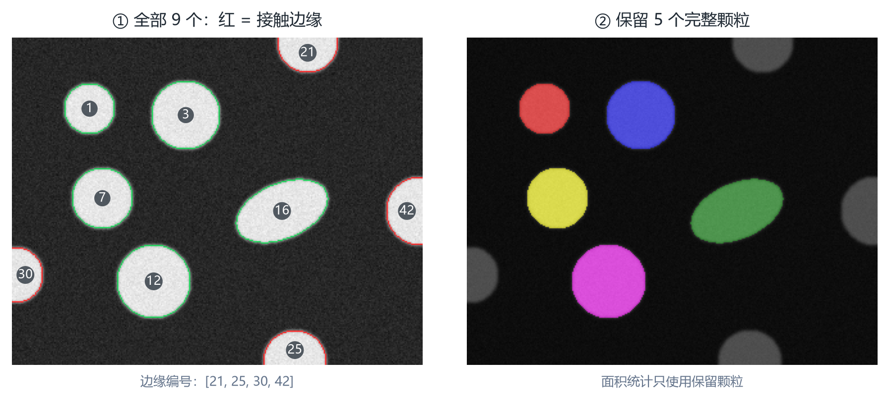

# Cellpose：跟 Agent 一起做颗粒分割与尺寸测量

[返回第二课入口](../README.md) · [学生提示词卡](课堂提示词.md) · [参考 Notebook](颗粒分割与测量.ipynb) · [素材与来源](素材/README.md)

**给谁用**：材料、化学、化工研究生。课前应已了解像素、灰度与 RGB 图像，也知道训练、预测和评估的基本含义；会用 VS Code 打开文件夹并启动 Agent，不要求会写 Python。

**课堂目标**：用自然语言指挥 Agent 完成一次图像分割与颗粒测量，能说清四件事：

1. 分割模型把一张图变成了什么；
2. 语义分割和实例分割差在哪里；
3. 一张显微图怎样变成颗粒数量、面积和周长；
4. 怎样用叠加轮廓和已知几何判断结果对不对。

**分工**：你说目标、给约束、核对结果；Agent 写代码、运行、贴输出。你不写代码，但要会看三样东西：**编号数、叠加轮廓、统计表**。

---

## 0. 先看结果：一张图变成一张表



一次完整流程只有四步：读图 → 分割 → 读标签 → 测量。彩色标签图说明它把哪些像素算成了同一个颗粒；测量表说明每个颗粒有多大。这两样就是 Agent 每步要交给你核对的东西。

> 图为流程示意，用测量练习的几何参考图演示；课堂实际分析的是 TiO₂ 电镜图。

本课程在三张 TiO₂ 电镜图上的实测结果（cpsam 默认参数，CPU）：

| 图片 | 预测实例 | 剔除边缘 | 保留 |
| --- | ---: | ---: | ---: |
| `09_TiO2_SEM_1908248.tif` | 214 | 3 | 211 |
| `10_TiO2_SEM_1908250.tif` | 69 | 2 | 67 |
| `11_TiO2_TSEM_1908249.tif` | 88 | 2 | 86 |

09 是主案例：模型分出 214 个实例，3 个接触边缘，保留 211 个。这些是模型输出，不是“真实颗粒数”。

> **预测数量不等于真实颗粒数。** 模型可能把背景纹理当成颗粒，可能把粘连颗粒分成两个，也可能把两个粘成一个。数量对不对，要用叠加轮廓和人工标注核对。

这节课的节奏不是“老师讲代码”，而是下面这个循环：



课堂上说给 Agent 的话，大致是这个长度：

```text
把 素材/09_TiO2_SEM_1908248.tif 里的颗粒分割出来，只分析前 712 行；
保存一张彩色标签图和一张轮廓叠加图，告诉我检测到几个实例。
不要修改 素材/ 里的文件。
```

一句话只包含一个任务、一个输入、一个要检查的输出。长流程拆成多句，对应后面的提示词卡。

**三条纪律**：

1. **一次只让 Agent 做一件事。** 不要一开口就说“帮我把整篇论文的数据都处理了”，它一次改很多文件，你无法核对。
2. **每一步都要求它运行并贴出真实输出。** 只说“代码写好了”不算完成。
3. **你负责核对数字和叠图。** 编号数、面积、轮廓对不上，就先停下来查，不要往下走。

| 你负责 | Agent 负责 |
| --- | --- |
| 说清任务、图像、分析区域 | 写脚本、调库、读文件 |
| 指定模型和关键参数 | 选择实现细节、排版输出 |
| 核对编号数、叠图、统计表 | 运行、报错、贴终端输出 |
| 判断结果能不能用于科研 | 解释它为什么这样做，并给出文件和行号 |

---

## 模型与输入输出

这一节把后面要用的概念一次讲清。课堂上可以边看图边讲，不必逐字念。

### 分割模型的任务

图像分割模型为图像中的像素分配区域归属。例如，输入一张 TiO₂ 颗粒电镜图，模型根据亮度、纹理和形状等图像特征，标出每个颗粒覆盖的区域。

> **图像分割（Image Segmentation）**：将图像中的像素划分到目标或背景等区域的任务。

语义分割和实例分割分别关注区域类别与独立目标：

| 任务 | 对颗粒图像的输出 | 可以进行的分析 |
| --- | --- | --- |
| 语义分割 | 每个像素属于“颗粒”或“背景” | 颗粒覆盖面积、面积占比 |
| 实例分割 | 每个独立颗粒具有自己的像素区域和编号 | 颗粒数量、单颗粒面积、周长和位置 |

> **语义分割（Semantic Segmentation）**：给每个像素分配类别。**实例分割（Instance Segmentation）**：进一步区分属于同一类别的独立目标。



同一张图，语义分割只回答“是不是颗粒”，实例分割还要回答“是哪一个颗粒”。**粒径分布、颗粒计数必须用实例分割**；只统计覆盖率，语义分割就够了。

### 标签图怎么读

实例分割的输出是一张与原图同样大小的**整数标签图**：背景是 0，每个颗粒用一个正整数编号，同一颗粒的所有像素编号相同。

```text
0 0 0 0 0 0
0 1 1 1 0 2
0 1 1 1 0 2
0 0 1 0 0 0
```

这段 4×6 的标签图里，编号 1 占 7 个像素，面积就是 7 平方像素；编号 2 占 4 个像素。颗粒数量等于实际出现的正整数编号数量，与编号的最大值无关——参考图故意使用 1、3、7、12 等跳跃编号，避免把“编号 42”误认为“有 42 个颗粒”。



读取一个颗粒只需要一行：`masks == 1` 得到这个颗粒的二值掩膜，True 的个数就是面积。

> **Mask（掩膜）**：描述目标像素区域的数组。**二值掩膜（Binary Mask）**：仅用 True 和 False 表示目标内部与外部的数组。**实例标签图（Instance Label Map）**：用整数编号记录每个像素所属实例的图像。

### Cellpose 模型

Cellpose 是面向细胞图像开发的实例分割方法与软件。本节固定使用 **Cellpose 4.2.1 中的 Cellpose-SAM 模型，权重名称为 `cpsam`**：它把通用分割模型 SAM 的图像编码能力与 Cellpose 的实例构建方法结合起来，输出独立目标的像素标签。[官方模型说明](https://cellpose.readthedocs.io/en/latest/models.html)

> **预训练模型（Pretrained Model）**：已经通过训练数据学习到参数、可以加载并用于预测的模型。**SAM（Segment Anything Model，通用分割模型）**：一种用于图像分割的基础模型。

它接收图像，输出标签图。内部如何从像素得到实例，本节不展开；对使用者来说需要知道的是：**模型输出的是“像素属于哪个实例”的判断**。粘连颗粒能否分开，取决于模型是否把它们分成两个区域。分不开时，先看叠图，再调参数，而不是直接相信数量。

`model.eval(...)` 中与结果关系最大的两个参数：

| 参数 | 本节取值 | 作用 |
| --- | ---: | --- |
| `cellprob_threshold` | 0.0 | 目标区域得分阈值；调低会找出更多、更大的区域，也更容易把背景算进来 |
| `min_size` | 15 | 小于该像素数的实例被丢弃；用于去掉噪点和小背景纹理 |

`diameter=None` 表示使用模型默认的直径设定；给出数值时，图像会按该直径缩放。其余参数使用默认值。本节不调整模型的内部筛选参数，把注意力放在分割结果和测量上。

### 输入：图像像素数组

本节接收二维灰度图或三通道彩色图。以高为 H、宽为 W 的图像为例：

| 数据 | 数组形状 | 数值含义 |
| --- | --- | --- |
| 灰度电镜图 | `(H, W)` | 每个像素的灰度值 |
| 三通道图像 | `(H, W, 3)` | 每个像素的三个通道数值 |
| 传入本节模型的数组 | `(H, W, 3)` | 灰度图复制为三个通道；彩色图保留原通道 |

> **RGB（Red, Green, Blue，红绿蓝）**：通过红、绿、蓝三个通道表示图像像素的方式。荧光图的显示颜色可以对应不同的染色通道。

程序先读取图像，再选取分析区域，最后调用 `model.eval(...)`。本节电镜图先裁去底部 56 行仪器信息栏，只分析前 712 行；标签图的行列与分析区域的像素位置一一对应。

> **ROI（Region of Interest，感兴趣区域）**：从原图中选取的分析范围。边缘剔除按 ROI 边界执行，质心坐标以 ROI 左上角为原点。



### 输出：实例标签图及辅助信息

本节调用返回三个变量：[官方接口说明](https://cellpose.readthedocs.io/en/latest/api.html)。

```python
masks, flows, styles = model.eval(image_3ch, channel_axis=-1)
```

| 输出 | 内容 | 本节用途 |
| --- | --- | --- |
| `masks` | 形状为 `(H, W)` 的整数标签图，背景为 0，各个实例使用正整数编号 | 计数、测量面积和周长、定位边缘目标 |
| `flows` | 模型返回的辅助信息 | 本节不使用 |
| `styles` | 为接口兼容保留的辅助返回项 | 本节不使用 |

> **Mask（掩膜）**：描述目标像素区域的数组。**实例标签图（Instance Label Map）**：用整数编号记录每个像素所属实例的图像。

模型预测提供像素区域，后续测量代码完成几何计算：

```text
原始图像 → Cellpose 预测 → 实例标签图 → 面积与周长 → 边缘剔除 → 统计表
```

面积按目标像素数计算。周长采用四方向 Crofton 估计：用边界与不同方向直线的交点数估计长度。

> **Crofton 周长（Crofton Perimeter）**：一种基于积分几何的数字图像周长估计方法。轮廓的像素化、分辨率和分割误差都会影响估计值；区域内部孔洞的边界也计入本节周长。

边缘剔除通过收集图像四边出现的编号，删除相应目标的整个区域。像素尺寸标定将平方像素换算为 μm²，将像素长度换算为 μm：若每像素为 s 微米，面积为 A×s²，周长为 P×s。



参考图共 9 个颗粒，编号 21、25、30、42 接触四边，剔除后保留 5 个。**边缘颗粒只被拍到了一部分，面积和周长都偏小**：计入会把截断区域当成小颗粒；剔除又会让大颗粒被系统性少统计，因为大颗粒更容易碰到边界。所以剔除后统计的对象是“完整落在当前视野内”的颗粒，粒径分布应结合多个视野和明确的采样规则。

---

## 1. 课前准备（教师，约 20 分钟）

### 1.1 环境

本材料固定使用 **Cellpose 4.2.1 + `cpsam` 模型**，建议 Python 3.11–3.13。安装步骤依据 [Cellpose 官方说明](https://github.com/MouseLand/cellpose#installation)。

课堂只有 90 分钟，**建议课前把环境和权重装到学生机**，或使用课程统一环境；课堂上的卡 0 负责安装和检查，网络慢时尤其要提前准备。

在 VS Code 中打开 `lesson02/4cellpose`，打开终端。本节用 uv 在当前目录创建环境，环境目录为 `.venv`：

```bash
uv venv --python 3.13
uv pip install -r requirements.txt
```

如果提示找不到 `uv`，先按 [uv 官方安装说明](https://docs.astral.sh/uv/getting-started/installation/)安装。`uv pip install` 会自动使用当前目录的 `.venv`，不需要手动激活。电脑上没有 Python 3.13 时，uv 会自行下载，需要联网。

确认版本：

```bash
uv run python -c "import importlib.metadata as m; print('Cellpose', m.version('cellpose'))"
```

应输出 `Cellpose 4.2.1`。版本不一致时，先修正环境，不要继续。

注册 Jupyter 内核，运行 Notebook 时选择这个内核：

```bash
uv run python -m ipykernel install --user --name cellpose-lesson02 --display-name "Python (Cellpose lesson02)"
```

> **内核（Kernel）**：执行 Notebook 中 Python 代码的进程。选择内核后，Notebook 使用该环境中安装的库。

课堂可先用中央处理器运行小图；图形处理器适合加速模型推理。

> **CPU（Central Processing Unit，中央处理器）**：执行程序指令的处理器。**GPU（Graphics Processing Unit，图形处理器）**：通过并行计算加速图像处理和神经网络运算的处理器。

NVIDIA 显卡用户按 [PyTorch 官方安装选择器](https://pytorch.org/get-started/locally/)得到安装命令，把其中的 `pip install` 换成 `uv pip install`，再执行 `uv pip install -r requirements.txt`。Notebook 默认使用 CPU；将 `DEVICE` 改为 `"cuda"` 使用 NVIDIA 显卡，Apple Silicon 可选择 `"mps"`。

> **CUDA（Compute Unified Device Architecture，统一计算设备架构）**：NVIDIA 的并行计算平台。**MPS（Metal Performance Shaders，Metal 高性能着色器）**：PyTorch 在 Apple 芯片上使用的 GPU 加速后端。

需要图形界面时，额外安装并启动：

```bash
uv pip install "cellpose[gui]==4.2.1"
uv run cellpose
```

### 1.2 提前下载模型（必须）

`cpsam` 权重约 **1.23 GB**，教室网络不稳定时，**务必在课前下载好**。联网时在课程目录运行：

```bash
uv run python -c "from cellpose import models; models.CellposeModel(gpu=False, pretrained_model='cpsam', use_bfloat16=False); print('模型准备完成')"
```

默认权重位置见 [官方安装文档](https://cellpose.readthedocs.io/en/latest/installation.html)：

| 系统 | 权重文件 |
| --- | --- |
| Windows | `C:\Users\用户名\.cellpose\models\cpsam` |
| macOS / Linux / WSL | `~/.cellpose/models/cpsam` |

也可以通过浏览器打开 [官方权重下载链接](https://huggingface.co/mouseland/cellpose-sam/resolve/main/cpsam)，保存到上述目录，文件名保持为 `cpsam`。把教师机的权重文件拷贝给学生后，再执行一次加载命令确认文件完整。

> 官方文档在 2026 年已列出 `cpsam_v2`、`cpdino` 等更新模型。本节固定 4.2.1 + `cpsam`，是为了让课堂上的数量和参数可以复现；换模型会改变输出，需重新核对。Cellpose 4.2.1 的高层 `Cellpose` 接口默认加载 `cpsam_v2`，本节统一用 `CellposeModel(pretrained_model='cpsam')` 显式指定。

如需把权重集中保存在本目录的 `models` 文件夹，在 Notebook 导入 Cellpose **之前**执行：

```python
import os
from pathlib import Path
os.environ['CELLPOSE_LOCAL_MODELS_PATH'] = str(Path('models').resolve())
```

将权重保存为 `models/cpsam`。重新启动内核后，从设置路径的单元开始运行。

### 1.3 案例图片

课堂主案例为 **3 张 TiO₂ 电镜图**；另保留两张 Cellpose 官方示例图（07、08）作备用观察，不进入主流程。完整目录与许可见 [显微图案例与来源](素材/README.md)。

| 案例 | 图像文件 | 观察重点 |
| --- | --- | --- |
| TiO₂ 电镜颗粒（主案例） | `09_TiO2_SEM_1908248.tif` | 第一次分割；颗粒面积、周长、团聚 |
| 第二个视野 | `10_TiO2_SEM_1908250.tif` | 稀疏颗粒、小目标与重复测量 |
| TiO₂ 透射扫描电镜颗粒 | `11_TiO2_TSEM_1908249.tif` | 成像对比度与颗粒边界 |
| 备用：杆状与球状目标 | `07_cellpose_039_img.png` | 形貌差异；有余力时观察 |
| 备用：多边形颗粒 | `08_cellpose_033_img.png` | 接触边界与周长；有余力时观察 |

> **SEM（Scanning Electron Microscopy，扫描电子显微术）**：通过扫描电子束获得样品表面相关信息的成像方法。**TSEM（Transmission Scanning Electron Microscopy，透射扫描电子显微术）**：在扫描过程中利用透射电子形成图像的方法。

电镜文件保留完整原图（768×1024），底部 56 行为仪器信息栏；Notebook 分析前 712 行。信息栏中的视野宽度 7.520 μm 可用于像素标定。

读标签和测量用的几何参考图放在 `scripts/fixtures/`（不是样品图，[说明](scripts/fixtures/README.md)）：

| 文件 | 用途 |
| --- | --- |
| [03_particles.png](scripts/fixtures/03_particles.png) | 模拟圆形与椭圆形颗粒，包含四个接触边缘的颗粒 |
| [03_particles_reference_mask.tif](scripts/fixtures/03_particles_reference_mask.tif) | 与模拟图对应的几何参考标签，用于核对读标签和测量代码 |


> 第一次分割用 09 的前 712 行，颗粒边界和团聚情况可以直接在叠图上核对。模型主要在细胞图像上训练，电镜颗粒属于迁移使用，结果必须逐个视野核查；这正是课堂要练习的判断。

### 1.4 教师先跑一遍

课前至少完成两件事：跑通参考 Notebook 的参考路径，再用真实模型跑一张电镜图。

```bash
uv run python prepare_examples.py
uv run python download_examples.py
uv run python verify_measurements.py
uv run python run_examples.py 09_TiO2_SEM_1908248.tif
```

本机实测（Cellpose 4.2.1 / cpsam，CPU，4 线程，2026-11-21）：

| 图片 | 预测实例 | 剔除边缘 | 保留 | 用时（秒） |
| --- | ---: | ---: | ---: | ---: |
| 09_TiO2_SEM_1908248.tif | 214 | 3 | 211 | 58.34 |
| 10_TiO2_SEM_1908250.tif | 69 | 2 | 67 | 58.02 |
| 11_TiO2_TSEM_1908249.tif | 88 | 2 | 86 | 63.34 |
| 07_cellpose_039_img.png（备用） | 138 | 1 | 137 | 25.54 |
| 08_cellpose_033_img.png（备用） | 270 | 59 | 211 | 12.24 |

你的机器会略有差异；数量差很多时，先查版本、参数和 ROI，不要直接上课。完整记录见 [本地验证记录](验证记录.md)。

### 1.5 Notebook 与脚本的定位

[颗粒分割与测量.ipynb](颗粒分割与测量.ipynb) 是**教师保险**：它已经验证过读图、预测、测量、边缘剔除、CSV 导出和几何检查。课堂上学生按提示词分步生成 `agent_demo/` 下的脚本；如果 Agent 卡住或时间不够，教师可以直接运行 Notebook，把叠加图和统计表投屏继续讲。

Notebook 默认 `SOURCE = "reference"`，用几何参考标签演示完整流程，得到 **9 个颗粒、剔除 4 个边缘颗粒、保留 5 个**。改成 `SOURCE = "cellpose"` 并设置 `IMAGE_NAME`，即可运行真实模型。

Notebook 输出包括全部颗粒表、保留颗粒表、标签图、轮廓叠加图，以及记录参数和软件版本的 JSON 文件，均保存在 `outputs/`。所有图像统一保存为 PNG（标签图为 16 位 PNG）；标签图另存一份逐对象 JSON（`objects` 字段，每个对象含包围盒和二值 mask），便于直接查看或由脚本读取。CSV 使用 UTF-8 编码并附带字节顺序标记，便于 Excel 打开。

---

## 2. 课堂总表（90 分钟）

| 时间 | 步骤 | 学生做什么 | 关键数字 |
| --- | --- | --- | --- |
| 0:00–0:05 | 开场 | 看流程图与实测表，说清输入和输出 | 214 → 3 → 211 |
| 0:05–0:15 | 概念 | 语义/实例、标签图、测量 | 0 是背景 |
| 0:15–0:27 | 1 环境 | 卡 0：用 uv 建环境、装 4.2.1、下载 cpsam | 4.2.1 / 1.23 GB |
| 0:27–0:39 | 2 第一张图 | 卡 1：分割 TiO₂（09），看叠图 | 形状 712×1024，214 个 |
| 0:39–0:49 | 3 读标签 | 卡 2：编号与二值掩膜 | 9 个编号，面积 1245 px² |
| 0:49–1:04 | 4 测量 | 卡 3：面积、周长、边缘剔除 | 9 → 剔除 4 → 保留 5 |
| 1:04–1:19 | 5 材料案例 | 卡 4：TiO₂ 第二视野（10） | 69 → 2 → 67 |
| 1:19–1:27 | 6 检查 | 卡 7：让 Agent 交代依据 | 文件、行号 |
| 1:27–1:30 | 收尾 | 三问、作业 | — |

**120 分钟版**：在步骤 5 之后加入卡 5（像素标定与面积分布，约 8 分钟）和卡 6（参数对照，约 10 分钟），并留 5 分钟讨论“同一张图能不能既调参又报结果”。

---

## 3. 每一步：对学生说什么、核对什么

提示词的完整文本在 [学生提示词卡](课堂提示词.md)；下面给出教师讲解要点和预期输出。

### Step 0｜开场：模型输出的是编号，不是尺寸（5 分钟）

**【讲】**

> 先看这张流程图。人看到的是颗粒，模型输出的是一张编号图：背景是 0，每个颗粒一个正整数。数量、面积、周长都从这张编号图算出来。
>
> 今天不手写代码。你们把要求说给 Agent，它写、它运行、它报结果；你们负责核对编号数、叠图和统计表。

**【问】** “标签图上每个颗粒一种颜色，能直接读出每个颗粒的面积吗？”（答：不能。颜色只是编号，面积要数每个编号占了多少像素。）

---

### Step 1｜环境：用 uv 装好并核对（12 分钟）

**【学生操作】** 卡 0。

**【Agent 应输出】** 类似：

```text
当前目录：...\lesson02\4cellpose
环境：...\lesson02\4cellpose\.venv
Python 3.13.x
Cellpose 4.2.1
torch 2.x.x+cpu
cpsam 权重：C:\Users\...\.cellpose\models\cpsam，1,233,587,898 字节
模型加载成功
```

**【讲】**

> 这节课的结果依赖两个固定条件：Cellpose 4.2.1 和 `cpsam` 权重。版本或权重不同，后面报出的数量就可能不同。
>
> 环境用 uv 建在当前目录的 `.venv`。后面的命令统一用 `uv run python`，不要混用系统里的 Python；混用会出现“代码没错，但找不到包”的情况。
>
> 权重只有第一次运行才下载，约 1.23 GB。教室网络慢时，这一步会卡很久，所以课前一定要准备好。

**【检查点】**

- `.venv` 是不是建在当前目录？
- `cellpose` 是不是 4.2.1？不是就停下。
- 模型文件是不是 `cpsam`，而不是 `cpsam_v2`？
- 权重路径在哪？文件大小约 1.23 GB 吗？
- Agent 用的解释器，和 VS Code 右下角选的是同一个吗？

---

### Step 2｜第一张图：先看它把什么算成一个对象（12 分钟）

**【学生操作】** 卡 1。

**【预期结果】**

- 只分析前 712 行，分析区形状 `(712, 1024)`，是灰度图。
- `masks` 形状 `(712, 1024)`，背景为 0。
- 模型报出 **214** 个实例；叠图保存在 `agent_demo/`。
- 214 是 cpsam 默认参数在本环境的参考值；接口或缩放不同会变，以叠图为准。

**【讲】**

> 先用 09 的颗粒区：这是真实的电镜图，颗粒小、有团聚，背景也有纹理。重点不是数量，而是**边界**：一个颗粒有没有被多切一刀？两个粘连颗粒有没有被合成一个？背景纹理有没有被当成颗粒？
>
> 模型主要在细胞图像上训练，这张图属于迁移使用。能分对说明泛化能力，分不对也正常——这正是需要人核对的原因。

**【检查点】**

- 叠图里的轮廓和颗粒边缘对得上吗？
- 团聚处是把颗粒分开了，还是合成了一大块？
- 背景里有没有零星的彩色小块？
- 数量与 214 差很多时，先查模型是不是 `cpsam`、ROI 是不是 712 行、图片有没有缩放。

---

### Step 3｜读懂标签：编号是追踪用的（10 分钟）

**【学生操作】** 卡 2。

**【预期结果】**

```text
标签图形状 (256, 320)，dtype uint16
编号：[1, 3, 7, 12, 16, 21, 25, 30, 42]
编号数量：9
编号 1 的像素数：1245
```

**【讲】**

> 编号是跳跃的：1、3、7……42。这是参考图故意设计的，用来提醒你：**编号只是身份，不是排序，也不代表数量**。9 个颗粒可以有编号 42。
>
> `masks == 1` 是一个二值数组。数 True 的个数，就是面积 1245 平方像素。这个数后面可以直接用来核对测量代码。

**【检查点】**

- 为什么 9 个颗粒的最大编号是 42？
- 面积 1245 是怎么数出来的？和 `masks == 1` 的 True 个数一致吗？
- 如果编号从 0 开始数，背景会被算成颗粒吗？

---

### Step 4｜测量：面积、周长与边缘剔除（15 分钟）

**【学生操作】** 卡 3。

**【预期结果】**

```text
全部：9；边缘剔除：4；保留：5
边缘编号：[21, 25, 30, 42]
编号 1：面积 1245 px²，周长约 125 px
```

**【讲】**

> 面积是像素计数，没有争议。周长是估计值：数字图像的边界是锯齿状的，Crofton 方法用不同方向的直线去截边界，再换算长度。编号 1 是半径 20 像素的圆，连续几何面积 πr² ≈ 1257 px²、周长 2πr ≈ 126 px；像素测量得到 1245 px² 和约 125 px，差 1% 左右，属于数字化带来的正常偏差。
>
> 边缘剔除的做法是：收集图像最外一圈出现的编号，把对应颗粒整个删掉。第 21、25、30、42 号只被拍到一部分，留着会让粒径分布偏小。

**【检查点】**

- 为什么剔除的是 21、25、30、42，而不是面积最小的四个？
- 剔除后统计的对象是什么？还叫“全部颗粒”吗？
- 参考图的 5 个保留颗粒，面积加起来是多少？和表对得上吗？

---

### Step 5｜第二个视野：TiO₂ 电镜图（15 分钟）

**【学生操作】** 卡 4。

**【预期结果】**

```text
实例总数：69
接触边缘：2
保留：67
用时：约 1–2 分钟（CPU，4 线程）
```

**【讲】**

> 这是同一批样品的第二个视野，颗粒更稀疏，小目标更多。模型在这种图上容易漏掉很小的颗粒，也容易把背景纹理算进来。先看叠加图，再谈数量。
>
> 把 09 和 10 的计数放在一起看：两张图的颗粒数、团聚程度和误检位置都不同。一个视野的数字不能代表整个样品。
>
> 电镜图底部 56 行是仪器信息栏，必须裁掉；不裁的话，文字和标尺会被当成对象。ROI 是分析的一部分，不是可选项。

**【检查点】**

- 数量与 69 差很多时，先查模型接口（是否用 `CellposeModel` 加载 `cpsam`）、ROI 和缩放。
- 背景里有没有零星的彩色小块？它们大约占多少像素？要把 `min_size` 调到多少才能去掉？
- 稀疏视野里，小颗粒有没有被漏掉？
- 69 这个数，你愿意直接写进报告吗？还需要什么证据？

---

### Step 6｜标定与参数对照（120 分钟版，约 18 分钟）

**【学生操作】** 卡 5、卡 6。

**【讲】**

> 像素面积不是物理面积。原图信息栏写着视野宽度 7.520 μm、横向 1024 像素，所以 s = 7.520 ÷ 1024 ≈ 0.00734 μm/像素。面积乘 s²，周长乘 s。
>
> 标定假设像素是正方形、图像没有被缩放或拼接。换成另一台仪器、另一种放大倍数，必须重新标定。
>
> 参数对照只改一个量：`min_size` 或 `cellprob_threshold`。数量变少不一定是坏事——可能去掉了背景误检；数量变多也不一定是好事——可能把一个大颗粒切成了几块。判断依据始终是叠图。

**【检查点】**

- 面积从 px² 换到 μm²，为什么乘 s² 而不是乘 s？
- 三组参数里，哪一组背景误检更少？哪一组漏掉了小颗粒？
- 调整参数用的图和报告数字的图是同一张吗？如果是，结论应该怎样表述？

---

### Step 7｜检查 Agent：让它交代依据（8 分钟）

**【学生操作】** 卡 7。

**【讲】**

> Agent 很容易把“我记得”说成“我验证过”。这一步专门练追问：参数在哪个文件、哪一行？面积是用什么函数算的？剔除依据是什么？
>
> 它说“不确定”是好事。科研里，能标出不确定的地方，比编一个圆滑的答案可靠。

**【检查点】**

- 它给的 shapes、编号、面积，和你刚才看到的终端输出一致吗？
- 它有没有把 `cellprob_threshold` 和 `min_size` 的作用说反？
- 它标为不确定的地方，你能不能自己复算？

---

### Step 8｜收尾：三问与作业（3 分钟）

1. 分割模型的输出是什么？0 和正整数分别代表什么？
2. 为什么要做实例分割，而不是只做语义分割？
3. 边缘颗粒为什么必须剔除？剔除后结论的适用范围是什么？

作业见第 6 节。

---

## 4. 面向材料化学的观察重点

- **09 主案例**：从颗粒投影面积和周长出发，观察粒径、形状与团聚状态。
- **10 第二个视野**：观察稀疏颗粒、小目标与漏检；和 09 比较计数差异。
- **11 TSEM**：比较亮颗粒暗背景与暗颗粒亮背景下的边界预测。
- **07、08（备用）**：杆状/球状与多边形目标的形貌差异；有余力时观察接触边界和周长估计。

`cpsam` 默认参数下，SEM 图的部分低对比度背景纹理会被识别为实例，粘连颗粒的边界也需要逐个核对。课堂可以把这当作模型适用性检查：先展示叠加图，标出背景误检与粘连处，再结合分辨率和最小目标尺寸调整 `min_size`、`cellprob_threshold` 等参数，比较预测结果。

> 计数表记录的是模型输出的实例数；人工标注用于评估检测与分割质量。两者不能混为一谈。

---

## 5. 常见问题

**Q1：`No module named 'cellpose'`**

VS Code 选错解释器。在课程目录运行 `uv run python -c "import sys; print(sys.executable)"`，看路径是不是当前目录 `.venv` 里的 Python；在 VS Code 右下角切换到同一个解释器，再运行 Notebook 或脚本。

**Q2：模型下载卡住或失败**

课前从 [官方权重链接](https://huggingface.co/mouseland/cellpose-sam/resolve/main/cpsam)下载 `cpsam`，放到 `~/.cellpose/models/`（Windows 为 `C:\Users\用户名\.cellpose\models\`），文件名保持 `cpsam`。再用加载命令确认文件大小约 1.23 GB。

**Q3：`DEVICE = "cuda"` 报错**

当前 PyTorch 是 CPU 版。按 [PyTorch 安装选择器](https://pytorch.org/get-started/locally/)安装匹配显卡的版本，或把 `DEVICE` 改回 `"cpu"`。课堂小图用 CPU 足够。

**Q4：Agent 说“已完成”，但没有运行输出**

要求它贴终端输出、输出文件路径和修改时间。没有运行记录的指标一律不算。课堂上坚持“一张卡、一次运行、一份输出”。

**Q5：检测数量明显偏多**

先看叠图。背景纹理被当成对象时，提高 `min_size` 或 `cellprob_threshold`；图像对比度太低时，先做裁剪或对比度处理，再谈参数。不要为了凑一个“看起来合理”的数量反复调参。

**Q6：粘连颗粒分不开**

这是实例分割的典型难点。先确认叠加图上是否真的没有分开；再尝试调整 `cellprob_threshold`，或换用分辨率更高的图像。仍分不开时，应在报告中说明，而不是把合并区域当作一个颗粒统计。

**Q7：同一张图调完参，又用这张图报结果**

这就是自己出题自己打分。调参用的图只能用于选择参数；报告结果应换用未参与调参的视野。课堂时间有限时可以比较几组，但要明确说明。

**Q8：不同机器上数量不一样**

先核对四件事：Cellpose 版本、权重文件、`eval` 参数、ROI。四者一致仍有小差异时，记录差异并说明；不要只报一个数。

**Q9：Agent 一次改了很多文件**

让它停下来，列出改了哪些文件、每个文件改了什么；用 `git diff` 或备份恢复。课堂上坚持“一张卡、一个文件、一次运行”。

**Q10：终端中文乱码**

用 VS Code 自带终端；或在 PowerShell 先执行 `chcp 65001`。这不影响计算结果，只影响显示。

---

## 6. 作业与评价

**提交**

1. 一张叠加轮廓图：绿色保留、红色边缘，文件名和参数写在图注里。
2. 一份 `*_kept_particles.csv`：至少包含编号、面积、周长、质心。
3. 5 行记录：
   - 我处理的是哪张图，ROI 是什么；
   - 模型报了多少个实例，剔除多少，保留多少；
   - 一个分割错误（背景误检、粘连或漏检），以及它为什么发生；
   - Agent 有一处说得含糊或算错的地方；
   - 我用什么数字、文件或叠图验证了它。

**口头检查（任选三题）**

1. `masks` 里 0 和正整数分别代表什么？
2. 语义分割与实例分割的输出差在哪里？
3. 面积和周长分别怎么得到？为什么周长是估计值？
4. 为什么要剔除接触边缘的颗粒？
5. 像素面积怎样换算成 μm²？
6. 怎样判断一张叠图的分割质量？

**评分参考**

| 项目 | 分值 |
| --- | ---: |
| 能说清输入、输出和标签图 | 2 |
| 能解释实例分割与标签图的作用 | 2 |
| 能独立核对数量、面积、边缘剔除 | 3 |
| 能读叠图并指出一处分割错误 | 2 |
| 能指出 Agent 的一处不确定并验证 | 1 |

---

## 7. 复现与参考实现

参考 Notebook 与脚本用于核对课堂结果，不要求学生照抄。

```bash
uv run python prepare_examples.py      # 生成 scripts/fixtures 下的几何参考图
uv run python download_examples.py     # 下载五张显微图并校验 SHA-256
uv run python verify_measurements.py   # 检查测量边界情况，无需权重
uv run python run_examples.py          # 批量运行五张图（三张 TiO₂ + 两张备用）
```

也可指定文件：

```bash
uv run python run_examples.py 09_TiO2_SEM_1908248.tif 10_TiO2_SEM_1908250.tif
```

批量脚本执行同一份 Notebook 的预测和测量代码，复用已加载的模型；结果保存到 `outputs`，计数和耗时记录在 `outputs/batch_summary.json`。

示意图由 [scripts/make_figures.py](scripts/make_figures.py) 生成：

```bash
uv run python scripts/make_figures.py
```

参考资料：[Cellpose 调用接口](https://cellpose.readthedocs.io/en/latest/api.html)、[Cellpose 模型说明](https://cellpose.readthedocs.io/en/latest/models.html)、[scikit-image 区域测量](https://scikit-image.org/docs/stable/api/skimage.measure.html)。

五张图均已完成真实预测与测量（三张 TiO₂ 主案例 + 两张备用），计数和耗时见 [本地验证记录](验证记录.md)。权重文件 1,233,587,898 字节，SHA-256：`e1440429eb384f95afe32bcba6510f90d518eaedc917ede549bed6804004abe2`。

原始论文：

- Stringer, C. et al. Cellpose: a generalist algorithm for cellular segmentation. *Nature Methods* 18, 100–106 (2021). [doi:10.1038/s41592-020-01018-x](https://doi.org/10.1038/s41592-020-01018-x)
- Pachitariu, M. & Stringer, C. Cellpose-SAM: superhuman generalization for cellular segmentation. *bioRxiv* (2025). [doi:10.1101/2025.04.28.651001](https://doi.org/10.1101/2025.04.28.651001)
