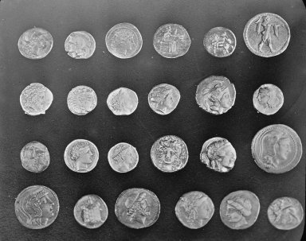
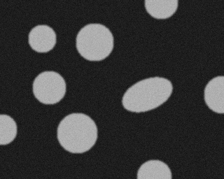
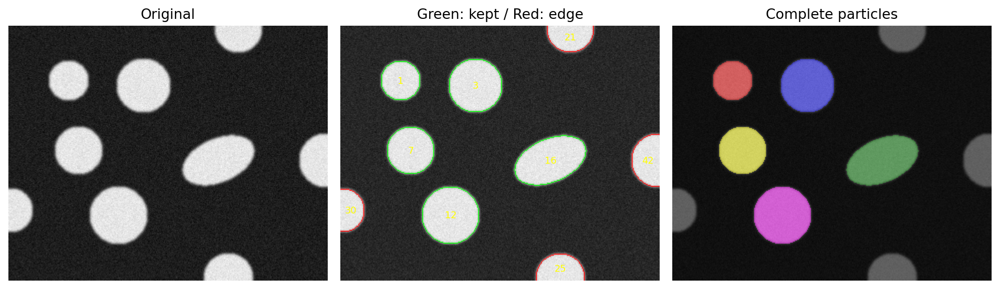

# Cellpose：图像分割与颗粒尺寸测量

本节使用 Cellpose 给图像中的每个目标分配编号，再从编号图计算颗粒面积、周长，并剔除接触图像边缘的颗粒。课堂流程为：查看原图 → 运行模型 → 解读标签 → 检查轮廓 → 剔除边缘颗粒 → 导出测量结果。

> **实例分割（Instance Segmentation）**：为每个独立目标标记其所在的像素区域。同一目标内的像素共享一个编号。

Cellpose 最初面向细胞图像。本节使用 Cellpose 官方细胞与颗粒案例，以及 BAM 公开的 TiO₂ 电镜图学习实例分割与几何测量。硬币和模拟颗粒用于基础操作与测量检查。将模型用于材料显微图像时，通过人工核对颗粒轮廓、粘连分离和漏检情况评估适用性。

## 1. 安装环境

本材料固定使用 **Cellpose 4.2.1 + `cpsam` 模型**。建议使用 Python 3.11。安装步骤依据 [Cellpose 官方说明](https://github.com/MouseLand/cellpose#installation)。

在 VS Code 中打开本目录，并打开终端。创建环境：

```bash
python -m venv .venv
```

| 系统与终端 | 激活环境 |
| --- | --- |
| Windows PowerShell | `.\.venv\Scripts\Activate.ps1` |
| Windows 命令提示符 | `.venv\Scripts\activate.bat` |
| macOS / Linux / WSL | `source .venv/bin/activate` |

> **WSL（Windows Subsystem for Linux，适用于 Linux 的 Windows 子系统）**：在 Windows 中运行 Linux 环境的功能。

macOS / Linux 中可用 `python3 -m venv .venv` 创建环境。激活后执行：

```bash
python -m pip install --upgrade pip
python -m pip install -r requirements.txt
python -m ipykernel install --user --name cellpose-lesson02 --display-name "Python (Cellpose lesson02)"
python -c "import importlib.metadata as m; print('Cellpose', m.version('cellpose'))"
```

在 VS Code 安装 Python、Jupyter 扩展，打开 [颗粒分割与测量.ipynb](颗粒分割与测量.ipynb)，点击右上角“选择内核”，选择 `Python (Cellpose lesson02)`。

> **内核（Kernel）**：执行 Notebook 中 Python 代码的进程。选择内核后，Notebook 使用该环境中安装的库。

课堂可先用中央处理器运行小图；图形处理器适合加速模型推理。

> **CPU（Central Processing Unit，中央处理器）**：执行程序指令的处理器。**GPU（Graphics Processing Unit，图形处理器）**：通过并行计算加速图像处理和神经网络运算的处理器。

NVIDIA 显卡用户按 [PyTorch 官方安装选择器](https://pytorch.org/get-started/locally/)安装与系统相匹配的版本，然后执行本目录依赖安装。Notebook 默认使用 CPU；将 `DEVICE` 改为 `"cuda"` 使用 NVIDIA 显卡，Apple Silicon 可选择 `"mps"`。

> **CUDA（Compute Unified Device Architecture，统一计算设备架构）**：NVIDIA 的并行计算平台。**MPS（Metal Performance Shaders，Metal 高性能着色器）**：PyTorch 在 Apple 芯片上使用的 GPU 加速后端。

需要图形界面时，额外安装并启动：

```bash
python -m pip install "cellpose[gui]==4.2.1"
python -m cellpose
```

## 2. 提前下载模型

本节显式选择 `cpsam`，即 2025 年发布的 Cellpose-SAM 模型。[官方模型说明](https://cellpose.readthedocs.io/en/latest/models.html)列出了其他可选模型。

> **SAM（Segment Anything Model，通用分割模型）**：用于图像分割的基础模型。Cellpose-SAM 将其图像编码能力用于细胞实例分割。

联网时在已激活的环境运行以下命令，完成权重下载和模型加载：

```bash
python -c "from cellpose import models; models.CellposeModel(gpu=False, pretrained_model='cpsam', use_bfloat16=False); print('模型准备完成')"
```

默认权重位置见 [官方安装文档](https://cellpose.readthedocs.io/en/latest/installation.html)：

| 系统 | 权重文件 |
| --- | --- |
| Windows | `C:\Users\用户名\.cellpose\models\cpsam` |
| macOS / Linux / WSL | `~/.cellpose/models/cpsam` |

也可以通过浏览器打开 [官方权重下载链接](https://huggingface.co/mouseland/cellpose-sam/resolve/main/cpsam)，将文件保存到上述目录，文件名保持为 `cpsam`。复制已有权重到另一台电脑后，执行加载命令检查文件完整性。模型文件较大，请在课前完成下载并运行一次预测。

如需将权重集中保存在本目录的 `models` 文件夹中，在 Notebook 导入 Cellpose **之前**执行：

```python
import os
from pathlib import Path
os.environ['CELLPOSE_LOCAL_MODELS_PATH'] = str(Path('models').resolve())
```

将权重保存为 `models/cpsam`。重新启动内核后，从设置路径的单元开始运行。

## 3. 案例图片

课堂主案例为 **3 张 TiO₂ 电镜图 + 4 张 Cellpose 官方示例图**，完整目录见 [显微图案例](素材/README.md#显微图案例)。

| 案例 | 图像文件 | 观察重点 |
| --- | --- | --- |
| TiO₂ 电镜颗粒 | `09_TiO2_SEM_1908248.tif`、`10_TiO2_SEM_1908250.tif` | 颗粒面积、周长、团聚和不同视野 |
| TiO₂ 透射扫描电镜颗粒 | `11_TiO2_TSEM_1908249.tif` | 成像对比度与颗粒边界 |
| 官方荧光细胞 | `05_cellpose_002_img.png` | 多通道图像与细胞实例 |
| 官方细胞轮廓 | `06_cellpose_016_img.png` | 相邻细胞分离 |
| 官方杆状与球状目标 | `07_cellpose_039_img.png` | 形貌差异 |
| 官方多边形颗粒 | `08_cellpose_033_img.png` | 接触目标与边界测量 |

> **SEM（Scanning Electron Microscopy，扫描电子显微术）**：通过扫描电子束获得样品表面相关信息的成像方法。**TSEM（Transmission Scanning Electron Microscopy，透射扫描电子显微术）**：在扫描过程中利用透射电子形成图像的方法。

电镜文件保留完整原图。Notebook 分析前 712 行颗粒区域，原图底部仪器信息与标尺用于核对采集条件和尺寸标定。

基础练习图片如下：

| 文件 | 用途 |
| --- | --- |
| [01_coins.png](素材/01_coins.png) | 真实硬币照片，观察模型预测的对象与边界 |
| [02_coins_crop.png](素材/02_coins_crop.png) | 原图裁剪，包含被视野边界截断的对象 |
| [03_particles.png](素材/03_particles.png) | 模拟圆形与椭圆形颗粒，包含四个接触边缘的颗粒 |
| [03_particles_reference_mask.tif](素材/03_particles_reference_mask.tif) | 与模拟图对应的几何参考标签，用于核对测量代码 |




参考标签的测量与边缘剔除结果如下，绿色轮廓表示保留颗粒，红色轮廓表示剔除颗粒。



图片来源、生成方式与使用说明见 [素材说明](素材/README.md)。

## 4. 运行 Notebook

Notebook 默认选择 `SOURCE = "reference"`，使用本地几何参考标签演示完整测量流程，得到 **9 个颗粒、剔除 4 个边缘颗粒、保留 5 个颗粒**。

运行真实模型预测时：

1. 将参数改为 `SOURCE = "cellpose"`。
2. 将 `IMAGE_NAME` 设置为案例文件名，例如 `"09_TiO2_SEM_1908248.tif"`，或自己的二维灰度 / RGB 图文件名，放入 `素材` 文件夹。
3. 从头运行 Notebook。模型输出写入 `outputs`，文件名带有 `cellpose`，便于追溯。
4. 查看原图上的分割轮廓，核对目标分离与边缘位置，再查看统计表。

四张官方示例随附本环境实际生成的 `*_predicted_mask.tif` 和 `*_prediction.json`。下载模型前，也可设置 `SOURCE = "saved"`、选择对应 `IMAGE_NAME`，并设置：

```python
SAVED_MASK = ASSETS / f'{Path(IMAGE_NAME).stem}_predicted_mask.tif'
```

这些文件为 `cpsam` 预测结果，供轮廓核查和测量演示使用。

> **RGB（Red, Green, Blue，红绿蓝）**：使用红、绿、蓝三个通道表示像素的图像形式。

已保存的预测标签可通过 `SOURCE = "saved"` 和 `SAVED_MASK` 重新读取。使用单通道整数 TIFF 标签图，每个目标占用一个正整数编号，背景为 0。

> **TIFF（Tagged Image File Format，标签图像文件格式）**：可以保存高位深图像的文件格式。本节使用整数 TIFF 保存目标编号。

面积按目标像素数计算，周长采用四方向 Crofton 估计。Notebook 用边界上的编号定位边缘颗粒，将这些编号对应的全部像素置零，并保留其原始编号记录。完整测量表同时记录保留与剔除状态，便于核查。

存在显微标尺时，填写 `PIXEL_SIZE_UM`，例如标尺 10 μm 跨越 100 像素，则填写 `0.1`。面积乘以像素尺寸的平方，周长乘以像素尺寸。参数默认 `None`，结果使用像素单位。

`09_TiO2_SEM_1908248.tif` 的原图信息栏标注视野宽度为 7.520 μm，图像横向为 1024 像素，因此可填写 `PIXEL_SIZE_UM = 7.520 / 1024`（约 0.007344 μm/像素）。本节只裁去底部信息栏，横向像素数量保持为 1024。其他图像应分别核对各自的标定信息。

输出包括全部颗粒表、保留颗粒表、过滤后标签、叠加图以及记录参数和软件版本的 JSON 文件。具体文件保存在 `outputs`。

> **JSON（JavaScript Object Notation，JavaScript 对象表示法）**：用键值对保存结构化数据的文本格式。

边缘剔除后，统计对象是完整落在当前视野内的颗粒。较大颗粒接触边界的机会更高，粒径分布研究应结合多个视野和明确的采样规则。

## 5. 复现与检查

```bash
python prepare_examples.py
python download_examples.py
python verify_measurements.py
```

本地已安装 Cellpose 4.2.1 并下载 `cpsam` 权重（1,233,587,898 字节，约 1.23 GB），使用 CPU 完成真实图像预测。课程环境位于 `.venv`，VS Code 内核名称为 `Python (Cellpose lesson02)`。

运行全部七张显微图：

```bash
python run_examples.py
```

也可指定文件：

```bash
python run_examples.py 05_cellpose_002_img.png 09_TiO2_SEM_1908248.tif
```

批量脚本执行同一份 Notebook 的预测和测量代码，复用已加载的模型；结果保存到 `outputs`，计数和耗时记录在 `outputs/batch_summary.json`。预测标签与图像原始标注分别记录，课堂通过叠加轮廓核查模型输出。

参考资料：[Cellpose 调用接口](https://cellpose.readthedocs.io/en/latest/api.html)、[scikit-image 区域测量](https://scikit-image.org/docs/stable/api/skimage.measure.html)。

七张显微图均已完成真实预测与测量，计数和耗时见 [本地验证记录](验证记录.md)。

## 6. 面向材料化学的观察重点

- **荧光细胞**：查看细胞膜、胞体与细胞核在各通道中的位置，核对模型分出的细胞区域。
- **多边形颗粒**：观察接触颗粒的分离效果，以及尖角、凹陷对周长估计的影响。
- **TiO₂ 电镜颗粒**：从颗粒投影面积和周长出发，观察粒径、形状与团聚状态。
- **SEM 与 TSEM**：比较亮颗粒暗背景与暗颗粒亮背景下的边界预测。

本次 `cpsam` 默认参数测试中，SEM 图的部分低对比度背景纹理被识别为实例，粘连颗粒的边界也需要逐个核对。课堂可将其作为模型适用性检查案例：先展示叠加图，标出背景误检与粘连处，再结合分辨率和最小目标尺寸调整 `MIN_SIZE_PX`、`CELLPROB_THRESHOLD` 等参数，并比较预测结果。计数表记录模型输出的实例数，人工标注用于评估检测与分割质量。
