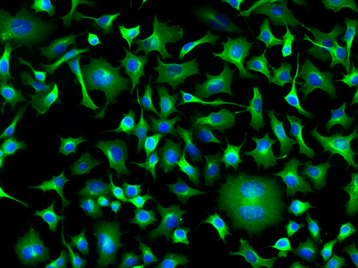
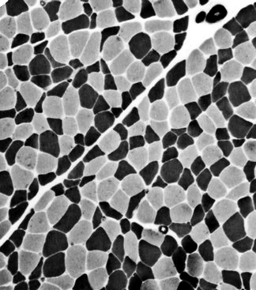

# 案例图片来源

| 文件 | 来源与处理 |
| --- | --- |
| `01_coins.png` | scikit-image 0.26.0 的 `skimage.data.coins()`；303×384 像素灰度图。原始来源为 Brooklyn Museum 的庞贝希腊硬币照片。官方数据说明标记为“无已知版权限制”。 |
| `02_coins_crop.png` | 从上一张图按 NumPy 行列切片 `[30:275, 25:360]` 裁剪；245×335 像素，产生被边界截断的对象。 |
| `03_particles.png` | 本课程脚本生成的 256×320 像素模拟图。圆形、椭圆形区域经过高斯模糊，再加入固定随机种子的噪声。 |
| `04_reference_overlay.png` | 执行 Notebook 参考路径得到的轮廓叠加图；红色表示边缘剔除，绿色表示保留。 |
| `03_particles_reference_mask.tif` | 模拟图生成时保存的几何参考标签。背景为 0，颗粒编号为 1、3、7、12、16、21、25、30、42。最后四个接触图像边缘。 |

模拟图片及其参考标签用于演示和检验测量步骤。真实材料中的形貌、对比度与粘连情况可通过后续显微图案例展开。

运行上级目录的 `prepare_examples.py` 可重新生成这些文件。硬币图来自 scikit-image 随包提供的数据；模拟图由本课程生成，随课程材料使用。

来源：[scikit-image coins 官方说明](https://scikit-image.org/docs/stable/api/skimage.data.html#skimage.data.coins)、[Brooklyn Museum 原始页面](https://www.brooklynmuseum.org/opencollection/archives/image/51611)。

## 显微图案例

课堂优先使用以下七张图。官方案例来自 [Cellpose 官方在线演示的 samples 目录](https://huggingface.co/spaces/mouseland/cellpose/tree/main/samples)；电镜案例来自 [BAM 研究团队公开数据](https://github.com/BAMresearch/automatic-sem-image-segmentation/tree/master/Datasets/Electron%20Microscopy%20Images)。

> **SEM（Scanning Electron Microscopy，扫描电子显微术）**：通过扫描电子束获得样品表面相关信息的成像方法。**TSEM（Transmission Scanning Electron Microscopy，透射扫描电子显微术）**：在扫描过程中利用透射电子形成图像的方法。

| 文件 | 来源 | 课堂用途 |
| --- | --- | --- |
| `05_cellpose_002_img.png` | Cellpose 官方 `002_img.png` | 荧光细胞的实例分割，观察胞体与细胞核通道 |
| `06_cellpose_016_img.png` | Cellpose 官方 `016_img.png` | 细胞轮廓与相邻细胞的分离 |
| `07_cellpose_039_img.png` | Cellpose 官方 `039_img.png` | 杆状与球状目标的形貌差异 |
| `08_cellpose_033_img.png` | Cellpose 官方 `033_img.png` | 多边形颗粒的形状、接触边界与周长 |
| `09_TiO2_SEM_1908248.tif` | BAM，SEM / `1908248.tif` | TiO₂ 颗粒的二维投影面积、周长与团聚现象 |
| `10_TiO2_SEM_1908250.tif` | BAM，SEM / `1908250.tif` | 第二个视野，观察稀疏颗粒与小目标 |
| `11_TiO2_TSEM_1908249.tif` | BAM，TSEM / `1908249.tif` | 透射对比度下的颗粒边界 |

官方数字编号图的内容描述依据图像外观；具体材料成分与采集方式以原始数据记录为准。BAM 数据集的研究对象为 TiO₂ 颗粒，相关研究为 [Rühle、Krumrey 和 Hodoroaba：Workflow towards automated segmentation of agglomerated, non-spherical particles from electron microscopy images using artificial neural networks](https://doi.org/10.1038/s41598-021-84287-6)。

七个原始文件均按课程顺序重命名，像素与文件内容保持原样。`案例来源.json` 保存下载地址和文件校验值。BAM 原图为 768×1024 像素，Notebook 分析前 712 行，底部 56 行仪器信息保留在原文件中。物理尺寸标定应结合原图标尺、视野宽度或仪器元数据完成；Notebook 默认使用像素单位。

来源项目的许可说明：[Cellpose 项目与数据说明](https://github.com/MouseLand/cellpose)、[官方演示仓库说明](https://huggingface.co/spaces/mouseland/cellpose/blob/main/README.md)、[BAM 数据许可](https://github.com/BAMresearch/automatic-sem-image-segmentation/blob/master/LICENSE)。BAM 图像数据采用 CC BY-NC-ND 4.0，随材料保留原始图和来源信息；分析结果由 Notebook 在本地 `outputs` 中生成。Cellpose 项目对其标注数据集标注为 CC BY-NC，官方演示代码仓库的许可与图像数据说明分别记录。

## 随附预测标签

四张官方图像（05—08）各附一个 `*_predicted_mask.tif` 和 `*_prediction.json`。标签由本环境的 Cellpose 4.2.1 / cpsam 实际推理生成；JSON 记录参数、计数、软件版本、原图和模型校验值。背景为 0，正整数表示预测实例。文件名中的 `predicted` 表明标签来源于模型预测，课堂可通过原图轮廓核查其分割质量。

七张图的原始下载可用 `python download_examples.py` 复现，脚本逐一核对文件校验值。
