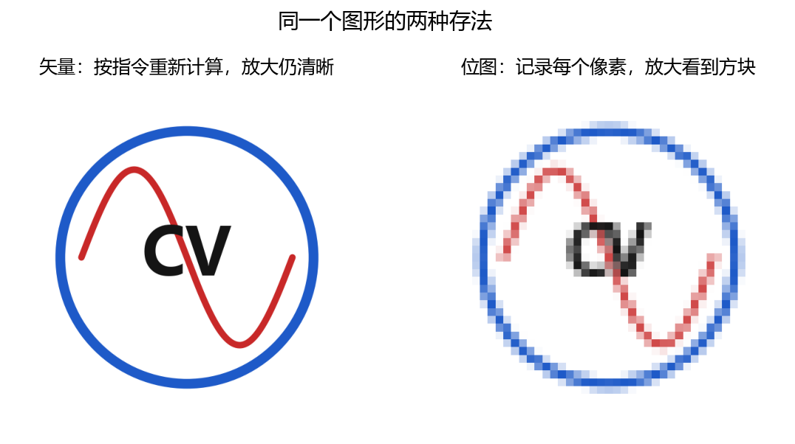
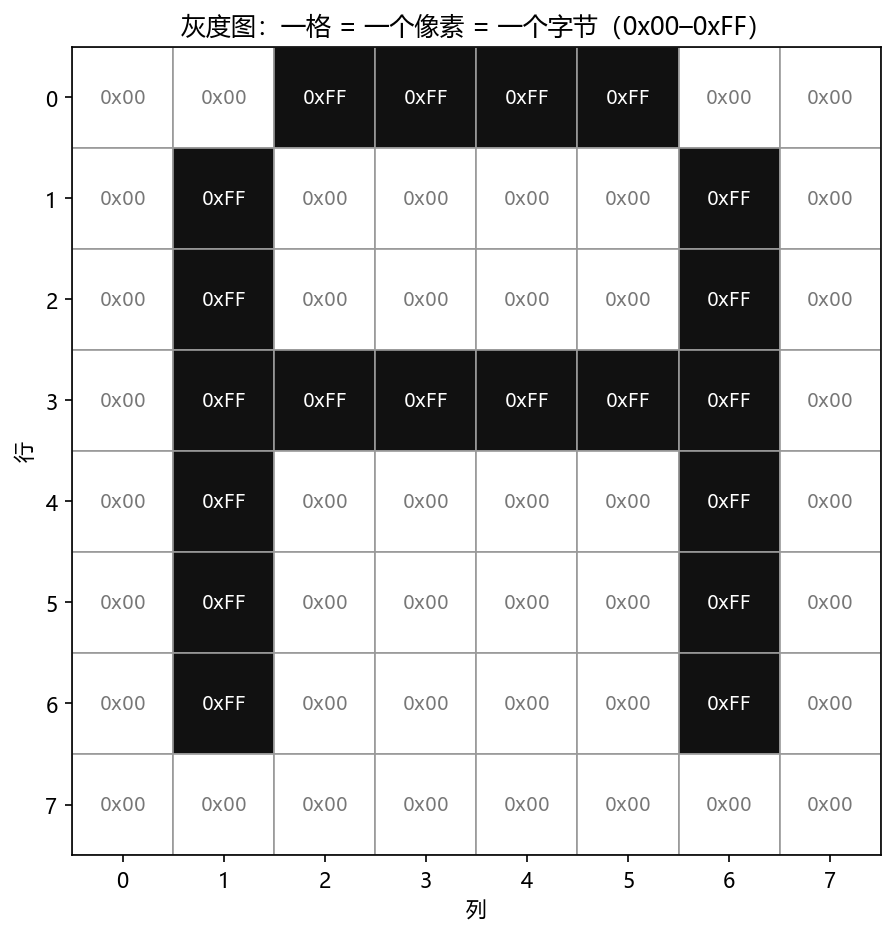
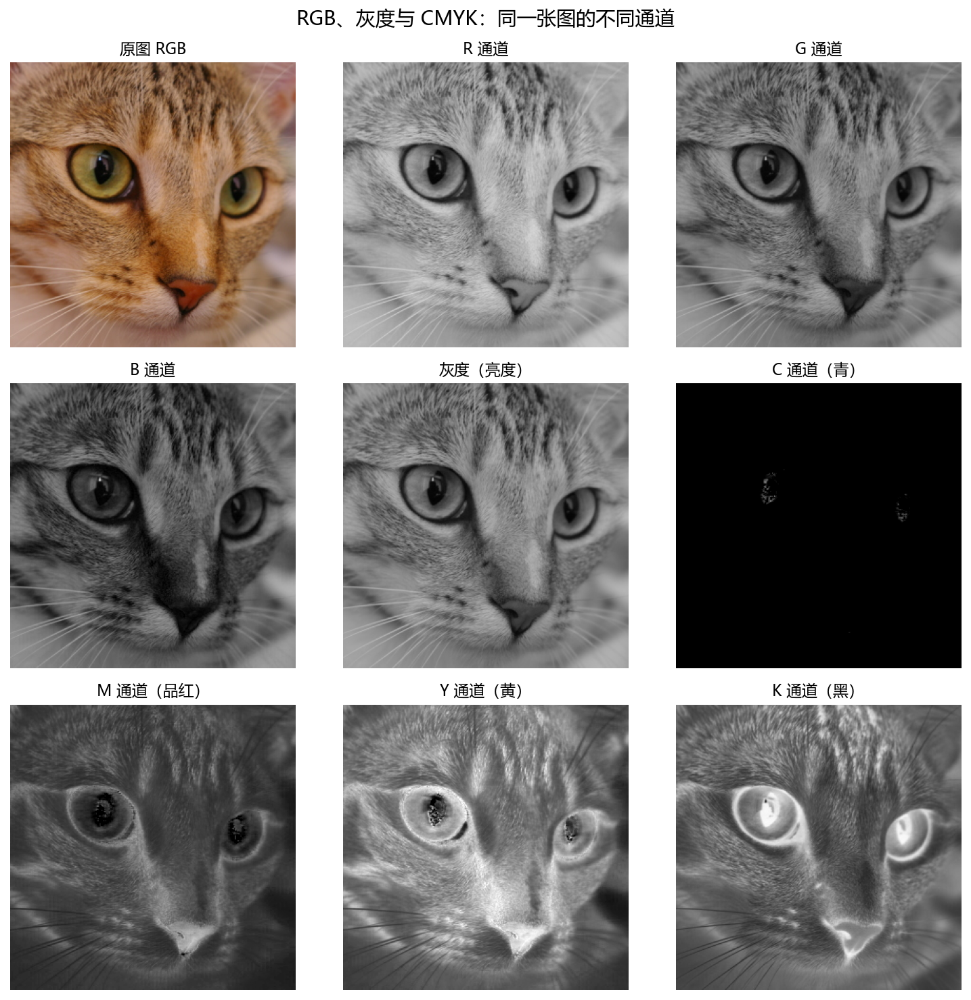
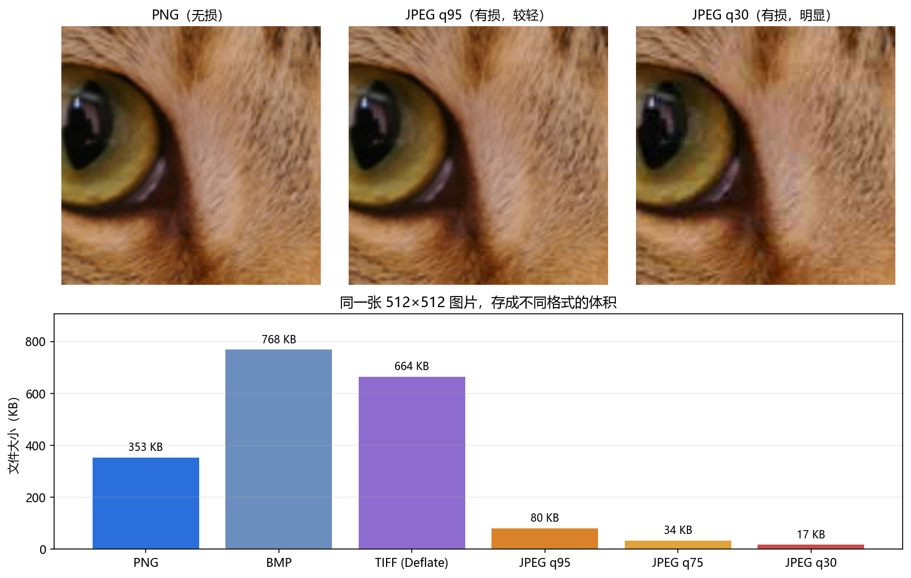
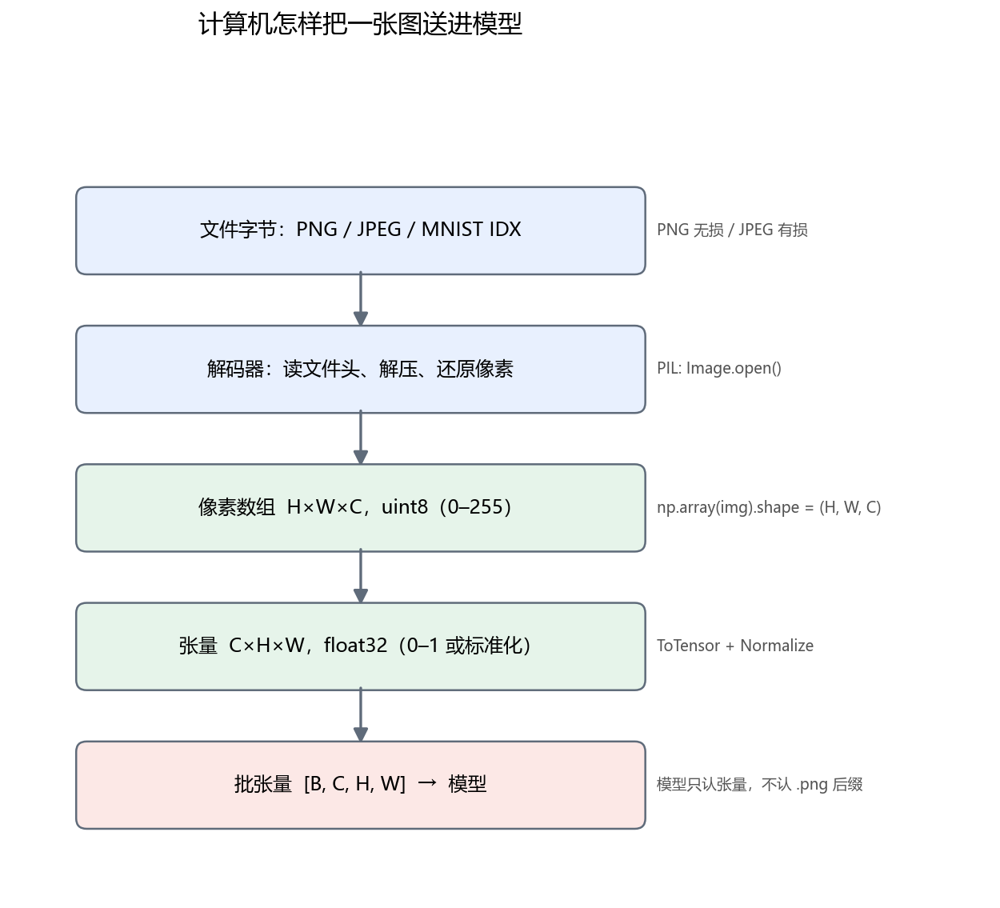
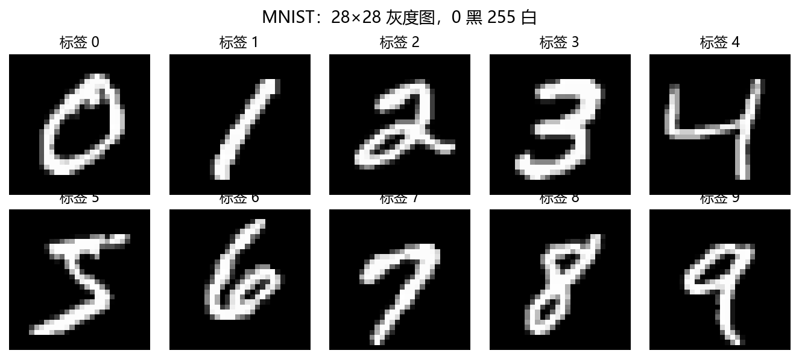
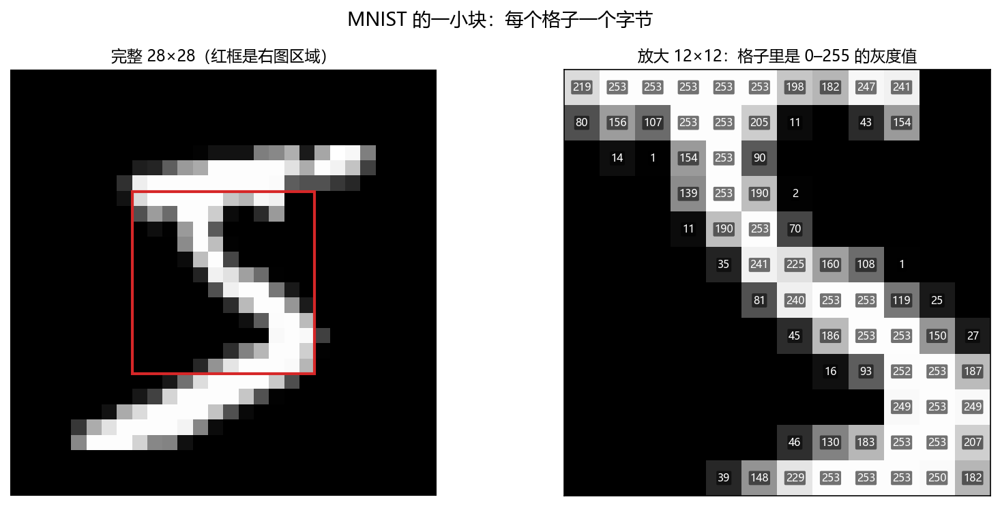
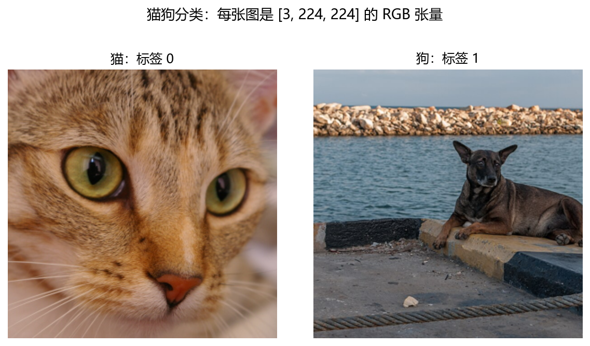

# 从投稿图到像素：计算机视觉先导

[返回 Vision 入口](README.md) · [返回第二课入口](../README.md) · [返回课程首页](../../README.md) · [素材与来源](assets/来源说明.md)

> 一张图，在屏幕上是一个样子，在文件里是一串字节，在模型里又是一组张量。
> 这篇先导材料要做的，就是把这三件事连起来。学完再看 MNIST，你会知道 `[64, 1, 28, 28]` 里的每个数字是从哪里来的。

**怎么用**：第 0–5 节建立“图—文件—字节”的概念；第 6 节接到 MNIST；第 7 节用猫狗做迁移思考。配合 [MNIST 课堂实战](../MNIST/README.md) 使用。

---

## 0. 从一条投稿要求说起

先看两个真实的投稿场景。

**场景一：Wiley 期刊的 Graphics FAQ。** 目标期刊的图形指南会把图分成矢量图与位图，并给出不同的分辨率要求。常见的分档是：

| 图件类型 | 常见要求 | 说明 |
| --- | --- | --- |
| 线图、示意图、曲线图 | 1200 dpi 或矢量格式 | 细线、文字多，最怕糊 |
| 半色调、照片 | 300 dpi | 连续色调，300 dpi 通常够印刷 |
| 组合图（照片上叠加标注） | 600 dpi | 兼有连续色调和细线 |
| 矢量图（EPS、PDF） | 不受 dpi 限制 | 按输出设备分辨率重新渲染 |

具体数字以目标期刊页面为准：<https://onlinelibrary.wiley.com/page/journal/21983844/homepage/graphics-faq/index.html#anchor21>

**场景二：ACS eBooks 的作者指南（课程提供的 PDF）。** 它对图件的要求写得更具体：

> “Vector graphics (EPS) are ideal because they are resolution-independent, meaning they can be scaled to any size without losing clarity or becoming pixelated. Always convert fonts to outlines or embed the fonts.”
>
> “If EPS files are not available, please send figures as TIFF files using the following: 600-1200 dpi TIFF files for all black and white and grayscale artwork; 300 dpi TIFF files for all color artwork (RGB color mode preferred).”

这两段话其实点了三件事：

1. **图是怎么存的**：矢量还是位图；
2. **图有多少细节**：分辨率、像素数；
3. **颜色是怎么编码的**：RGB 还是 CMYK。

这也是本讲的三个主线。最后我们会把这三件事落到一个具体任务上：MNIST 手写数字识别，以及猫狗分类。

**一个先记住的对比**：一张 600×400 像素的图，在屏幕上按 600 像素宽显示很清楚；但要印成 6 英寸宽，实际只有 100 dpi，远低于 300 dpi。屏幕清楚，不等于印刷合格。

---

## 1. 矢量图与位图：两种“画”的方式



左图是矢量方式渲染的，放大后边缘仍然光滑；右图是低分辨率位图放大，能看到一个个方块。差别不在“清晰度设置”，而在**文件里存的是什么**。

### 1.1 矢量图：存的是“怎么画”

矢量图不存像素，存的是画图指令：

- 一个圆心在 (300, 300)、半径 220 的圆；
- 一条从 A 到 B 的贝塞尔曲线；
- 一段文字、字号、字体；
- 填充色、描边宽度、透明度。

下面是一个简化到不能再简化的 SVG 例子（完整文件见 [vector_demo.svg](assets/vector_demo.svg)）：

```svg
<circle cx="300" cy="300" r="220" fill="none" stroke="#1e5ac8" stroke-width="16"/>
<path d="M120 300 C 210 120, 390 480, 480 300" fill="none" stroke="#c82828" stroke-width="10"/>
<text x="300" y="315" font-size="120" text-anchor="middle">CV</text>
```

这里没有任何“像素”。浏览器或打印机拿到这些指令后，按当前输出设备的分辨率实时算出该画哪些点。屏幕常见的 96–200 ppi 就按屏幕算，印刷 600 dpi 就按 600 dpi 算。所以矢量图**分辨率无关**：放大不是“把像素拉大”，而是“重新算一遍”。

常见矢量格式：

| 格式 | 本质 | 常见用途 |
| --- | --- | --- |
| SVG | XML 文本，描述图形 | 网页、示意图、图标 |
| EPS | PostScript 页面描述 | 期刊投稿、印刷 |
| PDF | 页面描述，可含矢量与位图 | 投稿、共享、印刷 |
| AI / CDR | 矢量软件原生文件 | 设计源文件 |

注意：PDF 和 EPS 里**可以嵌入位图**。一个 PDF 里有矢量文字，也可能有一张照片；它是不是“矢量图”，要看具体内容。

### 1.2 计算机怎样“识别”矢量图

计算机并不是“看懂”了圆，它做的是：

1. **解析文件**：SVG 用 XML 解析器，EPS/PDF 用 PostScript/PDF 解释器；
2. **建立图形对象**：圆、路径、文字、变换矩阵；
3. **按目标分辨率栅格化**：把连续坐标采样成像素，填色、描边、抗锯齿；
4. **输出**：屏幕像素或印刷网点。

所以矢量图的“识别”本质是**执行绘图指令**。字体也是一个关键：如果文字没有转曲、也没有嵌入字体，渲染器可能用别的字体替代，排版就变了。这就是期刊要求“fonts to outlines or embed the fonts”的原因。

### 1.3 位图：存的是“每个点是什么颜色”

位图（raster / bitmap）把画面切成网格，每个格子记录颜色。一个 28×28 的灰度图，就是 784 个 0–255 的数；一张 1920×1080 的彩色图，就是 1920×1080×3 个字节。

计算机读取位图的过程是：

1. 读文件头，知道格式、宽、高、通道数、位深；
2. 解压/解码，得到像素数组；
3. 把数组交给显示或程序。

放大位图时，屏幕只有两种办法：**最近邻**（直接复制方块）或**插值**（用周围像素猜新值）。插值看起来平滑，但没有增加真实细节。所以“把 72 dpi 的图改成 300 dpi”只是改了一个标签，像素并没有变多。

常见位图格式：PNG、JPEG、TIFF、BMP、GIF、WebP、RAW。

> **经典测试图**：Cameraman、Peppers、Mandrill（Baboon）等被广泛用于图像处理论文，便于不同算法在同一张图上比较。本讲选用 CC0 的 Chelsea 猫和 MNIST 样张，避免版权问题。

### 1.4 一张表分清

| 对比项 | 矢量图 | 位图 |
| --- | --- | --- |
| 文件里存什么 | 点、线、曲线、文字、填充等指令 | 每个像素的颜色值 |
| 放大后 | 重新计算，边缘清晰 | 看到像素块或插值模糊 |
| 分辨率 | 无关，取决于输出设备 | 固定，文件里写死 |
| 典型格式 | SVG、EPS、PDF、AI | PNG、JPEG、TIFF、BMP、RAW |
| 文件大小 | 通常较小，复杂图形可能很大 | 与像素数、通道数、压缩方式有关 |
| 适合内容 | 线图、示意图、文字、图标 | 照片、显微图、扫描图、屏幕截图 |
| 投稿建议 | 线图优先 EPS/PDF，字体转曲或嵌入 | 照片用 TIFF，按最终尺寸满足 dpi |

**一句话**：矢量图是“菜谱”，位图是“成品照片”。菜谱可以按人数重新做，照片放大只能看到像素。

> **dpi 与 ppi**：dpi 严格说是印刷“每英寸点数”，ppi 是图像“每英寸像素数”；期刊口语里常混用。关键不是这个缩写，而是：**在最终印刷尺寸下，像素够不够**。

---

## 2. 像素、灰度、RGB、CMYK

### 2.1 像素与位深

**像素（pixel）**是位图的最小单位。每个像素在每个通道上有一个数值，数值的位数叫**位深（bit depth）**。

- 8 位：0–255，共 256 级；
- 1 位：只有黑/白两级；
- 16 位：0–65535，医学、天文、专业影像常用；
- 浮点：HDR、科学计算，范围更大。

位深决定“能区分多少级”。8 位灰度只有 256 级，在平滑渐变里可能出现“色带”；16 位就细腻得多。

### 2.2 灰度图：一个通道

**灰度图（grayscale）**每个像素只有一个值，表示亮度：0 是黑，255 是白，128 是中灰。



上图是一个 8×8 的灰度图。每个格子就是一个像素。这里每个像素是 **8 位 = 1 字节**；十六进制一位代表 4 位，所以一个字节正好写成 **两位十六进制**：`0x00` 是黑（十进制 0），`0xFF` 是白（十进制 255）。8×8 = 64 个像素 = 64 个字节。

| 写法 | 黑 | 白 | 说明 |
| --- | --- | --- | --- |
| 十进制 | 0 | 255 | 人最熟悉 |
| 二进制（8 位） | `0000 0000` | `1111 1111` | 8 个 bit |
| 十六进制（8 位） | `0x00` | `0xFF` | 2 个十六进制位 |
| 十六进制（16 位） | `0x0000` | `0xFFFF` | 4 个十六进制位 |

> **为什么黑不是 `0x0000`？** 数值上 `0x0`、`0x00`、`0x0000` 都是 0；多出来的 0 表示“用几位来装”，不是“更黑”。`0x00` 是 8 位（1 字节），`0x0000` 是 16 位（2 字节）。如果图像是 16 位灰度，黑才是 `0x0000`，白是 `0xFFFF`。如果你说的 `0000` 是二进制，那只是 4 位；8 位黑要写成 `0000 0000`。

灰度不是简单把 RGB 三个数取平均。常用的是按人眼敏感度加权：

$$
Y = 0.299R + 0.587G + 0.114B
$$

绿色权重最高，蓝色最低。这也是为什么彩色图转灰度后，红色和绿色区域看起来亮度不同。

### 2.3 RGB：屏幕上的加色

**RGB** 用红、绿、蓝三个通道相加来产生颜色，叫**加色模型**：

- 三个都 0：黑；
- 三个都 255：白；
- 红 (255, 0, 0)、绿 (0, 255, 0)、蓝 (0, 0, 255)；
- 黄 (255, 255, 0)、青 (0, 255, 255)、品红 (255, 0, 255)。

每个通道 8 位，三个通道就是 24 位，共 $256^3 = 16{,}777{,}216$ 种颜色。常见的 sRGB 是一种具体的 RGB 色彩空间；说“RGB”只说明模型，不说明具体色域。



上图用一张猫的照片拆开看：R、G、B 三个通道各自是一张灰度图；灰度图是三者加权；CMYK 是印刷用的四个通道。注意 C 通道很暗，因为这只猫偏橙黄，青色成分少——通道图不是“颜色滤镜”，而是“这个通道的数值有多大”。

### 2.4 CMYK：印刷上的减色

**CMYK** 用青（Cyan）、品红（Magenta）、黄（Yellow）、黑（Key）四种油墨来吸收光，叫**减色模型**。它用于印刷，因为纸上的油墨是“减法”：白光打上去，油墨吸收一部分，剩下的反射到眼睛。

- 每个通道 8 位，四个通道 32 位；
- K 是黑色，单独加 K 可以更黑、更省墨、细节更好；
- RGB 转 CMYK 不是唯一公式，取决于 ICC 配置文件、油墨、纸张；
- RGB 的色域和 CMYK 的色域不一样：屏幕上的亮绿、亮橙，印刷可能印不出来；印刷的一些深色，屏幕也未必显示得准。

所以期刊常说“RGB 投稿可以，生产时转 CMYK”；但如果你很在意颜色，最好提前在 CMYK 下检查一遍。

### 2.5 一个像素要用几个十六进制数表示？

这是最容易混淆的地方。答案是：**看模式**。

| 图像模式 | 每像素通道数 | 每像素字节数 | 十六进制写法 | 例子 |
| --- | ---: | ---: | --- | --- |
| 1 位黑白 | 1 | 1/8（8 像素/字节） | 二进制 1 位 | 0 或 1 |
| 8 位灰度 | 1 | 1 | 2 位 | `0x80` = 128 |
| 24 位 RGB | 3 | 3 | 6 位 | `#FF8000` = (255,128,0) |
| 32 位 RGBA | 4 | 4 | 8 位 | `#FF8000FF` |
| 32 位 CMYK | 4 | 4 | 通常不用十六进制 | 常写成 C/M/Y/K 百分比 |
| 16 位/通道 RGB | 3 | 6 | 12 位 | 每通道 4 位十六进制 |

几个具体例子：

- 纯红：RGB `(255, 0, 0)`，十六进制 `#FF0000`；
- 中灰：灰度 `128`，十六进制 `0x80`；
- 天蓝：RGB `(135, 206, 235)`，十六进制 `#87CEEB`；
- 半透明红：RGBA `(255, 0, 0, 128)`，十六进制 `#FF000080`。

**八进制**也遵循同样的“一个字节”逻辑：一个字节 0–255 写成八进制是 `0o000`–`0o377`。例如 `0o200` = 128，`0o377` = 255。但十六进制更常用，因为两位十六进制刚好对应一个字节，读起来更整齐。

| 十进制 | 十六进制 | 八进制 | 二进制 |
| ---: | --- | --- | --- |
| 0 | `0x00` | `0o000` | `0000 0000` |
| 64 | `0x40` | `0o100` | `0100 0000` |
| 128 | `0x80` | `0o200` | `1000 0000` |
| 255 | `0xFF` | `0o377` | `1111 1111` |

**什么时候一个像素真的只是一个数？** 索引色（indexed color）：GIF 和某些 PNG 用索引（最多 8 位），每个像素存的是调色板的下标；真正的颜色要去调色板里查。这时一个像素是一个字节（8 位索引时），但它表示“第几号颜色”，不是颜色本身。

**一句话**：灰度图像素是“一个字节”；RGB 像素是“三个字节”；CMYK 是“四个字节”。不要把“一个像素”说成“一个十六进制数”，除非你说的是灰度或索引色。

---

## 3. 一张图占多少字节？

### 3.1 先算未压缩大小

对于位图，未压缩的像素数据大小是：

$$
\text{字节数} = \text{宽} \times \text{高} \times \text{通道数} \times \frac{\text{每通道位数}}{8}
$$

再加重文件头、元数据；如果文件用了压缩，实际文件会更小（或偶尔更大，因为压缩本身有开销）。

### 3.2 算几个例子

| 图像 | 计算 | 字节数 | 约合 |
| --- | --- | ---: | --- |
| MNIST 一张图 | 28×28×1×8/8 | 784 B | 0.77 KB |
| 1024×768 RGB | 1024×768×3 | 2,359,296 B | 2.25 MiB |
| 1920×1080 RGB | 1920×1080×3 | 6,220,800 B | 5.93 MiB |
| A4 300 dpi RGB | 2480×3508×3 | 26,099,520 B | 24.9 MiB |
| Letter 300 dpi RGB | 2550×3300×3 | 25,245,000 B | 24.1 MiB |
| 6000×4000 12-bit RAW | 6000×4000×12/8 | 36,000,000 B | 34.3 MiB |
| 6000×4000 14-bit RAW | 6000×4000×14/8 | 42,000,000 B | 40.1 MiB |
| 6000×4000 RGB 24-bit | 6000×4000×3 | 72,000,000 B | 68.7 MiB |

注意 MB 和 MiB 的区别：$10^6$ 字节是 1 MB，$1024^2$ 字节是 1 MiB。厂商标硬盘常用 MB，操作系统常显示 MiB，所以“500 GB”硬盘在系统里看起来只有 465 GB 左右。图像大小也会遇到同样的差异。

**MNIST 的实际文件**：训练图像是 60,000 张，每张 784 字节，加 16 字节文件头：

$$
60{,}000 \times 784 + 16 = 47{,}040{,}016\ \text{字节} \approx 47.0\ \text{MB}
$$

测试图像是 $10{,}000 \times 784 + 16 = 7{,}840{,}016$ 字节。注意：这是 `.gz` 解压后的 IDX 数据；`.gz` 文件本身还会再小一些。

### 3.3 RAW：传感器的原始数据

**RAW** 不是一种“通用图片格式”，而是相机传感器原始数据的统称。它通常记录：

- 每个感光单元的一个亮度值（12 位或 14 位常见）；
- 拜耳滤色阵列（Bayer CFA）信息：每个像素只记录 R、G 或 B 中的一个；
- 白平衡、曝光、镜头、色彩矩阵等元数据。

要变成能看的图，需要**去马赛克（demosaicing）**、白平衡、色彩变换、伽马校正等步骤。不同厂商的 RAW 后缀不同：

| 厂商/组织 | 常见后缀 |
| --- | --- |
| Canon | CR2、CR3 |
| Nikon | NEF |
| Sony | ARW |
| Adobe | DNG（开放格式） |
| Fujifilm | RAF |

以 6000×4000、14 位为例，未压缩像素数据是 42 MB；如果相机用了无损压缩，文件可能更小。再具体一点：Sony A7 IV 的传感器是 7008×4672，14 位未压缩数据约

$$
7008 \times 4672 \times 14 / 8 \approx 57.3\ \text{MB}
$$

实际 ARW 文件通常因无损压缩而小于这个数。所谓“无损 RAW”通常指对传感器数据做无损压缩；但有些相机的“压缩 RAW”是有损的，购买/拍摄时要看清设置。

RAW 不能直接喂给 CNN：它需要先解码、去马赛克、转成 RGB，再缩放、归一化。它适合“保留最大后期空间”，不适合“直接当训练数据”。

### 3.4 PNG 是无损的吗？

**是。** PNG 使用 DEFLATE（LZ77 + Huffman）做无损压缩，解码后每个像素的值与压缩前完全一致。它支持灰度、RGB、索引色、带 alpha，位深 1/2/4/8/16。

但有两个常见的误解：

1. **“无损”是相对于输入像素而言的。** 如果你先把图存成 JPEG q30，再转成 PNG，PNG 不会把丢掉的细节变回来；它只是忠实地保存了已经被 JPEG 破坏的像素。
2. **索引色 PNG 可能“减色”。** 把真彩色图转成 256 色索引 PNG，颜色被量化了；相对原始真彩色，这一步是有损的。文件仍然“无损地”保存了量化后的结果。

---

## 4. 格式：无损、有损与容器

### 4.1 三类要分清

- **无损压缩**：解码后像素与原始完全一致。PNG、GIF（LZW）、BMP（通常不压缩）、TIFF（LZW/Deflate/不压缩）、无损 WebP。
- **有损压缩**：解码后像素与原始不同，但文件小很多。JPEG、有损 WebP、HEIC。
- **容器格式**：TIFF 是容器，里面可以放不压缩、LZW、Deflate，甚至 JPEG；所以“TIFF 是无损的”这句话不严谨，要看具体压缩方式。

### 4.2 实测：同一张图存成不同格式

我们把一张 512×512 的猫图存成不同格式，文件大小如下（脚本见 [make_assets.py](scripts/make_assets.py)）：

| 格式 | 文件大小 | 相对未压缩 | 是否有损 | 说明 |
| --- | ---: | ---: | --- | --- |
| 未压缩 RGB | 786,432 B | 100% | — | 512×512×3 |
| BMP | 786,486 B | 100% | 无损 | 786,432 + 54 字节文件头 |
| PNG | 361,601 B | 46.0% | 无损 | DEFLATE + 行滤波 |
| TIFF（Deflate） | 679,844 B | 86.5% | 无损 | 容器 + Deflate |
| JPEG q95 | 81,858 B | 10.4% | 有损 | 质量高，体积仍小 |
| JPEG q75 | 34,669 B | 4.4% | 有损 | 常用质量 |
| JPEG q30 | 17,539 B | 2.2% | 有损 | 明显失真 |



上半部分是同一细节区域的放大：PNG 边缘干净；JPEG q95 已经有一点点软化；JPEG q30 在边缘出现“振铃”和块状模糊。下半部分是文件大小。原始样例文件在 [assets/format_samples/](assets/format_samples/)，可以自己打开对比；体积数据在 [format_sizes.json](assets/format_sizes.json)。

这张图说明了几件事：

- **无损不等于文件大**：PNG 只有未压缩的 46%，因为图像有大量重复和可预测的像素。
- **有损可以小一个数量级**：JPEG q75 只有 34 KB，适合照片。
- **格式不是越新越好，而是越合适越好**：线图用 JPEG 会在文字和线条边缘产生振铃；照片用 PNG 会很大。

### 4.3 常见格式怎么选

| 格式 | 压缩 | 有损/无损 | 透明 | 典型用途 | 注意 |
| --- | --- | --- | --- | --- | --- |
| PNG | DEFLATE | 无损 | 支持 | 截图、线图、图标、网页 | 照片体积偏大；索引色会减色 |
| JPEG | DCT + 量化 | 有损 | 不支持 | 照片、网页 | 反复保存会累积失真；文字边缘振铃 |
| TIFF | 不压缩/LZW/Deflate/JPEG | 取决于设置 | 支持 | 印刷、投稿、存档 | 容器格式，必须看压缩方式 |
| BMP | 通常不压缩 | 无损 | 有限 | Windows、简单位图 | 体积大；不适合网页 |
| GIF | LZW | 无损（限 256 色） | 1 位 | 简单动画、图标 | 颜色少；不适合照片 |
| WebP | VP8/VP8L | 有损/无损 | 支持 | 网页 | 期刊接受度不一 |
| RAW | 厂商算法 | 通常无损/近无损 | — | 摄影后期 | 不是通用图片格式；需解码 |

**投稿时的实用建议**：

- 线图、示意图、曲线图：优先 **EPS/PDF（矢量）**；没有矢量就用 **PNG**，不要用 JPEG。
- 照片、显微图：用 **TIFF**，按最终印刷尺寸满足 300 dpi；投稿系统不接受 TIFF 时再用高质量 JPEG。
- 截图：用 **PNG**；不要截屏后存 JPEG，文字边缘会糊。
- 中间处理：用 **PNG/TIFF** 保存，避免反复 JPEG 压缩。
- 网页：照片用 **JPEG/WebP**，图标/线图用 **PNG/SVG**。

---

## 5. 计算机怎样读取图像文件？



### 5.1 先看文件头

文件扩展名可以骗人，文件头一般不会。常见格式的“魔数”（文件开头的几个字节）：

| 格式 | 开头字节（十六进制） | ASCII/说明 |
| --- | --- | --- |
| PNG | `89 50 4E 47 0D 0A 1A 0A` | `\x89PNG\r\n\x1a\n` |
| JPEG | `FF D8 FF` | SOI 标记 |
| BMP | `42 4D` | `BM` |
| TIFF | `49 49 2A 00` 或 `4D 4D 00 2A` | `II*\0`（小端）或 `MM\0*`（大端） |
| GIF | `47 49 46 38` | `GIF8` |
| PDF | `25 50 44 46` | `%PDF` |
| EPS | `25 21 50 53` | `%!PS` |
| SVG | 文本 `<svg` 或 XML 声明 | 不是二进制魔数 |

读取图片的程序通常先读这几个字节判断格式，再调用对应解码器。

### 5.2 解码：从字节到数组

以 PNG 为例：

1. 读文件头，确认是 PNG；
2. 读 IHDR 块：宽、高、位深、颜色类型、压缩方法；
3. 读 IDAT 块：DEFLATE 解压，按行滤波还原；
4. 得到 `H×W×C` 的像素数组；
5. 如果有 ICC 配置文件，做颜色管理；
6. 交给显示或模型。

JPEG 则要经过霍夫曼解码、反量化、IDCT、色度上采样，得到 RGB 数组。RAW 还要去马赛克。不同格式的解码步骤不同，但终点都是**像素数组**。

### 5.3 在 Python 里读一张图

```python
# 假设当前目录是 lesson02/
from PIL import Image
import numpy as np

img = Image.open("assets/chelsea.png")
print(img.format, img.size, img.mode)
# PNG (451, 300) RGB

arr = np.asarray(img)
print(arr.shape, arr.dtype, arr.min(), arr.max())
# (300, 451, 3) uint8 0 255

r, g, b = arr[150, 200]
print(r, g, b, f"#{r:02X}{g:02X}{b:02X}")
```

几个容易踩的坑：

- `img.size` 是 **`(宽, 高)`**；`arr.shape` 是 **`(高, 宽, 通道)`**。两者顺序相反。
- PIL 默认 RGB；OpenCV 的 `cv2.imread` 默认 **BGR**；matplotlib 期望 RGB。混用会变色。
- `plt.imread` 对 PNG 常返回 0–1 的浮点数组；PIL 的 `np.asarray` 返回 0–255 的 `uint8`。
- `Image.open` 是惰性的，真正解码通常发生在 `np.asarray`、`convert` 或 `load` 时。
- **DPI 是元数据，不是像素数**。把一张 600×400 的图标记成 300 dpi，不会让它变成 1800×1200；印刷时该糊还是糊。

### 5.4 文件大小 ≠ 内存大小

一个 353 KB 的 PNG，解码后可能是 786 KB 的数组（512×512×3）。一张 4K RGB 图解码后是：

$$
3840 \times 2160 \times 3 = 24{,}883{,}200\ \text{字节} \approx 23.7\ \text{MiB}
$$

训练时一个 batch 有 64 张 224×224×3 的图：

$$
64 \times 224 \times 224 \times 3 = 9{,}633{,}792\ \text{字节}
$$

算一下：$224 \times 224 = 50{,}176$；$\times 3 = 150{,}528$；$\times 64 = 9{,}633{,}792$ 字节，约 9.2 MiB。这还只是输入，没算模型、梯度和中间激活。所以 batch 大小、图像尺寸会直接影响显存/内存。

---

## 6. MNIST：从 IDX 文件到张量



### 6.1 数据集长什么样

MNIST 是手写数字数据集，由 LeCun、Cortes、Burges 整理：

- 训练集 60,000 张，测试集 10,000 张；
- 每张 28×28 灰度图；
- 10 个类别（0–9）；
- 0 是背景（黑），255 是笔画（白）。

它之所以适合教学：图像小、格式统一、单通道、对比度高、类别平衡。真实图像几乎不会这么“干净”。

### 6.2 IDX：一种很朴素的二进制格式

MNIST 原始文件不是 PNG/JPEG，而是 **IDX**：

- 训练图像 `train-images-idx3-ubyte.gz`：
  - 魔数 `0x00000803`（2051）；
  - 图像数 60000；
  - 行数 28、列数 28；
  - 后面是 60000×28×28 个 `uint8`。
- 训练标签 `train-labels-idx1-ubyte.gz`：
  - 魔数 `0x00000801`（2049）；
  - 标签数 60000；
  - 后面是 60000 个 `uint8`。

文件头 16 字节（标签文件头 8 字节），之后就是连续的像素字节。没有压缩、没有颜色表、没有 EXIF。`.gz` 只是外面又套了一层 gzip。

这就是为什么 MNIST 的训练图像文件是 47,040,016 字节：16 字节头 + 60000×784 字节像素。



放大看，每个格子就是一个 0–255 的数。模型看到的不是“数字 5”这个符号，而是这 784 个数。

### 6.3 用 torchvision 读进来

```python
from torchvision import datasets, transforms

tf = transforms.Compose([
    transforms.ToTensor(),                       # 0–255 uint8 -> 0–1 float32，并加通道维
    transforms.Normalize((0.1307,), (0.3081,)),  # 用训练集均值/标准差标准化
])

train = datasets.MNIST("data", train=True, download=True, transform=tf)
x, y = train[0]
print(x.shape, x.dtype, y)
# torch.Size([1, 28, 28]) torch.float32 5
```

`ToTensor()` 做了三件事：

1. 把 PIL 图像或 NumPy 数组转成 `torch.Tensor`；
2. 把 0–255 缩放到 0–1；
3. 把通道放到最前面：灰度图 `H×W` → `1×H×W`，彩色图 `H×W×3` → `3×H×W`。

`Normalize((0.1307,), (0.3081,))` 再做 $(x-\mu)/\sigma$。这两个数来自训练集的全局统计，测试集不能重新算。

一个 batch：

```python
from torch.utils.data import DataLoader

loader = DataLoader(train, batch_size=64, shuffle=True)
images, labels = next(iter(loader))
print(images.shape, labels.shape)
# torch.Size([64, 1, 28, 28]) torch.Size([64])
```

这就是课堂上看到的 `[64, 1, 28, 28]`：64 张图、1 个通道、28 行、28 列。

> **通道在前还是在后？** PyTorch 的卷积输入是 `[B, C, H, W]`（通道在前）；TensorFlow/Keras 常用 `[B, H, W, C]`（通道在后）。同一张图，换框架时形状会变，但数值不变。看代码时先确认框架约定。

### 6.4 模型看到的是什么

- 如果第一层是 `Flatten`，784 个数排成一列，接 `Linear(784, 128)`；
- 如果第一层是卷积，输入保持 `[1, 28, 28]`，卷积核在 28×28 上滑动。

无论哪种，模型都不认识“图片”这个概念，它只认识张量和数字。图像文件、PNG 压缩、RGB/灰度，都是**进入模型之前**的事。

---

## 7. 猫狗：真实图像要多做什么？



### 7.1 和 MNIST 的差别

| 项目 | MNIST | 猫狗 |
| --- | --- | --- |
| 尺寸 | 固定 28×28 | 任意，常见几百到几千像素 |
| 通道 | 1（灰度） | 3（RGB） |
| 背景 | 干净、居中 | 复杂、变化大 |
| 类别 | 10 类 | 2 类 |
| 类内差异 | 小 | 姿态、光照、品种、遮挡差异大 |
| 数据量 | 60k/10k | 通常远少于 MNIST |
| 任务难度 | 入门 | 真实视觉任务 |

### 7.2 读取与预处理

一张猫图从文件到模型，通常要经过：

1. **读文件**：JPEG/PNG → RGB 数组 `[H, W, 3]`；
2. **统一尺寸**：`Resize(256)` + `CenterCrop(224)`，或 `RandomResizedCrop(224)`；
3. **转张量**：`ToTensor()` → `[3, 224, 224]`，值 0–1；
4. **标准化**：用 ImageNet 均值/标准差（用预训练模型时）或训练集统计；
5. **组 batch**：`[B, 3, 224, 224]`；
6. **模型**：CNN 或预训练网络。

```python
from torchvision import transforms

train_tf = transforms.Compose([
    transforms.RandomResizedCrop(224),
    transforms.RandomHorizontalFlip(),
    transforms.ToTensor(),
    transforms.Normalize(mean=[0.485, 0.456, 0.406],
                         std=[0.229, 0.224, 0.225]),
])
```

为什么是 224？因为很多预训练 CNN（ResNet、VGG 等）按 224×224 设计；不是“图像必须 224”，而是“你选的模型期望这个输入尺寸”。如果自己从头训练，尺寸可以改，但要相应调整全连接层。

### 7.3 数据怎么组织

最常用的目录结构：

```text
data/
  train/
    cat/
      cat_001.jpg
      cat_002.jpg
    dog/
      dog_001.jpg
  val/
    cat/
    dog/
  test/
    cat/
    dog/
```

`torchvision.datasets.ImageFolder` 会按子文件夹名分配标签（按字母顺序，`cat`=0，`dog`=1），并自动读取图片。训练集、验证集、测试集要分开；测试集只在最后用一次。

### 7.4 想一想

1. 把一张 4000×3000 的照片缩到 224×224，丢了什么？保留了什么？
2. 为什么不能把不同尺寸的图直接塞进一个 `Linear` 层？
3. 如果训练集都是室内猫，测试集都是户外猫，准确率会怎样？
4. 数据增强（随机裁剪、翻转、颜色抖动）为什么只用在训练集？
5. 如果两张图其实是同一张照片的副本，一张在训练集、一张在测试集，会高估还是低估准确率？

这些问题没有标准答案，但都指向同一件事：**模型看到的不是“猫”这个概念，而是被预处理成固定形状的张量。**

---

## 8. 小结：一张图的旅程

| 阶段 | 矢量图 | 位图 | MNIST | 猫狗 |
| --- | --- | --- | --- | --- |
| 文件里 | 绘图指令 | 压缩的像素字节 | IDX + gzip | JPEG/PNG |
| 解码后 | 按分辨率渲染 | H×W×C 数组 | 60000×28×28 uint8 | H×W×3 uint8 |
| 模型输入 | 先栅格化 | 归一化张量 | [1,28,28] 或 [64,1,28,28] | [3,224,224] 或 [B,3,224,224] |
| 关键操作 | 字体转曲/嵌入 | 解码、缩放、归一化 | ToTensor + Normalize | Resize/Crop + Normalize |
| 常见坑 | 导出成低分辨率 PNG | 把 DPI 标签当分辨率 | 忘记加通道维 | 忘记统一尺寸/通道顺序 |

**三句话记住本讲**：

1. **矢量图存指令，位图存像素。** 放大后的差别，来自“重新计算”和“复制/插值”的差别。
2. **灰度 1 通道，RGB 3 通道，CMYK 4 通道。** 一个像素通常是“每通道一个字节”，不是“一个十六进制数”。
3. **文件大小 ≠ 解码后大小 ≠ 模型输入大小。** 压缩、解码、归一化、组 batch，每一步都会改变形状和数值。

---

## 9. 课堂练习

**计算题**

1. 一张 1024×768 的 24 位 RGB 图，未压缩占多少字节？约多少 MiB？
2. MNIST 一张 28×28 灰度图占多少字节？60,000 张呢（不算文件头）？
3. 一张 3000×2000 的 12 位 RAW，未压缩像素数据多少字节？约多少 MB？
4. 一个 500 KB 的 JPEG，解码成 4000×3000 的 RGB 数组，占多少内存？
5. 期刊要求 300 dpi、图宽 3.5 英寸，至少需要多少像素宽？

**判断题**

6. 把 72 dpi 的图改成 300 dpi，打印就会变清晰。（ ）
7. PNG 是无损的，所以从 JPEG 转成 PNG 能恢复细节。（ ）
8. TIFF 一定是无损的。（ ）
9. BMP 通常比 JPEG 大，因为它通常不压缩。（ ）
10. RGB 的像素是三个字节，CMYK 的像素是四个字节。（ ）

**思考题**

11. 为什么线图适合 PNG/矢量，照片适合 JPEG？
12. 猫狗任务里，为什么不能直接把原始尺寸的图喂给全连接层？
13. 如果让你为一篇论文准备一张“实验装置示意图”和一张“SEM 照片”，你会分别选什么格式？为什么？

**参考答案**

1. $1024 \times 768 \times 3 = 2{,}359{,}296$ 字节，约 2.25 MiB。
2. $28 \times 28 = 784$ 字节；$60{,}000 \times 784 = 47{,}040{,}000$ 字节。
3. $3000 \times 2000 \times 12 / 8 = 9{,}000{,}000$ 字节，约 9 MB。
4. $4000 \times 3000 \times 3 = 36{,}000{,}000$ 字节，约 34.3 MiB。
5. $3.5 \times 300 = 1050$ 像素宽；高度按比例。
6. 错。DPI 是元数据，改标签不会增加像素。
7. 错。JPEG 丢掉的细节回不来。
8. 错。TIFF 是容器，可能用 JPEG 压缩，也可能无损。
9. 对。BMP 通常不压缩，文件接近原始像素大小。
10. 对（8 位/通道时）。
11. 线图边缘锐利，JPEG 的 DCT 会在边缘产生振铃；PNG 无损、矢量更不会糊。照片是连续色调，JPEG 的心理视觉模型能大幅压缩而不易察觉。
12. 全连接层的权重矩阵尺寸固定，输入必须展平成固定长度；原始图像尺寸可变，展平后长度不一致。
13. 示意图用 EPS/PDF/SVG（矢量）；SEM 照片用 TIFF（按最终尺寸满足 300 dpi），避免 JPEG 反复压缩。

---

## 10. 参考资料与素材来源

**投稿与图形规范**

- ACS eBooks, *Author Guidelines*, Revised August 2026（课程提供的 PDF）：图件格式、EPS 矢量、TIFF 600–1200 dpi 黑白/灰度、300 dpi 彩色、RGB 优先。
- Wiley, *Graphics FAQ*（目标期刊页面）：<https://onlinelibrary.wiley.com/page/journal/21983844/homepage/graphics-faq/index.html#anchor21>（2026-11-22 访问）。具体 dpi/格式以该刊页面为准。

**格式与标准**

- W3C, *PNG (Portable Network Graphics) Specification*：<https://www.w3.org/TR/png/>
- ITU-T Recommendation T.81（JPEG）：<https://www.itu.int/rec/T-REC-T.81>
- Adobe, *TIFF 6.0 Specification*：<https://www.adobe.io/open/standards/TIFF.html>
- GIF89a Specification：<https://www.w3.org/Graphics/GIF/spec-gif89a.txt>

**数据与工具**

- LeCun, Y.; Cortes, C.; Burges, C. J. C. *The MNIST Database of Handwritten Digits*：<https://yann.lecun.com/exdb/mnist/>
- PyTorch torchvision, MNIST：<https://pytorch.org/vision/stable/generated/torchvision.datasets.MNIST.html>
- Pillow 文档：<https://pillow.readthedocs.io/>
- scikit-image 数据说明：<https://scikit-image.org/docs/stable/api/skimage.data.html>

**图片素材**

- 猫图 `chelsea.png`：Stefan van der Walt，CC0，来自 scikit-image；经典教学测试图。
- 狗图 `dog.jpg`：Wilfredor，CC0，“Dog in Chacachacare”，Wikimedia Commons。
- MNIST 样张：LeCun 等，MNIST 数据集。
- 其余图表：本课程用 [make_assets.py](scripts/make_assets.py) 生成。

详细来源与许可见 [assets/来源说明.md](assets/来源说明.md)。
