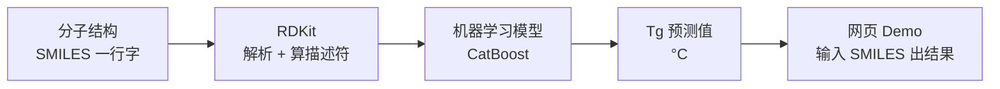
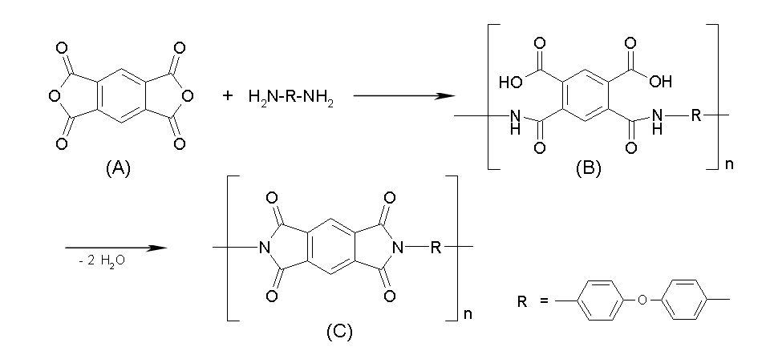
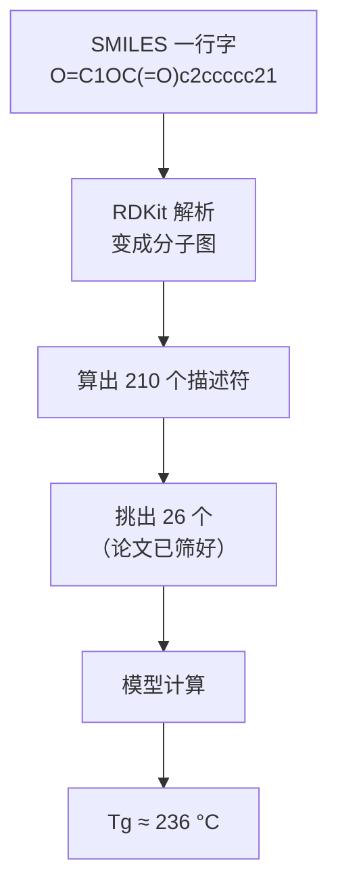
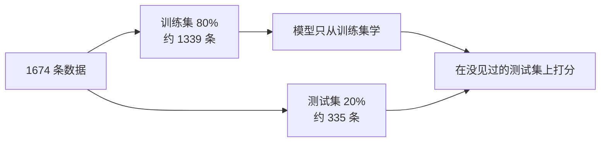

# 第三课 · 背景知识：从聚酰亚胺到机器学习

> **对应论文**：Wang et al., "Multifunctional polyimide performance prediction based on explainable machine learning", *Smart Molecules* **2025**, 3, e70020. DOI: [10.1002/smo2.70020](https://doi.org/10.1002/smo2.70020)
>
> **代码与数据**：<https://github.com/wsstju/SMILES-and-descriptor>（本地：`lesson03/SMILES-and-descriptor/`）
>
> **先修**：第二课机器学习基础；Python / pandas 基本操作
>
> **用法**：上课前读一遍，知道"要做什么、为什么这么做"。具体动手看《02_实操手册_Tg预测与网页Demo.md》。

---

## 0. 一句话和一张图

本课要回答一个问题：

> **给定一个聚酰亚胺的分子结构，能不能在合成之前，就先估出它的玻璃化转变温度（Tg）？**

最后的成果是一个网页：粘贴一行 SMILES，点一下，出预测值。



整条链条就三段：

1. **认识问题**：什么是聚酰亚胺？要预测什么？（§1–§2）
2. **认识工具**：计算机怎么表示分子？机器学习怎么做预测？（§3–§5）
3. **动手实现**：见《实操手册》，课上只做 Tg 一条线。

---

## 1. 为什么是聚酰亚胺

### 1.1 柔性显示基板的三条硬要求

聚酰亚胺（polyimide，简称 PI）是柔性显示、柔性电子里最常见的基板材料。它要同时满足三件事：

| 要求 | 具体指标 | 目标 |
|---|---|---|
| 光学上要透明 | 430 nm 透过率、截止波长 CW | 透过率 > 80%，CW 越小越无色 |
| 热学上要耐热 | 玻璃化转变温度 Tg | > 300 °C，能扛住 TFT 沉积等高温工序 |
| 尺寸上要稳定 | 热膨胀系数 CTE | 与金属电极匹配，避免受热翘曲、分层 |

### 1.2 麻烦在于：透明和耐热天然矛盾

PI 之所以耐热，是因为分子链之间作用强、堆得紧。可堆得紧往往颜色就深（共轭作用强），反过来想变透明，就得把链间距拉开：

- 引入 −CF₃、−SO₂−、脂环等基团，打断链间的电荷转移（CT）作用 → **变透明**；
- 但链堆积变松 → **Tg 下降、CTE 上升**。

所以 PI 设计的本质是**多目标折中**。这正是机器学习能帮上忙的地方：不用把每个配方都合成出来试，先在计算机里估算、筛选。

### 1.3 本课的三个目标性能

| 性能 | 符号 | 单位 | 通俗解释 | 本课采用的测法 |
|---|---|---|---|---|
| 玻璃化转变温度 | Tg | °C | 加热到这个温度，分子链开始"活络"，材料变软 | **只用 DSC** |
| 截止波长 | CW | nm | 吸收边在哪里，数值越小越透明、越无色 | UV-vis |
| 热膨胀系数 | CTE | ppm/K | 每升高 1 °C，尺寸伸长多少，越小越"不胀" | TMA |

> **注意**：Tg 可以用 DSC、DMA、TMA 等多种方法测，DMA 通常比 DSC 高几度到几十度。**混用测法会带来系统误差**，所以论文只保留 DSC 数据。这是数据清洗的第一个真实案例。

---

## 2. 聚酰亚胺是怎么合成的



一张图看懂三步反应：

1. **(A) 二酐 + 二胺**：二酐（图中 PMDA 型）和 H₂N–R–NH₂ 在溶液里开环加成；
2. **(B) 聚酰胺酸（PAA）**：生成含 −COOH / −CONH− 的线性中间体，可以涂膜；
3. **(C) 热酰亚胺化**：升温脱水（−2 H₂O），闭合成五元酰亚胺环，得到 PI。

图里的 **R = 4,4′-二苯醚（ODA）**。记住这句话：

> **换掉 R，就是换性能。** 机器学习要学的，就是"结构 R → 性能"这层关系。

还有一个容易被忽略的点：

> 画出来的结构是**重复单元**，两端是"开口"的，**不是一个完整分子**。

这件事在 §3.2 会直接决定数据能不能用。

---

## 3. 计算机怎么"看懂"分子

### 3.1 SMILES：用一行字写一个分子

SMILES 是一种用文本描述分子结构的写法。规则不多，够用就行：

| 概念 | 写法 | 例子 | 说明 |
|---|---|---|---|
| 原子 | `C` `N` `O` `F` | `CCO` | 大写 = 脂肪族（饱和） |
| 芳香原子 | `c` `n` `o` | `c1ccccc1` | 小写 = 芳香环上的原子 |
| 键 | `-` `=` `#` | `C=C` | 单键、双键、三键；单键可省略 |
| 支链 | `( )` | `CC(=O)C` | 括号里是挂出来的分支 |
| 环 | 数字 | `c1ccccc1` | 同一个数字表示首尾相连 |
| 电荷 / 同位素 | `[ ]` | `[NH4+]` | 方括号里写特殊状态 |
| 连接点 | `*` 或 `[*:1]` | `*c1ccccc1*` | 表示聚合物重复单元的接口 |

几个真实例子（都能被 RDKit 正确解析）：

| 分子 | SMILES | 分子式 |
|---|---|---|
| 水 | `O` | H₂O |
| 苯 | `c1ccccc1` | C₆H₆ |
| 丙酮 | `CC(=O)C` | C₃H₆O |
| 苯酐 | `O=C1OC(=O)c2ccccc21` | C₈H₄O₃ |
| PMDA（均苯四甲酸二酐） | `O=C1OC(=O)c2cc3C(=O)OC(=O)c3cc12` | C₁₀H₂O₆ |
| ODA（4,4′-二苯醚二胺） | `Nc1ccc(Oc2ccc(N)cc2)cc1` | C₁₂H₁₂N₂O |
| 6FDA（含氟二酐） | `O=C1OC(=O)c2cc(C(C(F)(F)F)(C(F)(F)F)c3ccc4C(=O)OC(=O)c4c3)ccc12` | C₁₉H₆F₆O₆ |

**练习**：把上面 7 个 SMILES 依次用 RDKit 画出来，对照化学结构看一眼。

### 3.2 第一件必做的事：封端

论文数据库里存的，常常是带连接点的重复单元：

```
论文 / 画图软件里：   *—[ 二酐 ]—[ 二胺 ]—*         * 是连接点，不是原子
送进 RDKit 之前：    [H]—[ 二酐 ]—[ 二胺 ]—[H]     用氢把两端补成完整分子
```

- `*` 在 SMILES 里是一个**真实的虚拟原子节点**，不是占位符；
- 直接删掉 `*` 等于删原子，`N(*)` 删成 `N()` 还会直接语法错误；
- 正确做法是**把 `*` 替换成 `[H]`**，得到两端封好的完整分子，再算描述符。

好消息：本仓库的数据已经封好端了，SMILES 两端是 `[H]`。但你自己从论文里抄结构时，这一步不能省。实操手册里给了现成的封端函数。

### 3.3 RDKit：分子工具箱

RDKit 是化学信息学最常用的开源库，本课只用到它三件事：**解析、画图、算描述符**。

```python
from rdkit import Chem

mol = Chem.MolFromSmiles("O=C1OC(=O)c2ccccc21")  # 解析：失败会返回 None
Chem.MolToSmiles(mol)                             # 规范化写法，可用于去重比对
```

> 判断一个 SMILES 能不能用，第一件事就是看 `MolFromSmiles` 是不是 `None`。

### 3.4 描述符：把分子变成 210 个数字

模型不认识结构图，只认识数字。**描述符（descriptor）**就是从分子结构算出来的一串数字，每个数字描述分子的某个方面。

论文用 RDKit 一次性算了 **210 个**描述符，大致分六类：

| 类别 | 代表描述符 | 说的是什么 |
|---|---|---|
| 组成 / 尺寸 | `MolWt`, `HeavyAtomMolWt` | 分子有多大、由什么原子组成 |
| 拓扑 / 形状 | `BertzCT`, `BalabanJ`, `Kappa3` | 分支多不多、环复杂不复杂 |
| 电子 / 电荷 | `MaxPartialCharge`, `PEOE_VSA*` | 极性、电荷怎么分布 |
| 疏水 / 溶解 | `MolLogP`, `SlogP_VSA*` | 亲水还是疏水、极化率大小 |
| 官能团 / 柔性 | `NumRotatableBonds`, `fr_*` | 有哪些基团、链柔不柔 |
| Burden 特征值 | `BCUT2D_*` | 加权矩阵的特征值，综合反映堆积与作用 |

> 单看任何一个数字都说明不了性能。但 210 个数字合起来，就勾勒出了分子的形状、极性、柔性……模型再从这些数字里找规律。

210 个太多，论文先做两步筛选：

```
210 个描述符
  → 去掉几乎不变的（方差筛选）
  → 按模型重要性排序，只留重要的
  → Tg 最终用 26 个
```

**课上直接用论文筛好的这 26 个**，省时间；课下可以自己重做一遍筛选（见实操手册 §12）。

### 3.5 完整数据流



一句话总结这一节：

> **结构 → SMILES → (RDKit) → 描述符 → 模型 → 性能。**

---

## 4. 机器学习在这里做什么

### 4.1 这是一道"有标准答案"的题

我们有 1674 个聚酰亚胺，每个都已知结构（SMILES）和实测 Tg。这相当于 1674 道带答案的练习题。模型的任务，是从中总结出"什么样的结构 → 什么样的 Tg"。

这在机器学习里叫**监督学习**；因为答案是连续的温度值，所以是**回归**问题。

### 4.2 为什么必须留出测试集

如果拿所有数据训练、又用同一批数据打分，等于考前把答案背下来，分数好看但没用。

所以标准做法是：



**测试集从头到尾不参与训练和调参**，这样得到的分数才能代表"遇到新分子时的表现"。

### 4.3 三个指标，一句话记住

| 指标 | 一句话理解 | 好坏的直觉 |
|---|---|---|
| **R²** | 模型解释了数据里多少"差异" | 满分 1；0.85 表示解释了 85% |
| **MAE** | 预测平均差多少度 | 单位同 Tg，直接读"差几度" |
| **RMSE** | 也是差几度，但对大错惩罚更重 | 比 MAE 大，说明有少数离谱的预测 |

画成图更好懂：把横轴当实测值、纵轴当预测值，点越贴近对角线 y = x，模型越准。

### 4.4 为什么用树模型

本课用的是 **CatBoost**（一种梯度提升树），论文里 Tg 和 CW 都用它，CTE 用随机森林。原因是：

- 表格型数据、样本量几百到几千时，树模型通常最稳；
- 不需要把不同量纲的特征缩放到同一范围；
- 训练快、调参少，适合课堂；
- 能直接给出"哪些描述符更重要"，方便回头看化学含义。

论文的实测成绩（测试集）：

| 性能 | 模型 | R² | MAE | RMSE |
|---|---|---|---|---|
| Tg | CatBoost | 0.865 | 18.1 °C | 25.6 °C |
| CW | CatBoost | 0.874 | 10.6 nm | 15.0 nm |
| CTE | 随机森林 | 0.855 | 6.6 ppm/K | 8.3 ppm/K |

你在课上跑出来的 Tg 结果应该和这组数字接近（R² 大约 0.85 上下），不完全相同是正常的——库的版本、随机种子都会有影响。

---

## 5. 数据从哪来，有什么规矩

### 5.1 三个来源

1. **专业数据库**：PolyInfo（NIMS，日本）<http://polymer.nims.go.jp>，收录聚合物 Tg、CTE 等物性；
2. **文献**：Web of Science / Scopus / SciFinder 检索，再回到原文和综述的表格里找数据；
3. **本仓库现成数据**：论文已经把整理好的数据放出来了，课上直接用。

### 5.2 仓库里的数据长什么样

| 文件 | 内容 | 规模 |
|---|---|---|
| `PI-Tg.xlsx` | 编号 / SMILES / Tg (℃) / 测法 | 1674 条 |
| `PI-CW.xlsx` | 编号 / SMILES / 截止波长 (nm) | 623 条 |
| `PI-CTE.xlsx` | 编号 / SMILES / CTE (ppm/K) | 512 条 |
| `descriptor_data-{Tg,CW,CTE}.csv` | SMILES + 210 个描述符 | 同上 |
| `Morgan_Frequency_Fingerprint-*.xlsx` | Morgan 指纹（另一种分子表示） | 同上 |
| `135 novel PIs.xlsx` | 论文新设计的 135 个 PI 及预测值 | 135 |

> 数据范围：Tg 19–448 °C，CW 244–515 nm，CTE −10–106 ppm/K。

### 5.3 三条硬规矩

1. **Tg 只用 DSC 数据**：DMA、TMA 测的一律剔除；
2. **重复单元先封端**：两端补 `[H]`，变成完整分子再算描述符；
3. **单位统一**：°C、nm、ppm/K（`ppm/°C` 和 `ppm/K` 数值等价）。

还有一个实操细节要记住：

> **计算描述符的 RDKit 版本，训练和预测必须一致。** 同一个分子，不同版本 RDKit 算出来的个别描述符可能不同（本课数据里 `NumHAcceptors` 就出现过新旧版本差 1 的情况）。最稳妥的做法是：训练时从 SMILES 现算，网页端也用同一套代码现算。

---

## 6. 课前准备（约 10 分钟）

### 6.1 装环境

```bash
python -m venv .venv
# Windows
.venv\Scripts\activate
pip install rdkit pandas scikit-learn catboost matplotlib joblib streamlit openpyxl
```

### 6.2 自检

```python
import rdkit, pandas, catboost, streamlit, sklearn
from rdkit import Chem

print("rdkit", rdkit.__version__)
print("catboost", catboost.__version__)
print(Chem.MolFromSmiles("c1ccccc1") is not None)   # 应该打印 True
```

三行都有输出、最后一行是 `True`，环境就准备好了。

### 6.3 提前打开这几个文件

- `example/Formation_of_polyimid.png` —— 本讲义 §2 的合成示意图；
- `SMILES-and-descriptor/PI-Tg.xlsx` —— 课上的标签数据；
- `SMILES-and-descriptor/CATB-Tg.ipynb` —— 论文作者的原始 notebook，可以对照看。

---

## 7. 课上做什么，课下做什么

| | 内容 |
|---|---|
| **课上**（一起做） | Tg 一条线：读数据 → 算描述符 → 训练 CatBoost → 评估 → 存模型 → 写 Streamlit 网页 |
| **课下**（自己完成） | CW、CTE 两条线（流程完全一样，换数据换模型）；重做特征筛选；多目标筛选候选分子 |

CW 和 CTE 在实操手册 §12 给了参数和特征数，照着套就行。

---

## 8. 带着三个问题来上课

1. 为什么"重复单元"不能直接拿去算描述符？如果忘了封端，会出什么问题？
2. 测试集 R² = 0.85，是不是说明模型"错 15%"？该怎么向化学家解释这个数字？
3. 如果一个新分子的描述符超出了训练数据的范围，模型给的结果还能信吗？

这三个问题，在实操和最后的讨论里都会回到。
