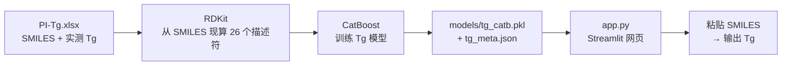

# 第三课 · 实操手册：Tg 性能预测与网页 Demo

> **课上只做 Tg 这一条线。** CW 和 CTE 的流程完全一样，放在 §12 课下完成。
>
> 建议课时：2 学时（含环境排错）。全部命令在 `lesson03/` 目录下执行。

---

## 0. 你会做出什么



一共写 3 个 Python 文件：

```
lesson03/
├── SMILES-and-descriptor/     ← 数据（已有，不要改）
├── pi_utils.py                ← 公共工具：封端 + 算描述符
├── train_tg.py                ← 训练脚本
├── app.py                     ← 网页
├── models/                    ← 训练产物（自动生成）
└── figs/                      ← 图片（自动生成）
```

---

## 1. 环境准备

```bash
cd lesson03
python -m venv .venv
# Windows
.venv\Scripts\activate
# macOS / Linux
# source .venv/bin/activate

pip install rdkit pandas scikit-learn catboost matplotlib joblib streamlit openpyxl
```

自检：

```python
import rdkit, pandas, catboost, streamlit, sklearn
from rdkit import Chem
print(rdkit.__version__, catboost.__version__)
print(Chem.MolFromSmiles("c1ccccc1") is not None)   # True
```

> 版本不用刻意对齐论文。**关键是训练和预测用同一个环境**，这样描述符前后一致。

---

## 2. 认识数据

| 文件 | 里面是什么 | 本课怎么用 |
|---|---|---|
| `SMILES-and-descriptor/PI-Tg.xlsx` | 编号、SMILES、Tg(℃)、测法 | **主数据**：SMILES 算特征，Tg 当标签 |
| `SMILES-and-descriptor/descriptor_data-Tg.csv` | 作者预先算好的 210 个描述符 | 对照参考；本课不从它取数 |
| `SMILES-and-descriptor/CATB-Tg.ipynb` | 论文原始 notebook | 想复刻论文流程时看 |

打开展示前几行：

```python
import pandas as pd
df = pd.read_excel("SMILES-and-descriptor/PI-Tg.xlsx")
print(df.shape)
print(df.columns.tolist())
print(df.head(3))
```

应该看到 **1674 行、4 列**，列名为 `PI number`、`SMILES`、`Tg(℃)`、`Measurement methods`。

> **为什么不直接用 `descriptor_data-Tg.csv`？**
> 那份 CSV 是用旧版 RDKit 算的。新版 RDKit 里个别描述符的定义改过（本数据里 `NumHAcceptors` 有 159 行比新算值大 1）。如果训练用 CSV、网页端用新版 RDKit 现算，就会出现"训练和预测不一致"。所以本课统一**从 SMILES 现算**，两边走同一套代码。

---

## 3. 读数据并做体检

先写 `pi_utils.py`：

```python
"""公共工具：描述符清单、封端、特征计算。train_tg.py 和 app.py 都用它。"""
from rdkit import Chem, RDLogger
from rdkit.Chem import Descriptors

RDLogger.DisableLog("rdApp.*")      # 关掉 RDKit 的警告刷屏

# 论文为 Tg 筛选出的 26 个描述符
FEATURES_TG = [
    "qed", "MaxPartialCharge", "MaxAbsPartialCharge", "BCUT2D_MWLOW",
    "BCUT2D_CHGHI", "BCUT2D_MRHI", "BertzCT", "PEOE_VSA6", "PEOE_VSA8",
    "PEOE_VSA9", "SMR_VSA6", "SMR_VSA7", "SlogP_VSA1", "SlogP_VSA11",
    "SlogP_VSA4", "SlogP_VSA8", "VSA_EState2", "VSA_EState8",
    "FractionCSP3", "NumAromaticRings", "NumHAcceptors",
    "NumRotatableBonds", "RingCount", "fr_aniline", "fr_bicyclic", "fr_ether",
]

_DESC = {name: func for name, func in Descriptors.descList}


def cap_smiles(smiles: str):
    """把重复单元两端的 * 换成 [H]，返回 RDKit 分子；解析失败返回 None。"""
    mol = Chem.MolFromSmiles(smiles)
    if mol is None:
        return None
    if any(atom.GetAtomicNum() == 0 for atom in mol.GetAtoms()):
        mol = Chem.ReplaceSubstructs(
            mol,
            Chem.MolFromSmarts("[#0]"),          # 只匹配虚拟原子 *
            Chem.MolFromSmiles("[H]"),
            replaceAll=True,
        )[0]
        Chem.SanitizeMol(mol)
    return Chem.RemoveHs(mol)


def calc_features(mol, features):
    """按给定的描述符名列表，从分子算出特征字典。"""
    return {name: _DESC[name](mol) for name in features}
```

然后体检：

```python
import pandas as pd
from rdkit import Chem
from pi_utils import cap_smiles

df = pd.read_excel("SMILES-and-descriptor/PI-Tg.xlsx")
tg_col = next(c for c in df.columns if c.lower().startswith("tg"))  # 避开 ℃ 编码问题

mols = df["SMILES"].map(lambda s: cap_smiles(str(s)))
print("解析成功:", mols.notna().sum(), "/", len(df))
print("标签缺失:", df[tg_col].isna().sum())

canon = mols.dropna().map(lambda m: Chem.MolToSmiles(m))
print("唯一结构:", canon.nunique(), "重复行:", len(canon) - canon.nunique())
print("Tg 范围:", df[tg_col].min(), "-", df[tg_col].max())
```

预期输出：

```text
解析成功: 1674 / 1674
标签缺失: 0
唯一结构: 1650 重复行: 24
Tg 范围: 19.0 - 448.0
```

**要读懂这两件事：**

1. **解析 100% 成功**，说明数据干净，可以放心用；
2. **有 24 条重复结构**。随机划分时，同一个分子可能一边在训练集、一边在测试集，分数会虚高。课上先按标准随机划分做，§12 再讨论怎么用 `GroupKFold` 处理。

---

## 4. 从 SMILES 现算描述符

```python
from pi_utils import FEATURES_TG, calc_features

df = df[mols.notna()].reset_index(drop=True)
mols = mols.dropna().reset_index(drop=True)
y = df[tg_col].astype(float)

# 逐条分子算 26 个描述符（1674 条大约 20 秒）
X = pd.DataFrame(
    [calc_features(m, FEATURES_TG) for m in mols],
    columns=FEATURES_TG,
)

print("特征矩阵:", X.shape)     # (1674, 26)
print(X.head(2).T)              # 看一眼每个描述符的数值
```

检查点：

- 形状必须是 `(1674, 26)`；
- 不该出现 `NaN`：`print(X.isna().sum().sum())` 应为 0。

> 为什么只有 26 个？论文从 210 个里先做方差筛选、再按重要性筛到 26 个。课上直接用这个列表，省时间；想自己重做筛选，见 §12。

---

## 5. 训练 Tg 模型

```python
from catboost import CatBoostRegressor
from sklearn.model_selection import train_test_split
from sklearn.metrics import r2_score, mean_absolute_error, mean_squared_error

X_train, X_test, y_train, y_test = train_test_split(
    X, y, test_size=0.2, random_state=1
)

model = CatBoostRegressor(
    iterations=1100, learning_rate=0.09, max_depth=6,
    loss_function="RMSE", random_seed=1, verbose=False,
    allow_writing_files=False,          # 不在当前目录生成 catboost_info
)
model.fit(X_train, y_train)

def report(name, y_true, y_pred):
    print(f"{name}: R2={r2_score(y_true, y_pred):.3f}  "
          f"RMSE={mean_squared_error(y_true, y_pred) ** 0.5:.2f}  "
          f"MAE={mean_absolute_error(y_true, y_pred):.2f}")

report("训练集", y_train, model.predict(X_train))
report("测试集", y_test, model.predict(X_test))
```

预期输出（数值会因版本略有不同，但应在同一量级）：

```text
训练集: R2=0.994  RMSE=4.99  MAE=3.56
测试集: R2=0.860  RMSE=26.06  MAE=18.46
```

**怎么读这组数字：**

- 训练集 R² 0.994、测试集 0.860 —— 有点过拟合，但测试集表现仍接近论文（0.865）；
- 测试集 RMSE ≈ 26 °C，意思是**典型误差在二十几度**，相当于 250 °C 上下差 10%；
- 论文报的是 R²=0.865、RMSE=25.6、MAE=18.1，我们的结果和它基本吻合。

### 交叉验证：结果稳不稳

```python
from sklearn.model_selection import KFold, cross_val_score

cv = KFold(n_splits=10, shuffle=True, random_state=1)
cv_r2 = cross_val_score(model, X, y, scoring="r2", cv=cv)
cv_rmse = -cross_val_score(model, X, y, scoring="neg_root_mean_squared_error", cv=cv)
print(f"10 折 CV: R2={cv_r2.mean():.3f} ± {cv_r2.std():.3f}  "
      f"RMSE={cv_rmse.mean():.2f} ± {cv_rmse.std():.2f}")
```

预期：

```text
10 折 CV: R2=0.848 ± 0.018  RMSE=26.07 ± 1.15
```

CV 的均值（0.848）才是你对外汇报的"模型真实水平"，比单次测试集划分更可靠。

---

## 6. 评估与画图

两张图就够：**预测 vs 实测**、**残差分布**。

```python
import matplotlib.pyplot as plt
from pathlib import Path

Path("figs").mkdir(exist_ok=True)

# 1) 预测 vs 实测
fig, ax = plt.subplots(figsize=(4.2, 4))
ax.scatter(y_train, model.predict(X_train), s=14, alpha=0.7, label="train")
ax.scatter(y_test, model.predict(X_test), s=18, marker="^", alpha=0.85, label="test")
ax.plot([0, 500], [0, 500], "k--", lw=1)
ax.set_xlabel("Experimental Tg / °C")
ax.set_ylabel("Predicted Tg / °C")
ax.legend()
fig.tight_layout()
fig.savefig("figs/tg_parity.png", dpi=300)

# 2) 残差分布
fig, ax = plt.subplots(figsize=(5, 3))
ax.hist(model.predict(X_train) - y_train, bins=40, alpha=0.6, label="train")
ax.hist(model.predict(X_test) - y_test, bins=40, alpha=0.6, label="test")
ax.set_xlabel("Residual (pred - true) / °C")
ax.set_ylabel("Count")
ax.legend()
fig.tight_layout()
fig.savefig("figs/tg_residual.png", dpi=300)
```

**看图的标准：**

- 散点应贴着虚线 y = x；偏离越远误差越大；
- 残差直方图应以 0 为中心、两边大致对称；
- 如果训练集贴得很紧、测试集散得很开，就是过拟合。

---

## 7. 保存模型

网页端要的不只是模型，还要**特征名、顺序、误差、训练范围**。这些信息单独存一个 JSON，避免以后对不上。

```python
import json, joblib, rdkit

Path("models").mkdir(exist_ok=True)
joblib.dump(model, "models/tg_catb.pkl")

meta = {
    "target": "Tg / °C",
    "features": FEATURES_TG,                       # 顺序不能乱
    "cv_rmse": float(cv_rmse.mean()),               # 给网页显示误差
    "train_min": {k: float(v) for k, v in X.min().items()},   # 判断外推
    "train_max": {k: float(v) for k, v in X.max().items()},
    "rdkit_version": rdkit.__version__,
}
Path("models/tg_meta.json").write_text(
    json.dumps(meta, ensure_ascii=False, indent=2), encoding="utf-8"
)
print("已保存 models/tg_catb.pkl 和 models/tg_meta.json")
```

> **为什么一定要存特征名？** 模型训练时特征列是固定顺序的。如果预测时列顺序变了，CatBoost 不会报错，但结果会错——这是最隐蔽的一类 bug。

---

## 8. 命令行预测一个分子

先验证"从 SMILES 到 Tg"这条路走得通，再去写网页。

```python
import joblib, json, pandas as pd
from pi_utils import cap_smiles, calc_features

model = joblib.load("models/tg_catb.pkl")
meta = json.loads(open("models/tg_meta.json", encoding="utf-8").read())

def predict_tg(smiles: str) -> float:
    mol = cap_smiles(smiles)
    if mol is None:
        raise ValueError("SMILES 解析失败")
    X_new = pd.DataFrame([calc_features(mol, meta["features"])], columns=meta["features"])
    return float(model.predict(X_new)[0])

smi = ("[H]c1cccc(c1)N1C(=O)c2c(C1=O)cc(cc2)Oc1cc2ccccc2cc1"
       "Oc1ccc2c(c1)C(=O)N(C2=O)[H]")          # PI-2，实测 255 °C
print(f"预测 Tg = {predict_tg(smi):.1f} °C")
```

预期：

```text
预测 Tg = 248.3 °C
```

（实测 255 °C，误差在 RMSE 范围内。）

再试一个带连接点的：

```python
print(f"{predict_tg('*c1ccc(N2C(=O)c3ccccc3C2=O)cc1*'):.1f} °C")   # 自动封端
```

如果这里能跑通，网页就只是给它套一个输入框。

---

## 9. 写网页：`app.py`

```python
"""Tg 预测网页。运行：streamlit run app.py"""
import json
from pathlib import Path

import joblib
import pandas as pd
import streamlit as st
from rdkit.Chem import Draw

from pi_utils import cap_smiles, calc_features

st.set_page_config(page_title="PI Tg 预测", page_icon="🧪", layout="centered")
st.title("聚酰亚胺 Tg 预测")
st.caption("输入重复单元 SMILES（两端可用 * 或 [H] 表示连接点），模型会先自动封端。")


@st.cache_resource          # 模型只加载一次，不要每次交互都读盘
def load_model():
    model = joblib.load("models/tg_catb.pkl")
    meta = json.loads(Path("models/tg_meta.json").read_text(encoding="utf-8"))
    return model, meta


model, meta = load_model()

smiles = st.text_area(
    "SMILES",
    height=120,
    placeholder="[H]c1cccc(c1)N1C(=O)...",
)

if smiles.strip():
    mol = cap_smiles(smiles.strip())
    if mol is None:
        st.error("SMILES 解析失败：请检查括号、价键和连接点是否正确。")
    else:
        left, right = st.columns([1, 1.4])

        with left:
            st.image(Draw.MolToImage(mol, size=(280, 280)), caption="解析出的结构")

        with right:
            X_new = pd.DataFrame(
                [calc_features(mol, meta["features"])], columns=meta["features"]
            )
            pred = float(model.predict(X_new)[0])

            st.metric("预测 Tg", f"{pred:.1f} °C")
            rmse = meta["cv_rmse"]
            st.write(f"参考误差：交叉验证 RMSE ≈ **{rmse:.1f} °C**")
            st.write(f"约 95% 区间：**{pred - 1.96 * rmse:.0f} – {pred + 1.96 * rmse:.0f} °C**")

            outside = [
                name for name in meta["features"]
                if not (meta["train_min"][name]
                        <= float(X_new.iloc[0][name])
                        <= meta["train_max"][name])
            ]
            if outside:
                st.warning(
                    f"有 {len(outside)} 个描述符超出训练范围，属于外推预测，结果仅供参考。"
                )

        with st.expander("查看 26 个描述符"):
            st.dataframe(X_new.T.rename(columns={0: "数值"}))
```

运行：

```bash
streamlit run app.py
```

浏览器打开 <http://localhost:8501>，粘贴 SMILES，即可看到结构图和 Tg。

**代码里的三个关键点：**

| 位置 | 作用 | 不这么做会怎样 |
|---|---|---|
| `@st.cache_resource` | 模型只加载一次 | 每次输入都重新读盘，页面卡顿 |
| `[calc_features(mol, meta["features"])]` | 按训练时的特征名和顺序取列 | 列顺序错乱，预测值悄悄出错 |
| `train_min` / `train_max` | 判断输入是否在训练分布内 | 外推结果被当成可信预测 |

---

## 10. 验收

| 测试 | 输入 | 期望 |
|---|---|---|
| 正常预测 | PI-2 的 SMILES（见 §8） | 240–260 °C 之间 |
| 错误输入 | `C1CC` | 红色提示"SMILES 解析失败" |
| 自动封端 | `*c1ccc(N2C(=O)c3ccccc3C2=O)cc1*` | 正常出数，不报错 |
| 结构显示 | 任意有效 SMILES | 左侧显示分子结构图 |
| 描述符展开 | 任意有效 SMILES | 表格里有 26 行 |

全部通过，这一课的核心成果就完成了。

---

## 11. 常见报错

| 现象 | 原因 | 修复 |
|---|---|---|
| `ModuleNotFoundError: rdkit` | 没激活虚拟环境 | 重新 activate `.venv` |
| `FileNotFoundError: SMILES-and-descriptor/...` | 不在 `lesson03/` 目录下运行 | `cd lesson03` 后再跑 |
| `KeyError: 'Tg(℃)'` | 列名里的 ℃ 编码不一致 | 用 `next(c for c in df.columns if c.lower().startswith("tg"))` |
| 网页预测值明显不对 | 特征列顺序/名字与训练不一致 | 用 `meta["features"]` 取列，别手写顺序 |
| `MolFromSmiles` 返回 `None` | 括号不配对、价态错误、混入空格换行 | 打印原字符串逐段排查 |
| 描述符出现 `NaN` | 个别分子解析异常 | 先 `dropna()`，再查是哪几条 |
| 结果与论文差很多 | RDKit / CatBoost 版本不同 | 正常。记录版本，看 CV 是否同量级 |
| Streamlit 页面空白 | 脚本报错被吞 | 看终端输出，或用 `streamlit run app.py` 的前台日志 |

---

## 12. 课下扩展：CW 与 CTE

流程和 Tg **完全一样**，只换三样东西：标签列、模型、特征列表。

| 性质 | 数据文件 | 标签列 | 模型 | 特征数 | 参数 |
|---|---|---|---|---|---|
| CW | `PI-CW.xlsx` | `Cut-off wavelength(nm)` | CatBoost | 27 | `iterations=900, learning_rate=0.10, max_depth=4` |
| CTE | `PI-CTE.xlsx` | `CTE (ppm/K)` | 随机森林 | 18 | `n_estimators=150, max_depth=16, max_features=8, min_samples_split=2` |

论文成绩供对照：CW 的 R²=0.874、RMSE=15.0 nm；CTE 的 R²=0.855、RMSE=8.3 ppm/K。

<details>
<summary>CW 的 27 个描述符</summary>

```python
FEATURES_CW = [
    "MaxEStateIndex", "SPS", "MaxPartialCharge", "MinPartialCharge",
    "MaxAbsPartialCharge", "MinAbsPartialCharge", "BCUT2D_MWLOW",
    "BCUT2D_CHGLO", "BCUT2D_LOGPHI", "BCUT2D_LOGPLOW", "PEOE_VSA12",
    "PEOE_VSA13", "SMR_VSA4", "SMR_VSA5", "SlogP_VSA4", "SlogP_VSA6",
    "SlogP_VSA8", "EState_VSA3", "VSA_EState8", "FractionCSP3",
    "NHOHCount", "NumHAcceptors", "NumSaturatedHeterocycles",
    "NumSaturatedRings", "fr_NH1", "fr_bicyclic", "fr_para_hydroxylation",
]
```

</details>

<details>
<summary>CTE 的 18 个描述符</summary>

```python
FEATURES_CTE = [
    "MinAbsEStateIndex", "SPS", "MinPartialCharge", "MaxAbsPartialCharge",
    "BCUT2D_MWHI", "BCUT2D_CHGHI", "BCUT2D_CHGLO", "BCUT2D_LOGPHI",
    "BCUT2D_LOGPLOW", "BCUT2D_MRHI", "BalabanJ", "Kappa3", "SMR_VSA5",
    "SMR_VSA9", "SlogP_VSA11", "SlogP_VSA8", "EState_VSA9", "MolLogP",
]
```

</details>

### 扩展任务（按兴趣选做）

1. **换模型对比**：同一个 Tg 任务，换 `RandomForestRegressor`、`XGBRegressor`、`HistGradientBoostingRegressor`，做一张对比表。
2. **处理重复结构**：用 `GroupKFold`（按规范 SMILES 分组）重跑交叉验证，和随机 KFold 比一比，看看分数是不是变低了。
3. **重做特征筛选**：不直接用 26 个，而是自己做方差筛选 + 重要性筛选。注意把 scaler 和筛选器放进 `Pipeline`，只在训练折内 `fit`，否则测试集信息会泄漏。
4. **多目标筛选**：三个模型都做好后，按 `Tg ≥ 340 °C`、`CW ≤ 360 nm`、`CTE ≤ 50 ppm/K` 筛选候选人，再用 RDKit `sascorer` 算合成可及性，讨论"性能好"和"能合成"怎么权衡。
5. **完善网页**：把 CW、CTE 的模型也加载进来，一页同时显示三个性能；再加一个"批量上传 CSV"的入口。

---

## 附录 A：`train_tg.py` 完整版

把 §3–§7 的内容合到一个脚本里，可以直接跑：

```python
"""第三课：训练 Tg 模型。在 lesson03/ 下运行：python train_tg.py"""
import json
from pathlib import Path

import joblib
import matplotlib.pyplot as plt
import pandas as pd
import rdkit
from catboost import CatBoostRegressor
from sklearn.metrics import mean_absolute_error, mean_squared_error, r2_score
from sklearn.model_selection import KFold, cross_val_score, train_test_split

from pi_utils import FEATURES_TG, calc_features, cap_smiles

DATA = Path("SMILES-and-descriptor")
OUT = Path("models"); OUT.mkdir(exist_ok=True)
FIGS = Path("figs"); FIGS.mkdir(exist_ok=True)

# 1. 读数据
df = pd.read_excel(DATA / "PI-Tg.xlsx")
tg_col = next(c for c in df.columns if c.lower().startswith("tg"))

mols = df["SMILES"].map(lambda s: cap_smiles(str(s)))
mask = mols.notna() & df[tg_col].notna()
print(f"SMILES 解析成功 {mask.sum()} / {len(df)}")

df = df[mask].reset_index(drop=True)
mols = mols[mask].reset_index(drop=True)
y = df[tg_col].astype(float)

# 2. 算描述符
X = pd.DataFrame(
    [calc_features(m, FEATURES_TG) for m in mols], columns=FEATURES_TG
)
print("特征矩阵:", X.shape)

# 3. 划分 + 训练
X_train, X_test, y_train, y_test = train_test_split(
    X, y, test_size=0.2, random_state=1
)
model = CatBoostRegressor(
    iterations=1100, learning_rate=0.09, max_depth=6,
    loss_function="RMSE", random_seed=1, verbose=False,
    allow_writing_files=False,          # 不在当前目录生成 catboost_info
)
model.fit(X_train, y_train)


def report(name, y_true, y_pred):
    print(f"{name}: R2={r2_score(y_true, y_pred):.3f}  "
          f"RMSE={mean_squared_error(y_true, y_pred) ** 0.5:.2f}  "
          f"MAE={mean_absolute_error(y_true, y_pred):.2f}")


report("训练集", y_train, model.predict(X_train))
report("测试集", y_test, model.predict(X_test))

# 4. 交叉验证
cv = KFold(n_splits=10, shuffle=True, random_state=1)
cv_r2 = cross_val_score(model, X, y, scoring="r2", cv=cv)
cv_rmse = -cross_val_score(model, X, y, scoring="neg_root_mean_squared_error", cv=cv)
print(f"10 折 CV: R2={cv_r2.mean():.3f} ± {cv_r2.std():.3f}  "
      f"RMSE={cv_rmse.mean():.2f} ± {cv_rmse.std():.2f}")

# 5. 画图
fig, ax = plt.subplots(figsize=(4.2, 4))
ax.scatter(y_train, model.predict(X_train), s=14, alpha=0.7, label="train")
ax.scatter(y_test, model.predict(X_test), s=18, marker="^", alpha=0.85, label="test")
ax.plot([0, 500], [0, 500], "k--", lw=1)
ax.set_xlabel("Experimental Tg / °C")
ax.set_ylabel("Predicted Tg / °C")
ax.legend()
fig.tight_layout()
fig.savefig(FIGS / "tg_parity.png", dpi=300)

fig, ax = plt.subplots(figsize=(5, 3))
ax.hist(model.predict(X_train) - y_train, bins=40, alpha=0.6, label="train")
ax.hist(model.predict(X_test) - y_test, bins=40, alpha=0.6, label="test")
ax.set_xlabel("Residual (pred - true) / °C")
ax.set_ylabel("Count")
ax.legend()
fig.tight_layout()
fig.savefig(FIGS / "tg_residual.png", dpi=300)

# 6. 保存
joblib.dump(model, OUT / "tg_catb.pkl")
meta = {
    "target": "Tg / °C",
    "features": FEATURES_TG,
    "cv_rmse": float(cv_rmse.mean()),
    "train_min": {k: float(v) for k, v in X.min().items()},
    "train_max": {k: float(v) for k, v in X.max().items()},
    "rdkit_version": rdkit.__version__,
}
(OUT / "tg_meta.json").write_text(
    json.dumps(meta, ensure_ascii=False, indent=2), encoding="utf-8"
)
print("已保存 models/tg_catb.pkl 和 models/tg_meta.json")
```

## 附录 B：`requirements.txt`

```text
rdkit
pandas
scikit-learn
catboost
matplotlib
joblib
streamlit
openpyxl
```

安装：`pip install -r requirements.txt`
