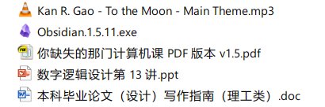
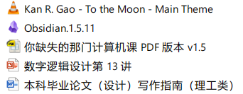
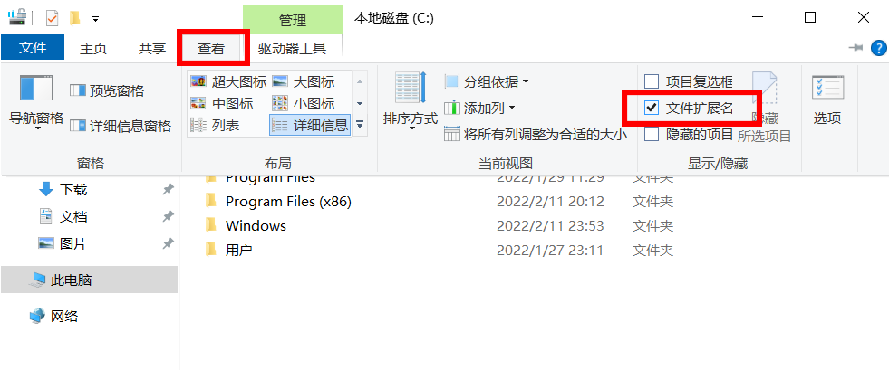
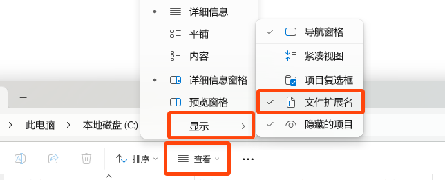
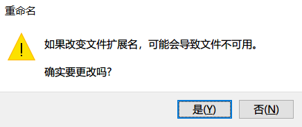
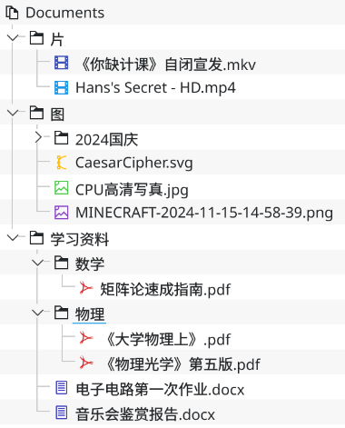

> 《你缺失的那门计算机课》，Hans Wan、Windy Deng 著。本地节选：仅收录“文件、文件名和文件类型”“文件夹、路径和目录”两节。图片、原文出处及改动说明见[来源与许可](SOURCE.md)。

# 文件与文件管理：两节选读

## 文件、文件名和文件类型

「文件」是数据存储在硬盘上的形式。这么说可能有些抽象，直观地说，文件就是我们在资源管理器里看到的这些东西：



文件有自己的名字，称为「文件名」。在 Windows 系统中，文件名可以分成三个部分：

- 「主名」是指文件名中，「点号」之前的部分。这部分内容可以自定，相当于人类的姓名。上图中， `数字逻辑设计第 13 讲` 和 `Obsidian.1.5.11` 等都是文件的主名。
- 「点号」是指文件名中间**最后一个** `.` 。
- 「扩展名」是指文件名中，「点号」之后的部分[^2]。扩展名指示文件的类型，它会告诉操作系统，这个文件应该用什么方式来打开。例如，上图中 `本科毕业论文（设计）写作指南（理工类）.doc` 中的 `doc` 就是这个文件的扩展名，它说明这个文件是一个 Word 文档，应该使用 Word 或 WPS 等软件打开。

> 如果你的电脑上，文件的扩展名没有显示出来（也就是说你只能看到文件的主名），像这样：
>
> 
>
> 在 Windows 10 中请点选文件夹窗口上方的【查看】选项卡，然后勾选【文件扩展名】这一项：
> 
> 
> 
> 在 Windows 11 中请点选文件夹窗口上方的【查看】菜单，然后勾选【显示】→【文件扩展名】：
> 
> 

扩展名也是可以人为改变的，但这样往往会出问题——试想，对于上图中的 `数字逻辑设计第 13 讲.ppt`，它本来是一个 `ppt` 文件，即 PowerPoint 幻灯片，应该用 PowerPoint 或 WPS 打开。如果你强行把它改成 `txt`，系统就会用记事本来打开一个幻灯片——用错误的工具打开文件。因此，扩展名不能随便改，因为改了之后系统就会用错误的工具去打开它。右键某一文件，选择【重命名】，你会看到系统会自动帮你选中文件的主名，而不选中扩展名。如果你执意更改文件的扩展名，系统会发出一个提示：



「那既然这样，我不想不小心突然间改掉文件的扩展名，还不如让扩展名不显示呢。」如果你有这样的想法，那么另一重危险正悄然降临。且看下面的两个文件：


这两个「高数速成秘籍」看起来完全一样，就是两个正常的 Word 文档，但众所周知，一个目录下不可能存在两个文件名相同的文件，显然这里面必然有猫腻。现在打开文件扩展名，这两个文件的名称变成了下面这个样子，可见，其中一个居然是可执行文件（`exe`）格式，即一个应用程序（详见 [下文](https://www.criwits.top/missing/file-and-file-management.html)），只是图标故意被做成了 Word 文档的样子。所以，看不到扩展名的话，指不定哪天有居心叵测的人发来一个这样伪装的病毒，那可就不好了。


## 文件夹、路径和目录

「文件夹」是一个用来存放其他文件的结构。不妨想象一下现实中的文件夹：在一个文件夹中，可以放很多各类文件。而电脑中的文件夹除了能放文件之外，还可以放很多的「子文件夹」，即文件夹里面的文件夹。这个过程可以循环重复，因而一个文件夹的内部结构可以相当错综复杂。

假设在 D 盘里的 `missing` 文件夹之中，有一个叫做 `源文件` 的子文件夹，在这个子文件夹中有一个文件叫 `第三章.docx`，我们用这种方式表示这个 `第三章.docx` 文件在整个电脑中的位置：

```
D:\missing\源文件\第三章.docx
```

这一长串东西可以唯一确定地表示出 `第三章.docx` 这个文件在电脑中的具体位置，我们把这一长串东西称为 `第三章.docx` 这个文件的「路径」（严格来说叫做「绝对路径」）。不难发现，路径是从分区（也就是「盘」）开始，用反斜杠 `\` 作为分隔，一级一级文件夹地展开，最后到具体的文件。类似地，不只是文件，文件夹的路径也可以用这样的方式来表示，例如

```
D:\missing\源文件
```

表示的就是 `源文件` 这个文件夹在电脑中的位置。一个文件或文件夹的路径是唯一确定的；一个路径也能唯一确定一个文件或文件夹。

也许你有听说过「目录」这个名字。其实「目录」就是文件夹。例如这个说法「打开目录 `D:\missing\public`」指的就是打开 D 盘中 `missing` 文件夹里的 `public` 文件夹。

目录（文件夹）一层一层的结构可以像这样从上到下画出来，称作「目录树」。树的特点是从一个「根」开始，生长出许多的枝叶，这和文件夹「一层套一层」的结构是一致的。下图便展示了一棵目录树，它的根是文件夹 `Documents`，而其他的文件和文件夹则是它的枝叶。与现实中的树不同的是，目录树是倒着的，根在上，叶子在下。



在目录树这种形式中，文件夹之间是「上下级」的关系，故「文件 A 在文件夹 B 中」也可以称作「文件 A 在文件夹 B 下」或者「A 在目录 B 下」甚至是「A 在 B 下」。也就是说，「下」这个字就是「在……里」的意思。

借助目录树这样的结构，我们就能理解「根目录」这个概念了。一个盘的「根目录」就指的是这个盘本身那一级目录——恰好是目录树的根，例如 C 盘根目录就指的是路径 `C:\` 。

想要在某处新建一个文件夹，可以直接在对应的资源管理器窗口（或者桌面）的空白处右键，选择【新建】→【文件夹】，或者按快捷键 `Ctrl` + `Shift` + `N`。

[^2]: 有时候我们称呼文件的扩展名时也会把点号包含进去。下面两种说法是等价的：
    - 某文件的扩展名是 `txt`。
    - 某文件的扩展名是 `.txt`。
