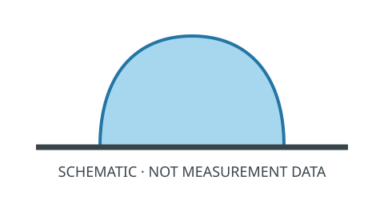

# 表面样品笔记

样品：M-02（虚构示例）

- 图片：[打开示意图](figure.svg)
- 问题：哪个文件保存了这张示意图？
- 阅读：[文件名与路径](missing-web/file-and-file-management.md)（Hans Wan、Windy Deng；[原始章节](https://www.criwits.top/missing/file-and-file-management.html)）

示例公式：$A=\pi r^2$。

想写其他公式时，查看[公式速查](math-in-markdown.zh.md)，再检查预览。

本笔记用于练习 Markdown。示意图并非真实测量结果。
